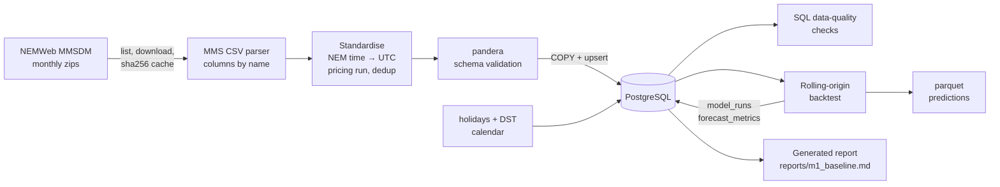

# GridCast-AU

**Australian electricity forecasting and market intelligence, starting with Victoria.**

GridCast-AU is a production-style data-science system for Australia's National Electricity Market (NEM). It ingests official AEMO market data into PostgreSQL, checks data quality, and evaluates 24-hour-ahead forecasts of regional **demand** and **wholesale spot price** with a leakage-safe, walk-forward backtest.

> **Status: Milestone 1 of 7 is complete.** It delivers a reproducible Victorian data pipeline and correctly evaluated baseline forecasts. Machine-learning models, prediction intervals, anomaly detection, the API and the dashboard are planned and **not built yet**; the sections below say so explicitly. Every number in this README comes from [`reports/m1_baseline.md`](reports/m1_baseline.md), which `gridcast report` generates from the database.

---

## The problem

Electricity must be generated the moment it is consumed. In the NEM, AEMO dispatches generation every **5 minutes**, and the price in each region is set by the marginal offer needed to meet demand. Market participants decide hours ahead how to bid, hedge, charge batteries and schedule maintenance. Network operators and retailers need the same foresight.

GridCast-AU answers five questions for Victoria (`VIC1`):

1. What will electricity demand be over the next 24 hours?
2. What will wholesale prices be?
3. How uncertain are those forecasts?
4. When is the market behaving abnormally?
5. Which factors are associated with unusually high demand or price?

Milestone 1 answers the question that has to come first: **what does a forecast need to beat?**

## Why electricity forecasting matters

- **Demand forecasts** drive generator commitment, network operations and retail hedging. Errors cost money in both directions: over-forecasting pays for capacity that isn't needed, and under-forecasting leaves the system scrambling for expensive fast-start supply.
- **Price** is far more volatile than demand. In Victoria's data, prices ranged from the −$1,000/MWh floor to $19,070/MWh, and 20.4% of 5-minute intervals had a negative price. A model that forecasts demand well does not, on that basis, forecast price well, so the two are treated as **separate modelling problems**.
- Victoria observes daylight saving, while the market runs on fixed UTC+10. Mishandling time zones silently shifts every forecast by an hour for half the year.

## Data sources

| Source | Used for | Licence / terms |
|---|---|---|
| AEMO MMSDM monthly archive (NEMWeb): `DISPATCHREGIONSUM`, `DISPATCHPRICE` | 5-minute demand and price | AEMO Copyright Permissions: use with attribution |
| `holidays` Python package (VIC) | Public-holiday calendar | MIT |
| AEMC schedule of reliability settings | Price cap/floor, used only for data-quality bounds | Public |
| Open-Meteo Previous Runs (GFS) and Historical Weather (ERA5) APIs *(milestone 2)* | Hourly archived weather forecasts and reanalysis for 5 Victorian sites | CC BY 4.0, non-commercial free tier |
| ABS Regional population 2024-25 *(milestone 2)* | Population weights for the weather sites | CC BY 4.0 |

Files are downloaded from AEMO's public file server with a project User-Agent, rate limiting, retries and a SHA-256-verified cache; no web pages are scraped. [`docs/data_sources.md`](docs/data_sources.md) gives URLs, schemas, timestamp conventions, measured missing-data characteristics and limitations for each source.

> Data source: Australian Energy Market Operator (AEMO), MMS Data Model monthly archive, NEMWeb. © AEMO.
> Weather data by [Open-Meteo.com](https://open-meteo.com/) (CC BY 4.0), from NOAA GFS and ECMWF ERA5. Population: Australian Bureau of Statistics, Regional population 2024-25 (CC BY 4.0).

## System architecture



| Layer | Implementation |
|---|---|
| Storage | PostgreSQL 17 (Docker Compose). Schema managed by **Alembic, with migration bodies in plain SQL** (`sql/schema/`) |
| ETL | `src/gridcast/ingestion/`: NEMWeb client, streaming MMS parser, standardisation, per-month lineage in `ingestion_runs` |
| Validation | pandera schemas (structural) + 13 SQL data-quality checks (`sql/checks/`) stored in `dq_results` |
| Features | DST-aware local calendar (`calendar_days`), target-time calendar features |
| Forecasting | `forecasting/origins.py` (leakage-safe geometry), `models/baselines.py`, `forecasting/backtest.py` |
| Evaluation | Metrics by lead time and segment, dev/holdout split, provenance (git SHA, batch id) |
| Tooling | uv, Python 3.12, ruff, mypy, pytest + hypothesis, structlog, typer CLI |

The schema keys every table by `region_id`, so adding another NEM region is a configuration change (`configs/base.yaml`), not a migration.

## Data quality

The data covers October 2021 (the start of 5-minute settlement) to September 2026: 60 monthly archives and **525,888 five-minute Victorian intervals**.

- **All fail-level checks pass:** no missing intervals, no duplicates, no off-grid or future timestamps, no intervals missing demand or price, no demand outside 0–12,000 MW, and no price outside its financial year's cap and floor.
- **Warn-level checks** report real market states rather than errors: administered pricing and the June 2022 market suspension (3,214 intervals), and other price post-processing flags. These are evaluated as separate segments, not removed.
- **The strict parser caught a wrong assumption.** The first full load rejected 15 months because `DISPATCHPRICE.APCFLAG` contained values such as 4, 8 and 20. The documentation confirmed that `APCFLAG` is a **5-bit field**, not a yes/no flag: administered price, VoLL override, market cap/floor binding, manual overwrite, and loss-factor scaling. Migration `0002` now stores the raw code and decodes each bit into its own column. A lenient parser would have silently mislabelled those intervals.
- AEMO's table versions changed during the period (`DISPATCHREGIONSUM` v5 → v8 → v9). Columns are matched by name, never by position, so no code change was needed.
- Intervention runs appear in 6 months. The *pricing* run (`INTERVENTION = 0`) is kept for both demand and price so the two targets stay consistent.

## Forecasting methodology

**Setup:**
- Forecasts are issued every **30 minutes**.
- Each forecast covers the next **288 five-minute intervals** (24 hours).
- The test window has 86,113 issue times in 59 monthly walk-forward folds.

**Leakage safety.** This matters more than model sophistication. At issue time *o*:
- Observed data is limited to intervals ending at or before *o* (with a configurable publication latency).
- Only **calendar** attributes of the target interval are used, because they are known in advance.
- Any lag *k* applied to the target is allowed only when *k* ≥ horizon.
- Fitted components (such as median profiles) use data strictly before the issue time.

These rules are enforced in code (`assert_known`) and verified by a **property-based test**: hypothesis replaces every value after the information cutoff with random noise, and each forecast must stay bit-for-bit identical.

**Validation.** There is no random splitting:
- Origins are processed in chronological monthly folds, and models are fit before each fold on data available at that time.
- **The final 12 months (Oct 2025 → Sep 2026) are a holdout.** They are reported separately and reserved for the final evaluation of later ML models.
- All models are scored on exactly the same (issue time, horizon) pairs: 24.8 million per model.

**Metrics:**
- Demand: MAE, RMSE, MAPE and bias.
- Price: MAE, RMSE, median absolute error and bias. MAPE is meaningless when prices are zero or negative.
- Results are reported by lead time and by segment: evening peak, weekends, public holidays, DST-change days, "normal" market conditions, price spikes (> $300/MWh), negative prices, and market intervention. The last three are defined by what actually happened, so they are diagnostics, not inputs a forecaster could use.

**Time handling:**
- AEMO timestamps are interval-*ending* NEM time (fixed UTC+10). They are stored as UTC `timestamptz`.
- Local Melbourne time is derived only for calendar features.
- Days when the clocks change have 276 or 300 intervals instead of 288. Tests cover the DST transitions.

## Baselines

| Target | Baseline | Forecast |
|---|---|---|
| both | Persistence | Last known value, for every horizon |
| both | Daily naive | Same interval 24 h earlier (steps back further if not yet known) |
| both | Weekly naive | Same interval 7 days earlier |
| price | 28-day median profile | Median over the previous 28 local days, by day type (working / weekend-or-holiday) × 5-minute local time slot; refreshed daily |

Together these baselines form the **baseline envelope**: the lowest error at each lead time. Any ML model must beat that envelope, not just the weakest baseline, to justify its complexity.

## Models

*Planned for milestone 2. Not implemented.*

The plan is regularised linear regression and LightGBM, using weather and engineered lag features. The backtest harness (`Forecaster.fit` / `predict`, fit before each fold) is already in place, so ML models will be evaluated with exactly the same splits, scored pairs and segments as the baselines.

## Uncertainty

*Planned for milestone 3. Not implemented.* The plan is quantile regression and conformal prediction intervals, with calibration reported overall and during extreme events. The `forecasts` table already has columns for interval bounds and level.

## Anomaly detection

*Planned for milestone 4. Not implemented.* The plan is robust z-scores, forecast-residual thresholds and Isolation Forest. Each anomaly will come with observable evidence, and the system will not claim to know causes.

## Results

All figures below are from the generated [`reports/m1_baseline.md`](reports/m1_baseline.md) (development period, Nov 2021 → Sep 2025 issue times, unless stated otherwise).

### Demand


| MAE (MW) | 5 min | 1 h | 4 h | 12 h | 24 h | All lead times |
|---|---:|---:|---:|---:|---:|---:|
| Persistence | **46.3** | **308.1** | 948.7 | 922.3 | **467.8** | 902.7 |
| Daily naive | 467.3 | 467.9 | **467.9** | **467.9** | **467.8** | **467.8** |
| Weekly naive | 531.4 | 531.6 | 531.6 | 531.5 | 531.4 | 531.3 |

- **Persistence wins only at very short lead times** (5 min to 1 h 35 min), plus the last few minutes before 24 h, where it is almost the same forecast as daily naive. From 1 h 40 min onwards, "same interval yesterday" is the best baseline. That gives a pooled MAE of 467.8 MW, a MAPE of 10.4%.
- "Same interval last week" is **worse** than "same interval yesterday" (531.3 MW). Recent conditions matter more for demand than the weekly cycle does.
- In the holdout year, the daily-naive MAE is 509.1 MW.

### Price


| MAE ($/MWh) | 5 min | 1 h | 4 h | 12 h | 24 h | All lead times |
|---|---:|---:|---:|---:|---:|---:|
| Persistence | **19.5** | **40.9** | 80.8 | 95.5 | 69.2 | 85.2 |
| Daily naive | 67.5 | 69.2 | 69.2 | 69.2 | 69.2 | 68.5 |
| Weekly naive | 83.1 | 85.0 | 85.0 | 85.0 | 85.0 | 84.2 |
| 28-day median profile | 61.7 | 62.7 | **62.9** | **63.3** | **63.9** | **62.9** |

- Persistence wins up to about 2.5 hours ahead; the two alternate between 2 h 25 min and 2 h 45 min. Beyond that, the 28-day median profile is best, with a pooled MAE of **$62.9/MWh**.
- That error is about the same size as the **median price itself ($60.61/MWh)**. Simple price forecasts carry little information beyond the next couple of hours.
- In price-spike intervals (> $300/MWh), even the best baseline's MAE is **$312.7/MWh**, versus $52.1/MWh under normal conditions.

## Failure cases

- **Price spikes dominate price error.** Spikes are about 3.7% of scored pairs but have roughly 6× the normal-period MAE. No point-forecast baseline anticipates them. This is the main argument for the planned uncertainty and anomaly work, rather than chasing a lower average MAE.
- **The median profile is biased low** (bias −$8.9/MWh). A median ignores the right-skewed spikes that pull the mean up. It minimises absolute error but systematically under-forecasts average cost.
- **Demand errors are larger when prices are negative.** The daily-naive MAE is 663.3 MW in negative-price intervals versus 422.7 MW under normal conditions. Negative prices cluster around high-solar middays, when `TOTALDEMAND` (which excludes rooftop PV) swings with solar output. This is an association observed in the backtest, not an established cause.
- **Market intervention periods** (mostly the June 2022 suspension) are the one segment where weekly naive beats daily naive for demand. The sample is small (154k pairs, concentrated in a single episode), so this shouldn't be generalised.
- **The DST-change-day segment is confounded.** Those days are always Sundays in April or October, so their lower error does not isolate the one-hour misalignment of fixed 24-hour lags.
- **Pipeline failure cases found and fixed:** the `APCFLAG` bit-field assumption (above), and a timestamp-resolution bug. pandas 3 stores datetimes in microseconds, and an early origin-grid calculation assumed nanoseconds. The unit tests caught it before any results were produced.

## Operational implications

- **Demand:** the bar for an ML model is clear. From 1 h 40 min ahead, it must beat yesterday's same interval (about 468 MW MAE, 10.4% MAPE) at each lead time. Below that, it must beat persistence, which is hard: 46 MW at 5 minutes. Weather is the obvious missing driver.
- **Price:** good price forecasting is mostly a question of *when* the market is risky, not a better average. Prediction intervals, spike probability and anomaly flags (milestones 3–4) are likely to be worth more to a trader or battery operator than a slightly lower MAE.
- **Holdout comparisons need context.** Price errors are lower in the holdout year for every baseline: the median profile's MAE is $40.4/MWh versus $62.9/MWh in development. The market was calmer; no model improved. Future model comparisons must always be made against baselines evaluated on the same period.

## Limitations

- **Victoria only** so far; the schema and configuration already allow other NEM regions.
- **Historical archive only.** MMSDM monthly files are published 2–6 weeks after month end. A live system needs the NEMWeb `DispatchIS` current reports (a later milestone).
- **Demand definition:** `TOTALDEMAND` excludes rooftop PV, so it is not consumer consumption.
- **Final prices:** backtests use final archive prices, which may differ slightly from what was visible in real time.
- **No weather yet**, so the "very hot days" segment is deferred to milestone 2. Observed weather at the target time would leak future information; M2 must use archived forecasts or label such models as an oracle upper bound.
- **Market cap values** for some financial years come from secondary sources. They are used only as data-quality bounds.

## Reproduction

Requirements: Docker, [uv](https://docs.astral.sh/uv/), make. Downloads, interim files and backtest predictions (~1.4 GB) go under `data/` (gitignored). To keep them elsewhere, such as an external drive, set `GRIDCAST_DATA_ROOT` in `.env`. The directory must exist, and the pipeline refuses to run if the drive isn't mounted. PostgreSQL itself stays in a Docker volume, because Postgres needs a filesystem with Unix permissions (exFAT drives don't qualify).

```bash
make setup          # uv sync; creates .env from .env.example (set a password)
make db-up          # PostgreSQL 17 via Docker Compose
make migrate        # Alembic → sql/schema/*.sql
make ingest         # Oct 2021 → Sep 2026 for VIC1 (START/END/REGIONS overridable)
make calendar       # holidays + DST days → calendar_days
make dq             # 13 data-quality checks → dq_results
make backtest       # demand + price walk-forward backtests
make report         # regenerates reports/m1_baseline.md and figures
```

Quality gates:

```bash
make lint typecheck test   # ruff, mypy, unit tests (incl. leakage property test)
make test-integration      # against a dedicated *_test database
```

The backtests are deterministic: re-running them reproduces every metric exactly. Each run records its git commit, configuration and batch id in `model_runs`.

### Repository layout

```
configs/            base.yaml (regions, windows, forecast setup), market_limits.yaml
sql/schema/         migration bodies (plain SQL)     sql/migrations/  Alembic env + revisions
sql/checks/         data-quality queries
src/gridcast/       ingestion/ validation/ database/ features/ forecasting/ models/ evaluation/
tests/              unit/ (no DB) and integration/ (PostgreSQL)
docs/               data_sources.md
reports/            generated milestone reports + figures
```
