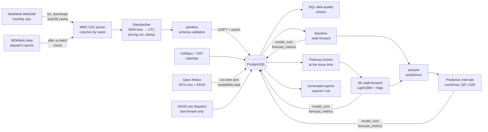
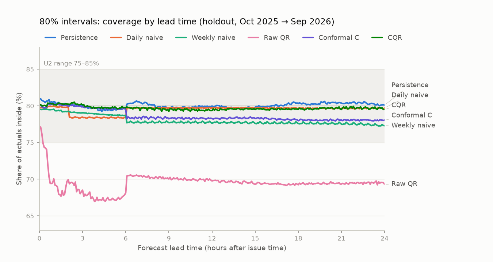
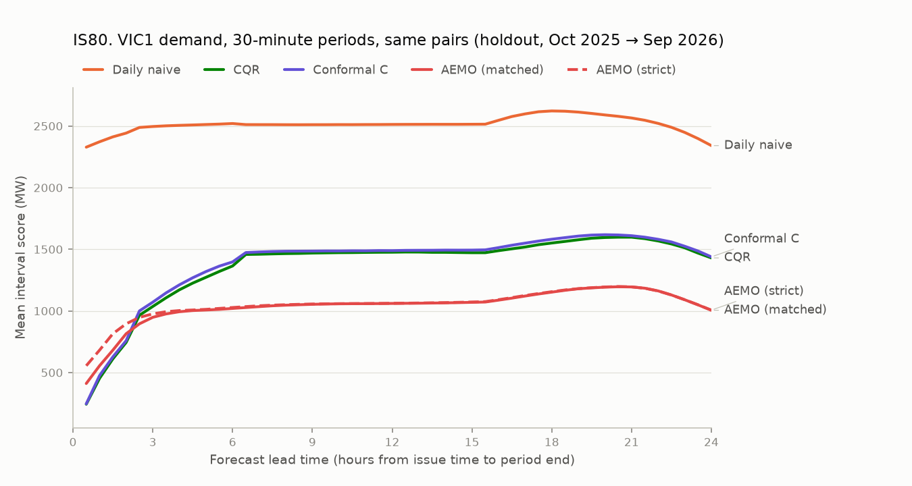
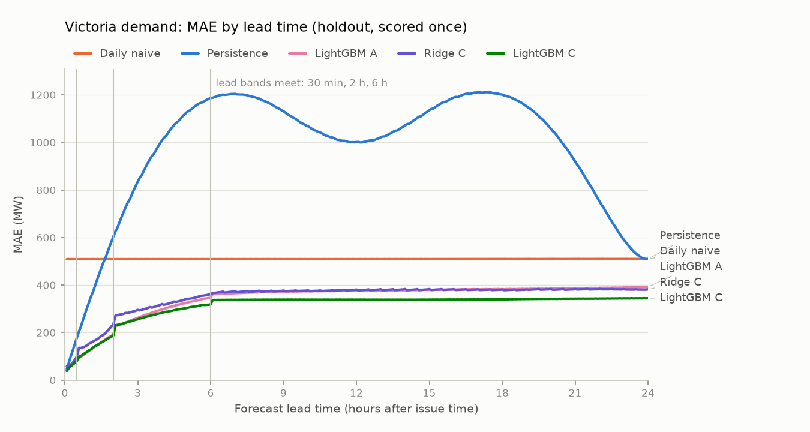
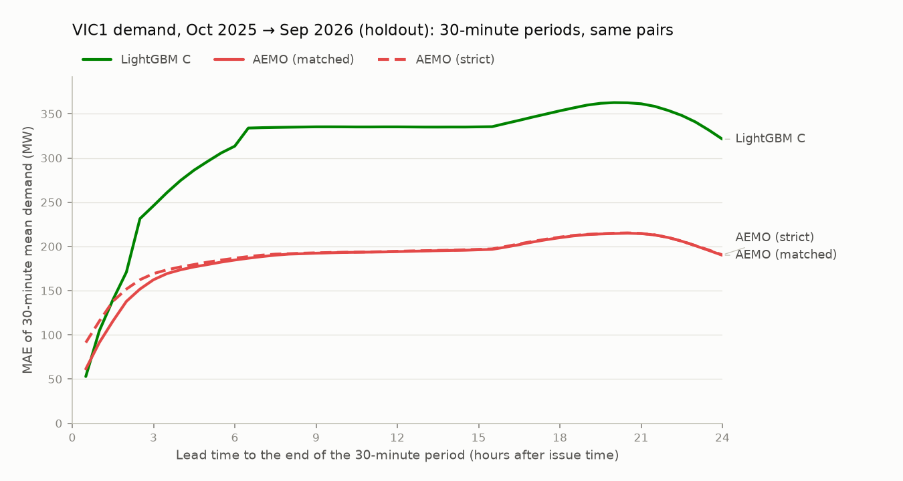
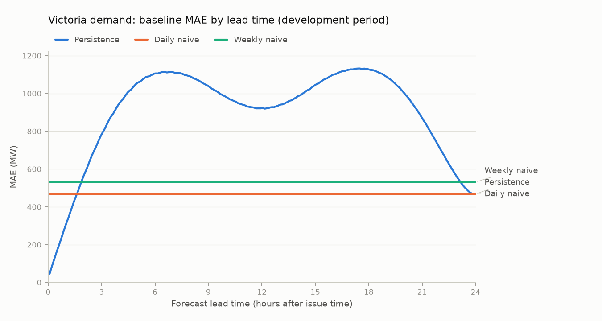
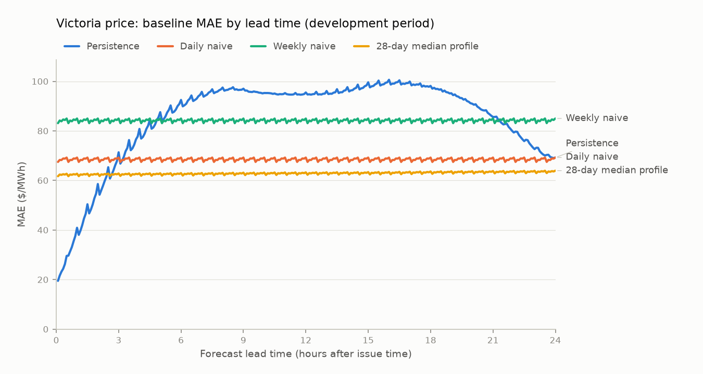

# GridCast-AU

**Australian electricity forecasting and market intelligence, starting with Victoria.**

GridCast-AU is a production-style data-science system for Australia's National Electricity Market (NEM). It ingests official AEMO market data and archived weather forecasts into PostgreSQL, checks data quality, and evaluates 24-hour-ahead forecasts of regional **demand** and **wholesale spot price** with a leakage-safe, walk-forward backtest.

> **Status: milestones 1–3 of 7 are complete.**
> - Milestone 1 delivered a reproducible Victorian data pipeline and correctly evaluated baseline forecasts for demand and price.
> - Milestone 2 added weather-aware machine-learning forecasts of **demand**. They were judged against success criteria written before any result existed, compared with AEMO's own forecasts, and scored once on a holdout year that was set aside before the model was built.
> - Milestone 3 added **prediction intervals** for demand: conformalised quantile regression on the milestone-2 model. They were judged against pre-registered criteria, compared with AEMO's probabilistic forecasts, and scored once on the same holdout year.
> - Price models, anomaly detection, the API and the dashboard are planned and **not built yet**; the sections below say so explicitly.
>
> Every number in this README comes from a generated report:
> - [`reports/m1_baseline.md`](reports/m1_baseline.md): the M1 baselines.
> - [`reports/m2_demand.md`](reports/m2_demand.md): the ML development period.
> - [`reports/m2_aemo.md`](reports/m2_aemo.md): the AEMO benchmark.
> - [`reports/m2_holdout.md`](reports/m2_holdout.md): the holdout, scored once.
> - [`reports/m3_intervals.md`](reports/m3_intervals.md): prediction intervals, development period.
> - [`reports/m3_aemo.md`](reports/m3_aemo.md): intervals against AEMO's probabilistic band (development part).
> - [`reports/m3_holdout.md`](reports/m3_holdout.md): intervals on the holdout, scored once.

---

## The problem

Electricity must be generated the moment it is consumed. In the NEM, AEMO dispatches generation every **5 minutes**, and the price in each region is set by the marginal offer needed to meet demand. Market participants decide hours ahead how to bid, hedge, charge batteries and schedule maintenance. Network operators and retailers need the same foresight.

GridCast-AU answers five questions for Victoria (`VIC1`):

1. What will electricity demand be over the next 24 hours?
2. What will wholesale prices be?
3. How uncertain are those forecasts?
4. When is the market behaving abnormally?
5. Which factors are associated with unusually high demand or price?

Milestone 1 answers the question that has to come first: **what does a forecast need to beat?** Milestone 2 answers question 1 for demand. It also tests whether the answer holds up on a year the model never saw, and how it compares with the operator's own forecast. Milestone 3 answers question 3 for demand: how wide the uncertainty is, and whether an interval's stated level can be trusted.

## Why electricity forecasting matters

- **Demand forecasts** drive generator commitment, network operations and retail hedging. Errors cost money in both directions:
  - over-forecasting pays for capacity that isn't needed;
  - under-forecasting leaves the system scrambling for expensive fast-start supply.
- **Price** is far more volatile than demand.
  - In Victoria's data, prices ranged from the −$1,000/MWh floor to $19,070/MWh, and 20.4% of 5-minute intervals had a negative price.
  - A model that forecasts demand well does not, on that basis, forecast price well. The two are treated as **separate modelling problems**.
- **Time zones are a trap.** Victoria observes daylight saving, while the market runs on fixed UTC+10. Mishandling this silently shifts every forecast by an hour for half the year.

## Data sources

| Source | Used for | Licence / terms |
|---|---|---|
| AEMO MMSDM monthly archive (NEMWeb): `DISPATCHREGIONSUM`, `DISPATCHPRICE` | 5-minute demand and price | AEMO Copyright Permissions: use with attribution |
| `holidays` Python package (VIC) | Public-holiday calendar | MIT |
| AEMC schedule of reliability settings | Price cap/floor, used only for data-quality bounds | Public |
| Open-Meteo Previous Runs (GFS) and Historical Weather (ERA5) APIs *(milestone 2)* | Hourly archived weather forecasts and reanalysis for 5 Victorian sites | CC BY 4.0, non-commercial free tier |
| ABS Regional population 2024-25 *(milestone 2)* | Population weights for the weather sites | CC BY 4.0 |
| AEMO MMSDM "all runs" archives: `PREDISPATCHREGIONSUM`, `P5MIN_REGIONSOLUTION` *(milestone 2)* | AEMO's own demand forecasts, as a **benchmark only**, never a model input | AEMO Copyright Permissions |
| NEMWeb daily dispatch reports (`DispatchIS_Reports`) *(milestone 2)* | The last day of holdout targets (1 Oct 2026), not yet in the monthly archive; loaded only after an exact match check against a month already in it | AEMO Copyright Permissions |

**How files are fetched.**
- Files come from AEMO's public file server with a project User-Agent, rate limiting, retries and a SHA-256-verified cache.
- No web pages are scraped.
- [`docs/data_sources.md`](docs/data_sources.md) gives, for each source, the URLs, schemas, timestamp conventions, measured missing-data characteristics and limitations.

> Data source: Australian Energy Market Operator (AEMO), MMS Data Model monthly archive and NEMWeb dispatch reports. © AEMO.
> Weather data by [Open-Meteo.com](https://open-meteo.com/) (CC BY 4.0), from NOAA GFS and ECMWF ERA5. Population: Australian Bureau of Statistics, Regional population 2024-25 (CC BY 4.0).

## System architecture



| Layer | Implementation |
|---|---|
| Storage | PostgreSQL 17 (Docker Compose). Schema managed by **Alembic, with migration bodies in plain SQL** (`sql/schema/`) |
| ETL | `src/gridcast/ingestion/`: NEMWeb client, streaming MMS parser, standardisation, Open-Meteo client, AEMO forecast and daily-report loaders, per-month lineage in `ingestion_runs` |
| Validation | pandera schemas (structural) + 23 SQL data-quality checks (`sql/checks/`) stored in `dq_results` |
| Features | `features/`: DST-aware local calendar, demand history known at the issue time, population-weighted weather taken from the latest forecast run published by the issue time (`weather/`). Listed in [`docs/feature_catalogue.md`](docs/feature_catalogue.md) |
| Forecasting | `forecasting/origins.py` (leakage-safe geometry), `models/baselines.py`, `models/ml.py`, `forecasting/walkforward.py` (quarterly retrains, per-retrain selection) |
| Evaluation | Metrics by lead time and segment, pre-registered success criteria, AEMO benchmark, the holdout lock (`evaluation/holdout.py`), provenance (git SHA, config hash, batch id) |
| Intervals | `intervals/`: rolling conformal calibration with exact rolling order statistics, quantile LightGBM, CQR, the half-hour recalibration for the AEMO comparison, the recipe freeze and the holdout lock (`intervals/holdout.py`) |
| Tooling | uv, Python 3.12, ruff, mypy, pytest + hypothesis, structlog, typer CLI, LightGBM, scikit-learn |

The schema keys every table by `region_id`, so adding another NEM region is a configuration change (`configs/base.yaml`), not a migration.

## Data quality

The data covers October 2021 (the start of 5-minute settlement) to September 2026: 60 monthly archives and **525,888 five-minute Victorian intervals**.

- **All fail-level checks pass:**
  - no missing intervals, duplicates, off-grid timestamps or future timestamps;
  - no intervals missing demand or price;
  - no demand outside 0–12,000 MW;
  - no price outside its financial year's cap and floor.
- **Warn-level checks report real market states rather than errors.** These include administered pricing, the June 2022 market suspension (3,214 intervals) and other price post-processing flags. They are evaluated as separate segments, not removed.
- **The strict parser caught a wrong assumption.**
  - The first full load rejected 15 months because `DISPATCHPRICE.APCFLAG` contained values such as 4, 8 and 20.
  - The documentation confirmed that `APCFLAG` is a **5-bit field**, not a yes/no flag. Its bits mean administered price, VoLL override, market cap/floor binding, manual overwrite, and loss-factor scaling.
  - Migration `0002` now stores the raw code and decodes each bit into its own column.
  - A lenient parser would have silently mislabelled those intervals.
- **AEMO's table versions changed during the period** (`DISPATCHREGIONSUM` v5 → v8 → v9). Columns are matched by name, never by position, so no code change was needed.
- **Intervention runs appear in 6 months.** The *pricing* run (`INTERVENTION = 0`) is kept for both demand and price, so the two targets stay consistent.
- **One more day for the holdout (milestone 2).** 1 October 2026 was loaded from NEMWeb's daily dispatch reports, because its monthly archive was not yet published. First, a whole month already in the archive was read from the daily reports and compared. September 2026 matched exactly: demand was identical at all 8,640 intervals. The details are in `docs/data_sources.md` §7.

## Forecasting methodology

**Setup:**
- Forecasts are issued every **30 minutes**.
- Each forecast covers the next **288 five-minute intervals** (24 hours).
- M1's baseline test window has 86,113 issue times in 59 monthly walk-forward folds.
- M2's ML models start in November 2022, after a year of training data, and retrain every 3 months.

**Leakage safety.** This matters more than model sophistication. At issue time *o*:
- Observed data is limited to intervals ending at or before *o* (with a configurable publication latency).
- **Calendar** attributes of the target interval are used, because they are known in advance.
- Any lag *k* applied to the target is allowed only when *k* ≥ horizon.
- Fitted components (such as median profiles) use data strictly before the issue time.
- **Weather (M2)** comes from the latest archived GFS forecast run published by *o*. Publication is assumed 6 h after the run time; 8 h is tested as a sensitivity.
  - Observed weather at the target time would leak the future, so it is used only by the **D** variant. D is an upper bound, never a forecast.

These rules are enforced in code (`assert_known`) and verified by **property-based tests**. Hypothesis replaces every value after the information cutoff with random noise, or deletes forecast runs not yet published, and each forecast or feature must stay bit-for-bit identical.

**Validation.** There is no random splitting:
- Origins are processed in chronological folds. Models are fit before each fold on data available at that time.
- **The final 12 months (Oct 2025 → Sep 2026) are a holdout.**
  - M1 reported its baselines there separately.
  - M2 froze its model configuration before looking at the holdout, then scored it **once**. `gridcast evaluate-holdout` refuses to run again for the same configuration.
- All models are scored on exactly the same (issue time, horizon) pairs. That is 24.8 million per model in M1. In M2 it is 14,436,480 in development and 5,045,760 in the holdout.

**Metrics:**
- Demand: MAE, RMSE, MAPE and bias.
- Price: MAE, RMSE, median absolute error and bias. MAPE is meaningless when prices are zero or negative.
- Results are reported by lead time and by segment.
  - Segments: evening peak, weekends, public holidays, DST-change days, "normal" market conditions, price spikes (> $300/MWh), negative prices and market intervention.
  - M2 adds hot days (≥ 35 °C) and very cloudy days.
  - Market-state and weather segments are defined by what actually happened, so they are diagnostics, not inputs a forecaster could use.

**Time handling:**
- AEMO timestamps are interval-*ending* NEM time (fixed UTC+10). They are stored as UTC `timestamptz`.
- Local Melbourne time is derived only for calendar features.
- Days when the clocks change have 276 or 300 intervals instead of 288. Tests cover the DST transitions.

## Baselines

| Target | Baseline | Forecast |
|---|---|---|
| both | Persistence | Last known value, for every horizon |
| both | Daily naive | Same interval 24 h earlier (steps back further if not yet known) |
| both | Weekly naive | Same interval 7 days earlier |
| price | 28-day median profile | Median over the previous 28 local days, by day type (working / weekend-or-holiday) × 5-minute local time slot; refreshed daily |

Together these baselines form the **baseline envelope**: the lowest error at each lead time. Any ML model must beat that envelope, not just the weakest baseline, to justify its complexity.

## Models

**Milestone 2: demand.** Gradient-boosted trees (LightGBM) and ridge regression, built as three variants that differ only in their weather inputs:

| Variant | Weather inputs | Role |
|---|---|---|
| **A** | none | Shows what weather adds |
| **C** | GFS temperature forecasts, as published by the issue time, population-weighted over 5 sites | **The headline model**: a forecast that could have been made at the time |
| **D** | ERA5 reanalysis temperature at the target time (the same features as C) | Perfect-foresight upper bound. C − D is the cost of temperature-forecast error |
| C⁺ / D⁺ | C / D plus apparent temperature, humidity, cloud cover and solar radiation | Reported, not pass/fail. These variables are archived only from 2024-01-19, so C⁺/D⁺ train on a shorter history |

**How the models are fit.**
- **Four fits per model,** one per lead band: 5 min–30 min, 35 min–2 h, 2 h 5 min–6 h and 6 h 5 min–24 h.
- **What each fit predicts** is chosen at every retrain from four target forms:
  - demand itself;
  - a correction to the same time yesterday;
  - a correction to the latest demand;
  - a correction to the latest demand plus yesterday's change.
- **Retrains every 3 months** use all data before the retrain. Settings are re-selected each time on the last 8 weeks before it:
  - target form;
  - LightGBM objective and size;
  - ridge penalty.
- **The training sample** is every 30-minute issue time, with targets staggered every 15 minutes.

**How the evaluation was protected.**
- **Pre-registered criteria.** The success criteria S1–S5 were written in [`docs/plans/m2_plan.md`](docs/plans/m2_plan.md) §3 before any ML result existed. They judge LightGBM C against the baseline envelope on identical pairs.
- **A second development run, disclosed.**
  - The first development run passed S1–S4, but it lost to persistence at 5 minutes and jumped at its only band boundary.
  - A second run with four lead bands and one more target form was then evaluated under an adoption rule written before its results. It was adopted.
  - Both runs are shown in `reports/m2_demand.md`. Because the development period was looked at twice, its numbers are slightly optimistic.
- **The freeze.** The configuration (hash `b88eae0a04e176af`) and the model and feature code were then **frozen**, before the AEMO comparison and before any holdout scoring.
- **The single holdout run.**
  - It first had to reproduce the development run's stored forecasts and fits for Aug–Sep 2025 exactly. It did, for all three evaluation sets.
  - Only then did it score the holdout.

## Uncertainty

**Milestone 3: prediction intervals for demand.** The headline is an **80% interval** (AEMO's POE90–POE10 range); 50% and 95% intervals are also reported. The method, the success criteria U1–U5 and the scoring were fixed in [`docs/plans/m3_plan.md`](docs/plans/m3_plan.md) before any interval existed.

**Methods, compared on identical (issue time, lead) pairs:**
- **Conformal intervals around a stored point forecast.** The lower and upper bounds come from separate quantiles of past signed errors, so an interval can be asymmetric and absorb a bias. They are built around LightGBM C and, as *interval baselines*, around persistence, daily naive and weekly naive.
- **Quantile LightGBM C (QR).** The milestone-2 model's features, training rows and retrain schedule, with a pinball-loss objective for six quantiles. Each quantile picks its own target form and leaf count at every retrain.
- **Conformalised quantile regression (CQR), the pre-registered headline.** The QR bounds corrected by the same rolling conformal calibration, with one score per side (Romano et al. 2019).

**How the intervals are calibrated:**
- **Past data only.** At each issue time, the calibration set for a lead holds only errors whose target was already known.
- **Settings re-selected every quarter.** 24 candidate settings run continuously: calibration windows of 4, 8, 13 or 26 weeks; per lead, or per lead and 3-hour block of the day; and adaptive conformal steps γ ∈ {0, 0.001, 0.005} (Gibbs & Candès 2021). At each quarterly retrain, the one with the best interval score over the previous 8 weeks is used for the next quarter.
- **Leakage tests.** Property tests perturb actual demand after an issue time, and forecasts issued after it, and check that every interval issued at that time is unchanged. Control tests show the checks fail when the rule is broken by one step. The reports run these tests themselves.

**How the evaluation was protected:**
- **The freeze.** The interval recipe (hash `d34273400899af69`) and its code were frozen at commit `bc5337e`, before AEMO's band was loaded for the comparison and before any holdout interval existed. Before the freeze, the frozen code had to recompute the stored development intervals exactly.
- **The single holdout run.**
  - The quantile models were first fitted over the holdout and stored without any score. Their first retrain had to reproduce the development fits exactly.
  - One locked run then built every interval over one continuous run from November 2022, so calibration windows carry across the boundary.
  - Before scoring anything, it had to reproduce all 10 stored development interval runs exactly. It did.
- **Disclosed:** the holdout year is new for intervals, but its point errors, including the winter under-forecast, were seen in milestone 2 before the interval recipe was designed.

**Scores.**
- *Coverage:* the share of actuals inside the interval.
- *Interval score* IS₈₀ = width + 10 × the distance by which the actual falls outside. It rewards a narrow interval only if the interval keeps its coverage. Lower is better.
- *Weighted interval score (WIS):* the same, combined over the three levels and the point forecast.

*Not yet built:* price intervals (they need a price model), and serving intervals through the `forecasts` table and the API (milestone 5).

## Anomaly detection

*Planned for milestone 4. Not implemented.* The plan is robust z-scores, forecast-residual thresholds and Isolation Forest. Each anomaly will come with observable evidence, and the system will not claim to know causes.

## Results

### Demand uncertainty: 80% prediction intervals (milestone 3)

From [`reports/m3_intervals.md`](reports/m3_intervals.md) (development, issue times 1 Aug 2023 → 30 Sep 2025) and [`reports/m3_holdout.md`](reports/m3_holdout.md) (holdout, 1 Oct 2025 → 30 Sep 2026, 5,045,760 scored pairs per method).



| # | Pre-registered criterion (CQR at 80%) | Development | Holdout |
|---|---|---|---|
| U1 | Pooled coverage in [78%, 82%] | **PASS**: 79.40% | **holds**: 79.69% (95% CI 78.17–81.08%) |
| U2 | Coverage in [75%, 85%] at every lead time from 5 min to 24 h | **PASS**: 288 of 288; 78.97% to 80.36% | **holds**: 288 of 288; 79.24% to 80.51% |
| U3 | Lower IS₈₀ than every baseline interval at every lead time from 2 h, and pooled | **PASS**: 265 of 265; pooled 1,248.1 vs 2,256.1 MW | **holds**: 265 of 265; pooled 1,365.2 vs 2,335.6 MW |
| U4 | Every interval leakage property test passes | **PASS**: 7 of 7 | **holds**: 11 of 11 (with step 5's half-hour tests) |
| U5 | The holdout is scored once, by the frozen recipe | n/a | **PASS** |

| Pooled over all lead times (development → holdout) | Coverage at 80% (%) | IS₈₀ (MW) | WIS (MW) |
|---|---:|---:|---:|
| **CQR on quantile LightGBM C** (headline) | 79.4 → 79.7 | 1,248.1 → 1,365.2 | 150.5 → 165.9 |
| Conformal around LightGBM C | 79.1 → 78.6 | 1,267.2 → 1,390.4 | 150.6 → 165.9 |
| Quantile LightGBM C, raw | 64.7 → 69.5 | 1,382.2 → 1,456.9 | 159.6 → 174.3 |
| Conformal around daily naive (best baseline interval) | 79.5 → 79.5 | 2,407.3 → 2,499.4 | 281.7 → 291.3 |

- **The intervals keep their stated level in a year they never saw.**
  - Pooled 80% coverage is 79.69% in the holdout, against 79.40% in development.
  - Every one of the 288 lead times stays between 79.24% and 80.51%.
  - The 50% and 95% intervals cover 49.1% and 94.1%.
- **They are much sharper than baseline intervals with the same coverage.** CQR's IS₈₀ is 45.4% below the best baseline interval's in the holdout (48.2% in development).
- **The conformal step is what makes them trustworthy.** Raw quantile LightGBM covers only 69.5% at 80% in the holdout (64.7% in development).
- **CQR's edge over simpler conformal intervals around the point forecast is small.**
  - Its IS₈₀ is lower by 25.1 MW in the holdout (95% CI 5.3 to 45.1 MW) and by 19.0 MW in development.
  - Over all three levels the two are indistinguishable: the WIS difference is +0.1 MW in the holdout (−1.2 to +1.4).
- **Monthly coverage swings more than pooled coverage.** It ranges from 75.0% (Jan 2026) to 84.1% (Nov 2025) in the holdout, and from 67.6% (Dec 2023) to 87.8% (Apr 2025) in development.
- **The winter under-forecast did not break them (a pre-registered check).**
  - For targets in Jun–Aug 2026, when milestone 2's point forecast was most biased, CQR covered 79.1% (95% CI 76.1–81.9%).
  - Its misses were close to balanced: 11.2% below and 9.7% above.

### Demand uncertainty against AEMO's probabilistic forecast (milestone 3)

From [`reports/m3_aemo.md`](reports/m3_aemo.md) (development part, Oct 2024 → Sep 2025) and the holdout report.
- AEMO's pre-dispatch PASA publishes demand with a 10%, 50% and 90% probability of exceedance (POE). Reading POE90–POE10 as an 80% band is this project's choice.
- Both are compared on 30-minute mean demand, with the run issued at the same moment. The comparison is a benchmark, not pass/fail.



| 80% band, 30-minute demand | Development | Holdout |
|---|---:|---:|
| AEMO POE90–POE10: coverage | 70.9% | 69.2% |
| CQR: coverage | 80.2% | 79.5% |
| Mean width, AEMO vs CQR (MW) | 433.3 vs 961.0 | 431.4 vs 958.9 |
| IS₈₀, CQR − AEMO (MW; 95% interval from resampling whole days) | +395.8 (+348.8 to +444.4) | +327.1 (+270.0 to +386.8) |

- **AEMO's band is less than half as wide and misses more often than an 80% interval should.** In the holdout, actual demand fell below it on 15.1% of half-hours and above it on 15.7%.
- **Its interval score is still lower, because its centre is more accurate.** Milestone 2 found the same for point forecasts. CQR scores better only at the first 4 of 48 half-hour lead times, up to 2 h ahead, in both periods.
- **These are facts about the band as published, not a judgement of AEMO.** Pre-dispatch PASA assesses reserve adequacy. Its `DEMAND50` also sits above AEMO's own pre-dispatch demand forecast for unexplained reasons (`docs/m3_data_spike.md`). A band re-centred on pre-dispatch gives the same picture.

### Demand: the holdout year, scored once (milestone 2)

From [`reports/m2_holdout.md`](reports/m2_holdout.md): issue times 1 Oct 2025 → 30 Sep 2026, 5,045,760 scored pairs per model.



| MAE (MW), holdout | 5 min | 1 h | 4 h | 12 h | 24 h | All lead times |
|---|---:|---:|---:|---:|---:|---:|
| **LightGBM C** (forecast temperature) | **39.1** | 125.4 | **283.4** | **338.6** | **344.7** | **312.0** |
| LightGBM A (no weather) | 39.2 | **124.2** | 297.4 | 376.1 | 392.0 | 343.8 |
| Ridge C | 57.7 | 153.9 | 320.2 | 381.2 | 382.1 | 349.5 |
| Persistence | 46.7 | 328.8 | 1,008.8 | 1,001.7 | 509.7 | 970.7 |
| Daily naive | 508.9 | 509.0 | 509.0 | 509.0 | 509.7 | 509.3 |
| *LightGBM D (actual temperature; an upper bound, not a forecast)* | *39.3* | *123.0* | *275.1* | *338.4* | *345.4* | *310.7* |

Bold marks the lowest MAE among the forecasts that could have been made at the time (D excluded).

| # | Pre-registered criterion (LightGBM C) | Development, Nov 2022 → Sep 2025 ([`m2_demand.md`](reports/m2_demand.md)) | Holdout, Oct 2025 → Sep 2026 |
|---|---|---|---|
| S1 | Beats the best baseline at every lead time from 2 h to 24 h | **PASS**: 265 of 265 lead times | **holds**: 265 of 265; closest at 24 h, 344.7 vs 509.7 MW |
| S2 | Beats the best baseline pooled over all lead times | **PASS**: 263.6 vs 463.0 MW | **holds**: 312.0 vs 493.9 MW |
| S3 | Weather adds value (C beats A) | **PASS**: 263.6 vs 327.0 MW | **holds**: 312.0 vs 343.8 MW |
| S4 | Perfect foresight is no worse (D ≤ C), and every leakage property test passes | **PASS**: 260.0 vs 263.6 MW; 6 of 6 tests | **holds**: 310.7 vs 312.0 MW; 6 of 6 tests |
| S5 | The holdout is scored once, by the frozen configuration | n/a | **PASS** |

On the holdout, S1–S4 were recomputed as written and reported as replication. S5 is the only holdout criterion.

- **The model beats every baseline at every lead time from 2 hours on, in both periods.** It does worse in the holdout than in development, and by more than the baselines do.
  - LightGBM C's pooled MAE rose from 263.6 to 312.0 MW (+18.4%).
  - The best baseline's rose from 463.0 to 493.9 MW (+6.7%), so the holdout year was harder for every forecast.
  - The extra loss is mostly a winter under-forecast (see *Failure cases*).
- **Weather helps most at long lead times and on hot days.**
  - In development, forecast temperature cuts the pooled MAE by 19.4%: from 2.0% in the first hour to 21.3% at 12–24 h. In the holdout, the 12–24 h gain is 11.1%, and in the first hour C is 1.3% worse than A.
  - On days reaching 35 °C in the holdout, C's MAE is 443.1 MW, against 1,024.2 MW for A and 1,251.4 MW for daily naive.
- **Perfect temperature adds little.** D's pooled MAE is 310.7 MW against C's 312.0 MW in the holdout (260.0 vs 263.6 MW in development). Error in the temperature forecast is not what limits the model.
- **More weather variables help (reported, not pass/fail).** C⁺ adds humidity, cloud cover, solar radiation and apparent temperature.
  - Holdout: pooled MAE 270.1 MW, against C's 312.0 MW.
  - Development, scored from February 2025: 243.7 against 276.9 MW.
- **The gain is not a publication-timing artefact.** Assuming every GFS run was published 8 h after its run time instead of 6 h moves the holdout pooled MAE from 312.0 to 314.1 MW. In development it moved by 1.3 MW, against a weather gain of 63.4 MW.
- **Very short lead times.** At 5 minutes, C beats persistence: 39.1 vs 46.7 MW in the holdout. The first development run did not (58.4 vs 46.9 MW). The disclosed second run, adopted under its pre-written rule, fixed this.

### Demand: against AEMO's own forecasts (milestone 2)

From [`reports/m2_aemo.md`](reports/m2_aemo.md) (development part, Oct 2024 → Sep 2025) and the holdout report. AEMO's forecasts are a benchmark, never a model input. The comparison is not pass/fail.



| Pooled MAE difference, LightGBM C − AEMO (MW; 95% interval from resampling whole days) | Development | Holdout |
|---|---:|---:|
| vs AEMO 30-minute pre-dispatch (run at our issue time), 30-minute means | +119.1 (+110.1 to +128.7) | +124.2 (+113.4 to +135.1) |
| vs AEMO 5-minute pre-dispatch, leads 5–55 minutes | −5.2 (−6.4 to −4.1) | −5.2 (−7.1 to −3.4) |

- **Beyond the first half-hour, AEMO's 30-minute pre-dispatch is clearly more accurate.**
  - Holdout pooled MAE: 185.7 vs 309.9 MW.
  - LightGBM C is lower at only 1 of 48 half-hourly lead times (30 minutes).
  - LightGBM D, with the actual temperature, does not close the gap either. AEMO's forecast uses information this model doesn't have; what exactly is not verified here.
- **Against AEMO's 5-minute pre-dispatch, LightGBM C is slightly more accurate.** It is lower at 9 of 11 lead times in the holdout (10 of 11 in development), and the interval excludes zero in both periods.

### Demand baselines (milestone 1)

From [`reports/m1_baseline.md`](reports/m1_baseline.md) (development period, Nov 2021 → Sep 2025 issue times, unless stated otherwise).



| MAE (MW) | 5 min | 1 h | 4 h | 12 h | 24 h | All lead times |
|---|---:|---:|---:|---:|---:|---:|
| Persistence | **46.3** | **308.1** | 948.7 | 922.3 | **467.8** | 902.7 |
| Daily naive | 467.3 | 467.9 | **467.9** | **467.9** | **467.8** | **467.8** |
| Weekly naive | 531.4 | 531.6 | 531.6 | 531.5 | 531.4 | 531.3 |

- **Persistence wins only at very short lead times** (5 min to 1 h 35 min), plus the last few minutes before 24 h, where it is almost the same forecast as daily naive.
  - From 1 h 40 min onwards, "same interval yesterday" is the best baseline.
  - That gives a pooled MAE of 467.8 MW, a MAPE of 10.4%.
- "Same interval last week" is **worse** than "same interval yesterday" (531.3 MW). Recent conditions matter more for demand than the weekly cycle does.
- In the holdout year, the daily-naive MAE is 509.1 MW.

These M1 numbers cover a longer period than M2's development period, which starts in November 2022. M2 also excludes pairs without archived weather. So M2 rescored the baselines on its own pairs, and M2's comparisons use those rescored values.

### Price baselines (milestone 1)



| MAE ($/MWh) | 5 min | 1 h | 4 h | 12 h | 24 h | All lead times |
|---|---:|---:|---:|---:|---:|---:|
| Persistence | **19.5** | **40.9** | 80.8 | 95.5 | 69.2 | 85.2 |
| Daily naive | 67.5 | 69.2 | 69.2 | 69.2 | 69.2 | 68.5 |
| Weekly naive | 83.1 | 85.0 | 85.0 | 85.0 | 85.0 | 84.2 |
| 28-day median profile | 61.7 | 62.7 | **62.9** | **63.3** | **63.9** | **62.9** |

- Persistence wins up to about 2.5 hours ahead; the two alternate between 2 h 25 min and 2 h 45 min. Beyond that, the 28-day median profile is best, with a pooled MAE of **$62.9/MWh**.
- That error is about the same size as the **median price itself ($60.61/MWh)**. Simple price forecasts carry little information beyond the next couple of hours.
- In price-spike intervals (> $300/MWh), even the best baseline's MAE is **$312.7/MWh**, versus $52.1/MWh under normal conditions.

## Failure cases

### Prediction intervals (milestone 3)

- **Hot days.**
  - On days forecast to reach 35 °C, CQR's 80% coverage was 73.1% in the holdout (95% CI 62.6–82.3%) and 71.5% in development.
  - Demand exceeded the upper bound on 22.1% and 23.9% of those pairs, against the 10% a calibrated interval allows.
  - The group is known when the forecast is issued, so this is an honest conditional failure.
- **Extreme outcomes.** These groups are defined by what happened, so their coverage is biased downwards by construction.
  - In the top 1% of actual demand intervals, coverage was 53.2% in the holdout (64.3% in development).
  - When the realised price exceeded $300/MWh, it was 46.2% (69.8%).
  - Almost all of these misses are above the interval.
- **Some months.** Holdout coverage fell to 77.7% in December 2025 and 75.0% in January 2026; the worst development month was December 2023, at 67.6%. Pooled calibration hides these swings.
- **The levels are not always nested.**
  - Each level is calibrated separately, so on 10.61% of holdout pairs (14.3% in development) a wider level's bound falls inside a narrower one's.
  - Sorting the bounds removes this at almost no cost: the WIS changes by −0.12 MW in the holdout. A service that publishes intervals should sort them.
- **Raw quantiles cross.** Before sorting, the quantile LightGBM bounds crossed on 29.2% of scored holdout pairs. Each quantile has its own model and settings.

### Demand models (milestone 2)

- **The models under-forecast in winter, worst in the holdout winter.**
  - **Size.** LightGBM C's pooled bias (forecast − actual) is −104.1 MW in the holdout, against −5.2 MW in development. By issue month it is worst in June 2026, at −307.3 MW, when daily naive's bias was −16.9 MW.
  - **Context.** July 2026 had the highest mean demand of any month in either period: 6,384.3 MW over its scored pairs. The highest development month was July 2025, at 5,941.9 MW.
  - **Not weather-forecast error.** D, given the actual temperature, is as biased (−314.8 MW in June 2026).
  - **Not specific to trees.** Ridge C, a linear model, is about as biased as LightGBM C over the whole holdout (−100.9 MW pooled).
  - **Less in the model without weather.** A's June 2026 bias is −77.7 MW, and in April–June 2026 A beats C (268.7 vs 284.0 MW).
  - **Visible in development, but not examined.** The same pattern is there: the worst development month was June 2024, at −172.6 MW. The development report showed only pooled bias, so it was not examined before the freeze.
  - **Disclosure.** The monthly view in the holdout report was added after the holdout was scored, and it says so.
  - **Cause.** Not established. One untested explanation is that winter demand at a given temperature has moved since the training years, which would hurt the weather models more than A.
- **Error jumps where lead bands meet.**
  - Each model is four fits, and MAE steps up at the band boundaries: by 42.7 MW between 2 h and 2 h 5 min in the holdout (24.0 MW in development).
  - Elsewhere, the median step between neighbouring lead times is 0.4 MW.
  - The later band's fit is weakest at its shortest leads.
- **The worst days are not always weather days.**
  - The worst holdout day, Sunday 9 August 2026 (12.8 °C maximum), had a C MAE of 1,039.1 MW at 2–24 h with a −904 MW bias. Every model failed on it: A scored 1,063.5 MW and daily naive 1,108.1 MW.
  - On the hottest days the weather inputs are what saves the forecast. On 27 January 2026 (40.5 °C), C's MAE was 686.2 MW against A's 1,885.5 MW.
- **Price-spike intervals are hard for demand as well.** In intervals whose realised price exceeded $300/MWh, C's holdout MAE is 676.5 MW, against 294.9 MW under normal conditions. This is an association in an ex-post segment, not a cause.
- **AEMO's pre-dispatch is better beyond the first half-hour,** as shown above. The pre-registered criteria compare the model with naive baselines, not with AEMO, and passing them does not make it the best available demand forecast.

### Baselines (milestone 1)

- **Price spikes dominate price error.**
  - Spikes are about 3.7% of scored pairs but have roughly 6× the normal-period MAE.
  - No point-forecast baseline anticipates them.
  - This is the main argument for the planned uncertainty and anomaly work, rather than chasing a lower average MAE.
- **The median profile is biased low** (bias −$8.9/MWh). A median ignores the right-skewed spikes that pull the mean up. It minimises absolute error but systematically under-forecasts average cost.
- **Demand errors are larger when prices are negative.**
  - The daily-naive MAE is 663.3 MW in negative-price intervals, versus 422.7 MW under normal conditions.
  - Negative prices cluster around high-solar middays, when `TOTALDEMAND` (which excludes rooftop PV) swings with solar output.
  - This is an association observed in the backtest, not an established cause.
- **Market intervention periods** (mostly the June 2022 suspension) are the one segment where weekly naive beats daily naive for demand. The sample is small (154k pairs, concentrated in a single episode), so this shouldn't be generalised.
- **The DST-change-day segment is confounded.** Those days are always Sundays in April or October, so their lower error does not isolate the one-hour misalignment of fixed 24-hour lags.
- **Pipeline failure cases found and fixed:**
  - the `APCFLAG` bit-field assumption (above);
  - a timestamp-resolution bug: pandas 3 stores datetimes in microseconds, and an early origin-grid calculation assumed nanoseconds. The unit tests caught it before any results were produced.

## Operational implications

- **For demand an hour or more ahead, use AEMO's pre-dispatch where it exists.**
  - It was more accurate than this model in both periods, by 119.1 MW pooled in development and 124.2 MW in the holdout.
  - This model's evidence is that it beats naive forecasts by a wide margin and that weather adds real value. It does not show that it beats the operator.
- **Under an hour ahead, the model is slightly better than AEMO's 5-minute pre-dispatch:** 5.2 MW lower MAE pooled in both periods. The gain is small but consistent.
- **Watch bias by season, not just pooled error.**
  - The holdout's main failure, a winter under-forecast, was already visible month by month in development.
  - An operational version needs a rolling bias monitor by season, and a review whenever demand moves outside the range of the training years.
- **The next demand model to test is C⁺.**
  - Cloud cover, solar radiation and humidity forecasts improved on temperature alone in both periods.
  - C⁺ was reported, not pre-registered, and trains on a shorter archive. It needs its own pre-registered evaluation before it replaces C.
- **Weather matters for day-ahead decisions, not the next hour.** Within the first hour, recent demand carries the forecast. At 12–24 h, and on hot days, the temperature forecast is where most of the gain comes from.
- **The demand intervals can be taken at their word, except on hot days.**
  - At 80% they covered 79.69% of the holdout, at every lead time and through the winter in which the point forecast was biased.
  - On days forecast to reach 35 °C they covered 73.1% (holdout) and 71.5% (development). Those days need a wider band or a flag.
- **AEMO's POE90–POE10 band is not an 80% interval.** Used as one, it would surprise its user more often than stated: in the holdout, actual demand was outside it on 15.1% + 15.7% of half-hours. It is narrower around a better centre, so a combined product (AEMO's centre with calibrated widths) is the obvious next experiment. It is not tested here.
- **CQR buys little over conformal intervals around the point forecast.** The simpler method has nearly the same weighted interval score and needs no quantile models (6.7 hours of fitting for the holdout alone).
- **Price: good forecasting is mostly a question of *when* the market is risky, not a better average.** Price intervals, spike probability and anomaly flags (after a price model, and milestone 4) are likely to be worth more to a trader or battery operator than a slightly lower MAE.
- **Holdout comparisons need context.**
  - Price errors are lower in the holdout year for every baseline: the median profile's MAE is $40.4/MWh versus $62.9/MWh in development. The market was calmer; no model improved.
  - For demand it went the other way: every baseline did worse in the holdout. Model comparisons must always be made against baselines evaluated on the same period.

## Limitations

- **Victoria only** so far; the schema and configuration already allow other NEM regions.
- **Historical archive only.**
  - MMSDM monthly files are published 2–6 weeks after month end.
  - The last holdout day came from NEMWeb's daily dispatch reports, after an exact match check. That is a first step towards live data.
  - A live system needs the NEMWeb `DispatchIS` current reports (a later milestone).
- **Demand definition:** `TOTALDEMAND` excludes rooftop PV, so it is not consumer consumption.
- **Final prices:** backtests use final archive prices, which may differ slightly from what was visible in real time.
- **Weather inputs are archived forecasts, with assumptions.**
  - Open-Meteo's archive of GFS runs is used with an assumed 6 h publication delay (8 h is tested).
  - The headline model uses temperature only, because the other forecast variables are archived only from 2024-01-19.
  - Open-Meteo's free tier is for non-commercial use.
- **One holdout year** is one draw of weather and demand conditions. The 2026 winter shows how much a single season can move the error.
- **Development numbers are slightly optimistic.** Two development runs looked at the same period. The holdout numbers are not optimistic in this way.
- **Intervals for demand only**, at fixed 50%, 80% and 95% levels. Price intervals need a price model. Intervals are stored with each run but not yet served: the `forecasts` table and the API come in milestone 5.
- **The interval design was not blind.** Its candidate grid, including the adaptive steps, was designed after milestone 2's development and holdout point errors had been seen. Settings are re-selected from past data only, and the holdout was scored once, but the holdout is new for intervals only.
- **Market cap values** for some financial years come from secondary sources. They are used only as data-quality bounds.

## Reproduction

Requirements: Docker, [uv](https://docs.astral.sh/uv/), make. On macOS, LightGBM also needs the OpenMP runtime (`brew install libomp`).

**Where data goes.**
- Downloads, interim files, models and backtest predictions go under `data/` (gitignored).
- To keep them elsewhere, such as an external drive, set `GRIDCAST_DATA_ROOT` in `.env`. The directory must exist, and the pipeline refuses to run if the drive isn't mounted.
- PostgreSQL itself stays in a Docker volume, because Postgres needs a filesystem with Unix permissions (exFAT drives don't qualify).

```bash
make setup          # uv sync; creates .env from .env.example (set a password)
make db-up          # PostgreSQL 17 via Docker Compose
make migrate        # Alembic → sql/schema/*.sql
make ingest         # Oct 2021 → Sep 2026 for VIC1 (START/END/REGIONS overridable)
make calendar       # holidays + DST days → calendar_days
make dq             # data-quality checks → dq_results
make backtest       # demand + price walk-forward backtests (baselines)
make report         # regenerates reports/m1_baseline.md and figures
make weather        # M2: Open-Meteo GFS forecasts + ERA5 for the weather sites
make backtest-ml    # M2: LightGBM + ridge walk-forward (several hours on a laptop)
make weather-ablation  # M2: weather-feature drop/add test on the stored run (~30-40 min)
make report-m2      # M2: regenerates reports/m2_demand.md (S1–S4) and figures
make ingest-aemo    # M2: AEMO 30-min and 5-min pre-dispatch archives (benchmark only)
make report-aemo    # M2: regenerates reports/m2_aemo.md (development part)
make ingest-daily   # M2: 1 Oct 2026 from NEMWeb's daily reports, after a match check on Sep 2026
make evaluate-holdout  # M2: the single holdout run (took 10 h); refuses to run twice
make report-holdout # M2: regenerates reports/m2_holdout.md and figures
make intervals-conformal   # M3: conformal intervals around the stored development forecasts (minutes)
make backtest-qr           # M3: quantile LightGBM C walk-forward, development (took 7.8 h)
make intervals-cqr         # M3: CQR on the stored quantiles (minutes)
make report-m3             # M3: regenerates reports/m3_intervals.md (U1–U4; runs the leakage tests)
make intervals-halfhour    # M3: the same recipe on 30-minute means, for the AEMO comparison
make intervals-freeze-check  # M3: checks the frozen recipe recomputes the stored development intervals (~8 min)
make ingest-aemo-poe       # M3: AEMO pre-dispatch PASA POE bands (benchmark only)
make report-m3-aemo        # M3: regenerates reports/m3_aemo.md (development part)
make backtest-qr-holdout   # M3: quantile LightGBM C over the holdout, stored unscored (took 6.7 h)
make evaluate-holdout-intervals  # M3: the single holdout interval run (15 min); refuses to run twice
make report-m3-holdout     # M3: regenerates reports/m3_holdout.md and figures
```

`make evaluate-holdout` checks before it starts, and refuses to run unless all of these hold:
- the configuration matches the frozen hash;
- the working tree is clean;
- the model and feature code is unchanged since the frozen commit;
- no holdout result exists yet for that configuration.

On a fresh database it would score the holdout once; on this one it refuses, because the holdout has been scored.

`make evaluate-holdout-intervals` refuses on the same terms, for the frozen interval recipe:
- the recipe hashes must match the freeze;
- the working tree must be clean;
- the code must be unchanged since the frozen commit;
- step 6a's unscored QR batch must exist;
- no holdout interval result may exist yet.

Quality gates:

```bash
make lint typecheck test   # ruff, mypy, unit tests (incl. leakage property tests)
make test-integration      # against a dedicated *_test database
```

The backtests are deterministic: re-running them reproduces every metric exactly. Both holdout runs checked this. Before scoring anything:
- milestone 2's run reproduced the development run's stored forecasts and model fits for Aug–Sep 2025 exactly;
- milestone 3's run reproduced every stored development interval exactly.

Each run records its git commit, configuration and batch id in `model_runs`.

### Repository layout

```
configs/            base.yaml (regions, windows, forecast and ML setup, frozen config hash), market_limits.yaml
sql/schema/         migration bodies (plain SQL)     sql/migrations/  Alembic env + revisions
sql/checks/         data-quality queries
src/gridcast/       ingestion/ validation/ database/ features/ weather/ forecasting/ models/ evaluation/ intervals/
tests/              unit/ (no DB) and integration/ (PostgreSQL)
docs/               data_sources.md, feature_catalogue.md, m2_data_spike.md, m3_data_spike.md, m3_prescoring_spike.md, plans/ (milestone plans)
reports/            generated milestone reports + figures
```
