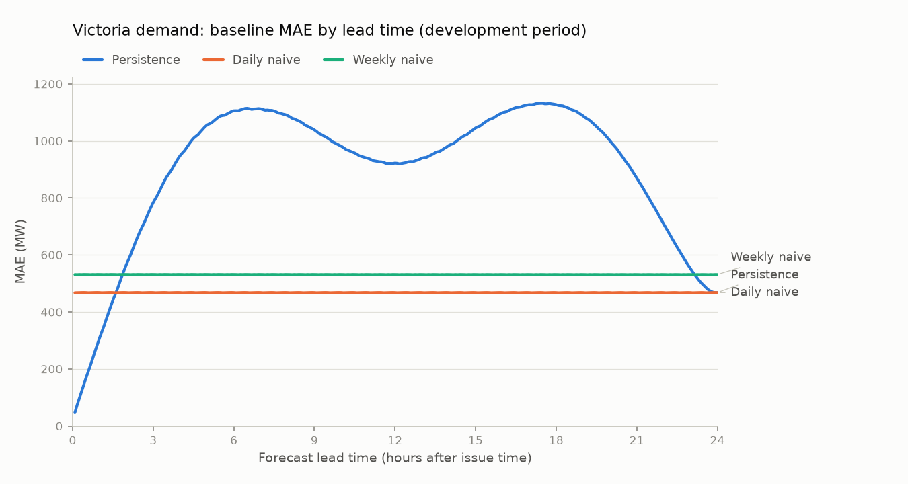
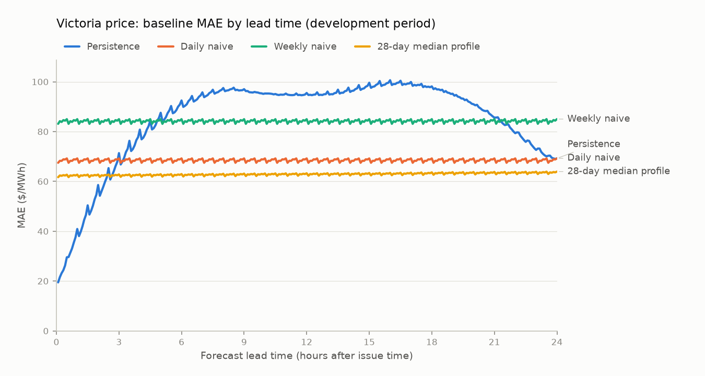

# Milestone 1: Victorian baseline forecasts

> **Generated** by `gridcast report` on 2026-11-02 01:10 UTC from results stored in PostgreSQL. Do not edit by hand: re-run the pipeline instead.

## Provenance

| Item | Value |
| :--- | :--- |
| Region | VIC1 |
| Data | AEMO MMSDM `DISPATCHREGIONSUM` + `DISPATCHPRICE`, 525,888 five-minute intervals |
| Data window (interval end) | 2021-09-30 14:05 UTC → 2026-09-30 14:00 UTC |
| Forecast origins | 86,113 (every 30 min), 59 monthly walk-forward folds |
| Horizons | 1–288 × 5 min (24 h); data latency 0 intervals |
| Scored (origin, horizon) pairs per model | 24,800,544 of 24,800,544 |
| Development period (origins) | 2021-11-01 → 2025-10-01 (NEM time) |
| Holdout period (origins) | from 2025-10-01 (NEM time) |
| Demand batch | `5836b22c-39cc-4eec-a46c-ee22dfbb7cc6` |
| Price batch | `07acd3a0-8b48-43b1-8d23-908ba23ac0c6` |
| Git commit(s) | `945bd4042ae0feaa60ef18268877d27255f47451` |

## Data quality

Latest data-quality run: 2026-11-02 00:58 UTC. Fail-level checks must be zero. Warn-level checks report real market states, not data errors; those states are evaluated as separate segments.

| Check | Region | Status | Count |
| :--- | :--- | ---: | ---: |
| Months whose latest ingestion failed (`ingestion_failures`) | - | PASS | 0 |
| Missing 5-min intervals (gaps) (`missing_intervals`) | VIC1 | PASS | 0 |
| Months with row count != 288 x days (`rows_per_month`) | VIC1 | PASS | 0 |
| Duplicate intervals in the database (`duplicate_intervals`) | VIC1 | PASS | 0 |
| Off-grid / future / out-of-window timestamps (`implausible_timestamps`) | VIC1 | PASS | 0 |
| Intervals missing demand or price (`null_values`) | VIC1 | PASS | 0 |
| Demand outside plausible bounds (`demand_out_of_range`) | VIC1 | PASS | 0 |
| Price below floor / above FY market price cap (`price_out_of_bounds`) | VIC1 | PASS | 0 |
| Latest interval older than freshness threshold (`stale_feed`) | VIC1 | PASS | 0 |
| Duplicates removed from source (`source_duplicates`) | - | PASS | 0 |
| Administered pricing / suspension episodes (`market_flags`) | VIC1 | WARN | 3,214 |
| Intervals with APCFLAG price post-processing bits (`price_adjustments`) | VIC1 | WARN | 5 |
| Prices not marked FIRM (`price_not_firm`) | VIC1 | PASS | 0 |

Demand ranged 1,225–10,784 MW. Price ranged −$1,000 to $19,070/MWh with a median of $60.61/MWh, and 20.4% of intervals had a negative price.

## How to read the results

- Each origin issues a 24-hour forecast (288 five-minute steps). Errors are grouped by **lead time** (horizon) and pooled over every origin.
- Every model is scored on the **same** (origin, horizon) pairs.
- Error = forecast − actual, so positive bias means over-forecasting.
- **Bold** marks the lowest error in each column. Taken per lead time, the best baseline forms the *baseline envelope* that any ML model must beat.
- Price spikes, negative prices and interventions are defined by what actually happened (*ex-post*). They describe where models fail; they cannot be used to choose a model at forecast time.

## Demand baselines

- **Persistence** has the lowest MAE at 20 of 288 lead times: 5 min–1 h 35 min, 23 h 55 min.
- **Daily naive** has the lowest MAE at 267 of 288 lead times: 1 h 40 min–23 h 50 min.
- Exact tie at 24 h: Persistence = Daily naive (identical forecasts).
- Daily naive first beats persistence at a lead time of 1 h 40 min.

### MAE (MW), development period

| Model | 5 min | 30 min | 1 h | 4 h | 12 h | 24 h | All horizons |
| :--- | ---: | ---: | ---: | ---: | ---: | ---: | ---: |
| Persistence | **46.3** | **168.8** | **308.1** | 948.7 | 922.3 | **467.8** | 902.7 |
| Daily naive | 467.3 | 467.9 | 467.9 | **467.9** | **467.9** | **467.8** | **467.8** |
| Weekly naive | 531.4 | 531.6 | 531.6 | 531.6 | 531.5 | 531.4 | 531.3 |

### MAE (MW), holdout period

| Model | 5 min | 30 min | 1 h | 4 h | 12 h | 24 h | All horizons |
| :--- | ---: | ---: | ---: | ---: | ---: | ---: | ---: |
| Persistence | **46.7** | **179.6** | **329.3** | 1,010.1 | 1,002.2 | **509.8** | 971.6 |
| Daily naive | 508.3 | 508.4 | 508.4 | **508.5** | **508.9** | **509.8** | **509.1** |
| Weekly naive | 586.3 | 586.3 | 586.3 | 586.5 | 587.2 | 588.0 | 586.7 |

### RMSE (MW), development period

| Model | 5 min | 30 min | 1 h | 4 h | 12 h | 24 h | All horizons |
| :--- | ---: | ---: | ---: | ---: | ---: | ---: | ---: |
| Persistence | **59.8** | **211.9** | **387.1** | 1,147.0 | 1,151.4 | **690.1** | 1,153.9 |
| Daily naive | 689.8 | 690.2 | 690.2 | **690.2** | **690.2** | **690.1** | **690.2** |
| Weekly naive | 782.0 | 782.4 | 782.4 | 782.4 | 782.3 | 782.2 | 782.0 |

### MAPE (%), development period

| Model | 5 min | 30 min | 1 h | 4 h | 12 h | 24 h | All horizons |
| :--- | ---: | ---: | ---: | ---: | ---: | ---: | ---: |
| Persistence | **1.0** | **3.6** | **6.5** | 20.0 | 20.6 | **10.4** | 19.8 |
| Daily naive | 10.4 | 10.4 | 10.4 | **10.4** | **10.4** | **10.4** | **10.4** |
| Weekly naive | 11.8 | 11.8 | 11.8 | 11.8 | 11.8 | 11.8 | 11.8 |

### Bias (MW, forecast − actual), development period

| Model | 5 min | 30 min | 1 h | 4 h | 12 h | 24 h | All horizons |
| :--- | ---: | ---: | ---: | ---: | ---: | ---: | ---: |
| Persistence | -0.3 | -0.0 | -0.0 | -0.0 | -0.2 | -0.5 | -2.6 |
| Daily naive | -0.8 | -0.8 | -0.8 | -0.8 | -0.7 | -0.5 | -0.7 |
| Weekly naive | -1.8 | -1.8 | -1.8 | -1.8 | -2.0 | -2.1 | -2.0 |

### MAE (MW) by segment, all horizons pooled, development period

| Segment | Pairs | Persistence | Daily naive | Weekly naive |
| :--- | ---: | ---: | ---: | ---: |
| All target intervals | 19,768,320 | 902.7 | **467.8** | 531.3 |
| Working days (not weekend or public holiday) | 13,505,478 | 898.2 | **455.8** | 532.4 |
| Evening peak (local 17:00-21:00) | 3,294,624 | 1,160.4 | **484.3** | 621.9 |
| Saturday/Sunday | 5,640,768 | 911.9 | **489.0** | 511.2 |
| Victorian public holidays | 801,786 | 894.6 | **489.4** | 664.9 |
| Local days when clocks change (23 h / 25 h days) | 97,344 | 835.7 | **279.0** | 377.0 |
| No price spike, negative price or market intervention | 15,185,035 | 880.1 | **422.7** | 492.1 |
| Realised price > $300/MWh (ex-post) | 734,304 | 1,101.0 | **434.4** | 460.1 |
| Realised price < $0/MWh (ex-post) | 3,709,829 | 955.8 | **663.3** | 716.8 |
| Administered pricing or market suspension (ex-post) | 154,272 | 904.2 | 352.9 | **243.7** |

## Price baselines

- **Persistence** has the lowest MAE at 31 of 288 lead times: 5 min–2 h 25 min, 2 h 35 min–2 h 40 min.
- **28-day median profile** has the lowest MAE at 257 of 288 lead times: 2 h 30 min, 2 h 45 min–24 h.
- Daily naive first beats persistence at a lead time of 3 h.

### MAE ($/MWh), development period

| Model | 5 min | 30 min | 1 h | 4 h | 12 h | 24 h | All horizons |
| :--- | ---: | ---: | ---: | ---: | ---: | ---: | ---: |
| Persistence | **19.5** | **29.5** | **40.9** | 80.8 | 95.5 | 69.2 | 85.2 |
| Daily naive | 67.5 | 69.2 | 69.2 | 69.2 | 69.2 | 69.2 | 68.5 |
| Weekly naive | 83.1 | 85.0 | 85.0 | 85.0 | 85.0 | 85.0 | 84.2 |
| 28-day median profile | 61.7 | 62.7 | 62.7 | **62.9** | **63.3** | **63.9** | **62.9** |

### MAE ($/MWh), holdout period

| Model | 5 min | 30 min | 1 h | 4 h | 12 h | 24 h | All horizons |
| :--- | ---: | ---: | ---: | ---: | ---: | ---: | ---: |
| Persistence | **8.5** | **12.4** | **17.2** | **37.5** | 55.7 | 41.8 | 46.5 |
| Daily naive | 42.6 | 41.8 | 41.8 | 41.7 | 41.7 | 41.8 | 42.4 |
| Weekly naive | 55.1 | 54.0 | 54.0 | 54.1 | 54.1 | 54.0 | 54.8 |
| 28-day median profile | 40.1 | 39.7 | 39.7 | 39.8 | **40.1** | **40.4** | **40.4** |

### RMSE ($/MWh), development period

| Model | 5 min | 30 min | 1 h | 4 h | 12 h | 24 h | All horizons |
| :--- | ---: | ---: | ---: | ---: | ---: | ---: | ---: |
| Persistence | **176.9** | **266.2** | 326.7 | 423.5 | 423.8 | 406.0 | 399.0 |
| Daily naive | 365.6 | 406.0 | 406.0 | 406.0 | 406.0 | 406.0 | 379.5 |
| Weekly naive | 375.9 | 420.3 | 420.3 | 420.3 | 420.3 | 420.3 | 390.9 |
| 28-day median profile | 271.0 | 303.6 | **303.6** | **303.7** | **303.8** | **304.2** | **281.3** |

### Median absolute error ($/MWh), development period

| Model | 5 min | 30 min | 1 h | 4 h | 12 h | 24 h | All horizons |
| :--- | ---: | ---: | ---: | ---: | ---: | ---: | ---: |
| Persistence | **6.3** | **10.9** | **16.9** | 45.3 | 66.4 | **37.8** | 52.5 |
| Daily naive | 38.3 | 37.7 | 37.8 | **37.8** | **37.8** | **37.8** | **38.1** |
| Weekly naive | 51.4 | 50.7 | 50.7 | 50.7 | 50.7 | 50.7 | 51.3 |
| 28-day median profile | 39.3 | 38.9 | 38.9 | 39.0 | 39.4 | 39.9 | 39.9 |

### Bias ($/MWh, forecast − actual), development period

| Model | 5 min | 30 min | 1 h | 4 h | 12 h | 24 h | All horizons |
| :--- | ---: | ---: | ---: | ---: | ---: | ---: | ---: |
| Persistence | 1.0 | 0.0 | 0.0 | 0.0 | 0.0 | 0.0 | 0.0 |
| Daily naive | -0.0 | -0.0 | -0.0 | 0.0 | 0.0 | 0.0 | 0.0 |
| Weekly naive | -0.0 | -0.1 | -0.1 | -0.0 | -0.0 | 0.0 | -0.0 |
| 28-day median profile | -8.4 | -9.6 | -9.6 | -9.5 | -9.5 | -9.5 | -8.9 |

### MAE ($/MWh) by segment, all horizons pooled, development period

| Segment | Pairs | Persistence | Daily naive | Weekly naive | 28-day median profile |
| :--- | ---: | ---: | ---: | ---: | ---: |
| All target intervals | 19,768,320 | 85.2 | 68.5 | 84.2 | **62.9** |
| Working days (not weekend or public holiday) | 13,505,478 | 90.5 | 74.4 | 92.5 | **67.4** |
| Evening peak (local 17:00-21:00) | 3,294,624 | 116.5 | 112.9 | 134.0 | **92.2** |
| Saturday/Sunday | 5,640,768 | 73.6 | 55.3 | 65.9 | **53.2** |
| Victorian public holidays | 801,786 | 72.4 | 55.1 | 67.4 | **50.1** |
| Local days when clocks change (23 h / 25 h days) | 97,344 | 67.9 | **40.0** | 50.1 | 46.6 |
| No price spike, negative price or market intervention | 15,185,035 | 73.3 | 57.2 | 74.5 | **52.1** |
| Realised price > $300/MWh (ex-post) | 734,304 | 349.5 | 336.4 | 347.4 | **312.7** |
| Realised price < $0/MWh (ex-post) | 3,709,829 | 81.7 | 61.0 | 69.8 | **57.7** |
| Administered pricing or market suspension (ex-post) | 154,272 | 97.1 | 92.9 | 140.2 | **66.1** |

### Price MAE by position within the half hour, development period

Origins fall on :00 and :30, so each lead time targets a fixed 5-minute slot inside a half-hour block. These baselines don't depend on the origin, so the table isolates how their error changes with the target's position in the block (mean per-horizon MAE, $/MWh).

| Interval ends at (min past :00/:30) | Daily naive | Weekly naive | 28-day median profile |
| :--- | ---: | ---: | ---: |
| :00 | 69.2 | 85.0 | 63.3 |
| :05 | 67.5 | 83.1 | 62.3 |
| :10 | 68.3 | 84.2 | 63.0 |
| :15 | 68.2 | 83.9 | 62.8 |
| :20 | 68.9 | 84.6 | 63.1 |
| :25 | 68.8 | 84.4 | 63.0 |

## Notes and limitations

- All of these are baselines. Nothing here is fitted to the holdout period, which stays reserved for the final evaluation of later ML models.
- Seasonal naive uses fixed absolute lags (exactly 24 h / 7 d in UTC). On the two days a year when clocks change, "same time yesterday" is one local hour off. DST-change days are always Sundays in April or October, so the `dst_change_day` segment also mixes in day-type and seasonal effects. It cannot isolate the DST cost on its own.
- `TOTALDEMAND` excludes rooftop PV, so midday demand partly reflects solar output (see `docs/data_sources.md`).
- Backtests use final (revised) archive prices, which can differ slightly from what a live system saw in real time.
