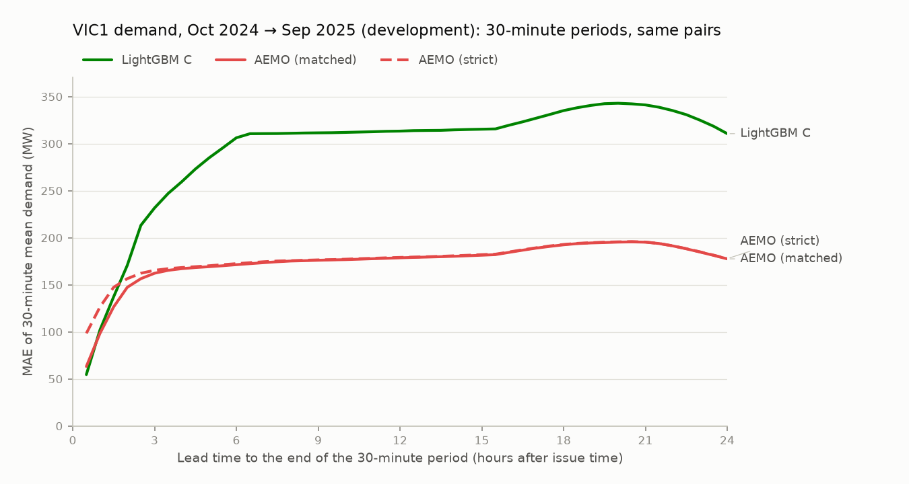

# Milestone 2: AEMO benchmark (development part)

*Generated by `gridcast report-aemo` from the stored development forecasts of the frozen model and AEMO's archived forecasts. Do not edit by hand.*

AEMO publishes its own demand forecasts: **30-minute pre-dispatch** (every half hour, up to the end of the next trading day) and **5-minute pre-dispatch** (every 5 minutes, the next hour). This report compares them with GridCast's frozen headline model, LightGBM C (archived GFS temperature forecasts), over the development part of the benchmark window. AEMO's forecasts are a benchmark only, never a model input, and the comparison is not pass/fail (m2_plan.md §3). The model config was frozen before this comparison existed, so nothing here can change it. The holdout part (Oct 2025 → Sep 2026) is compared once, in step 6.

## Provenance

| Item | Value |
| :--- | :--- |
| Region | VIC1 |
| Our forecasts | main batch `6d783932-5834-4e18-a9e8-0e3567db46e6` (commit `96a6e50842d37002f09d48fccdb002358bdad90e`) |
| ML config | `b88eae0a04e176af` = frozen config (`backtest.frozen_ml_config_hash`) |
| Issue times compared (NEM time) | 2024-10-01 00:00 → 2025-09-30 23:30, 17,520, every 30 min |
| AEMO pre-dispatch runs in the window | 17,519 of 17,520 (48 a day) |
| AEMO 5-minute pre-dispatch runs in the window | 105,115 of 105,120 (288 a day) |
| Strict alignment: run used | 17,519 × 30 min before the issue time, 1 × 60 min before the issue time |
| 5-minute run at the issue time missing / published after it | 2 / 0 issue times (excluded) |
| Report generated from commit | `98cba525bfaf0d8645029019d18b8575c84cdd8f` |

## How the forecasts are lined up

- **Our forecasts** are issued every 30 minutes for every 5 minutes of the next 24 h. For the 30-minute comparison they are averaged over each period, because AEMO's pre-dispatch `TOTALDEMAND` is the period mean (step 0). The actual demand is averaged the same way. Lead time is measured from our issue time to the end of the period.
- **AEMO (matched)**, the headline: AEMO's run whose nominal run time is our issue time. Both forecasts then use information up to the same moment; AEMO publishes its run one to fourteen minutes later.
- **AEMO (strict)**: the latest run already published at our issue time, normally the run from 30 minutes earlier. This is what an operator could have read at that moment, but AEMO's information is half an hour older than ours, so it flatters our model.
- **AEMO 5-minute pre-dispatch**: the run at our issue time, published before it; its intervals 1–11 are our leads of 5–55 minutes.
- Every forecast in a table is scored on the **same (issue time, lead) pairs**: those where both AEMO alignments have a value. Pre-dispatch does not always reach 24 h (runs issued from 04:00 to 12:00 NEM time end at the next 04:00), so long leads cover fewer issue times:

| Lead | AEMO (matched) available | AEMO (strict) available | Pairs scored |
| :--- | ---: | ---: | ---: |
| 30 min | 100.0% | 100.0% | 100.0% |
| 1 h | 100.0% | 100.0% | 100.0% |
| 2 h | 100.0% | 100.0% | 100.0% |
| 4 h | 100.0% | 100.0% | 100.0% |
| 6 h | 100.0% | 100.0% | 100.0% |
| 12 h | 100.0% | 100.0% | 100.0% |
| 18 h | 91.7% | 89.6% | 89.6% |
| 24 h | 66.7% | 64.6% | 64.6% |

AEMO (matched) covers every issue time up to 16 h ahead. Beyond that the scored pairs come from fewer issue times (those whose AEMO run reaches that far), so the shape of every curve there partly reflects which issue times remain.

## 30-minute pre-dispatch vs our forecasts

### MAE (MW) of 30-minute mean demand

| Lead | AEMO (matched) | AEMO (strict) | LightGBM C | LightGBM A | LightGBM D | Ridge C | Best baseline | Pairs |
| :--- | ---: | ---: | ---: | ---: | ---: | ---: | ---: | ---: |
| 30 min | 63.2 | 98.4 | 54.6 | 55.3 | 54.2 | 62.9 | 114.5 (Persistence) | 17,519 |
| 1 h | 98.4 | 126.5 | 102.0 | 105.6 | 101.4 | 135.6 | 279.5 (Persistence) | 17,519 |
| 2 h | 147.3 | 156.5 | 170.6 | 183.2 | 168.6 | 218.8 | 522.9 (Daily naive) | 17,519 |
| 4 h | 167.1 | 168.3 | 259.6 | 298.6 | 255.0 | 314.5 | 523.0 (Daily naive) | 17,519 |
| 6 h | 171.4 | 172.5 | 306.2 | 364.4 | 296.9 | 368.2 | 523.0 (Daily naive) | 17,519 |
| 12 h | 178.7 | 179.1 | 313.3 | 401.7 | 310.4 | 377.7 | 523.0 (Daily naive) | 17,519 |
| 18 h | 192.5 | 192.9 | 335.1 | 430.9 | 330.5 | 396.4 | 548.2 (Daily naive) | 15,694 |
| 24 h | 177.6 | 177.8 | 310.7 | 421.8 | 302.0 | 379.3 | 489.6 (Daily naive) | 11,314 |
| **All leads (pooled)** | **173.4** | **176.1** | **292.5** | **368.2** | **288.7** | **351.9** | 526.3 (Daily naive) |  |

- LightGBM C has a lower MAE than AEMO (matched) at 1 of 48 leads; AEMO (matched) is as good or better at: 1 h–24 h.
- Against AEMO (strict), LightGBM C is lower at 3 of 48 leads; AEMO (strict) is as good or better at: 2 h–24 h.

### Pooled difference, with uncertainty

Pooled over every lead on the same pairs. The 95% interval comes from resampling whole issue days (2,000 bootstrap draws), which keeps the strong correlation between errors within a day.

| Forecast A | Forecast B | MAE A | MAE B | A − B | 95% interval | Pairs | Days |
| :--- | :--- | ---: | ---: | ---: | ---: | ---: | ---: |
| LightGBM C | AEMO (matched) | 292.5 | 173.4 | +119.1 | +110.1 to +128.7 | 785,067 | 365 |
| LightGBM C | AEMO (strict) | 292.5 | 176.1 | +116.4 | +107.3 to +125.9 | 785,067 | 365 |
| LightGBM C | AEMO 5-min pre-dispatch | 83.2 | 88.4 | -5.2 | -6.4 to -4.1 | 192,698 | 365 |

- LightGBM C vs AEMO (matched): AEMO (matched) is more accurate (the interval excludes zero).
- LightGBM C vs AEMO (strict): AEMO (strict) is more accurate (the interval excludes zero).
- LightGBM C vs AEMO 5-min pre-dispatch: LightGBM C is more accurate (the interval excludes zero).

### Bias (MW, forecast − actual)

| Lead | AEMO (matched) | AEMO (strict) | LightGBM C |
| :--- | ---: | ---: | ---: |
| 30 min | +3.5 | -5.7 | -1.0 |
| 1 h | -5.7 | -27.2 | -9.2 |
| 2 h | -41.6 | -47.6 | -13.2 |
| 4 h | -52.4 | -50.0 | -23.7 |
| 6 h | -39.3 | -36.4 | -25.8 |
| 12 h | -32.5 | -33.1 | -38.6 |
| 18 h | -36.9 | -36.8 | -41.6 |
| 24 h | -35.4 | -35.1 | -64.6 |

### By quarter of the issue time (all leads pooled, MAE in MW)

| Issue quarter (NEM time) | LightGBM C | AEMO (matched) | AEMO (strict) | Pairs |
| :--- | ---: | ---: | ---: | ---: |
| 2024 Q4 | 324.0 | 180.9 | 183.8 | 197,844 |
| 2025 Q1 | 338.3 | 193.8 | 196.7 | 193,590 |
| 2025 Q2 | 217.2 | 144.0 | 146.3 | 195,741 |
| 2025 Q3 | 290.6 | 174.9 | 177.7 | 197,892 |

## 5-minute pre-dispatch vs our forecasts (leads 5–55 minutes)

| Lead | AEMO 5-min pre-dispatch | LightGBM C | Persistence | Pairs |
| :--- | ---: | ---: | ---: | ---: |
| 5 min | 40.5 | 41.4 | 48.8 | 17,518 |
| 10 min | 56.8 | 54.0 | 79.7 | 17,518 |
| 15 min | 64.5 | 60.6 | 107.1 | 17,518 |
| 20 min | 72.3 | 67.9 | 133.9 | 17,518 |
| 25 min | 81.6 | 75.4 | 162.3 | 17,518 |
| 30 min | 91.1 | 85.3 | 189.8 | 17,518 |
| 35 min | 98.0 | 95.8 | 215.3 | 17,518 |
| 40 min | 104.3 | 99.7 | 240.6 | 17,518 |
| 45 min | 112.1 | 105.2 | 268.6 | 17,518 |
| 50 min | 120.8 | 111.4 | 296.0 | 17,518 |
| 55 min | 130.4 | 118.2 | 323.3 | 17,518 |
| **All (pooled)** | **88.4** | **83.2** | **187.8** |  |

- LightGBM C has a lower MAE than AEMO 5-minute pre-dispatch at 10 of 11 leads; AEMO is as good or better at: 5 min.

## Notes and limitations

- **Different purposes.** Pre-dispatch is an operational market forecast that AEMO re-runs every half hour with the latest data and bids; it is not built to minimise the error of a 24-hour-ahead demand forecast. GridCast's model is.
- **What is "actual".** The target is `DISPATCHREGIONSUM.TOTALDEMAND`, AEMO's operational dispatch demand (step 0), not metered consumption. Interval 0 of every 5-minute pre-dispatch run equals it, apart from a few small differences (`aemo_p5min_alignment`, docs/data_sources.md §6).
- **Alignment was chosen before any result.** The plan first named only the strict alignment; matched became the headline on 2026-11-08, before this comparison was run, because strict gives AEMO older information than our model. Both are shown.
- **The development period was looked at twice** when choosing between two development runs (`reports/m2_demand.md`, *Development runs*), so our development numbers are slightly optimistic. AEMO's are not. The holdout, scored once, is the unbiased comparison.
- **Missing runs.** AEMO runs missing from the archive (data-quality check `aemo_missing_runs`) leave their issue times out of the matched comparison; the strict alignment falls back to the latest published run.
