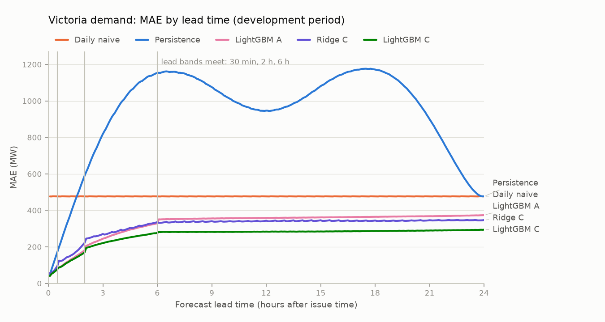
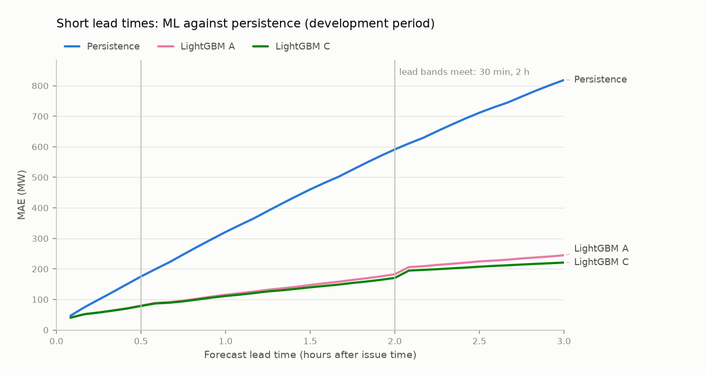

# Milestone 2: weather-aware demand forecasts (development period)

> **Generated** by `gridcast report-m2` on 2026-11-07 06:26 UTC from the stored walk-forward run. Do not edit by hand: re-run the pipeline instead. The holdout period is not scored here.

## Provenance

| Item | Value |
| :--- | :--- |
| Region | VIC1 |
| Batches | main `6d783932-5834-4e18-a9e8-0e3567db46e6`, plus `94ea74a5-f644-46cf-8dce-dc82e8f13f11`, delay `358eeab3-29b6-4ef3-be14-0f2447799f58` |
| Git commit(s) of the runs | `96a6e50842d37002f09d48fccdb002358bdad90e` |
| ML config hash | `b88eae0a04e176af` (matches the current config) |
| Development issue times (NEM time) | 2022-11-01 00:00 → 2025-09-30 23:30, 51,120 (every 30 min) |
| Retrains | 12, every 3 months, 2022-11-01 → 2025-08-01 |
| Lead bands (steps of 5 min) | 1–6, 7–24, 25–72, 73–288 |
| Scored (issue time, lead) pairs, every model | 14,436,480 of 14,722,560 (286,080 excluded, 1.94%) |
| Training rows at the last retrain (shared by A, C, D) | 6,323,488 |
| Leakage property tests (run by this command) | 6 passed, 0 failed |
| Report generated from commit | `3599d62772d95097841996df1a40a142f35689a9` |

## Success criteria (pre-registered)

Set in `docs/plans/m2_plan.md` §3 before any ML result existed. They apply to LightGBM, variant C (GFS temperature forecasts as available at the issue time), scored on exactly the same pairs as the rescored baselines. *Best baseline* means the lowest MAE among persistence, daily naive, weekly naive at each lead time. S5 (the holdout, scored once) belongs to step 6.

| # | Pass if | Measured | Result |
| :--- | :--- | :--- | :--- |
| S1 | MAE_C(h) < min over baselines of MAE(h), for every h from 2 h to 24 h | 265 of 265 lead times; closest at 24 h: 294.2 vs 476.7 MW | **PASS** |
| S2 | pooled MAE_C < mean over h of (min over baselines of MAE(h)) | 263.6 vs 463.0 MW | **PASS** |
| S3 | pooled MAE_C < pooled MAE_A | 263.6 vs 327.0 MW | **PASS** |
| S4 | pooled MAE_D ≤ pooled MAE_C, and every leakage property test passes | 260.0 vs 263.6 MW; leakage tests 6 passed, 0 failed | **PASS** |

**4 of 4 criteria pass.**

## How to read the results

- Each issue time (every 30 min) gets a 24-hour forecast in 5-minute steps; errors are grouped by **lead time** and pooled over every issue time.
- **A** has no weather, **C** uses GFS temperature forecasts published before the issue time, **D** uses ERA5 reanalysis for the target time (perfect foresight, an upper bound for C's inputs). C and D have identical features, so C − D is the cost of weather-forecast error.
- Every ML model is 4 fits, one per lead band (5 min–30 min, 35 min–2 h, 2 h 5 min–6 h, 6 h 5 min–24 h). Its settings (target form, objective, size or penalty) are re-selected at every retrain (every 3 months) on the last 8 weeks before it.
- **Bold** marks the lowest error in each column. Error = forecast − actual.

## MAE by lead time

### MAE (MW), development period

| Model | 5 min | 30 min | 35 min | 1 h | 2 h | 2 h 5 min | 4 h | 6 h | 6 h 5 min | 12 h | 24 h | All horizons |
| :--- | ---: | ---: | ---: | ---: | ---: | ---: | ---: | ---: | ---: | ---: | ---: | ---: |
| LightGBM A | **40.4** | 79.7 | 88.5 | 115.4 | 182.6 | 206.0 | 279.5 | 329.2 | 351.0 | 358.9 | 373.9 | 327.0 |
| LightGBM C | 40.5 | 78.7 | 86.9 | 111.4 | 170.6 | 194.6 | 242.8 | 276.6 | 281.4 | 283.8 | 294.2 | 263.6 |
| LightGBM D | 40.7 | **78.0** | **86.1** | **110.1** | **168.3** | **191.2** | **238.2** | **270.2** | **278.1** | **280.6** | **286.9** | **260.0** |
| Ridge A | 56.9 | 97.7 | 123.4 | 144.3 | 231.5 | 259.4 | 319.8 | 371.1 | 371.5 | 386.9 | 392.0 | 353.9 |
| Ridge C | 57.0 | 97.0 | 124.6 | 142.5 | 222.7 | 245.6 | 294.2 | 335.8 | 331.5 | 343.5 | 347.0 | 316.6 |
| Ridge D | 56.8 | 96.9 | 124.8 | 142.8 | 222.0 | 247.2 | 295.7 | 336.7 | 334.0 | 346.6 | 348.5 | 318.7 |
| Persistence | 46.9 | 175.1 | 198.8 | 321.0 | 591.3 | 610.9 | 990.2 | 1,153.3 | 1,154.1 | 946.8 | 476.7 | 935.4 |
| Daily naive | 476.3 | 476.7 | 476.3 | 476.6 | 476.6 | 476.3 | 476.6 | 476.6 | 476.3 | 476.6 | 476.7 | 476.7 |
| Weekly naive | 542.7 | 542.7 | 542.7 | 542.7 | 542.7 | 542.7 | 542.7 | 542.7 | 542.7 | 542.6 | 542.8 | 542.5 |

### RMSE (MW), development period

| Model | 5 min | 30 min | 35 min | 1 h | 2 h | 2 h 5 min | 4 h | 6 h | 6 h 5 min | 12 h | 24 h | All horizons |
| :--- | ---: | ---: | ---: | ---: | ---: | ---: | ---: | ---: | ---: | ---: | ---: | ---: |
| LightGBM A | 53.1 | 111.1 | 124.2 | 166.0 | 268.5 | 303.6 | 421.5 | 494.3 | 530.6 | 539.1 | 561.8 | 502.2 |
| LightGBM C | **53.1** | 109.6 | 121.4 | 159.4 | 248.6 | 280.2 | 353.5 | 400.5 | 409.7 | 410.0 | 429.5 | 388.8 |
| LightGBM D | 53.2 | **108.8** | **120.5** | **157.9** | **246.2** | **277.9** | **348.5** | **391.3** | **407.3** | **407.8** | **418.3** | **385.3** |
| Ridge A | 72.7 | 131.7 | 164.7 | 200.4 | 322.8 | 358.0 | 454.4 | 525.8 | 529.6 | 548.9 | 559.2 | 512.7 |
| Ridge C | 72.7 | 130.7 | 164.8 | 195.7 | 307.7 | 333.3 | 406.1 | 462.6 | 457.6 | 472.7 | 479.8 | 444.5 |
| Ridge D | 72.5 | 130.7 | 165.2 | 196.4 | 307.2 | 334.8 | 406.7 | 461.3 | 457.9 | 473.3 | 476.5 | 444.5 |
| Persistence | 60.6 | 219.8 | 249.3 | 402.8 | 734.4 | 757.7 | 1,195.9 | 1,390.9 | 1,392.8 | 1,178.0 | 705.1 | 1,193.9 |
| Daily naive | 705.0 | 704.9 | 705.0 | 704.9 | 704.9 | 705.0 | 704.9 | 704.9 | 705.0 | 704.9 | 705.1 | 705.0 |
| Weekly naive | 803.1 | 803.1 | 803.1 | 803.1 | 803.1 | 803.1 | 803.1 | 803.0 | 803.0 | 803.0 | 803.3 | 802.8 |

### Bias (MW, forecast − actual), development period

| Model | 5 min | 30 min | 35 min | 1 h | 2 h | 2 h 5 min | 4 h | 6 h | 6 h 5 min | 12 h | 24 h | All horizons |
| :--- | ---: | ---: | ---: | ---: | ---: | ---: | ---: | ---: | ---: | ---: | ---: | ---: |
| LightGBM A | 0.6 | 2.6 | 2.1 | 2.5 | 5.4 | 14.9 | 19.3 | 24.8 | 22.9 | 23.1 | 23.0 | 20.4 |
| LightGBM C | -0.2 | 1.1 | -2.8 | -3.1 | -2.1 | -1.0 | 1.5 | 4.6 | -5.7 | -6.1 | -9.0 | -5.2 |
| LightGBM D | -0.9 | 0.5 | -3.9 | -5.2 | -2.0 | -2.5 | 1.2 | 4.9 | -0.7 | 2.4 | 2.3 | 0.9 |
| Ridge A | 4.5 | 3.5 | 10.2 | 10.3 | 10.2 | 28.5 | 28.5 | 28.4 | 41.8 | 43.3 | 43.8 | 36.9 |
| Ridge C | 3.9 | 3.0 | 7.8 | 7.9 | 7.9 | 20.9 | 20.7 | 20.7 | 29.3 | 31.2 | 28.5 | 25.4 |
| Ridge D | 4.1 | 3.1 | 9.2 | 9.3 | 9.2 | 23.5 | 23.2 | 23.2 | 29.9 | 31.6 | 31.2 | 26.7 |
| Persistence | -0.2 | 0.0 | -0.1 | 0.1 | 0.1 | -0.1 | 0.2 | 0.3 | 0.1 | 0.2 | 0.4 | -2.0 |
| Daily naive | 0.5 | 0.4 | 0.5 | 0.5 | 0.5 | 0.5 | 0.5 | 0.5 | 0.5 | 0.7 | 0.4 | 0.6 |
| Weekly naive | 4.3 | 4.3 | 4.3 | 4.3 | 4.3 | 4.3 | 4.3 | 4.3 | 4.3 | 4.2 | 4.1 | 4.2 |

## Short lead times and the band boundaries

- At 5 min, LightGBM C's MAE is 40.5 MW against 46.9 MW for persistence; LightGBM C is better from 5 min on. Lead times under 2 h are reported, not pass/fail.
- Between 30 min (one band's last step) and 35 min (the next band's first), LightGBM C's MAE changes by +8.2 MW (A: +8.8 MW), against a median step of 0.5 MW between neighbouring lead times elsewhere. The later band's fit is weakest at its shortest leads.
- Between 2 h (one band's last step) and 2 h 5 min (the next band's first), LightGBM C's MAE changes by +24.0 MW (A: +23.4 MW), against a median step of 0.5 MW between neighbouring lead times elsewhere. The later band's fit is weakest at its shortest leads.
- Between 6 h (one band's last step) and 6 h 5 min (the next band's first), LightGBM C's MAE changes by +4.8 MW (A: +21.8 MW), against a median step of 0.5 MW between neighbouring lead times elsewhere. The later band's fit is weakest at its shortest leads.
- The first development run's two weaknesses were the 5-minute result and the jump at its only band boundary (2 h). They are reported as they are; see *Development runs* for how this run compares.

## Development runs

The development period was scored by two complete runs of the walk-forward. The first showed two weaknesses (5-minute MAE above persistence; a jump at its band boundary). The second was agreed with the user to address them: lead bands 2 → 4; target form latest added. Every other ML and setup setting is identical, and both runs scored the same pairs (same count; the baselines' pooled MAE is identical to the bit).

| Run | Batch | Commit | Lead bands | Target forms | S1–S4 passed | Pooled MAE, LightGBM C (MW) | 5 min: LightGBM C vs persistence (MW) | MAE step at band boundaries (MW) |
| :--- | :--- | :--- | :--- | :--- | ---: | ---: | ---: | :--- |
| 1 | `b424894e` | `15623d6` | 5 min–2 h, 2 h 5 min–24 h | residual, direct, anchored | 4 of 4 | 267.5 | 58.4 vs 46.9 | 2 h: +76.8 |
| 2 | `6d783932` | `96a6e50` | 5 min–30 min, 35 min–2 h, 2 h 5 min–6 h, 6 h 5 min–24 h | residual, direct, anchored, latest | 4 of 4 | 263.6 | 40.5 vs 46.9 | 30 min: +8.2; 2 h: +24.0; 6 h: +4.8 |

**Adoption rule (pre-registered in `docs/plans/m2_plan.md` before the second run's results):** the second run's config is frozen for the holdout if S1–S4 all pass for it and its pooled LightGBM C MAE is no higher than the first run's on identical pairs; otherwise the first run's config is frozen.

**Outcome:** the second run's pooled MAE is -4.0 MW against the first run's, and 4 of 4 criteria pass. **The second run's config is adopted for the holdout.** The rest of this report describes the second run.

Two looks at the same period make the adopted run's development numbers slightly optimistic; the holdout, scored once, is the unbiased estimate.

## Weather value by lead time

Mean of the per-lead MAE within each lead-time range (MW). The delay column comes from the delay batch, on its own common pairs.

| Lead time | LightGBM A | LightGBM C | LightGBM D | C vs A (%) | C − D (MW) | 8 h delay − C (MW) |
| :--- | ---: | ---: | ---: | ---: | ---: | ---: |
| 5 min–1 h | 80.7 | 79.1 | 78.4 | -2.0 | +0.6 | +0.0 |
| 1 h 5 min–2 h | 150.4 | 142.4 | 140.5 | -5.4 | +1.9 | +0.0 |
| 2 h 5 min–6 h | 275.7 | 240.9 | 236.2 | -12.7 | +4.7 | +0.0 |
| 6 h 5 min–12 h | 355.3 | 282.2 | 279.1 | -20.6 | +3.1 | +1.6 |
| 12 h 5 min–24 h | 365.1 | 287.3 | 283.4 | -21.3 | +3.9 | +1.7 |

## Weather value: the “investigate before believing” check

The plan (§2.5) says any feature that improves pooled MAE by more than 15% on its own is checked for leakage before it is believed. Over the development period, weather (C vs A) cuts the pooled MAE by **19.4%**, above that threshold. Weather is a group of features, so each one is also tested alone below.

**Drop/add test.** At each listed retrain, LightGBM C's chosen setting was refitted on that retrain's early-stopping rows (the last 8 weeks before it are monitored) with each weather feature added alone to the weather-free set, or dropped from the full set. MAE is pooled over every lead band. *Keep gain* is what the feature adds on top of the other weather features. A feature is flagged above 15%. The all-features fit reproduced the stored run's early-stopping MAE exactly at every retrain and band. Run from commit `96a6e50842d37002f09d48fccdb002358bdad90e`.

| Retrain | Feature | MAE no weather | MAE + feature | Add gain (%) | Keep gain (%) | All weather gain (%) | Flagged |
| :--- | :--- | ---: | ---: | ---: | ---: | ---: | :--- |
| 2025-02-01 | `wx_temp` | 461.8 | 345.5 | 25.2 | 1.6 | 26.4 | **yes** |
| 2025-02-01 | `wx_cooling_degrees` | 461.8 | 339.6 | 26.5 | 2.0 | 26.4 | **yes** |
| 2025-02-01 | `wx_heating_degrees` | 461.8 | 455.5 | 1.4 | 0.9 | 26.4 | no |
| 2025-02-01 | `wx_temp_sq` | 461.8 | 344.8 | 25.3 | 1.2 | 26.4 | **yes** |
| 2025-02-01 | `wx_temp_single_site` | 461.8 | 346.5 | 25.0 | 1.3 | 26.4 | **yes** |
| 2025-08-01 | `wx_temp` | 300.8 | 256.8 | 14.6 | 0.9 | 14.9 | no |
| 2025-08-01 | `wx_cooling_degrees` | 300.8 | 300.5 | 0.1 | 0.7 | 14.9 | no |
| 2025-08-01 | `wx_heating_degrees` | 300.8 | 258.5 | 14.1 | 0.8 | 14.9 | no |
| 2025-08-01 | `wx_temp_sq` | 300.8 | 258.3 | 14.1 | 0.3 | 14.9 | no |
| 2025-08-01 | `wx_temp_single_site` | 300.8 | 259.1 | 13.9 | 0.8 | 14.9 | no |

**Flagged:** `wx_cooling_degrees`, `wx_temp`, `wx_temp_single_site`, `wx_temp_sq`. The evidence below is the leakage check the plan asks for.

- Monitored issue times per retrain: 2025-02-01: 2024-12-07 → 2025-01-31; 2025-08-01: 2025-06-06 → 2025-07-31.
- No weather feature matters much given the others: the largest keep gain is 2.0%. The features are near-substitutes, so a flag measures what temperature as a whole adds, not one suspicious column.
- The degree features behave as their definitions imply: cooling degrees (heat above the base temperature) help alone at 2025-02-01 (26.5%) but not at 2025-08-01 (0.1%); heating degrees the reverse (14.1% vs 1.4%). Information leaked from future demand would not depend on the season like this.

**Leakage evidence:**

- **Leakage property tests:** 6 passed, 0 failed (future demand and unpublished forecast rows perturbed or deleted; C's features must not change).
- **Publication timing:** assuming GFS runs are published 8 h after their run time instead of 6 h changes the pooled MAE by +1.3 MW, against a C-vs-A gain of 63.4 MW. The gain does not hinge on the last hours before publication, where a timing leak would sit.
- **Where the gain comes from:** C vs A is -2.0% at 5 min–1 h and -21.3% at 12 h 5 min–24 h, so weather helps most at long leads, where recent demand says least.
- **Perfect foresight bounds it:** D's pooled MAE is 3.6 MW below C's, and C is no better than D in any lead-time range.

## C⁺ and D⁺: all forecast weather variables (reported, not pass/fail)

C⁺ adds apparent temperature, humidity, cloud cover and solar radiation forecasts, archived only from 2024-01-19, so it trains from then and is scored from 2025-02-01 (11,616 issue times, 3,345,408 pairs), next to headline C on the same pairs.

| Model | 5 min | 30 min | 35 min | 1 h | 2 h | 2 h 5 min | 4 h | 6 h | 6 h 5 min | 12 h | 24 h | All horizons |
| :--- | ---: | ---: | ---: | ---: | ---: | ---: | ---: | ---: | ---: | ---: | ---: | ---: |
| LightGBM C⁺ | **41.6** | 85.7 | 97.1 | 123.9 | 181.1 | 198.1 | 233.1 | 256.4 | 258.1 | 259.7 | 268.1 | 243.7 |
| LightGBM D⁺ | 41.7 | **84.8** | **90.9** | **117.8** | **171.9** | **181.5** | **213.4** | **234.0** | **237.0** | **237.1** | **240.7** | **223.2** |
| LightGBM C | 41.6 | 85.3 | 96.3 | 123.9 | 188.5 | 204.2 | 256.9 | 297.4 | 292.6 | 296.8 | 306.1 | 276.9 |
| Ridge C⁺ | 63.5 | 106.0 | 139.0 | 155.6 | 229.4 | 242.2 | 277.7 | 306.8 | 298.0 | 306.2 | 306.6 | 284.8 |
| Ridge D⁺ | 64.2 | 105.5 | 143.7 | 154.5 | 223.6 | 238.6 | 265.1 | 290.7 | 288.1 | 292.4 | 292.4 | 274.0 |
| Ridge C | 60.9 | 107.2 | 128.9 | 154.3 | 248.9 | 249.6 | 310.2 | 360.0 | 342.4 | 353.5 | 351.1 | 326.7 |
| Persistence | 50.2 | 201.1 | 228.3 | 373.7 | 693.7 | 716.8 | 1,159.3 | 1,341.7 | 1,341.7 | 1,032.8 | 501.3 | 1,061.7 |
| Daily naive | 504.4 | 503.9 | 504.4 | 503.9 | 503.9 | 504.4 | 503.9 | 503.9 | 504.3 | 503.6 | 501.3 | 503.5 |
| Weekly naive | 610.1 | 610.3 | 610.1 | 610.3 | 610.3 | 610.1 | 610.2 | 610.1 | 609.9 | 610.2 | 607.5 | 609.1 |

## Publication-delay sensitivity (reported, never the headline)

C rebuilt as if every GFS run were published 8 h after its run time (headline: 6 h), with headline C's chosen settings at every retrain, so only the input timing differs.

| Model | 5 min | 30 min | 35 min | 1 h | 2 h | 2 h 5 min | 4 h | 6 h | 6 h 5 min | 12 h | 24 h | All horizons |
| :--- | ---: | ---: | ---: | ---: | ---: | ---: | ---: | ---: | ---: | ---: | ---: | ---: |
| LightGBM C | **40.5** | **78.7** | **86.9** | **111.4** | **170.6** | **194.6** | **242.8** | **276.6** | **281.4** | **283.8** | **294.2** | **263.6** |
| Ridge C | 57.0 | 97.0 | 124.6 | 142.5 | 222.7 | 245.6 | 294.2 | 335.8 | 331.5 | 343.5 | 347.0 | 316.6 |
| LightGBM C (8 h delay) | **40.5** | **78.7** | **86.9** | **111.4** | **170.6** | **194.6** | **242.8** | **276.6** | 283.1 | 284.9 | 295.0 | 264.8 |
| Ridge C (8 h delay) | 57.0 | 97.0 | 124.6 | 142.5 | 222.7 | 245.6 | 294.2 | 335.8 | 331.1 | 343.2 | 347.0 | 316.6 |

## Errors by year

Pooled MAE (MW) by NEM year of the issue time. Weather-model upgrades can change C's forecast error over time; C − D tracks that cost.

| Year | Pairs | LightGBM A | LightGBM C | LightGBM D | Ridge C | Daily naive | C − D |
| :--- | ---: | ---: | ---: | ---: | ---: | ---: | ---: |
| 2022 (Nov–Dec) | 843,264 | 300.7 | 241.5 | 235.9 | 284.4 | 419.2 | +5.6 |
| 2023 | 5,016,528 | 295.3 | 242.5 | 239.9 | 299.3 | 442.9 | +2.6 |
| 2024 | 4,802,736 | 338.3 | 273.3 | 268.4 | 318.5 | 491.0 | +5.0 |
| 2025 (Jan–Sep) | 3,773,952 | 360.5 | 284.0 | 281.4 | 344.3 | 516.1 | +2.6 |

## Model selection at each retrain

LightGBM C, per retrain and lead band: the winning setting and the best early-stopping MAE each target form reached (residual: correction to the same time yesterday; direct: demand itself; anchored: correction to the latest demand plus yesterday's change; latest: correction to the latest demand, i.e. persistence). This is the planned residual-vs-direct ablation.

| Retrain | Lead band | Chosen | Trees | Best residual (MW) | Best direct (MW) | Best anchored (MW) | Best latest (MW) |
| :--- | :--- | :--- | ---: | ---: | ---: | ---: | ---: |
| 2022-11-01 | 5 min–30 min | latest, L1, 31 leaves | 541 | 72.5 | 64.4 | 70.6 | **60.9** |
| 2022-11-01 | 35 min–2 h | latest, L1, 127 leaves | 687 | 137.0 | 131.1 | 136.6 | **126.7** |
| 2022-11-01 | 2 h 5 min–6 h | direct, L1, 31 leaves | 375 | 235.5 | **234.9** | 238.3 | 238.3 |
| 2022-11-01 | 6 h 5 min–24 h | direct, L2, 31 leaves | 276 | 278.0 | **269.7** | 275.8 | 277.5 |
| 2023-02-01 | 5 min–30 min | latest, L1, 127 leaves | 309 | 70.5 | 60.4 | 64.3 | **52.7** |
| 2023-02-01 | 35 min–2 h | latest, L1, 127 leaves | 345 | 133.5 | 123.3 | 133.4 | **114.2** |
| 2023-02-01 | 2 h 5 min–6 h | latest, L1, 31 leaves | 667 | 248.9 | 246.3 | 257.8 | **226.0** |
| 2023-02-01 | 6 h 5 min–24 h | direct, L1, 31 leaves | 602 | 313.2 | **305.5** | 316.7 | 308.7 |
| 2023-05-01 | 5 min–30 min | latest, L1, 127 leaves | 788 | 60.2 | 56.2 | 60.7 | **55.0** |
| 2023-05-01 | 35 min–2 h | latest, L1, 127 leaves | 613 | 120.6 | 113.6 | 119.3 | **111.1** |
| 2023-05-01 | 2 h 5 min–6 h | latest, L2, 127 leaves | 758 | 209.2 | 205.7 | 209.9 | **203.1** |
| 2023-05-01 | 6 h 5 min–24 h | direct, L1, 31 leaves | 387 | 242.3 | **236.3** | 238.0 | 238.8 |
| 2023-08-01 | 5 min–30 min | latest, L1, 127 leaves | 608 | 66.2 | 59.3 | 66.5 | **56.9** |
| 2023-08-01 | 35 min–2 h | latest, L1, 127 leaves | 717 | 123.9 | 116.6 | 123.4 | **110.0** |
| 2023-08-01 | 2 h 5 min–6 h | direct, L1, 31 leaves | 1021 | 196.5 | **190.2** | 196.8 | 190.8 |
| 2023-08-01 | 6 h 5 min–24 h | direct, L1, 31 leaves | 463 | 221.5 | **219.1** | 225.8 | 223.6 |
| 2023-11-01 | 5 min–30 min | latest, L2, 31 leaves | 746 | 68.9 | 67.5 | 70.0 | **62.1** |
| 2023-11-01 | 35 min–2 h | latest, L1, 127 leaves | 940 | 138.4 | 135.3 | 140.2 | **129.9** |
| 2023-11-01 | 2 h 5 min–6 h | residual, L1, 31 leaves | 631 | **237.2** | 247.6 | 240.1 | 241.3 |
| 2023-11-01 | 6 h 5 min–24 h | residual, L1, 127 leaves | 174 | **282.8** | 291.8 | 290.3 | 297.8 |
| 2024-02-01 | 5 min–30 min | latest, L1, 127 leaves | 345 | 73.9 | 62.4 | 69.5 | **57.4** |
| 2024-02-01 | 35 min–2 h | latest, L1, 127 leaves | 380 | 156.5 | 141.3 | 157.2 | **131.3** |
| 2024-02-01 | 2 h 5 min–6 h | latest, L1, 31 leaves | 1448 | 277.3 | 281.8 | 284.4 | **260.2** |
| 2024-02-01 | 6 h 5 min–24 h | residual, L1, 127 leaves | 315 | **347.6** | 349.2 | 355.8 | 349.3 |
| 2024-05-01 | 5 min–30 min | latest, L1, 127 leaves | 726 | 61.5 | 57.2 | 60.2 | **55.1** |
| 2024-05-01 | 35 min–2 h | latest, L1, 127 leaves | 856 | 113.4 | 111.6 | 112.9 | **107.6** |
| 2024-05-01 | 2 h 5 min–6 h | latest, L1, 31 leaves | 1462 | 191.9 | 196.0 | 190.8 | **189.8** |
| 2024-05-01 | 6 h 5 min–24 h | latest, L1, 31 leaves | 972 | 229.5 | 228.9 | 232.0 | **228.8** |
| 2024-08-01 | 5 min–30 min | latest, L1, 127 leaves | 428 | 70.1 | 65.8 | 68.5 | **57.3** |
| 2024-08-01 | 35 min–2 h | latest, L1, 127 leaves | 578 | 140.4 | 142.1 | 141.1 | **124.3** |
| 2024-08-01 | 2 h 5 min–6 h | residual, L1, 127 leaves | 520 | **236.5** | 251.0 | 242.2 | 244.3 |
| 2024-08-01 | 6 h 5 min–24 h | residual, L1, 127 leaves | 356 | **258.8** | 278.9 | 266.1 | 280.1 |
| 2024-11-01 | 5 min–30 min | latest, L1, 127 leaves | 587 | 74.9 | 71.2 | 73.8 | **67.3** |
| 2024-11-01 | 35 min–2 h | latest, L1, 127 leaves | 983 | 152.8 | 145.0 | 152.9 | **141.8** |
| 2024-11-01 | 2 h 5 min–6 h | latest, L1, 31 leaves | 1265 | 271.9 | 269.3 | 272.6 | **267.0** |
| 2024-11-01 | 6 h 5 min–24 h | residual, L1, 31 leaves | 373 | **304.0** | 305.1 | 307.3 | 309.1 |
| 2025-02-01 | 5 min–30 min | latest, L1, 127 leaves | 591 | 89.9 | 70.2 | 77.0 | **61.2** |
| 2025-02-01 | 35 min–2 h | latest, L1, 127 leaves | 544 | 174.5 | 154.2 | 167.3 | **142.3** |
| 2025-02-01 | 2 h 5 min–6 h | latest, L1, 31 leaves | 811 | 317.0 | 305.7 | 325.5 | **302.0** |
| 2025-02-01 | 6 h 5 min–24 h | direct, L1, 31 leaves | 1174 | 373.0 | **372.9** | 407.0 | 374.4 |
| 2025-05-01 | 5 min–30 min | latest, L1, 127 leaves | 407 | 65.0 | 60.0 | 63.9 | **58.8** |
| 2025-05-01 | 35 min–2 h | direct, L1, 31 leaves | 1803 | 131.5 | **126.8** | 131.8 | 127.2 |
| 2025-05-01 | 2 h 5 min–6 h | latest, L1, 127 leaves | 451 | 239.5 | 240.8 | 240.3 | **237.0** |
| 2025-05-01 | 6 h 5 min–24 h | anchored, L1, 31 leaves | 805 | 284.3 | 286.8 | **282.9** | 285.6 |
| 2025-08-01 | 5 min–30 min | latest, L1, 31 leaves | 1479 | 69.4 | 63.2 | 68.4 | **59.9** |
| 2025-08-01 | 35 min–2 h | latest, L1, 127 leaves | 1131 | 145.8 | 138.4 | 144.4 | **128.6** |
| 2025-08-01 | 2 h 5 min–6 h | latest, L1, 127 leaves | 678 | 239.4 | 238.1 | 239.0 | **237.4** |
| 2025-08-01 | 6 h 5 min–24 h | anchored, L1, 31 leaves | 730 | 278.7 | 278.4 | **276.4** | 281.3 |

Winning target form across every grid-selected fit (A, C, D, C⁺, D⁺):

| Family | Lead band | anchored | direct | latest | residual |
| :--- | :--- | ---: | ---: | ---: | ---: |
| LightGBM | 5 min–30 min | 0 | 0 | 42 | 0 |
| LightGBM | 35 min–2 h | 0 | 4 | 38 | 0 |
| LightGBM | 2 h 5 min–6 h | 2 | 2 | 32 | 6 |
| LightGBM | 6 h 5 min–24 h | 3 | 18 | 5 | 16 |
| Ridge | 5 min–30 min | 25 | 0 | 11 | 6 |
| Ridge | 35 min–2 h | 28 | 0 | 12 | 2 |
| Ridge | 2 h 5 min–6 h | 19 | 4 | 9 | 10 |
| Ridge | 6 h 5 min–24 h | 13 | 7 | 5 | 17 |

## Feature importance (LightGBM C)

Built-in importance of the saved models, as a share of each model's total, averaged over the retrains. Gain depends on the target form, which changes between retrains, so read it as a ranking, not an effect size.

### Lead band 5 min–30 min

| Feature | Gain share, mean (%) | Range over retrains (%) | Split share, mean (%) |
| :--- | ---: | ---: | ---: |
| `dem_change_1h` | 25.1 | 19.0–31.5 | 8.8 |
| `cal_slot` | 12.2 | 9.8–13.8 | 7.4 |
| `cal_tod_cos` | 9.3 | 7.9–12.3 | 4.5 |
| `dem_std_1h` | 8.5 | 6.8–9.1 | 8.1 |
| `cal_tod_sin` | 7.2 | 5.6–12.2 | 4.9 |
| `lead_minutes` | 6.0 | 4.5–11.4 | 3.5 |
| `dem_mean_1h` | 4.9 | 4.4–5.8 | 6.1 |
| `dem_now` | 4.2 | 1.5–5.4 | 7.3 |
| `dem_std_24h` | 2.8 | 1.0–4.2 | 6.8 |
| `dem_mean_24h` | 2.6 | 0.8–3.9 | 6.0 |
| `dem_now_vs_yesterday` | 2.4 | 0.6–4.0 | 6.1 |
| `dem_same_time_last_week` | 2.2 | 1.0–3.6 | 5.1 |

### Lead band 35 min–2 h

| Feature | Gain share, mean (%) | Range over retrains (%) | Split share, mean (%) |
| :--- | ---: | ---: | ---: |
| `cal_tod_cos` | 27.8 | 3.7–33.0 | 3.4 |
| `cal_slot` | 10.0 | 3.1–11.5 | 6.2 |
| `dem_change_1h` | 8.3 | 7.3–9.2 | 6.8 |
| `dem_now` | 7.5 | 3.9–41.6 | 6.5 |
| `dem_mean_1h` | 5.9 | 1.2–6.6 | 5.6 |
| `lead_minutes` | 4.3 | 3.0–4.8 | 3.4 |
| `cal_tod_sin` | 4.2 | 3.9–4.8 | 3.5 |
| `cal_month` | 3.9 | 1.7–4.5 | 5.3 |
| `dem_mean_24h` | 3.6 | 2.6–4.5 | 8.9 |
| `dem_std_24h` | 3.2 | 1.3–4.1 | 8.8 |
| `dem_now_vs_yesterday` | 3.0 | 1.9–7.8 | 7.0 |
| `dem_same_time_yesterday` | 3.0 | 2.0–10.3 | 4.2 |

### Lead band 2 h 5 min–6 h

| Feature | Gain share, mean (%) | Range over retrains (%) | Split share, mean (%) |
| :--- | ---: | ---: | ---: |
| `cal_slot` | 13.3 | 3.6–23.9 | 6.4 |
| `dem_same_time_yesterday` | 13.1 | 6.7–39.6 | 5.4 |
| `dem_mean_1h` | 11.7 | 0.6–25.5 | 4.1 |
| `cal_tod_sin` | 8.9 | 2.7–26.0 | 3.2 |
| `dem_now_vs_yesterday` | 7.6 | 1.6–27.8 | 7.0 |
| `dem_same_time_last_week` | 6.2 | 2.5–12.1 | 5.3 |
| `dem_now` | 4.3 | 1.7–6.1 | 4.6 |
| `cal_tod_cos` | 4.0 | 2.4–5.2 | 3.5 |
| `dem_mean_24h` | 3.9 | 1.5–7.8 | 10.6 |
| `cal_month` | 3.2 | 1.5–4.6 | 6.8 |
| `dem_std_24h` | 3.2 | 1.7–6.7 | 9.4 |
| `dem_yesterday_vs_last_week` | 2.9 | 0.6–9.9 | 5.5 |

### Lead band 6 h 5 min–24 h

| Feature | Gain share, mean (%) | Range over retrains (%) | Split share, mean (%) |
| :--- | ---: | ---: | ---: |
| `dem_same_time_yesterday` | 22.7 | 4.7–57.6 | 7.7 |
| `dem_yesterday_vs_last_week` | 8.0 | 0.9–18.0 | 7.1 |
| `dem_same_time_last_week` | 7.5 | 1.9–14.2 | 6.9 |
| `dem_now_vs_yesterday` | 7.3 | 0.3–36.8 | 3.4 |
| `cal_slot` | 5.7 | 2.0–9.5 | 7.6 |
| `cal_day_of_week` | 5.4 | 3.0–9.0 | 7.0 |
| `wx_temp_single_site` | 5.0 | 3.2–7.1 | 5.8 |
| `cal_month` | 4.9 | 2.4–7.2 | 9.1 |
| `dem_mean_24h` | 4.4 | 1.1–8.4 | 9.6 |
| `cal_non_working` | 3.8 | 3.2–5.7 | 2.3 |
| `wx_heating_degrees` | 3.6 | 1.9–5.2 | 4.2 |
| `dem_std_24h` | 3.5 | 1.2–5.9 | 7.7 |

## MAE (MW) by segment, all lead times pooled

Weather and market-state segments are defined by what actually happened (*ex-post*); they show where models fail, not a way to choose one.

| Segment | Pairs | LightGBM A | LightGBM C | LightGBM D | Ridge C | Persistence | Daily naive |
| :--- | ---: | ---: | ---: | ---: | ---: | ---: | ---: |
| All target intervals | 14,436,480 | 327.0 | 263.6 | **260.0** | 316.6 | 935.4 | 476.7 |
| Working days (not weekend or public holiday) | 9,877,584 | 328.6 | 266.0 | **261.5** | 322.8 | 929.7 | 463.1 |
| Evening peak (local 17:00-21:00) | 2,404,920 | 369.0 | 264.7 | **251.3** | 320.9 | 1,204.0 | 494.4 |
| Saturday/Sunday | 4,123,866 | 311.7 | 248.5 | **247.7** | 296.9 | 946.8 | 498.0 |
| Victorian public holidays | 545,622 | 401.3 | 323.2 | **312.3** | 336.7 | 931.2 | 527.2 |
| Local days when clocks change (23 h / 25 h days) | 69,696 | 205.8 | **200.4** | 212.2 | 221.2 | 848.9 | 305.6 |
| No price spike, negative price or market intervention | 11,238,577 | 280.8 | 223.8 | **219.5** | 272.3 | 917.4 | 423.6 |
| Realised price > $300/MWh (ex-post) | 141,936 | 503.7 | 395.0 | **347.5** | 490.0 | 1,477.3 | 539.1 |
| Realised price < $0/MWh (ex-post) | 3,043,247 | 489.7 | **404.7** | 405.7 | 472.3 | 977.9 | 669.6 |
| Administered pricing or market suspension (ex-post) | 14,976 | 225.3 | 175.4 | **150.5** | 199.1 | 648.5 | 472.2 |
| Local days whose weighted ERA5 maximum temperature is at least 35 °C (ex-post) | 317,952 | 860.4 | 469.3 | **426.6** | 469.7 | 1,342.3 | 906.5 |
| Local days whose weighted ERA5 cloud cover averages at least 80% over 09:00-17:00 local (ex-post) | 5,166,486 | 324.1 | **268.1** | 269.4 | 319.6 | 866.2 | 500.0 |

## Failure cases

The 10 local days with the highest LightGBM C MAE at lead times 2 h–24 h (S1's range), among days with at least 90% of the usual number of scored pairs (1,042 of 1,047 days). Bias is forecast − actual. *C temp forecast error* is the mean absolute difference between C's forecast temperature and ERA5 on that day's pairs.

| Rank | Local date | Day | MAE LightGBM C | MAE LightGBM A | MAE Daily naive | Bias C (MW) | ERA5 max temp (°C) | C temp forecast error (°C) |
| ---: | :--- | :--- | ---: | ---: | ---: | ---: | ---: | ---: |
| 1 | 2024-12-16 | Monday | 1,223.6 | 1,834.8 | 2,119.2 | -1,186 | 38.6 | 1.9 |
| 2 | 2024-12-27 | Friday | 1,003.6 | 1,170.2 | 1,313.0 | +1,003 | 22.0 | 0.8 |
| 3 | 2025-02-06 | Thursday | 793.9 | 1,119.2 | 1,349.8 | -788 | 34.7 | 1.6 |
| 4 | 2025-01-27 | Australia Day | 777.2 | 993.5 | 1,381.3 | -548 | 39.4 | 1.8 |
| 5 | 2022-12-27 | Christmas Day (observed) | 751.7 | 1,149.9 | 921.3 | -745 | 36.7 | 1.6 |
| 6 | 2024-06-13 | Thursday | 733.2 | 626.0 | 641.4 | -733 | 10.8 | 1.8 |
| 7 | 2024-09-27 | Friday before the AFL Grand Final | 692.3 | 693.7 | 1,029.0 | +619 | 16.4 | 1.1 |
| 8 | 2023-03-06 | Monday | 690.1 | 630.1 | 527.3 | +688 | 24.5 | 1.5 |
| 9 | 2025-02-04 | Tuesday | 689.1 | 1,103.7 | 893.2 | -626 | 35.8 | 1.0 |
| 10 | 2024-01-26 | Australia Day | 668.4 | 987.6 | 1,537.8 | +659 | 22.1 | 1.0 |

**Known events** (rank among all complete days; listed whatever their rank):

| Event | Rank | Local date | Day | MAE LightGBM C | MAE LightGBM A | MAE Daily naive | Bias C (MW) | ERA5 max temp (°C) | C temp forecast error (°C) |
| :--- | ---: | :--- | :--- | ---: | ---: | ---: | ---: | ---: | ---: |
| Severe storms: transmission towers down, widespread outages | 34 | 2024-02-13 | Tuesday | 549.3 | 839.5 | 1,079.5 | +376 | 36.5 | 1.6 |
| Short afternoon demand spike, cause unverified (m2_handoff.md) | 436 | 2024-12-09 | Monday | 277.0 | 305.8 | 789.9 | -134 | 21.1 | 1.3 |

## Notes and limitations

- S1–S4 judge LightGBM C only. Ridge, C⁺/D⁺, the delay check and lead times under 2 h are reported, not pass/fail.
- All of this is the development period, inside which the settings were selected (each retrain sees only data before it). The holdout is scored once, in step 6.
- Headline C uses forecast temperature only: other forecast variables are archived only from 2024-01-19 (see C⁺). Pairs without C weather (the GFS archive gap) are excluded for every model.
- The drop/add test runs at a few retrains on their early-stopping slices, not as a full walk-forward per feature.
- `TOTALDEMAND` excludes rooftop PV, so cloudy and sunny days shift midday demand in ways temperature alone cannot explain.
