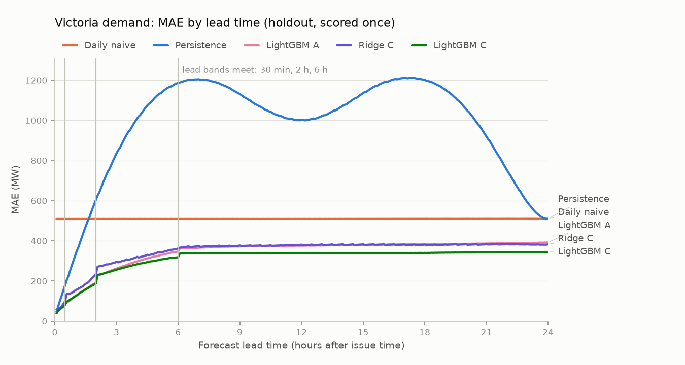
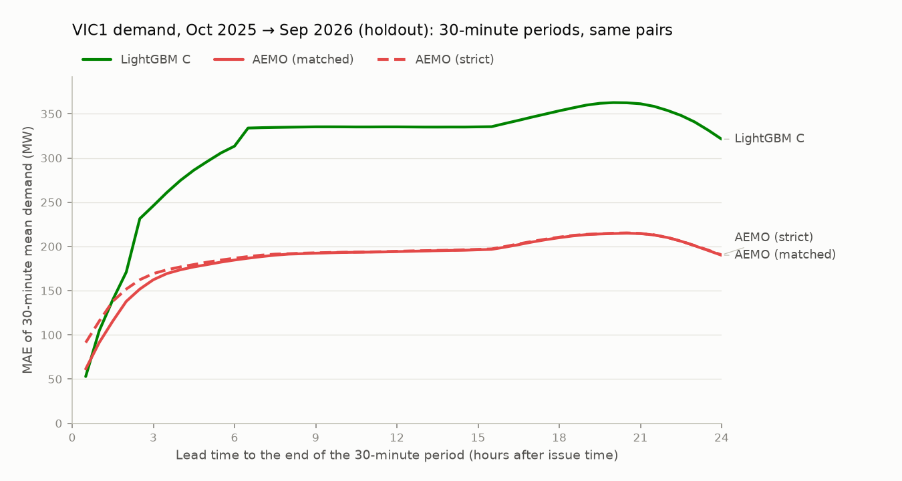

# Milestone 2: the holdout, scored once

> **Generated** by `gridcast report-holdout` on 2026-11-09 01:04 UTC from the stored holdout run (issue times 2025-10-01 → 2026-09-30, NEM time). Do not edit by hand. The model config was frozen before the AEMO benchmark and before any holdout scoring; this is the unbiased estimate of how the recipe performs.

## Summary

- **S5 passes:** the holdout was scored by one `evaluate-holdout` run of the frozen config, after it reproduced run 2's development forecasts exactly.
- **4 of 4 development criteria hold on the holdout** (replication, reported, not pass/fail).
- LightGBM C's pooled MAE is 312.0 MW on the holdout against 263.6 MW in development (+18.4%); the best baseline's mean MAE moved from 463.0 to 493.9 MW (+6.7%).
- LightGBM C's pooled bias (forecast − actual) is -104.1 MW on the holdout against -5.2 MW in development; see *Bias by month* (a diagnostic added after scoring).

## Provenance

| Item | Value |
| :--- | :--- |
| Region | VIC1 |
| Holdout batches | holdout_main `fcb6abb6-49a3-4923-9d79-64e05a44d75f`, holdout_plus `f3bb3bf7-ecbd-4adb-bb55-8602b31dad94`, holdout_delay `60da4e17-870a-48cb-88bf-e010a03f7549` |
| Run commit (recorded at the start of the run) | `a72408c80312457b132f1d84aeebb0986173228c` |
| ML config hash | `b88eae0a04e176af` = `backtest.frozen_ml_config_hash` (matches the current config) |
| Model and feature code frozen at | `96a6e50` (unchanged at the run) |
| Holdout issue times (NEM time) | 2025-10-01 00:00 → 2026-09-30 23:30, 17,520 (every 30 min) |
| Retrains forecasting the holdout | 5: 2025-08-01, 2025-11-01, 2026-02-01, 2026-05-01, 2026-08-01 (the first is the last development retrain) |
| Scored (issue time, lead) pairs, every model | 5,045,760 of 5,045,760 (0 excluded, 0.00%) |
| Training rows at the last retrain (shared by A, C, D) | 8,005,408 |
| Development reference (run 2) | main `6d783932-5834-4e18-a9e8-0e3567db46e6`, plus `94ea74a5-f644-46cf-8dce-dc82e8f13f11`, delay `358eeab3-29b6-4ef3-be14-0f2447799f58` |
| Market data after the MMSDM archive | 282 target intervals (2026-10-01) from NEMWeb's daily dispatch reports, loaded after a match check against MMSDM over 2026-09: 8,640 intervals compared, demand different at 0 (`docs/data_sources.md` §7) |
| Leakage property tests (run by this command) | 6 passed, 0 failed |
| Report generated from commit | `c32cb95d597b22ba1333fabe317c22388cbb89d5` |

## S5: holdout used once

| # | Pass if | Measured | Result |
| :--- | :--- | :--- | :--- |
| S5 | holdout scored by a single `gridcast evaluate-holdout` run against the frozen model config; the command refuses to run again for the same config hash | 3 holdout batch(es) stored for config `b88eae0a04e176af`, 3 evaluation set(s), from run commit(s) `a72408c`; reproduction check passed for every set; `evaluate-holdout` refuses while these batches exist | **PASS** |

**Reproduction check (step 6, decision 3).** The run started at the last development retrain and forecast its whole fold. Before any holdout pair was scored, its forecasts for the development issue times had to equal run 2's stored forecasts exactly (float32, NaN in the same places), and its fits had to match run 2's stored fit records (setting, tree count, rows, every candidate's early-stopping MAE):

| Set | Run 2 batch | Retrain | Models | Dev issue times | Forecasts per model | Fits | Result |
| :--- | :--- | :--- | ---: | ---: | ---: | ---: | :--- |
| holdout_main | `6d783932-5834-4e18-a9e8-0e3567db46e6` | 2025-08-01 | 6 | 2,928 | 843,264 | 24 | exact |
| holdout_plus | `94ea74a5-f644-46cf-8dce-dc82e8f13f11` | 2025-08-01 | 4 | 2,928 | 843,264 | 16 | exact |
| holdout_delay | `358eeab3-29b6-4ef3-be14-0f2447799f58` | 2025-08-01 | 2 | 2,928 | 843,264 | 8 | exact |

## Replication of S1–S4 on the holdout

Pre-registered on 2026-11-09, before the holdout run (m2_plan.md step 6, decision 4): S1–S4 are recomputed exactly as written in §3, by the same code as the development report, on the holdout pairs. They are reported, not pass/fail, and do not change the development verdicts. *Best baseline* is the lowest MAE among persistence, daily naive, weekly naive at each lead time.

| # | Pass if | Development (run 2) | Dev | Holdout | Holdout |
| :--- | :--- | :--- | :--- | :--- | :--- |
| S1 | MAE_C(h) < min over baselines of MAE(h), for every h from 2 h to 24 h | 265 of 265 lead times; closest at 24 h: 294.2 vs 476.7 MW | PASS | 265 of 265 lead times; closest at 24 h: 344.7 vs 509.7 MW | **holds** |
| S2 | pooled MAE_C < mean over h of (min over baselines of MAE(h)) | 263.6 vs 463.0 MW | PASS | 312.0 vs 493.9 MW | **holds** |
| S3 | pooled MAE_C < pooled MAE_A | 263.6 vs 327.0 MW | PASS | 312.0 vs 343.8 MW | **holds** |
| S4 | pooled MAE_D ≤ pooled MAE_C, and every leakage property test passes | 260.0 vs 263.6 MW; leakage tests 6 passed, 0 failed | PASS | 310.7 vs 312.0 MW; leakage tests 6 passed, 0 failed | **holds** |

**4 of 4 hold on the holdout.**

## Development vs holdout

Pooled MAE (MW) over every lead time. The periods differ (development: issue times Nov 2022 → Sep 2025; holdout: Oct 2025 → Sep 2026), so a change mixes how well the recipe generalises with how hard the period was; the baselines' change shows the latter.

| Model | Development | Holdout | Change |
| :--- | ---: | ---: | ---: |
| LightGBM C | 263.6 | 312.0 | +18.4% |
| LightGBM A | 327.0 | 343.8 | +5.1% |
| LightGBM D | 260.0 | 310.7 | +19.5% |
| Ridge C | 316.6 | 349.5 | +10.4% |
| Persistence | 935.4 | 970.7 | +3.8% |
| Daily naive | 476.7 | 509.3 | +6.8% |
| Weekly naive | 542.5 | 587.5 | +8.3% |
| Best baseline at each lead (mean) | 463.0 | 493.9 | +6.7% |

Mean of the per-lead MAE (MW) within each lead-time range:

| Lead time | C dev | C holdout | Best baseline dev | Best baseline holdout | C below best, dev | C below best, holdout |
| :--- | ---: | ---: | ---: | ---: | ---: | ---: |
| 5 min–1 h | 79.1 | 86.4 | 185.7 | 190.1 | 57% | 55% |
| 1 h 5 min–2 h | 142.4 | 160.2 | 439.3 | 459.0 | 68% | 65% |
| 2 h 5 min–6 h | 240.9 | 280.5 | 476.6 | 509.1 | 49% | 45% |
| 6 h 5 min–12 h | 282.2 | 338.4 | 476.6 | 509.1 | 41% | 34% |
| 12 h 5 min–24 h | 287.3 | 340.7 | 476.7 | 509.5 | 40% | 33% |

## MAE by lead time (holdout)

### MAE (MW)

| Model | 5 min | 30 min | 35 min | 1 h | 2 h | 2 h 5 min | 4 h | 6 h | 6 h 5 min | 12 h | 24 h | All horizons |
| :--- | ---: | ---: | ---: | ---: | ---: | ---: | ---: | ---: | ---: | ---: | ---: | ---: |
| LightGBM A | 39.2 | 82.5 | **93.8** | 124.2 | 192.3 | 226.4 | 297.4 | 346.8 | 361.9 | 376.1 | 392.0 | 343.8 |
| LightGBM C | **39.1** | 81.6 | 98.0 | 125.4 | 188.1 | 230.8 | 283.4 | 318.4 | 336.9 | 338.6 | **344.7** | 312.0 |
| LightGBM D | 39.3 | **81.3** | 95.7 | **123.0** | **183.9** | **225.1** | **275.1** | **309.1** | **336.7** | **338.4** | 345.4 | **310.7** |
| Ridge A | 57.3 | 100.8 | 133.6 | 154.7 | 246.0 | 281.6 | 345.1 | 397.4 | 395.2 | 413.4 | 416.9 | 378.0 |
| Ridge C | 57.7 | 100.2 | 136.1 | 153.9 | 235.4 | 271.8 | 320.2 | 362.0 | 366.2 | 381.2 | 382.1 | 349.5 |
| Ridge D | 57.8 | 100.1 | 135.9 | 154.0 | 235.2 | 273.1 | 321.8 | 364.8 | 368.7 | 382.4 | 382.1 | 350.8 |
| Persistence | 46.7 | 179.3 | 204.9 | 328.8 | 604.6 | 626.1 | 1,008.8 | 1,186.9 | 1,188.2 | 1,001.7 | 509.7 | 970.7 |
| Daily naive | 508.9 | 509.0 | 508.9 | 509.0 | 509.0 | 509.0 | 509.0 | 509.0 | 509.0 | 509.0 | 509.7 | 509.3 |
| Weekly naive | 587.3 | 587.2 | 587.3 | 587.2 | 587.3 | 587.3 | 587.3 | 587.3 | 587.4 | 587.8 | 589.0 | 587.5 |

### RMSE (MW)

| Model | 5 min | 30 min | 35 min | 1 h | 2 h | 2 h 5 min | 4 h | 6 h | 6 h 5 min | 12 h | 24 h | All horizons |
| :--- | ---: | ---: | ---: | ---: | ---: | ---: | ---: | ---: | ---: | ---: | ---: | ---: |
| LightGBM A | 52.1 | 117.6 | **134.3** | 181.3 | 282.7 | 333.5 | 444.7 | 515.1 | 539.0 | 562.0 | 592.1 | 525.8 |
| LightGBM C | **51.9** | 116.2 | 140.4 | 181.9 | 272.3 | 340.9 | 422.0 | 468.9 | 490.1 | 492.0 | 499.5 | 463.1 |
| LightGBM D | 52.0 | **115.8** | 136.1 | **177.9** | **265.6** | **328.5** | **407.8** | **454.3** | **485.1** | **487.7** | **498.9** | **459.0** |
| Ridge A | 73.6 | 137.3 | 177.6 | 214.7 | 342.8 | 387.8 | 487.4 | 562.2 | 564.0 | 587.3 | 596.0 | 549.1 |
| Ridge C | 73.8 | 136.3 | 180.3 | 212.3 | 327.1 | 375.2 | 446.7 | 504.7 | 511.6 | 529.1 | 532.8 | 496.5 |
| Ridge D | 73.9 | 136.3 | 180.0 | 212.7 | 327.2 | 376.3 | 448.6 | 506.1 | 513.6 | 531.1 | 533.2 | 498.2 |
| Persistence | 60.7 | 225.9 | 257.6 | 414.1 | 752.5 | 778.0 | 1,224.7 | 1,433.4 | 1,435.2 | 1,229.6 | 754.5 | 1,236.6 |
| Daily naive | 754.2 | 754.2 | 754.2 | 754.2 | 754.2 | 754.2 | 754.2 | 754.2 | 754.2 | 754.2 | 754.5 | 754.6 |
| Weekly naive | 878.7 | 878.8 | 878.7 | 878.8 | 878.8 | 878.7 | 878.8 | 878.8 | 878.7 | 879.5 | 881.0 | 879.5 |

### Bias (MW, forecast − actual)

| Model | 5 min | 30 min | 35 min | 1 h | 2 h | 2 h 5 min | 4 h | 6 h | 6 h 5 min | 12 h | 24 h | All horizons |
| :--- | ---: | ---: | ---: | ---: | ---: | ---: | ---: | ---: | ---: | ---: | ---: | ---: |
| LightGBM A | 0.8 | -4.0 | -5.1 | -10.0 | -15.3 | -31.0 | -33.4 | -33.5 | -46.0 | -47.2 | -51.6 | -42.7 |
| LightGBM C | -1.2 | -7.4 | -22.6 | -28.6 | -43.4 | -83.2 | -93.3 | -97.2 | -113.8 | -113.9 | -116.1 | -104.1 |
| LightGBM D | -1.8 | -8.9 | -23.3 | -29.7 | -41.8 | -81.7 | -88.5 | -89.5 | -123.8 | -124.1 | -126.0 | -110.7 |
| Ridge A | 0.2 | -1.3 | -10.8 | -11.7 | -12.1 | -33.5 | -35.3 | -36.0 | -68.5 | -72.3 | -72.2 | -61.3 |
| Ridge C | -2.5 | -4.1 | -25.2 | -26.1 | -26.4 | -67.9 | -69.6 | -70.0 | -111.1 | -116.5 | -116.7 | -100.9 |
| Ridge D | -2.1 | -3.7 | -23.1 | -23.9 | -24.3 | -63.7 | -65.3 | -65.8 | -105.1 | -109.7 | -108.6 | -94.9 |
| Persistence | 1.6 | -0.0 | 1.5 | -0.0 | -0.1 | 1.5 | -0.1 | -0.2 | 1.4 | -0.8 | -2.5 | -3.0 |
| Daily naive | -0.8 | -0.8 | -0.8 | -0.8 | -0.8 | -0.8 | -0.8 | -0.9 | -0.9 | -1.5 | -2.5 | -1.5 |
| Weekly naive | -4.2 | -4.2 | -4.1 | -4.2 | -4.2 | -4.1 | -4.1 | -4.1 | -4.0 | -4.8 | -6.8 | -5.1 |

## Short lead times and the band boundaries (holdout)

- At 5 min, LightGBM C's MAE is 39.1 MW against 46.7 MW for persistence; LightGBM C is better from 5 min on.
- Between 30 min and 35 min (a band boundary), LightGBM C's MAE changes by +16.4 MW, against a median step of 0.4 MW between neighbouring lead times elsewhere.
- Between 2 h and 2 h 5 min (a band boundary), LightGBM C's MAE changes by +42.7 MW, against a median step of 0.4 MW between neighbouring lead times elsewhere.
- Between 6 h and 6 h 5 min (a band boundary), LightGBM C's MAE changes by +18.5 MW, against a median step of 0.4 MW between neighbouring lead times elsewhere.

## Weather value by lead time (holdout)

Mean of the per-lead MAE within each lead-time range (MW). The delay column comes from the delay batch, on its own common pairs.

| Lead time | LightGBM A | LightGBM C | LightGBM D | C vs A (%) | C − D (MW) | 8 h delay − C (MW) |
| :--- | ---: | ---: | ---: | ---: | ---: | ---: |
| 5 min–1 h | 85.3 | 86.4 | 85.3 | +1.3 | +1.2 | +0.0 |
| 1 h 5 min–2 h | 161.8 | 160.2 | 156.5 | -1.0 | +3.7 | +0.0 |
| 2 h 5 min–6 h | 294.3 | 280.5 | 272.6 | -4.7 | +7.9 | +0.0 |
| 6 h 5 min–12 h | 371.1 | 338.4 | 337.6 | -8.8 | +0.8 | +2.5 |
| 12 h 5 min–24 h | 383.3 | 340.7 | 341.7 | -11.1 | -0.9 | +3.0 |

## C⁺ and D⁺: all forecast weather variables (holdout, reported, not pass/fail)

C⁺ and D⁺ next to headline C on their common pairs (5,045,760).

| Model | 5 min | 30 min | 35 min | 1 h | 2 h | 2 h 5 min | 4 h | 6 h | 6 h 5 min | 12 h | 24 h | All horizons |
| :--- | ---: | ---: | ---: | ---: | ---: | ---: | ---: | ---: | ---: | ---: | ---: | ---: |
| LightGBM C⁺ | 39.2 | 80.5 | **92.2** | 117.1 | 170.0 | 219.0 | 249.2 | 271.6 | 287.7 | 289.9 | 300.4 | 270.1 |
| LightGBM D⁺ | 39.3 | **79.7** | 92.3 | **115.2** | **162.8** | **199.3** | **222.9** | **242.7** | **261.4** | **262.2** | **268.9** | **244.2** |
| LightGBM C | **39.1** | 81.6 | 98.0 | 125.4 | 188.1 | 230.8 | 283.4 | 318.4 | 336.9 | 338.6 | 344.7 | 312.0 |
| Ridge C⁺ | 60.8 | 99.0 | 143.5 | 152.0 | 216.0 | 257.3 | 280.1 | 299.4 | 315.1 | 318.7 | 326.3 | 298.1 |
| Ridge D⁺ | 61.1 | 98.8 | 145.9 | 152.7 | 211.6 | 248.7 | 265.2 | 279.4 | 295.5 | 298.8 | 302.4 | 279.7 |
| Ridge C | 57.7 | 100.2 | 136.1 | 153.9 | 235.4 | 271.8 | 320.2 | 362.0 | 366.2 | 381.2 | 382.1 | 349.5 |
| Persistence | 46.7 | 179.3 | 204.9 | 328.8 | 604.6 | 626.1 | 1,008.8 | 1,186.9 | 1,188.2 | 1,001.7 | 509.7 | 970.7 |
| Daily naive | 508.9 | 509.0 | 508.9 | 509.0 | 509.0 | 509.0 | 509.0 | 509.0 | 509.0 | 509.0 | 509.7 | 509.3 |
| Weekly naive | 587.3 | 587.2 | 587.3 | 587.2 | 587.3 | 587.3 | 587.3 | 587.3 | 587.4 | 587.8 | 589.0 | 587.5 |

## Publication-delay sensitivity (holdout, never the headline)

C rebuilt as if every GFS run were published 8 h after its run time (headline: 6 h), with headline C's chosen settings at every retrain.

| Model | 5 min | 30 min | 35 min | 1 h | 2 h | 2 h 5 min | 4 h | 6 h | 6 h 5 min | 12 h | 24 h | All horizons |
| :--- | ---: | ---: | ---: | ---: | ---: | ---: | ---: | ---: | ---: | ---: | ---: | ---: |
| LightGBM C | **39.1** | **81.6** | **98.0** | **125.4** | **188.1** | **230.8** | **283.4** | **318.4** | **336.9** | **338.6** | **344.7** | **312.0** |
| Ridge C | 57.7 | 100.2 | 136.1 | 153.9 | 235.4 | 271.8 | 320.2 | 362.0 | 366.2 | 381.2 | 382.1 | 349.5 |
| LightGBM C (8 h delay) | **39.1** | **81.6** | **98.0** | **125.4** | **188.1** | **230.8** | **283.4** | **318.4** | 339.5 | 341.3 | 347.4 | 314.1 |
| Ridge C (8 h delay) | 57.7 | 100.2 | 136.1 | 153.9 | 235.4 | 271.8 | 320.2 | 362.0 | 366.7 | 380.7 | 382.9 | 349.8 |

## Errors by quarter (holdout)

Pooled MAE (MW) by NEM-time quarter of the issue time.

| Quarter | Pairs | LightGBM A | LightGBM C | LightGBM D | Ridge C | Daily naive | C − D |
| :--- | ---: | ---: | ---: | ---: | ---: | ---: | ---: |
| 2025 Q4 | 1,271,808 | 377.4 | 315.8 | 321.2 | 364.7 | 537.1 | -5.4 |
| 2026 Q1 | 1,244,160 | 396.8 | 317.4 | 318.7 | 399.2 | 625.6 | -1.3 |
| 2026 Q2 | 1,257,984 | 268.7 | 284.0 | 291.5 | 281.1 | 388.8 | -7.4 |
| 2026 Q3 | 1,271,808 | 332.6 | 330.5 | 311.5 | 353.4 | 486.8 | +18.9 |

## Bias by month (diagnostic, added after scoring)

Added to this report after the holdout was scored, to locate its largest change from development: LightGBM C's bias. It reads the same stored forecasts; nothing was re-run, re-selected or re-scored. Rows: the last development year (run 2) and the holdout, by NEM-time month of the issue time, all lead times pooled on each batch's common pairs. *Mean actual* is the mean demand over the month's scored pairs. Bias is forecast − actual (MW).

| Issue month | Period | Pairs | Mean actual (MW) | Bias LightGBM C | Bias LightGBM A | Bias LightGBM D | Bias Daily naive | MAE LightGBM C |
| :--- | :--- | ---: | ---: | ---: | ---: | ---: | ---: | ---: |
| Oct 2024 | development | 428,544 | 4,136.7 | +48.0 | +104.3 | +64.4 | +3.6 | 281.3 |
| Nov 2024 | development | 414,720 | 4,229.9 | -46.9 | -36.0 | -15.4 | +10.0 | 329.6 |
| Dec 2024 | development | 428,544 | 4,101.3 | +20.6 | +15.8 | +65.4 | +14.6 | 370.6 |
| Jan 2025 | development | 428,544 | 4,423.0 | +0.9 | +62.6 | +39.5 | -23.9 | 339.6 |
| Feb 2025 | development | 387,072 | 4,824.7 | -88.0 | -149.8 | -60.0 | -5.7 | 373.7 |
| Mar 2025 | development | 428,544 | 4,686.4 | +0.4 | +4.9 | -1.7 | +8.1 | 305.4 |
| Apr 2025 | development | 414,720 | 4,466.4 | -35.2 | +23.2 | -25.8 | -21.3 | 227.5 |
| May 2025 | development | 428,544 | 5,035.0 | -16.1 | +64.5 | -28.3 | -4.3 | 214.7 |
| Jun 2025 | development | 414,720 | 5,892.6 | -110.6 | -70.0 | -110.0 | -43.9 | 222.4 |
| Jul 2025 | development | 428,544 | 5,941.9 | -104.5 | -38.0 | -146.5 | +1.0 | 292.7 |
| Aug 2025 | development | 428,544 | 5,538.5 | -45.2 | -52.6 | -47.6 | +32.7 | 277.4 |
| Sep 2025 | development | 414,720 | 4,810.4 | -65.6 | -3.3 | -68.7 | +12.2 | 308.2 |
| Oct 2025 | holdout | 428,544 | 4,431.6 | -89.4 | -18.5 | -70.7 | +15.8 | 314.7 |
| Nov 2025 | holdout | 414,720 | 4,345.4 | -44.8 | +0.6 | -45.8 | +4.8 | 276.4 |
| Dec 2025 | holdout | 428,544 | 4,170.0 | +59.8 | +52.5 | +53.3 | +28.4 | 355.0 |
| Jan 2026 | holdout | 428,544 | 4,629.0 | -85.0 | -88.1 | -99.5 | -38.1 | 345.0 |
| Feb 2026 | holdout | 387,072 | 4,706.8 | -70.7 | -11.1 | -65.4 | -17.5 | 338.0 |
| Mar 2026 | holdout | 428,544 | 4,682.3 | -109.4 | -21.1 | -121.1 | +6.3 | 271.3 |
| Apr 2026 | holdout | 414,720 | 4,652.4 | -54.0 | +25.4 | -61.0 | +5.0 | 225.1 |
| May 2026 | holdout | 428,544 | 5,325.9 | -200.2 | -92.4 | -223.0 | -34.3 | 274.0 |
| Jun 2026 | holdout | 414,720 | 5,932.2 | -307.3 | -77.7 | -314.8 | -16.9 | 353.3 |
| Jul 2026 | holdout | 428,544 | 6,384.3 | -304.2 | -172.1 | -229.7 | -7.2 | 355.5 |
| Aug 2026 | holdout | 428,544 | 5,872.9 | -17.3 | -58.5 | -86.4 | +40.6 | 313.9 |
| Sep 2026 | holdout | 414,720 | 4,987.5 | -23.9 | -46.0 | -60.7 | -6.9 | 321.8 |

- LightGBM C's most negative monthly bias in the holdout is Jun 2026 (-307.3 MW; LightGBM A -77.7 MW, LightGBM D -314.8 MW, Daily naive -16.9 MW).
- In development (every issue month, Nov 2022 → Sep 2025), its most negative was Jun 2024 (-172.6 MW).
- The highest mean actual demand of any holdout month is Jul 2026 (6,384.3 MW); of any development month, Jul 2025 (5,941.9 MW). The holdout month is higher than every development month.

## Model selection at the holdout retrains

LightGBM C, per retrain and lead band: the winning setting and the best early-stopping MAE each target form reached. Retrains inside the holdout select on their own last 8 weeks, which lie in the holdout period, as an operational retrain would.

| Retrain | Lead band | Chosen | Trees | Best residual (MW) | Best direct (MW) | Best anchored (MW) | Best latest (MW) |
| :--- | :--- | :--- | ---: | ---: | ---: | ---: | ---: |
| 2025-08-01 | 5 min–30 min | latest, L1, 31 leaves | 1479 | 69.4 | 63.2 | 68.4 | **59.9** |
| 2025-08-01 | 35 min–2 h | latest, L1, 127 leaves | 1131 | 145.8 | 138.4 | 144.4 | **128.6** |
| 2025-08-01 | 2 h 5 min–6 h | latest, L1, 127 leaves | 678 | 239.4 | 238.1 | 239.0 | **237.4** |
| 2025-08-01 | 6 h 5 min–24 h | anchored, L1, 31 leaves | 730 | 278.7 | 278.4 | **276.4** | 281.3 |
| 2025-11-01 | 5 min–30 min | latest, L1, 127 leaves | 465 | 74.8 | 69.9 | 76.0 | **68.5** |
| 2025-11-01 | 35 min–2 h | latest, L1, 31 leaves | 2349 | 163.2 | 157.9 | 163.0 | **157.8** |
| 2025-11-01 | 2 h 5 min–6 h | latest, L1, 31 leaves | 1773 | 285.6 | 284.1 | 287.9 | **277.0** |
| 2025-11-01 | 6 h 5 min–24 h | direct, L1, 31 leaves | 546 | 331.7 | **321.1** | 335.8 | 325.6 |
| 2026-02-01 | 5 min–30 min | latest, L1, 127 leaves | 592 | 73.2 | 66.9 | 66.1 | **54.5** |
| 2026-02-01 | 35 min–2 h | latest, L1, 127 leaves | 585 | 147.0 | 141.8 | 146.1 | **130.3** |
| 2026-02-01 | 2 h 5 min–6 h | latest, L1, 31 leaves | 1429 | 287.4 | 293.4 | 287.9 | **274.2** |
| 2026-02-01 | 6 h 5 min–24 h | residual, L1, 31 leaves | 516 | **375.0** | 378.0 | 394.9 | 376.0 |
| 2026-05-01 | 5 min–30 min | latest, L1, 127 leaves | 1465 | 61.6 | 59.6 | 62.0 | **58.8** |
| 2026-05-01 | 35 min–2 h | direct, L1, 127 leaves | 830 | 123.1 | **121.5** | 123.9 | 122.3 |
| 2026-05-01 | 2 h 5 min–6 h | residual, L2, 31 leaves | 1215 | **212.4** | 215.7 | 214.2 | 213.7 |
| 2026-05-01 | 6 h 5 min–24 h | residual, L2, 127 leaves | 182 | **252.1** | 256.0 | 252.6 | 260.4 |
| 2026-08-01 | 5 min–30 min | latest, L1, 127 leaves | 388 | 73.8 | 76.7 | 72.7 | **64.2** |
| 2026-08-01 | 35 min–2 h | latest, L1, 127 leaves | 243 | 160.1 | 167.8 | 158.2 | **152.4** |
| 2026-08-01 | 2 h 5 min–6 h | residual, L1, 31 leaves | 77 | **275.0** | 319.5 | 276.2 | 334.4 |
| 2026-08-01 | 6 h 5 min–24 h | residual, L2, 31 leaves | 64 | **314.4** | 384.6 | 324.6 | 375.2 |

## MAE (MW) by segment, all lead times pooled (holdout)

Segments are defined by what actually happened (*ex-post*).

| Segment | Pairs | LightGBM A | LightGBM C | LightGBM D | Ridge C | Persistence | Daily naive |
| :--- | ---: | ---: | ---: | ---: | ---: | ---: | ---: |
| All target intervals | 5,045,760 | 343.8 | 312.0 | **310.7** | 349.5 | 970.7 | 509.3 |
| Working days (not weekend or public holiday) | 3,469,824 | 349.5 | **308.7** | 312.0 | 354.5 | 972.1 | 496.0 |
| Evening peak (local 17:00-21:00) | 840,960 | 350.6 | 284.9 | **282.7** | 340.0 | 1,204.4 | 520.9 |
| Saturday/Sunday | 1,437,696 | 327.9 | 319.5 | **308.7** | 336.4 | 972.5 | 541.2 |
| Victorian public holidays | 180,288 | 333.4 | 285.7 | **277.9** | 321.2 | 928.4 | 481.9 |
| Local days when clocks change (23 h / 25 h days) | 27,648 | 367.8 | 294.9 | 328.3 | **285.8** | 908.8 | 509.6 |
| No price spike, negative price or market intervention | 3,735,506 | 309.2 | 294.9 | **294.0** | 327.8 | 955.5 | 465.7 |
| Realised price > $300/MWh (ex-post) | 10,272 | 1,430.0 | 676.5 | 697.9 | **622.7** | 2,031.3 | 1,298.5 |
| Realised price < $0/MWh (ex-post) | 1,299,982 | 434.7 | 358.1 | **355.8** | 409.8 | 1,006.0 | 628.1 |
| Administered pricing or market suspension (ex-post) | 0 | – | – | – | – | – | – |
| Local days whose weighted ERA5 maximum temperature is at least 35 °C (ex-post) | 69,120 | 1,024.2 | **443.1** | 468.2 | 562.7 | 1,493.0 | 1,251.4 |
| Local days whose weighted ERA5 cloud cover averages at least 80% over 09:00-17:00 local (ex-post) | 1,969,200 | 347.3 | **339.9** | 348.4 | 365.4 | 872.4 | 509.7 |

## Failure cases

The 10 local days with the highest LightGBM C MAE at lead times 2 h–24 h (S1's range), among days with at least 90% of the usual number of scored pairs (364 of 366 days). Bias is forecast − actual. *C temp forecast error* is the mean absolute difference between C's forecast temperature and ERA5 on that day's pairs.

| Rank | Local date | Day | MAE LightGBM C | MAE LightGBM A | MAE Daily naive | Bias C (MW) | ERA5 max temp (°C) | C temp forecast error (°C) |
| ---: | :--- | :--- | ---: | ---: | ---: | ---: | ---: | ---: |
| 1 | 2026-08-09 | Sunday | 1,039.1 | 1,063.5 | 1,108.1 | -904 | 12.8 | 0.6 |
| 2 | 2026-01-10 | Saturday | 810.3 | 613.7 | 2,383.0 | +771 | 25.0 | 1.6 |
| 3 | 2026-07-07 | Tuesday | 749.1 | 904.3 | 677.1 | -749 | 10.0 | 1.8 |
| 4 | 2025-12-25 | Christmas Day | 717.5 | 654.5 | 694.9 | +713 | 16.5 | 0.5 |
| 5 | 2026-03-16 | Monday | 695.3 | 538.5 | 1,139.5 | -695 | 19.1 | 1.2 |
| 6 | 2026-05-17 | Sunday | 688.5 | 577.5 | 591.1 | -688 | 17.1 | 0.6 |
| 7 | 2026-01-27 | Tuesday | 686.2 | 1,885.5 | 1,994.4 | -623 | 40.5 | 2.8 |
| 8 | 2026-09-30 | Wednesday | 685.0 | 627.8 | 730.8 | -562 | 22.8 | 0.7 |
| 9 | 2026-01-30 | Friday | 682.8 | 809.0 | 772.3 | -681 | 30.5 | 0.7 |
| 10 | 2026-02-18 | Wednesday | 650.8 | 722.9 | 1,384.6 | +407 | 24.0 | 1.1 |

## AEMO benchmark, holdout part

The step-5 comparison (`reports/m2_aemo.md`) repeated on the holdout issue times, with the same alignments (matched is the headline; strict is the latest run published by the issue time), the same pairs rule and the same day-block bootstrap (2,000 draws, seed `ml.seed`). AEMO's forecasts are a benchmark only, not pass/fail. AEMO (matched) covers every issue time up to 16 h ahead; longer leads cover fewer issue times.

### MAE (MW) of 30-minute mean demand, holdout

| Lead | AEMO (matched) | AEMO (strict) | LightGBM C | LightGBM A | LightGBM D | Ridge C | Best baseline | Pairs |
| :--- | ---: | ---: | ---: | ---: | ---: | ---: | ---: | ---: |
| 30 min | 61.4 | 91.3 | 52.9 | 53.6 | 52.7 | 60.0 | 108.4 (Persistence) | 17,520 |
| 1 h | 91.3 | 115.5 | 104.6 | 102.0 | 102.4 | 134.7 | 263.8 (Persistence) | 17,520 |
| 2 h | 137.9 | 151.8 | 171.0 | 174.3 | 166.8 | 207.1 | 506.0 (Daily naive) | 17,520 |
| 4 h | 173.6 | 176.9 | 274.6 | 286.9 | 266.5 | 308.8 | 506.0 (Daily naive) | 17,520 |
| 6 h | 184.6 | 186.7 | 313.4 | 339.8 | 303.9 | 354.6 | 506.0 (Daily naive) | 17,520 |
| 12 h | 194.1 | 194.5 | 335.2 | 372.5 | 334.9 | 376.2 | 506.0 (Daily naive) | 17,520 |
| 18 h | 209.9 | 210.5 | 353.4 | 399.4 | 356.0 | 395.8 | 528.5 (Daily naive) | 15,695 |
| 24 h | 190.0 | 190.4 | 321.3 | 374.4 | 325.1 | 365.4 | 463.2 (Daily naive) | 11,315 |
| **All leads (pooled)** | **185.7** | **188.9** | **309.9** | **342.1** | **309.1** | **348.3** | 508.3 (Daily naive) |  |

- LightGBM C has a lower MAE than AEMO (matched) at 1 of 48 leads; AEMO (matched) is as good or better at: 1 h–24 h.
- Against AEMO (strict), LightGBM C is lower at 2 of 48 leads.

### Pooled difference (MW, A − B, 95% day-block interval), development vs holdout

| Forecast A | Forecast B | Development | Holdout | Holdout pairs | Holdout days |
| :--- | :--- | ---: | ---: | ---: | ---: |
| LightGBM C | AEMO (matched) | +119.1 (+110.1 to +128.7) | +124.2 (+113.4 to +135.1) | 785,115 | 365 |
| LightGBM C | AEMO (strict) | +116.4 (+107.3 to +125.9) | +121.0 (+110.2 to +132.0) | 785,115 | 365 |
| LightGBM C | AEMO 5-min pre-dispatch | -5.2 (-6.4 to -4.1) | -5.2 (-7.1 to -3.4) | 192,720 | 365 |

- Holdout, LightGBM C vs AEMO (matched): AEMO (matched) is more accurate (the interval excludes zero).
- Holdout, LightGBM C vs AEMO (strict): AEMO (strict) is more accurate (the interval excludes zero).
- Holdout, LightGBM C vs AEMO 5-min pre-dispatch: LightGBM C is more accurate (the interval excludes zero).

### By quarter of the issue time (all leads pooled, MAE in MW)

| Issue quarter (NEM time) | LightGBM C | AEMO (matched) | AEMO (strict) | Pairs |
| :--- | ---: | ---: | ---: | ---: |
| 2025 Q4 | 311.7 | 205.5 | 208.9 | 197,892 |
| 2026 Q1 | 317.1 | 190.4 | 193.8 | 193,590 |
| 2026 Q2 | 282.2 | 152.5 | 155.1 | 195,741 |
| 2026 Q3 | 328.6 | 194.1 | 197.4 | 197,892 |

### 5-minute pre-dispatch vs our forecasts (leads 5–55 minutes), holdout

| Lead | AEMO 5-min pre-dispatch | LightGBM C | Persistence | Pairs |
| :--- | ---: | ---: | ---: | ---: |
| 5 min | 38.4 | 39.1 | 46.7 | 17,520 |
| 10 min | 54.9 | 51.9 | 74.6 | 17,520 |
| 15 min | 63.8 | 58.9 | 102.0 | 17,520 |
| 20 min | 72.0 | 65.9 | 127.1 | 17,520 |
| 25 min | 80.9 | 73.2 | 153.7 | 17,520 |
| 30 min | 89.5 | 81.6 | 179.3 | 17,520 |
| 35 min | 97.0 | 98.0 | 204.9 | 17,520 |
| 40 min | 105.7 | 102.0 | 226.5 | 17,520 |
| 45 min | 114.3 | 107.9 | 253.9 | 17,520 |
| 50 min | 122.5 | 113.8 | 279.3 | 17,520 |
| 55 min | 130.4 | 119.4 | 304.6 | 17,520 |
| **All (pooled)** | **88.1** | **82.9** | **177.5** |  |

- LightGBM C has a lower MAE than AEMO 5-minute pre-dispatch at 9 of 11 leads; AEMO is as good or better at: 5 min, 35 min.

## Notes and limitations

- **One look.** The holdout is scored once (S5). A bug found later is disclosed and its effect reported; the holdout is not re-run to fix it.
- **Development numbers are slightly optimistic.** The development period was looked at twice (two development runs, `reports/m2_demand.md`); these holdout numbers are not.
- **Added after scoring:** *Bias by month* and the bias line of the *Summary* were added to this report after the holdout had been scored and read, to locate its largest change from development. They read the stored forecasts only.
- **Retrains inside the holdout** select their settings on their own last weeks, which lie in the holdout period. An operational retrain would do the same; no forecast uses data after its issue time.
- **Split by issue time** (as in M1): development issue times on the last day before the holdout have targets on its first day. Those actuals were used to score the development period, never to fit a model.
- **282 target intervals** come from NEMWeb's daily dispatch reports, because the monthly MMSDM archive for that month was not yet published (see *Provenance*).
- S1–S4 replications judge LightGBM C only; ridge, C⁺/D⁺, the delay check, AEMO and lead times under 2 h are reported, not pass/fail.
- LightGBM A and LightGBM D use the same retrains and pairs as C, so C − A is the value of forecast temperature and C − D the cost of its error.
