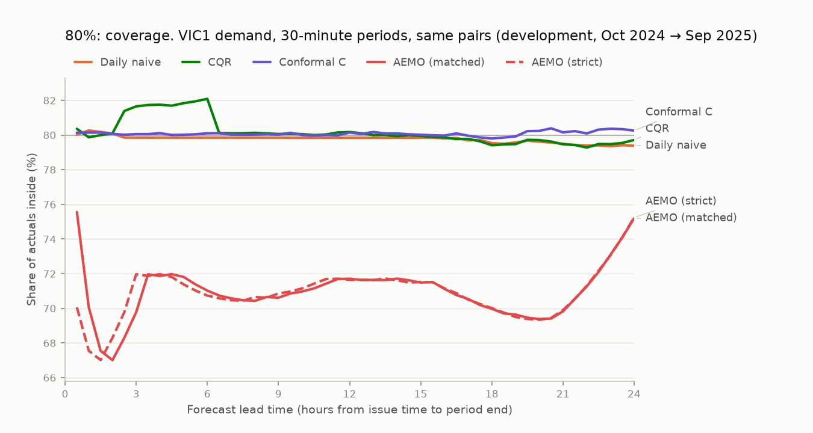
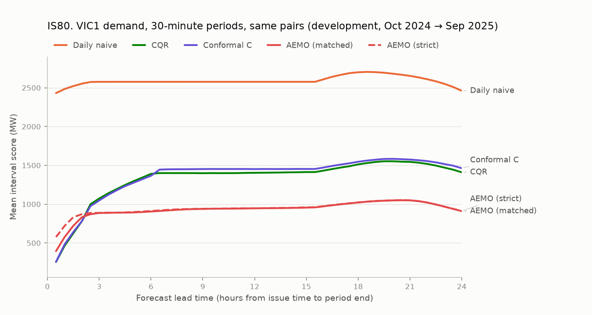

# Milestone 3: our intervals against AEMO's POE band (development part)

*Generated by `gridcast report-m3-aemo` from the stored half-hour interval batch and AEMO's archived PDPASA runs. Do not edit by hand.*

AEMO publishes probabilistic demand forecasts in pre-dispatch PASA (`PDPASA_REGIONSOLUTION`): for every 30-minute period up to the end of the next trading day, demand with a 10%, 50% and 90% probability of exceedance (POE). Its POE90–POE10 range is an 80% band. This report compares that band with GridCast's 80% prediction intervals over the development part of the benchmark window. AEMO's band is a benchmark only, never a model input, and the comparison is not pass/fail (m3_plan.md §3). The interval recipe was frozen before AEMO's band was loaded for this comparison, so nothing here can change it. The holdout part (Oct 2025 → Sep 2026) is compared once, in step 6.

## Summary

- **Coverage:** AEMO's band (matched) contains 70.9% of actual 30-minute demand; our CQR 80% interval contains 80.2%. An 80% interval should contain 80%.
- **Width:** AEMO's band is 433.3 MW wide on average, CQR's 961.0 MW.
- **Interval score** (lower is better; width plus a penalty for each miss): AEMO 925.7 MW, CQR 1,321.5 MW, so CQR's is higher than AEMO's (+395.8 MW, 95% interval +348.8 to +444.4 MW). CQR scores better at 4 of 48 lead times.

## Provenance

| Item | Value |
| :--- | :--- |
| Region | VIC1 |
| Our intervals | half-hour batch `27aa78d6-8ab8-4509-aa40-d8b08cda68ea` (runs CQR 91, Conformal C 87, Persistence 88, Daily naive 89, Weekly naive 90) |
| Built from commit | `bc5337efa9bd0d0f2a1dfa6a17d58058b5781a6a` |
| Interval recipe | `d34273400899af69` = frozen (`intervals.frozen_config_hash`); QR recipe `8767a8948966637c` = frozen; frozen code at `bc5337e` |
| Issue times compared (NEM time) | 2024-10-01 00:00 → 2025-09-30 23:30, 17,520, every 30 min |
| AEMO PDPASA `LOR` runs in the window | 17,519 of 17,520 |
| Strict alignment: run used | 17,519 × 30 min, 1 × 60 min before the issue time |
| Stored metrics recomputed | 25 pooled 80% statistics of 5 runs (all equal) |
| Report generated from commit | `526f0485cf230deced2f94afae101fec76f261a2` |

## How the intervals are lined up

- **Our intervals** are issued every 30 minutes. AEMO's band is for 30-minute means, and the mean of six 5-minute quantiles is not a quantile of the mean, so the comparison uses our intervals recalibrated on half-hour periods: the frozen recipe (calibration windows, time-of-day blocks, ACI, per-retrain selection) applied to the period means of the actuals, the point forecasts and the QR quantiles. A period counts only if all six of its 5-minute pairs are scored. Lead time runs from our issue time to the end of the period.
- **AEMO (matched)**, the headline: the PDPASA run whose nominal run time is our issue time, so both use information up to the same moment; AEMO publishes it 4–7 minutes later. A run's nominal time is 30 minutes before its `RUN_DATETIME` (step 0).
- **AEMO (strict)**: the latest run already published at our issue time, normally the one from 30 minutes earlier.
- **Re-centred** (sensitivity): the same half-width around the `TOTALDEMAND` of the pre-dispatch run with the same nominal run time, instead of `DEMAND50`.
- Every interval is scored on the **same (issue time, period) pairs**: our scored periods where all four AEMO bands exist. Runs end at the end of the next trading day, so long leads cover fewer issue times:

| Period ends | AEMO (matched) available | AEMO (strict) available | Scored |
| :--- | ---: | ---: | ---: |
| 30 min | 100.0% | 100.0% | 100.0% |
| 1 h | 100.0% | 100.0% | 100.0% |
| 2 h | 100.0% | 100.0% | 100.0% |
| 4 h | 100.0% | 100.0% | 100.0% |
| 6 h | 100.0% | 100.0% | 100.0% |
| 12 h | 100.0% | 100.0% | 100.0% |
| 18 h | 91.7% | 89.6% | 89.6% |
| 24 h | 66.7% | 64.6% | 64.6% |

## Coverage

### Share of actual demand inside the 80% interval (%)

| Period ends | AEMO (matched) | AEMO (strict) | CQR | Conformal C | Best baseline | Pairs |
| :--- | ---: | ---: | ---: | ---: | ---: | ---: |
| 30 min | 75.6 | 70.1 | 80.4 | 80.1 | 80.4 (Persistence) | 17,519 |
| 1 h | 70.1 | 67.6 | 79.9 | 80.1 | 80.6 (Persistence) | 17,519 |
| 2 h | 67.0 | 68.3 | 80.1 | 80.1 | 80.2 (Persistence) | 17,519 |
| 4 h | 71.9 | 72.0 | 81.8 | 80.1 | 79.5 (Persistence) | 17,519 |
| 6 h | 71.0 | 70.7 | 82.1 | 80.1 | 79.9 (Daily naive) | 17,519 |
| 12 h | 71.7 | 71.6 | 80.2 | 80.1 | 79.8 (Daily naive) | 17,519 |
| 18 h | 70.0 | 70.0 | 79.4 | 79.8 | 79.5 (Daily naive) | 15,694 |
| 24 h | 75.2 | 75.2 | 79.7 | 80.3 | 80.2 (Persistence) | 11,314 |
| **All periods (pooled)** | **70.9** | **70.9** | **80.2** | **80.1** | 79.8 (Daily naive) | 785,067 |

*Best baseline:* the conformal baseline with the lowest IS80 at that lead (pooled row: lowest pooled IS80).

### Misses below and above (%)

A calibrated 80% interval misses 10% of the time on each side.

| Period ends | AEMO (matched) below | AEMO (matched) above | CQR below | CQR above | Conformal C below | Conformal C above |
| :--- | ---: | ---: | ---: | ---: | ---: | ---: |
| 30 min | 20.6 | 3.8 | 9.9 | 9.8 | 10.0 | 9.9 |
| 1 h | 20.8 | 9.1 | 9.9 | 10.2 | 9.9 | 9.9 |
| 2 h | 16.6 | 16.4 | 9.9 | 10.0 | 9.8 | 10.1 |
| 4 h | 13.3 | 14.8 | 8.1 | 10.2 | 9.9 | 9.9 |
| 6 h | 15.2 | 13.8 | 8.2 | 9.7 | 9.8 | 10.1 |
| 12 h | 15.1 | 13.2 | 10.0 | 9.9 | 9.5 | 10.3 |
| 18 h | 15.6 | 14.5 | 10.5 | 10.1 | 9.8 | 10.4 |
| 24 h | 12.9 | 11.9 | 10.0 | 10.3 | 9.8 | 10.0 |
| **All periods (pooled)** | 15.5 | 13.6 | 9.8 | 10.0 | 9.7 | 10.2 |

## Width and interval score

### Mean width (MW)

| Period ends | AEMO (matched) | AEMO (strict) | CQR | Conformal C | Best baseline | Pairs |
| :--- | ---: | ---: | ---: | ---: | ---: | ---: |
| 30 min | 231.9 | 262.2 | 176.8 | 171.3 | 271.7 (Persistence) | 17,519 |
| 1 h | 262.2 | 291.7 | 324.6 | 317.6 | 594.4 (Persistence) | 17,519 |
| 2 h | 321.4 | 351.5 | 561.5 | 528.8 | 1,123.1 (Persistence) | 17,519 |
| 4 h | 414.7 | 417.5 | 890.5 | 820.5 | 1,913.3 (Persistence) | 17,519 |
| 6 h | 426.1 | 428.9 | 1,052.5 | 969.3 | 1,755.0 (Daily naive) | 17,519 |
| 12 h | 455.9 | 456.7 | 1,023.3 | 1,014.2 | 1,755.1 (Daily naive) | 17,519 |
| 18 h | 468.4 | 469.3 | 1,090.4 | 1,073.4 | 1,818.3 (Daily naive) | 15,694 |
| 24 h | 494.3 | 495.4 | 996.8 | 1,013.4 | 1,711.7 (Persistence) | 11,314 |
| **All periods (pooled)** | **433.3** | **438.7** | **961.0** | **940.2** | 1,755.9 (Daily naive) | 785,067 |

### Interval score IS80 (MW)

IS80 = width + 10 × the distance by which the actual falls outside the interval (Gneiting & Raftery 2007); lower is better.

| Period ends | AEMO (matched) | AEMO (strict) | CQR | Conformal C | Best baseline | Pairs |
| :--- | ---: | ---: | ---: | ---: | ---: | ---: |
| 30 min | 394.8 | 576.9 | 255.0 | 256.2 | 370.7 (Persistence) | 17,519 |
| 1 h | 576.9 | 720.4 | 464.2 | 482.8 | 793.0 (Persistence) | 17,519 |
| 2 h | 832.7 | 870.7 | 780.8 | 781.6 | 1,468.5 (Persistence) | 17,519 |
| 4 h | 890.8 | 891.2 | 1,193.0 | 1,177.5 | 2,511.9 (Persistence) | 17,519 |
| 6 h | 905.1 | 912.3 | 1,390.7 | 1,365.9 | 2,576.7 (Daily naive) | 17,519 |
| 12 h | 946.6 | 947.4 | 1,404.2 | 1,452.1 | 2,576.9 (Daily naive) | 17,519 |
| 18 h | 1,021.4 | 1,023.3 | 1,512.9 | 1,547.0 | 2,700.0 (Daily naive) | 15,694 |
| 24 h | 910.3 | 911.2 | 1,410.6 | 1,463.4 | 2,442.6 (Persistence) | 11,314 |
| **All periods (pooled)** | **925.7** | **938.6** | **1,321.5** | **1,350.2** | 2,588.8 (Daily naive) | 785,067 |

## Pooled differences, with uncertainty

Block bootstrap (2,000 draws) over whole NEM issue days, and over consecutive 7-day blocks as a sensitivity check (misses cluster in weather spells).

| Statistic | A | B | A − B | 95% interval (day blocks) | 95% interval (7-day blocks) | Pairs | Days |
| :--- | ---: | ---: | ---: | ---: | ---: | ---: | ---: |
| IS80 | CQR | AEMO (matched) | +395.8 MW | +348.8 to +444.4 | +331.9 to +456.3 | 785,067 | 365 |
| IS80 | CQR | AEMO (strict) | +382.8 MW | +335.5 to +431.8 | +318.4 to +443.0 | 785,067 | 365 |
| IS80 | CQR | AEMO re-centred (matched) | +371.6 MW | +322.0 to +422.2 | +302.6 to +436.4 | 785,067 | 365 |
| IS80 | Conformal C | AEMO (matched) | +424.5 MW | +373.3 to +477.9 | +357.6 to +492.9 | 785,067 | 365 |
| Mean width | CQR | AEMO (matched) | +527.7 MW | +509.1 to +547.0 | +488.6 to +563.9 | 785,067 | 365 |
| Coverage | CQR | AEMO (matched) | +9.27 pp | +7.67 to +10.83 | +7.37 to +11.13 | 785,067 | 365 |

## Sensitivity: the re-centred band and the strict alignment

All periods pooled, same pairs.

| Interval | Coverage % | Below % | Above % | Mean width (MW) | IS80 (MW) |
| :--- | ---: | ---: | ---: | ---: | ---: |
| AEMO band (matched) | 70.9 | 15.5 | 13.6 | 433.3 | 925.7 |
| AEMO band (strict) | 70.9 | 15.4 | 13.8 | 438.7 | 938.6 |
| AEMO band re-centred (matched) | 70.7 | 11.2 | 18.1 | 433.3 | 949.8 |
| AEMO band re-centred (strict) | 70.4 | 11.3 | 18.3 | 438.7 | 964.5 |
| CQR, LightGBM C (headline) | 80.2 | 9.8 | 10.0 | 961.0 | 1,321.5 |
| Conformal around LightGBM C | 80.1 | 9.7 | 10.2 | 940.2 | 1,350.2 |
| Conformal around daily naive | 79.8 | 10.2 | 10.0 | 1,755.9 | 2,588.8 |

## By quarter of the issue time

| Issue quarter (NEM time) | AEMO (matched) coverage % | CQR coverage % | Conformal C coverage % | AEMO (matched) IS80 | CQR IS80 | Conformal C IS80 | Pairs |
| :--- | ---: | ---: | ---: | ---: | ---: | ---: | ---: |
| 2024 Q4 | 66.2 | 80.0 | 78.1 | 1,003.0 | 1,404.2 | 1,550.7 | 197,844 |
| 2025 Q1 | 71.2 | 79.2 | 80.8 | 987.5 | 1,588.2 | 1,568.2 | 193,590 |
| 2025 Q2 | 75.3 | 82.9 | 82.9 | 756.6 | 1,006.6 | 1,023.2 | 195,741 |
| 2025 Q3 | 71.1 | 78.8 | 78.6 | 955.3 | 1,289.3 | 1,259.9 | 197,892 |

## What AEMO's band is

- **Symmetric:** 100.0% of PDPASA `LOR` rows in the window have POE10 − POE50 equal to POE50 − POE90 within 1 MW.
- **Half-width:** 216.7 MW on the compared pairs on average, 4.48% of `DEMAND50`.
- **Offset:** `DEMAND50` sits +46.4 MW above the matched pre-dispatch `TOTALDEMAND` on average (standard deviation 33.7 MW), as step 0 found. Neither the documentation nor the data say why, so the data cannot tell a definition difference from a different forecast (docs/m3_data_spike.md §4).
- **Re-centring uses earlier information:** the pre-dispatch run with the same nominal run time was published after the PDPASA run for 0 of the runs used.

## Notes and limitations

- **Different products.** Pre-dispatch PASA assesses system adequacy (the `LOR` run checks for lack of reserve). The data model describes its demand columns only as 10%, 50% and 90% POE forecasts (step 0); reading POE90–POE10 as an 80% band is this project's choice (m3_plan.md §2.6). Its coverage and interval score are facts about the band as published, not a judgement of what AEMO built it for.
- **What is "actual".** The target is the 30-minute mean of `DISPATCHREGIONSUM.TOTALDEMAND`, as in M2's AEMO comparison.
- **Choices made before any result.** The alignments, the re-centred sensitivity and the half-hour recipe were fixed before this comparison existed (m3_plan.md §2.6 and step 5). Step 0 looked at four sampled months of the band (Oct 2024, Jan 2025, Jul 2025, Sep 2026) to decide whether to include it.
- **Our development numbers** come from settings re-selected at every retrain from past data only, but the recipe was designed after M2's point errors had been seen (m3_plan.md §3). The holdout, scored once, is the unbiased comparison.
