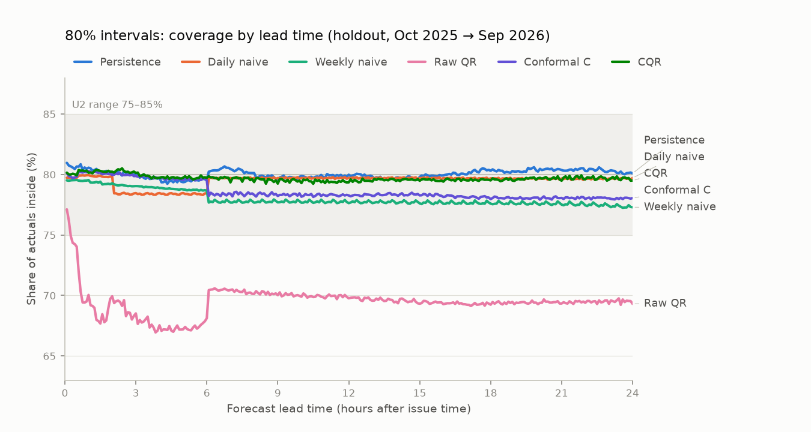
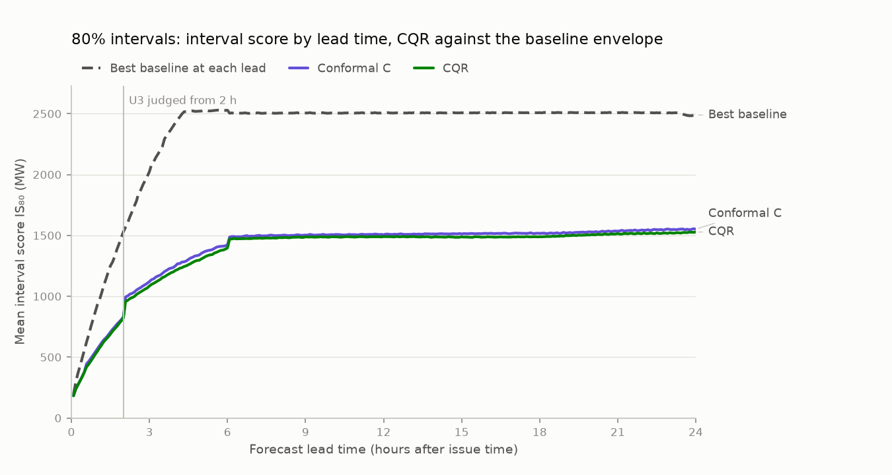
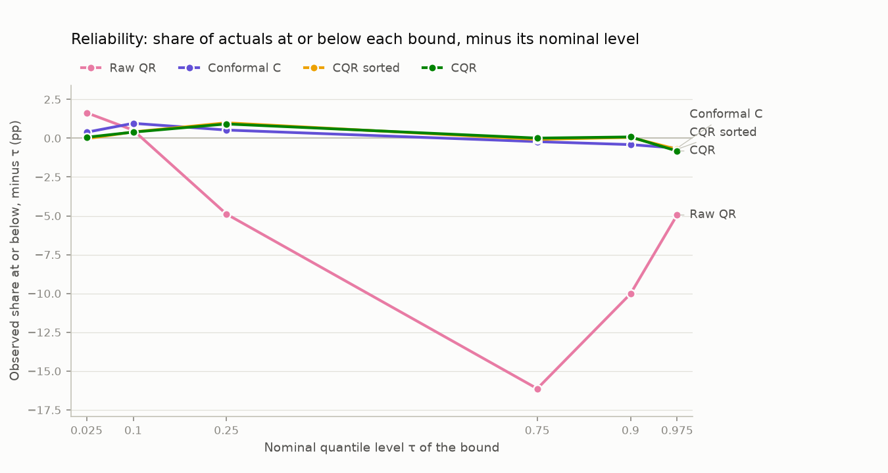
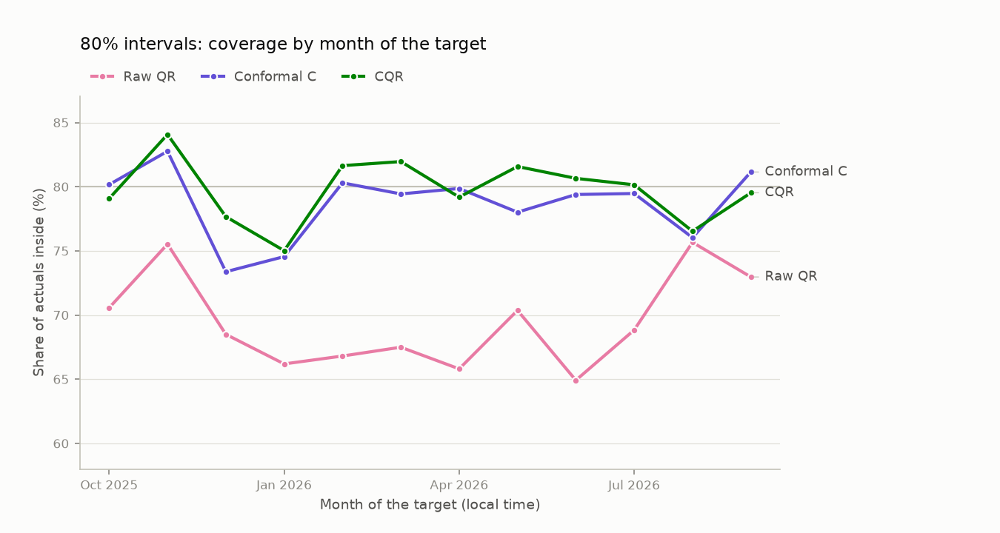
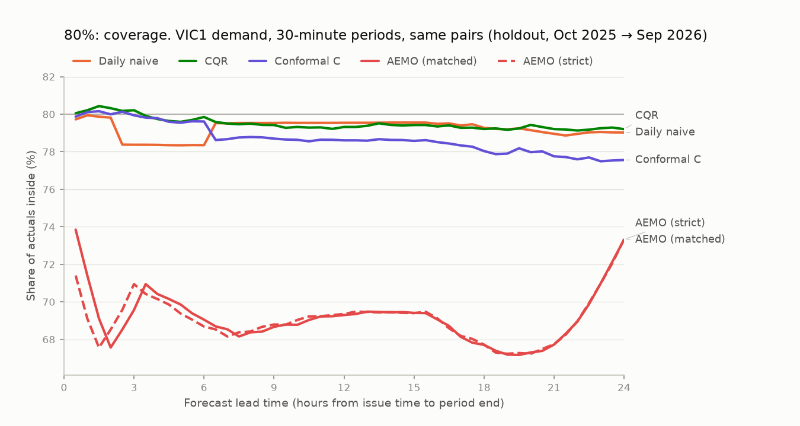
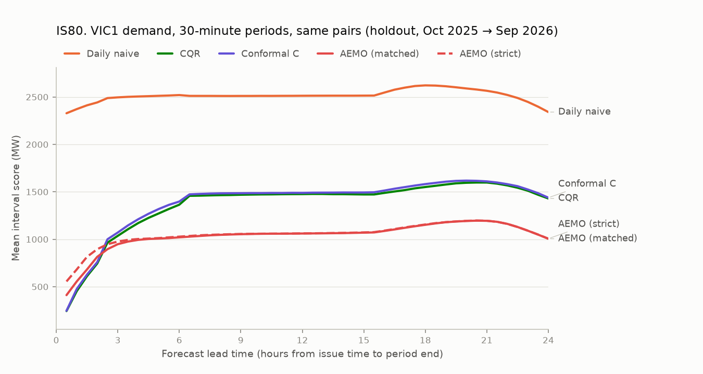

# Milestone 3: prediction intervals for Victorian demand, the holdout scored once

> **Generated** by `gridcast report-m3-holdout` on 2026-11-13 07:59 UTC from the stored holdout interval run (issue times 2025-10-01 → 2026-09-30, NEM time). Do not edit by hand. The interval recipe was frozen before the AEMO comparison and before any holdout interval existed, and the report's contents were fixed before the holdout was scored (m3_plan.md step 6).

## Summary

- **U5 passes:** the holdout intervals were scored by one `evaluate-holdout-intervals` run of the frozen recipe, after its continuous run reproduced every stored development interval exactly.
- **4 of 4 development criteria hold on the holdout** (U1 holds, U2 holds, U3 holds, U4 holds; replication, reported, not pass/fail).
- **Calibration:** CQR's 80% intervals cover 79.69% of actual demand on the holdout (95% CI 78.17–81.08% with day blocks, 77.96–81.44% with 7-day blocks), against 79.40% in development; 49.1% at 50% and 94.1% at 95%. The raw quantile LightGBM C bounds cover 69.5% at 80%.
- **Sharpness:** CQR's pooled IS₈₀ is 1,365.2 MW, against 2,499.4 MW for the best baseline interval (conformal around daily naive; −45.4%) and 1,390.4 MW for conformal intervals around the same point forecast (difference −25.1 (−45.1 to −5.3) MW). Over all three levels, the WIS difference to conformal C is +0.1 (−1.2 to +1.4) MW; its 95% interval includes zero.
- **By lead time:** 80% coverage stays within 75–85% at 288 of 288 leads, from 79.24% to 80.51%. **By month** it ranges from 75.0% (Jan 2026) to 84.1% (Nov 2025).
- **Winter (Jun 2026, Jul 2026, Aug 2026, pre-registered):** CQR covers 79.1% at 80% (95% CI 76.1–81.9%), missing below on 11.2% and above on 9.7% of pairs. Conformal around LightGBM C covers 78.3%.
- **Against AEMO's POE band (holdout part):** AEMO's band (matched) contains 69.2% of actual 30-minute demand and CQR's 80% interval 79.5%; CQR's IS80 is +327.1 MW against AEMO's (95% CI +270.0 to +386.8 MW).

## Provenance

| Item | Value |
| :--- | :--- |
| Region | VIC1 |
| Holdout interval batch | `2744fd09-4e6d-41c5-9579-a13c8fe9a5b0` (5-minute runs CQR 97, Conformal C 93, Raw QR 98, Persistence 94, Daily naive 95, Weekly naive 96; 5 half-hour runs) |
| Run commit (recorded at the start of the run) | `074e900d809affcf85121dddb5c20048297409fd` |
| Interval recipe | `d34273400899af69` = `intervals.frozen_config_hash`; QR recipe `8767a8948966637c` = frozen; frozen code at `bc5337e` (unchanged at the run) |
| Point forecasts | holdout: M2's `holdout_main` `fcb6abb6-49a3-4923-9d79-64e05a44d75f`; calibration history before 2025-10-01: run 2 `6d783932-5834-4e18-a9e8-0e3567db46e6` |
| Quantile LightGBM C | step 2 `4bab11d7-4301-4c74-9f32-ddd9644f3921` before the holdout, step 6a `b226706b-0bed-476c-b4fc-6c283786a8cc` (run 92, commit `3cc2528`, 6.7 h) from it |
| Continuous run | issue times from 2022-11-01; intervals output from 2023-08-01; 14.8 min |
| Holdout issue times (NEM time) | 2025-10-01 00:00 → 2026-09-30 23:30, 17,520 (every 30 min) |
| Scored (issue time, lead) pairs, every method | 5,045,760 of 5,045,760 (`holdout_main`'s common mask) |
| Selection retrains applying to the holdout | 2025-08-01, 2025-11-01, 2026-02-01, 2026-05-01, 2026-08-01 |
| Pooled metrics checked against the stored ones | CQR 29, Conformal C 16, Raw QR 28, Persistence 16, Daily naive 16, Weekly naive 16 (all equal) |
| Bootstrap | 2,000 draws, whole NEM issue days (365 days), 95% percentile intervals, seed 2609; sensitivity: 7-day blocks (53 blocks) |
| Leakage property tests (run by this command) | 11 passed, 0 failed |
| Report generated from commit | `074e900d809affcf85121dddb5c20048297409fd` |

## U5: holdout used once

| # | Pass if | Measured | Result |
| :--- | :--- | :--- | :--- |
| U5 | the holdout is scored by a single `gridcast evaluate-holdout-intervals` run against the frozen interval recipe; the command refuses to run again for the same recipe hash | 1 holdout interval batch(es) stored for recipe `d34273400899af69` (11 runs), from run commit(s) `074e900`; before scoring, the continuous run reproduced the 10 stored development interval runs exactly; `evaluate-holdout-intervals` refuses while this batch exists | **PASS** |

**Reproduction before scoring (step 6 decision).** The locked run built every interval over one continuous run of issue times from 2022-11-01, so calibration windows, ACI state and selections carry across the holdout boundary. Before any holdout pair was scored, the development part of each result had to equal the stored development batch exactly, bounds and selections:

| Run | Development batch | Issue times compared | Selections | Result |
| :--- | :--- | ---: | ---: | :--- |
| `conformal_lgbm_C` | `72eb5209-9bef-4870-a375-131a86ee7e0f` | 38,016 | 108 | exact |
| `conformal_persistence` | `72eb5209-9bef-4870-a375-131a86ee7e0f` | 38,016 | 108 | exact |
| `conformal_daily_naive` | `72eb5209-9bef-4870-a375-131a86ee7e0f` | 38,016 | 108 | exact |
| `conformal_weekly_naive` | `72eb5209-9bef-4870-a375-131a86ee7e0f` | 38,016 | 108 | exact |
| `cqr_lgbm_C` | `484194d7-2e62-4176-80b0-b8f117354929` | 38,016 | 108 | exact |
| `conformal30_lgbm_C` | `27aa78d6-8ab8-4509-aa40-d8b08cda68ea` | 38,016 | 108 | exact |
| `conformal30_persistence` | `27aa78d6-8ab8-4509-aa40-d8b08cda68ea` | 38,016 | 108 | exact |
| `conformal30_daily_naive` | `27aa78d6-8ab8-4509-aa40-d8b08cda68ea` | 38,016 | 108 | exact |
| `conformal30_weekly_naive` | `27aa78d6-8ab8-4509-aa40-d8b08cda68ea` | 38,016 | 108 | exact |
| `cqr30_lgbm_C` | `27aa78d6-8ab8-4509-aa40-d8b08cda68ea` | 38,016 | 108 | exact |

- **QR (step 6a), before the other retrains were fitted:** the 2025-08-01 retrain's 4 fit records (rows, every candidate's pinball loss and tree count, each quantile's selection) and 5,059,584 rearranged quantile values for 2,928 development issue times equal step 2's batch `4bab11d7-4301-4c74-9f32-ddd9644f3921`: exact.
- **Point refits (step 6a):** at all 5 retrains, 5,889,024 point forecasts equal run 2's and `holdout_main`'s stored ones: exact.
- **QR overlap (step 6b):** step 6a's quantiles equal step 2's on 2,928 development issue times.

## Replication of U1–U4 on the holdout

The development criteria, recomputed on the holdout issue times with the same code. They are reported as *holds* or *does not hold* and do not change the development verdicts (m3_plan.md §3). U4 is the same leakage test suite, run by this command.

| # | Pass if | Development | Dev | Holdout | Holdout |
| :--- | :--- | :--- | :--- | :--- | :--- |
| U1 | pooled 80% coverage ∈ [78%, 82%] | 79.40% | PASS | 79.69% | **holds** |
| U2 | 80% coverage(h) ∈ [75%, 85%] for every h from 5 min to 24 h | 288 of 288 lead times; lowest 78.97% at 18 h, highest 80.36% at 5 h 55 min | PASS | 288 of 288 lead times; lowest 79.24% at 10 h 30 min, highest 80.51% at 2 h 25 min | **holds** |
| U3 | IS₈₀(h) < min over baseline intervals of IS₈₀(h) for every h from 2 h to 24 h, and pooled IS₈₀ < mean over h of that minimum | 265 of 265 lead times; closest at 2 h 5 min: 926.8 vs 1,574.6 MW (Persistence); pooled 1,248.1 vs 2,256.1 MW | PASS | 265 of 265 lead times; closest at 2 h 5 min: 957.2 vs 1,568.1 MW (Persistence); pooled 1,365.2 vs 2,335.6 MW | **holds** |
| U4 | every interval leakage property test passes (run by this report) | leakage tests 11 passed, 0 failed | PASS | leakage tests 11 passed, 0 failed | **holds** |

**4 of 4 hold on the holdout.**

## Development vs holdout

Pooled over every lead time, on each period's own scored pairs (development: run 2's common mask from 2023-08-01; holdout: `holdout_main`'s). Each cell reads development → holdout.

| Method | Coverage at 50% (%) | Coverage at 80% (%) | Coverage at 95% (%) | IS₈₀ (MW) | WIS (MW) |
| :--- | ---: | ---: | ---: | ---: | ---: |
| CQR, LightGBM C (headline) | 49.7 → 49.1 | 79.4 → 79.7 | 93.9 → 94.1 | 1,248.1 → 1,365.2 | 150.5 → 165.9 |
| CQR, rearranged (reported only) | 49.4 → 48.9 | 79.3 → 79.6 | 94.3 → 94.3 | 1,245.6 → 1,364.6 | 150.2 → 165.8 |
| Conformal around LightGBM C | 50.3 → 49.3 | 79.1 → 78.6 | 94.4 → 94.0 | 1,267.2 → 1,390.4 | 150.6 → 165.9 |
| Quantile LightGBM C, raw | 35.8 → 38.8 | 64.7 → 69.5 | 87.6 → 88.4 | 1,382.2 → 1,456.9 | 159.6 → 174.3 |
| Conformal around persistence | 49.4 → 49.6 | 80.0 → 80.1 | 94.0 → 94.1 | 2,717.0 → 2,717.4 | 384.9 → 383.0 |
| Conformal around daily naive | 49.8 → 50.3 | 79.5 → 79.5 | 94.2 → 93.0 | 2,407.3 → 2,499.4 | 281.7 → 291.3 |
| Conformal around weekly naive | 50.7 → 50.2 | 78.3 → 78.0 | 92.8 → 92.5 | 2,752.1 → 2,864.0 | 322.5 → 336.1 |

## Winter, Jun 2026, Jul 2026, Aug 2026 (pre-registered)

M2's holdout found its largest error in the winter: LightGBM C under-forecast demand, worst in Jun 2026 (`reports/m2_holdout.md`, *Bias by month*). This section was fixed before the holdout intervals were scored. It shows how the intervals cope with a point forecast that is biased for weeks: pairs whose target falls in these months, by M2's lead bands.

80% coverage (%), with 95% intervals over whole issue days where the pairs come from at least 10 issue days:

| Lead band | Pairs | Issue days | CQR 80% (95% CI) | Conformal C 80% (95% CI) | Raw QR 80% (95% CI) | Daily naive 80% (95% CI) |
| :--- | ---: | ---: | ---: | ---: | ---: | ---: |
| 5 min–30 min | 26,496 | 92 | 79.6 (78.7 to 80.6) | 79.4 (78.3 to 80.5) | 73.7 (72.8 to 74.7) | 79.4 (75.7 to 83.1) |
| 35 min–2 h | 79,488 | 93 | 79.7 (78.2 to 81.1) | 80.1 (78.3 to 81.6) | 64.9 (62.8 to 67.1) | 79.3 (75.6 to 82.9) |
| 2 h 5 min–6 h | 211,968 | 93 | 81.1 (78.5 to 83.4) | 79.3 (76.8 to 81.8) | 63.7 (60.3 to 67.3) | 78.3 (73.9 to 82.4) |
| 6 h 5 min–24 h | 953,856 | 93 | 78.6 (74.9 to 82.0) | 77.9 (74.1 to 81.3) | 71.5 (67.8 to 75.2) | 78.3 (74.6 to 81.9) |
| All leads | 1,271,808 | 93 | 79.1 (76.1 to 81.9) | 78.3 (75.0 to 81.3) | 69.9 (66.6 to 73.0) | 78.4 (74.8 to 81.8) |

Share of actuals below and above the 80% interval (%):

| Lead band | CQR below / above % | Conformal C below / above % | Raw QR below / above % | Daily naive below / above % |
| :--- | ---: | ---: | ---: | ---: |
| 5 min–30 min | 9.8 / 10.6 | 9.7 / 10.9 | 10.0 / 16.3 | 10.2 / 10.4 |
| 35 min–2 h | 9.5 / 10.9 | 10.5 / 9.4 | 7.7 / 27.4 | 10.3 / 10.4 |
| 2 h 5 min–6 h | 9.4 / 9.4 | 10.9 / 9.7 | 5.0 / 31.3 | 10.9 / 10.9 |
| 6 h 5 min–24 h | 11.8 / 9.6 | 13.9 / 8.2 | 4.8 / 23.7 | 10.8 / 10.9 |
| All leads | 11.2 / 9.7 | 13.1 / 8.6 | 5.1 / 25.0 | 10.8 / 10.9 |

Settings selected at the 2026-05-01 retrain, whose quarter holds the winter's first month (80% level; `w<weeks>_<grouping>_g<γ>`, where γ is the ACI step):

| Method | 5 min–30 min | 35 min–2 h | 2 h 5 min–6 h | 6 h 5 min–24 h |
| :--- | ---: | ---: | ---: | ---: |
| CQR | `w8_lead_tod_g0` | `w4_lead_tod_g0` | `w26_lead_tod_g0.001` | `w4_lead_g0` |
| Conformal C | `w8_lead_tod_g0` | `w4_lead_tod_g0.001` | `w26_lead_tod_g0.005` | `w8_lead_tod_g0.001` |

## Methods

As in the development report (`reports/m3_intervals.md`, *Methods*): CQR on quantile LightGBM C (the headline), conformal intervals around LightGBM C and around the three baselines, raw QR, and CQR rearranged (reported only). Settings are re-selected at every quarterly retrain from past data only, with the frozen recipe.

## Pooled results (holdout)

| Method | Coverage at 50% (%) | Coverage at 80% (%) | Coverage at 95% (%) | Width 80% (MW) | IS₈₀ (MW) | WIS (MW) |
| :--- | ---: | ---: | ---: | ---: | ---: | ---: |
| CQR, LightGBM C (headline) | 49.1 | 79.7 | 94.1 | 968 | 1,365.2 | 165.9 |
| CQR, rearranged (reported only) | 48.9 | 79.6 | 94.3 | 966 | 1,364.6 | 165.8 |
| Conformal around LightGBM C | 49.3 | 78.6 | 94.0 | 933 | 1,390.4 | 165.9 |
| Quantile LightGBM C, raw | 38.8 | 69.5 | 88.4 | 796 | 1,456.9 | 174.3 |
| Conformal around persistence | 49.6 | 80.1 | 94.1 | 2,009 | 2,717.4 | 383.0 |
| Conformal around daily naive | 50.3 | 79.5 | 93.0 | 1,680 | 2,499.4 | 291.3 |
| Conformal around weekly naive | 50.2 | 78.0 | 92.5 | 1,797 | 2,864.0 | 336.1 |

Per level, with 95% intervals for coverage (block bootstrap over whole issue days) and the share of actuals below and above the interval:

| Method | Level | Coverage % (95% CI) | Below % | Above % | Width (MW) | Interval score (MW) |
| :--- | :--- | ---: | ---: | ---: | ---: | ---: |
| CQR, LightGBM C (headline) | 50% | 49.1 (47.5 to 50.7) | 25.9 | 25.0 | 474 | 950.5 |
|  | 80% | 79.7 (78.2 to 81.1) | 10.4 | 9.9 | 968 | 1,365.2 |
|  | 95% | 94.1 (93.2 to 94.9) | 2.6 | 3.3 | 1,606 | 2,025.4 |
| CQR, rearranged (reported only) | 50% | 48.9 (47.4 to 50.5) | 26.0 | 25.1 | 473 | 950.2 |
|  | 80% | 79.6 (78.1 to 81.1) | 10.4 | 9.9 | 966 | 1,364.6 |
|  | 95% | 94.3 (93.4 to 95.1) | 2.5 | 3.2 | 1,609 | 2,013.9 |
| Conformal around LightGBM C | 50% | 49.3 (47.7 to 50.9) | 25.5 | 25.2 | 459 | 945.1 |
|  | 80% | 78.6 (77.1 to 80.1) | 11.0 | 10.4 | 933 | 1,390.4 |
|  | 95% | 94.0 (93.2 to 94.8) | 2.9 | 3.1 | 1,508 | 1,969.1 |
| Quantile LightGBM C, raw | 50% | 38.8 (37.2 to 40.3) | 20.1 | 41.1 | 395 | 1,013.3 |
|  | 80% | 69.5 (67.8 to 71.1) | 10.5 | 20.0 | 796 | 1,456.9 |
|  | 95% | 88.4 (87.4 to 89.4) | 4.1 | 7.4 | 1,302 | 2,202.8 |
| Conformal around persistence | 50% | 49.6 (48.5 to 50.8) | 25.1 | 25.2 | 1,055 | 1,963.9 |
|  | 80% | 80.1 (78.9 to 81.3) | 9.9 | 10.0 | 2,009 | 2,717.4 |
|  | 95% | 94.1 (93.4 to 94.8) | 2.9 | 3.0 | 3,009 | 3,690.2 |
| Conformal around daily naive | 50% | 50.3 (48.2 to 52.4) | 24.8 | 24.9 | 799 | 1,690.1 |
|  | 80% | 79.5 (77.7 to 81.2) | 10.1 | 10.5 | 1,680 | 2,499.4 |
|  | 95% | 93.0 (91.9 to 94.1) | 3.6 | 3.4 | 2,677 | 3,691.2 |
| Conformal around weekly naive | 50% | 50.2 (48.0 to 52.4) | 24.6 | 25.2 | 925 | 1,947.2 |
|  | 80% | 78.0 (76.0 to 80.0) | 10.9 | 11.1 | 1,797 | 2,864.0 |
|  | 95% | 92.5 (91.2 to 93.8) | 3.7 | 3.7 | 2,948 | 4,377.5 |

### Headline differences and the block-length sensitivity (holdout)

Negative differences mean CQR scores better.

| Quantity | Estimate | 95% CI, day blocks | 95% CI, 7-day blocks |
| :--- | ---: | ---: | ---: |
| CQR coverage at 50% (%) | 49.09 | 47.52 to 50.67 | 47.29 to 51.06 |
| CQR coverage at 80% (%) | 79.69 | 78.17 to 81.08 | 77.96 to 81.44 |
| CQR coverage at 95% (%) | 94.12 | 93.22 to 94.94 | 93.14 to 95.09 |
| CQR − Conformal C: IS₈₀ (MW) | −25.1 | −45.1 to −5.3 | −50.6 to +1.0 |
| CQR − Conformal C: WIS (MW) | +0.1 | −1.2 to +1.4 | −1.5 to +1.7 |
| CQR − Daily naive: IS₈₀ (MW) | −1,134.2 | −1,245.5 to −1,025.2 | −1,317.8 to −972.5 |
| CQR − Daily naive: WIS (MW) | −125.3 | −137.6 to −113.6 | −146.0 to −106.9 |

Other differences (reported only):

| Comparison | Score | Difference, MW (95% CI, day blocks) |
| :--- | :--- | ---: |
| CQR − Raw QR | IS₈₀ | −91.6 (−122.3 to −59.6) |
| CQR − Raw QR | WIS | −8.4 (−10.9 to −5.7) |
| CQR sorted − CQR | WIS | −0.1 (−0.1 to −0.1) |
| CQR sorted − CQR | IS₈₀ | −0.7 (−1.7 to +0.5) |
| Conformal C − Daily naive | IS₈₀ | −1,109.1 (−1,224.1 to −1,000.7) |

## By lead time (holdout)

80% coverage by lead time, with U2's 75–85% range shaded.

80% coverage (%) by lead-time group:

| Lead time | CQR | CQR sorted | Conformal C | Raw QR | Persistence | Daily naive | Weekly naive |
| :--- | ---: | ---: | ---: | ---: | ---: | ---: | ---: |
| 5 min–1 h | 80.2 | 80.1 | 80.0 | 72.6 | 80.6 | 79.8 | 79.5 |
| 1 h 5 min–2 h | 80.3 | 80.2 | 80.1 | 68.6 | 80.3 | 79.8 | 79.3 |
| 2 h 5 min–6 h | 79.9 | 79.8 | 79.8 | 67.8 | 79.7 | 78.4 | 78.9 |
| 6 h 5 min–12 h | 79.5 | 79.5 | 78.3 | 70.1 | 80.0 | 79.7 | 77.8 |
| 12 h 5 min–24 h | 79.6 | 79.6 | 78.2 | 69.5 | 80.1 | 79.7 | 77.6 |

The dashed line is the lowest baseline IS₈₀ at each lead time (Persistence at 5 min–4 h 15 min, 23 h 25 min–24 h; Daily naive at 4 h 20 min–23 h 20 min).

IS₈₀ (MW) by lead-time group:

| Lead time | CQR | CQR sorted | Conformal C | Raw QR | Persistence | Daily naive | Weekly naive |
| :--- | ---: | ---: | ---: | ---: | ---: | ---: | ---: |
| 5 min–1 h | 383.4 | 382.7 | 395.5 | 406.9 | 583.2 | 2,364.0 | 2,468.2 |
| 1 h 5 min–2 h | 699.9 | 698.7 | 715.0 | 762.5 | 1,260.0 | 2,437.8 | 2,561.9 |
| 2 h 5 min–6 h | 1,199.1 | 1,195.6 | 1,237.8 | 1,319.3 | 2,357.5 | 2,514.4 | 2,721.4 |
| 6 h 5 min–12 h | 1,483.3 | 1,482.8 | 1,501.7 | 1,573.5 | 3,033.1 | 2,505.5 | 2,909.5 |
| 12 h 5 min–24 h | 1,498.9 | 1,499.1 | 1,524.7 | 1,589.8 | 2,978.8 | 2,507.8 | 2,946.8 |

## Reliability and quantile loss (holdout)

Share at or below each bound (%):

| Method | τ = 0.025 | τ = 0.1 | τ = 0.25 | τ = 0.75 | τ = 0.9 | τ = 0.975 |
| :--- | ---: | ---: | ---: | ---: | ---: | ---: |
| CQR, LightGBM C (headline) | 2.6 | 10.4 | 25.9 | 75.0 | 90.1 | 96.7 |
| CQR, rearranged (reported only) | 2.5 | 10.4 | 26.0 | 74.9 | 90.1 | 96.8 |
| Conformal around LightGBM C | 2.9 | 11.0 | 25.5 | 74.8 | 89.6 | 96.9 |
| Quantile LightGBM C, raw | 4.1 | 10.5 | 20.1 | 58.9 | 80.0 | 92.6 |
| Conformal around persistence | 2.9 | 9.9 | 25.1 | 74.8 | 90.0 | 97.0 |
| Conformal around daily naive | 3.6 | 10.1 | 24.8 | 75.1 | 89.5 | 96.6 |
| Conformal around weekly naive | 3.7 | 10.9 | 24.6 | 74.8 | 88.9 | 96.3 |

Mean pinball loss per quantile level (MW):

| Method | τ = 0.025 | τ = 0.1 | τ = 0.25 | τ = 0.75 | τ = 0.9 | τ = 0.975 | Mean |
| :--- | ---: | ---: | ---: | ---: | ---: | ---: | ---: |
| CQR, LightGBM C (headline) | 22.77 | 60.78 | 112.21 | 125.41 | 75.75 | 27.86 | 70.80 |
| CQR, rearranged (reported only) | 22.62 | 60.77 | 112.15 | 125.40 | 75.69 | 27.73 | 70.73 |
| Conformal around LightGBM C | 22.74 | 65.56 | 114.13 | 122.14 | 73.48 | 26.48 | 70.75 |
| Quantile LightGBM C, raw | 23.82 | 65.23 | 117.44 | 135.87 | 80.46 | 31.25 | 75.68 |
| Conformal around persistence | 46.21 | 134.86 | 244.32 | 246.65 | 136.88 | 46.05 | 142.49 |
| Conformal around daily naive | 46.63 | 122.72 | 206.23 | 216.29 | 127.23 | 45.65 | 127.46 |
| Conformal around weekly naive | 54.54 | 142.85 | 245.72 | 241.08 | 143.55 | 54.90 | 147.11 |

## Nesting of the levels (holdout, disclosure)

| Method | Not nested, any level (%) | lo80 > lo50 (%) | hi80 < hi50 (%) | lo95 > lo80 (%) | hi95 < hi80 (%) |
| :--- | ---: | ---: | ---: | ---: | ---: |
| CQR, LightGBM C (headline) | 10.61 | 2.68 | 1.99 | 3.12 | 3.22 |
| CQR, rearranged (reported only) | 0.00 | 0.00 | 0.00 | 0.00 | 0.00 |
| Conformal around LightGBM C | 2.82 | 0.00 | 0.00 | 1.79 | 1.16 |
| Quantile LightGBM C, raw | 0.00 | 0.00 | 0.00 | 0.00 | 0.00 |
| Conformal around persistence | 0.00 | 0.00 | 0.00 | 0.00 | 0.00 |
| Conformal around daily naive | 0.46 | 0.01 | 0.06 | 0.17 | 0.23 |
| Conformal around weekly naive | 5.77 | 2.05 | 0.88 | 1.79 | 1.43 |

Sorting CQR's bounds per pair changes its WIS by −0.12 (−0.13 to −0.11) MW and its 80% coverage from 79.69% to 79.65%.

## Conditional coverage (holdout)

Shown for CQR, conformal around LightGBM C, raw QR and the best baseline interval on the holdout (conformal around daily naive, lowest pooled IS₈₀).

80% coverage by month of the target (Oct 2026 left out of the figure: fewer than 7 target days).

### By month

| Target month | Days | CQR 80% | Conformal C 80% | Raw QR 80% | Daily naive 80% | CQR below % | CQR above % |
| :--- | ---: | ---: | ---: | ---: | ---: | ---: | ---: |
| Oct 2025 | 31 | 79.1 | 80.2 | 70.6 | 82.6 | 9.6 | 11.3 |
| Nov 2025 | 30 | 84.1 | 82.8 | 75.5 | 85.2 | 9.6 | 6.3 |
| Dec 2025 | 31 | 77.7 | 73.4 | 68.5 | 72.9 | 17.0 | 5.4 |
| Jan 2026 | 31 | 75.0 | 74.6 | 66.2 | 69.2 | 7.6 | 17.3 |
| Feb 2026 | 28 | 81.6 | 80.3 | 66.8 | 85.6 | 12.1 | 6.2 |
| Mar 2026 | 31 | 82.0 | 79.4 | 67.5 | 85.2 | 9.1 | 9.0 |
| Apr 2026 | 30 | 79.2 | 79.9 | 65.8 | 82.8 | 11.0 | 9.8 |
| May 2026 | 31 | 81.6 | 78.0 | 70.4 | 77.7 | 6.9 | 11.6 |
| Jun 2026 | 30 | 80.7 | 79.4 | 64.9 | 79.0 | 7.1 | 12.3 |
| Jul 2026 | 31 | 80.1 | 79.5 | 68.8 | 79.3 | 11.6 | 8.3 |
| Aug 2026 | 31 | 76.5 | 76.0 | 75.7 | 76.8 | 14.9 | 8.6 |
| Sep 2026 | 30 | 79.5 | 81.1 | 73.0 | 78.2 | 8.4 | 12.1 |
| Oct 2026 | 1 | 52.1 | 47.6 | 48.5 | 94.5 | 0.1 | 47.8 |

*Days* counts target days with at least one scored pair.

### By target hour

| Target hour (local) | CQR 80% | Conformal C 80% | Raw QR 80% | Daily naive 80% | CQR IS₈₀ |
| :--- | ---: | ---: | ---: | ---: | ---: |
| 00:00 | 79.5 | 75.9 | 69.5 | 78.6 | 702.5 |
| 01:00 | 80.1 | 78.6 | 71.2 | 80.5 | 658.0 |
| 02:00 | 81.1 | 78.9 | 73.0 | 79.9 | 648.9 |
| 03:00 | 80.9 | 79.4 | 73.6 | 84.1 | 645.7 |
| 04:00 | 81.1 | 79.5 | 73.6 | 82.3 | 649.3 |
| 05:00 | 80.1 | 76.3 | 73.5 | 72.0 | 693.2 |
| 06:00 | 81.7 | 87.7 | 73.8 | 88.9 | 825.0 |
| 07:00 | 79.6 | 81.4 | 70.8 | 77.8 | 1,019.3 |
| 08:00 | 77.1 | 70.1 | 69.3 | 77.2 | 1,240.2 |
| 09:00 | 83.5 | 86.7 | 70.4 | 85.6 | 1,639.0 |
| 10:00 | 79.5 | 78.5 | 69.1 | 79.7 | 2,073.3 |
| 11:00 | 76.5 | 73.4 | 67.2 | 73.3 | 2,473.9 |
| 12:00 | 79.7 | 79.2 | 64.2 | 79.6 | 2,582.2 |
| 13:00 | 79.1 | 79.0 | 62.6 | 80.7 | 2,623.6 |
| 14:00 | 78.9 | 81.2 | 62.2 | 80.6 | 2,540.3 |
| 15:00 | 75.6 | 68.9 | 64.3 | 71.6 | 2,301.2 |
| 16:00 | 79.1 | 78.6 | 68.2 | 77.9 | 1,910.0 |
| 17:00 | 81.8 | 85.4 | 68.9 | 83.0 | 1,609.1 |
| 18:00 | 76.4 | 72.3 | 67.9 | 73.9 | 1,332.0 |
| 19:00 | 78.3 | 78.8 | 68.8 | 78.1 | 1,147.6 |
| 20:00 | 81.1 | 82.4 | 69.0 | 82.5 | 1,023.6 |
| 21:00 | 79.8 | 75.0 | 69.1 | 74.0 | 886.4 |
| 22:00 | 79.9 | 78.3 | 71.0 | 80.5 | 805.8 |
| 23:00 | 81.9 | 81.5 | 75.7 | 85.5 | 736.0 |

### By year

| Target year | Days | CQR 50% | CQR 80% | CQR 95% | Conformal C 80% | Raw QR 80% | Daily naive 80% |
| :--- | ---: | ---: | ---: | ---: | ---: | ---: | ---: |
| 2025 | 92 | 48.7 | 80.2 | 95.4 | 78.7 | 71.5 | 80.2 |
| 2026 | 274 | 49.2 | 79.5 | 93.7 | 78.6 | 68.8 | 79.3 |

### By retrain quarter

| Retrain (issue times from) | Issue days | CQR 50% | CQR 80% | CQR 95% | CQR IS₈₀ | Conformal C 80% | Raw QR 80% | Daily naive 80% |
| :--- | ---: | ---: | ---: | ---: | ---: | ---: | ---: | ---: |
| 2025-08-01 | 31 | 50.6 | 79.1 | 93.9 | 1,463.2 | 80.0 | 70.4 | 82.2 |
| 2025-11-01 | 92 | 45.9 | 78.9 | 94.4 | 1,506.9 | 77.0 | 70.0 | 75.3 |
| 2026-02-01 | 89 | 51.0 | 80.9 | 93.8 | 1,319.5 | 79.8 | 66.8 | 85.1 |
| 2026-05-01 | 92 | 50.6 | 80.7 | 95.2 | 1,133.0 | 78.8 | 67.9 | 78.4 |
| 2026-08-01 | 61 | 48.1 | 77.8 | 92.7 | 1,518.8 | 78.6 | 74.3 | 77.9 |

## Extreme events (holdout, reported only)

Coverage intervals resample whole issue days, shown only for groups whose pairs come from at least 10 issue days.

### Groups known at the issue time

| Group | Target days | Issue days | Pairs | CQR 80% (95% CI) | Conformal C 80% (95% CI) | Raw QR 80% (95% CI) | Daily naive 80% (95% CI) | CQR below / above % | CQR IS₈₀ |
| :--- | ---: | ---: | ---: | ---: | ---: | ---: | ---: | ---: | ---: |
| Forecast daily maximum ≥ 35 °C | 10 | 23 | 124,416 | 73.1 (62.6 to 82.3) | 70.7 (60.3 to 79.8) | 67.3 (57.3 to 76.3) | 52.2 (41.8 to 61.4) | 4.8 / 22.1 | 2,107.0 |
| Forecast daily maximum ≤ 12 °C | 13 | 21 | 106,254 | 75.7 (68.1 to 82.2) | 76.8 (71.7 to 80.9) | 62.8 (53.0 to 72.9) | 70.2 (58.6 to 80.4) | 10.1 / 14.2 | 1,224.6 |
| Victorian public holidays | 13 | 28 | 180,288 | 79.4 (74.1 to 84.7) | 78.2 (70.3 to 85.2) | 70.6 (64.7 to 77.1) | 80.8 (72.9 to 87.8) | 13.9 / 6.7 | 1,346.7 |
| Days when clocks change (23 h / 25 h) | 2 | 5 | 27,648 | 74.4 | 75.9 | 63.2 | 77.2 | 12.5 / 13.1 | 1,371.1 |

Summary: Forecast daily maximum ≥ 35 °C: 73.1% (95% CI 62.6–82.3%), missing above on 22.1% of pairs; Forecast daily maximum ≤ 12 °C: 75.7% (95% CI 68.1–82.2%), missing above on 14.2% of pairs; Victorian public holidays: 79.4% (95% CI 74.1–84.7%), missing below on 13.9% of pairs; Days when clocks change (23 h / 25 h): 74.4%, missing above on 13.1% of pairs.

### Groups defined by the outcome

Biased downwards by construction (see the development report). The top-1% threshold is the 99th percentile of actual demand over the scored holdout target intervals; named events outside the holdout have no pairs.

| Group | Target days | Issue days | Pairs | CQR 80% (95% CI) | Conformal C 80% (95% CI) | Raw QR 80% (95% CI) | Daily naive 80% (95% CI) | CQR below / above % | CQR IS₈₀ |
| :--- | ---: | ---: | ---: | ---: | ---: | ---: | ---: | ---: | ---: |
| Top 1% of actual demand intervals (≥ 8,030 MW) | 34 | 56 | 50,640 | 53.2 (44.2 to 62.5) | 65.5 (52.8 to 76.7) | 20.1 (13.4 to 28.5) | 54.7 (39.2 to 68.0) | 1.0 / 45.8 | 2,660.0 |
| Realised price > $300/MWh | 17 | 31 | 10,272 | 46.2 (28.9 to 61.5) | 44.6 (25.9 to 62.7) | 33.1 (22.0 to 43.5) | 39.2 (20.9 to 58.2) | 8.9 / 44.9 | 4,316.9 |
| 2024-02-13: Severe storms: transmission towers down, widespread outages | 0 | 0 | 0 | – | – | – | – | – | – |
| 2024-12-09: Short afternoon demand spike, cause unverified (m2_handoff.md) | 0 | 0 | 0 | – | – | – | – | – | – |

## Per-retrain selections (holdout)

Selections that apply to holdout issue times (the first is the last development retrain, whose quarter runs into the holdout):

| Method | Level | Selections | 4 weeks | 8 weeks | 13 weeks | 26 weeks | per lead | lead × time of day | γ = 0 | γ = 0.001 | γ = 0.005 |
| :--- | ---: | ---: | ---: | ---: | ---: | ---: | ---: | ---: | ---: | ---: | ---: |
| CQR | 50% | 20 | 10 | 5 | 4 | 1 | 1 | 19 | 9 | 7 | 4 |
| CQR | 80% | 20 | 8 | 7 | 4 | 1 | 1 | 19 | 7 | 8 | 5 |
| CQR | 95% | 20 | 3 | 8 | 5 | 4 | 1 | 19 | 9 | 6 | 5 |
| Conformal C | 50% | 20 | 10 | 5 | 4 | 1 | 0 | 20 | 7 | 9 | 4 |
| Conformal C | 80% | 20 | 7 | 7 | 5 | 1 | 0 | 20 | 5 | 8 | 7 |
| Conformal C | 95% | 20 | 3 | 13 | 3 | 1 | 0 | 20 | 7 | 10 | 3 |

CQR's 80% selection at each of these retrains and lead bands:

| Retrain | 5 min–30 min | 35 min–2 h | 2 h 5 min–6 h | 6 h 5 min–24 h |
| :--- | ---: | ---: | ---: | ---: |
| 2025-08-01 | `w4_lead_tod_g0` | `w8_lead_tod_g0.001` | `w8_lead_tod_g0.001` | `w13_lead_tod_g0.001` |
| 2025-11-01 | `w8_lead_tod_g0.005` | `w4_lead_tod_g0` | `w13_lead_tod_g0` | `w13_lead_tod_g0` |
| 2026-02-01 | `w13_lead_tod_g0.005` | `w4_lead_tod_g0.005` | `w4_lead_tod_g0.005` | `w4_lead_tod_g0.001` |
| 2026-05-01 | `w8_lead_tod_g0` | `w4_lead_tod_g0` | `w26_lead_tod_g0.001` | `w4_lead_g0` |
| 2026-08-01 | `w8_lead_tod_g0.001` | `w8_lead_tod_g0.005` | `w4_lead_tod_g0.001` | `w8_lead_tod_g0.001` |

Crossed CQR intervals in the holdout, output as zero width at the midpoint: 5,263 at 50%, 18 at 80%, 0 at 95%.

### Quantile crossing (raw QR, holdout)

- Quantile pairs that crossed before sorting: 29.2% of scored pairs (27.6% of all pairs forecast from 2025-08-01).
- Per (retrain, band), the range of the crossing share over the retrains: 5 min–30 min 1.8–3.5%; 35 min–2 h 9.2–36.9%; 2 h 5 min–6 h 18.2–48.4%; 6 h 5 min–24 h 17.2–47.9%.

## Leakage tests (U4)

Run by this command: `tests/unit/test_interval_leakage.py`, `tests/unit/test_quantile.py::test_quantiles_ignore_demand_after_their_issue_time`. **11 passed, 0 failed.**

## AEMO's POE band, holdout part

Step 5's comparison (`reports/m3_aemo.md`) repeated on the holdout issue times (2025-10-01 00:00 → 2026-09-30 23:30 NEM time, 17,520 issue times; 17,520 of 17,520 PDPASA `LOR` runs in the window). Same alignments (matched is the headline), the same pairs rule, the frozen half-hour recipe, and the same bootstrap. AEMO's band is a benchmark only, not pass/fail. 25 pooled 80% statistics of the holdout half-hour runs were recomputed from the stored bounds and equal the stored metrics.

- **Coverage:** AEMO's band (matched) contains 69.2% of actual 30-minute demand; our CQR 80% interval contains 79.5%. An 80% interval should contain 80%.
- **Width:** AEMO's band is 431.4 MW wide on average, CQR's 958.9 MW.
- **Interval score** (lower is better; width plus a penalty for each miss): AEMO 1,029.3 MW, CQR 1,356.4 MW, so CQR's is higher than AEMO's (+327.1 MW, 95% interval +270.0 to +386.8 MW). CQR scores better at 4 of 48 lead times.

### Share of actual demand inside the 80% interval (%), holdout

| Period ends | AEMO (matched) | AEMO (strict) | CQR | Conformal C | Best baseline | Pairs |
| :--- | ---: | ---: | ---: | ---: | ---: | ---: |
| 30 min | 73.8 | 71.4 | 80.1 | 79.9 | 80.7 (Persistence) | 17,520 |
| 1 h | 71.4 | 69.1 | 80.2 | 80.1 | 80.4 (Persistence) | 17,520 |
| 2 h | 67.6 | 68.5 | 80.3 | 80.0 | 80.0 (Persistence) | 17,520 |
| 4 h | 70.4 | 70.2 | 79.7 | 79.8 | 79.7 (Persistence) | 17,520 |
| 6 h | 69.1 | 68.7 | 79.9 | 79.6 | 78.4 (Daily naive) | 17,520 |
| 12 h | 69.3 | 69.4 | 79.3 | 78.6 | 79.5 (Daily naive) | 17,520 |
| 18 h | 67.7 | 67.7 | 79.2 | 78.0 | 79.3 (Daily naive) | 15,695 |
| 24 h | 73.3 | 73.3 | 79.2 | 77.6 | 80.0 (Persistence) | 11,315 |
| **All periods (pooled)** | **69.2** | **69.1** | **79.5** | **78.8** | 79.2 (Daily naive) | 785,115 |

### Misses below and above (%), holdout

| Period ends | AEMO (matched) below | AEMO (matched) above | CQR below | CQR above | Conformal C below | Conformal C above |
| :--- | ---: | ---: | ---: | ---: | ---: | ---: |
| 30 min | 22.8 | 3.3 | 9.9 | 10.0 | 10.2 | 9.9 |
| 1 h | 20.9 | 7.7 | 9.6 | 10.2 | 9.8 | 10.1 |
| 2 h | 17.0 | 15.4 | 9.4 | 10.2 | 9.8 | 10.2 |
| 4 h | 13.5 | 16.1 | 10.1 | 10.1 | 9.9 | 10.3 |
| 6 h | 14.9 | 16.0 | 9.9 | 10.3 | 10.0 | 10.4 |
| 12 h | 14.9 | 15.8 | 11.0 | 9.7 | 10.9 | 10.5 |
| 18 h | 14.8 | 17.5 | 10.8 | 9.9 | 11.0 | 10.9 |
| 24 h | 12.9 | 13.8 | 11.0 | 9.7 | 11.5 | 10.9 |
| **All periods (pooled)** | 15.1 | 15.7 | 10.6 | 9.9 | 10.7 | 10.6 |

### Interval score IS80 (MW), holdout

| Period ends | AEMO (matched) | AEMO (strict) | CQR | Conformal C | Best baseline | Pairs |
| :--- | ---: | ---: | ---: | ---: | ---: | ---: |
| 30 min | 411.0 | 555.4 | 243.1 | 246.1 | 353.9 (Persistence) | 17,520 |
| 1 h | 555.4 | 681.7 | 453.0 | 475.4 | 757.5 (Persistence) | 17,520 |
| 2 h | 815.1 | 895.5 | 744.5 | 758.6 | 1,392.9 (Persistence) | 17,520 |
| 4 h | 993.5 | 1,002.9 | 1,171.0 | 1,211.4 | 2,350.5 (Persistence) | 17,520 |
| 6 h | 1,020.2 | 1,027.6 | 1,364.3 | 1,397.6 | 2,520.1 (Daily naive) | 17,520 |
| 12 h | 1,060.7 | 1,061.9 | 1,476.2 | 1,489.0 | 2,512.8 (Daily naive) | 17,520 |
| 18 h | 1,152.4 | 1,155.9 | 1,550.8 | 1,581.6 | 2,622.2 (Daily naive) | 15,695 |
| 24 h | 1,005.3 | 1,006.3 | 1,430.0 | 1,438.5 | 2,253.0 (Persistence) | 11,315 |
| **All periods (pooled)** | **1,029.3** | **1,044.7** | **1,356.4** | **1,378.6** | 2,512.7 (Daily naive) | 785,115 |

### Pooled differences, development and holdout

| Period | Statistic | A | B | A − B | 95% interval (day blocks) | 95% interval (7-day blocks) | Pairs | Days |
| :--- | ---: | ---: | ---: | ---: | ---: | ---: | ---: | ---: |
| Development | IS80 | CQR | AEMO (matched) | +395.8 MW | +348.8 to +444.4 | +331.9 to +456.3 | 785,067 | 365 |
| Development | IS80 | CQR | AEMO (strict) | +382.8 MW | +335.5 to +431.8 | +318.4 to +443.0 | 785,067 | 365 |
| Development | IS80 | CQR | AEMO re-centred (matched) | +371.6 MW | +322.0 to +422.2 | +302.6 to +436.4 | 785,067 | 365 |
| Development | IS80 | Conformal C | AEMO (matched) | +424.5 MW | +373.3 to +477.9 | +357.6 to +492.9 | 785,067 | 365 |
| Development | Mean width | CQR | AEMO (matched) | +527.7 MW | +509.1 to +547.0 | +488.6 to +563.9 | 785,067 | 365 |
| Development | Coverage | CQR | AEMO (matched) | +9.27 pp | +7.67 to +10.83 | +7.37 to +11.13 | 785,067 | 365 |
| **Holdout** | IS80 | CQR | AEMO (matched) | +327.1 MW | +270.0 to +386.8 | +243.5 to +414.2 | 785,115 | 365 |
| **Holdout** | IS80 | CQR | AEMO (strict) | +311.7 MW | +254.4 to +371.0 | +227.6 to +398.9 | 785,115 | 365 |
| **Holdout** | IS80 | CQR | AEMO re-centred (matched) | +293.0 MW | +233.3 to +354.7 | +207.9 to +385.1 | 785,115 | 365 |
| **Holdout** | IS80 | Conformal C | AEMO (matched) | +349.3 MW | +291.1 to +409.5 | +262.8 to +436.7 | 785,115 | 365 |
| **Holdout** | Mean width | CQR | AEMO (matched) | +527.5 MW | +506.6 to +546.7 | +482.2 to +571.2 | 785,115 | 365 |
| **Holdout** | Coverage | CQR | AEMO (matched) | +10.36 pp | +8.47 to +12.14 | +7.79 to +12.71 | 785,115 | 365 |

### Sensitivity: the re-centred band and the strict alignment (holdout)

| Interval | Coverage % | Below % | Above % | Mean width (MW) | IS80 (MW) |
| :--- | ---: | ---: | ---: | ---: | ---: |
| AEMO band (matched) | 69.2 | 15.1 | 15.7 | 431.4 | 1,029.3 |
| AEMO band (strict) | 69.1 | 15.0 | 16.0 | 436.6 | 1,044.7 |
| AEMO band re-centred (matched) | 69.4 | 9.9 | 20.7 | 431.4 | 1,063.4 |
| AEMO band re-centred (strict) | 69.1 | 9.9 | 21.0 | 436.6 | 1,081.4 |
| CQR, LightGBM C (headline) | 79.5 | 10.6 | 9.9 | 958.9 | 1,356.4 |
| Conformal around LightGBM C | 78.8 | 10.7 | 10.6 | 933.0 | 1,378.6 |
| Conformal around daily naive | 79.2 | 10.1 | 10.7 | 1,657.4 | 2,512.7 |

### By quarter of the issue time (holdout)

| Issue quarter (NEM time) | AEMO (matched) coverage % | CQR coverage % | Conformal C coverage % | AEMO (matched) IS80 | CQR IS80 | Conformal C IS80 | Pairs |
| :--- | ---: | ---: | ---: | ---: | ---: | ---: | ---: |
| 2025 Q4 | 60.3 | 80.0 | 78.5 | 1,226.4 | 1,399.9 | 1,395.1 | 197,892 |
| 2026 Q1 | 70.9 | 79.4 | 77.7 | 1,035.7 | 1,561.4 | 1,583.1 | 193,590 |
| 2026 Q2 | 75.3 | 80.5 | 80.1 | 799.0 | 1,091.4 | 1,124.3 | 195,741 |
| 2026 Q3 | 70.3 | 78.2 | 78.8 | 1,053.7 | 1,374.5 | 1,413.5 | 197,892 |

### What AEMO's band is (holdout)

- **Symmetric:** 100.0% of PDPASA `LOR` rows in the window have POE10 − POE50 equal to POE50 − POE90 within 1 MW.
- **Half-width:** 215.7 MW on the compared pairs on average, 4.33% of `DEMAND50`.
- **Offset:** `DEMAND50` sits +56.9 MW above the matched pre-dispatch `TOTALDEMAND` on average (standard deviation 40.6 MW), as step 0 found. Neither the documentation nor the data say why, so the data cannot tell a definition difference from a different forecast (docs/m3_data_spike.md §4).
- **Re-centring uses earlier information:** the pre-dispatch run with the same nominal run time was published after the PDPASA run for 0 of the runs used.

## Disclosures

- **The holdout is new for intervals, not for point forecasts.** Its point errors, including the winter under-forecast, were seen in M2 before the interval recipe was designed (m3_plan.md §1). The recipe's settings are re-selected from past data only, but its design was not blind to them.
- **The winter section was chosen knowing M2's winter bias.** It was fixed before any holdout interval was scored, so its numbers were not looked for.
- **Two stages.** Step 6a fitted QR over the holdout and stored its quantiles without computing any metric. This run scored them, under the U5 lock, with everything else.
- **One look.** The holdout intervals are scored once (U5). A problem found later is disclosed here, not fixed by rescoring.
- 0 holdout pairs without C's weather inputs are excluded for every method (`holdout_main`'s common mask).
