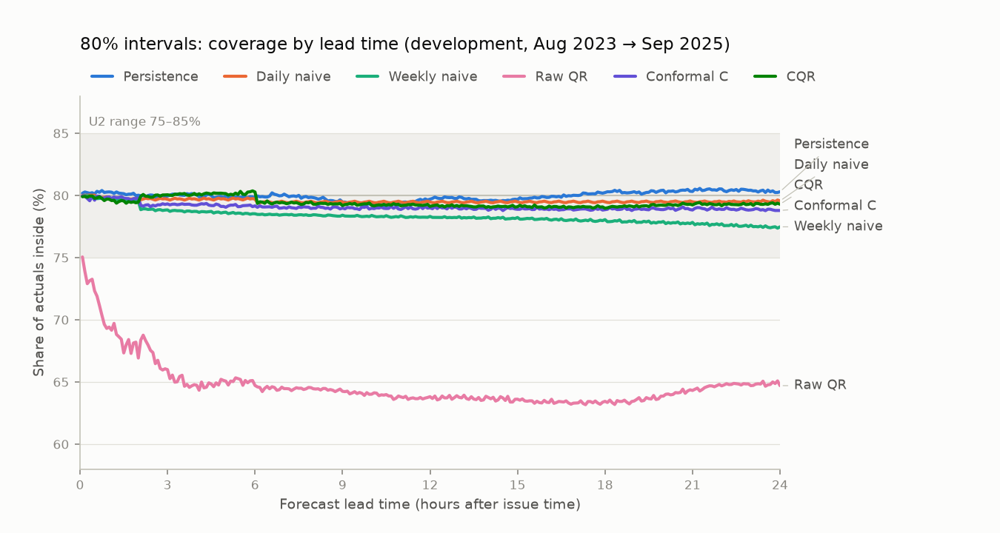
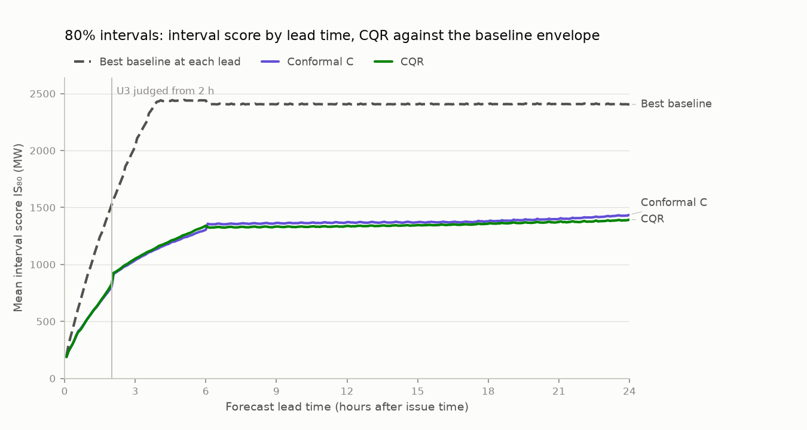
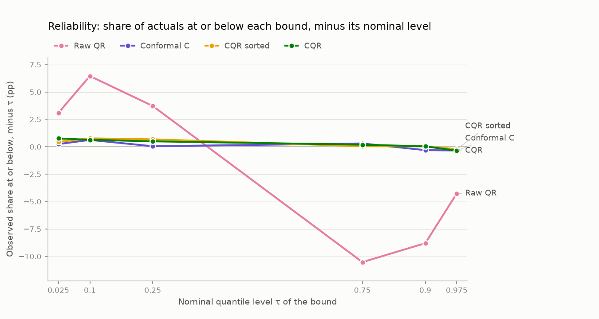
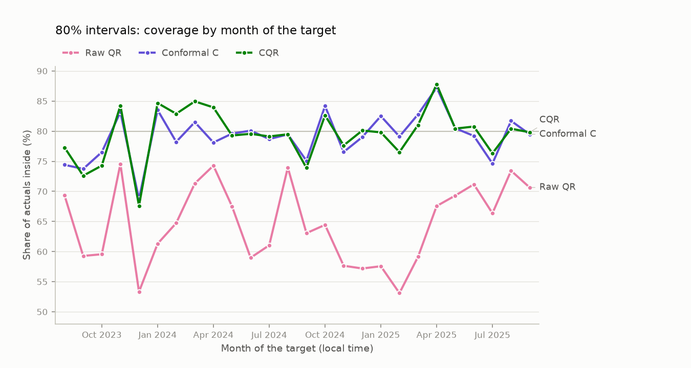

# Milestone 3: prediction intervals for Victorian demand (development period)

> **Generated** by `gridcast report-m3` on 2026-11-11 15:40 UTC from the stored interval batches. Do not edit by hand: re-run the pipeline instead. The holdout year is not scored here (step 6).

## Summary

- **4 of 4 pre-registered development criteria pass** (U1 pass, U2 pass, U3 pass, U4 pass). U5, the single holdout run, belongs to step 6.
- **Calibration:** the headline CQR intervals cover 79.40% of actual demand at 80% (95% CI 78.48–80.28% with day blocks, 78.22–80.59% with 7-day blocks), 49.7% at 50% and 93.9% at 95%. The raw quantile LightGBM C bounds it corrects cover 64.7% at 80%.
- **Sharpness:** CQR's pooled IS₈₀ is 1,248.1 MW, against 2,407.3 MW for the best baseline interval (conformal around daily naive; −48.2%) and 1,267.2 MW for conformal intervals around the same point forecast (−1.5%; difference −19.0 (−32.2 to −6.8) MW with day blocks, −36.6 to −1.2 with 7-day blocks). Over all three levels, the WIS difference to conformal C is −0.1 (−0.9 to +0.7) MW; its 95% interval includes zero.
- **By lead time:** 80% coverage stays within 75–85% at 288 of 288 leads, from 78.97% to 80.36%. **By month** it ranges from 67.6% (Dec 2023) to 87.8% (Apr 2025).
- **Extreme events known at the issue time** (reported only): Forecast daily maximum ≥ 35 °C: 71.5% (95% CI 67.1–75.9%), missing above on 23.9% of pairs; Forecast daily maximum ≤ 12 °C: 79.7% (95% CI 76.9–82.8%), missing above on 13.5% of pairs; Victorian public holidays: 69.7% (95% CI 64.1–75.1%), missing below on 17.4% of pairs; Days when clocks change (23 h / 25 h): 81.2% (95% CI 69.0–90.8%), missing below on 9.5% of pairs.
- **Disclosed:** on 14.3% of scored pairs the CQR levels are not nested (each level is corrected separately). Sorting the bounds (a reported-only row) changes the WIS by −0.30 (−0.35 to −0.26) MW.

## Provenance

| Item | Value |
| :--- | :--- |
| Region | VIC1 |
| Interval batches | conformal `72eb5209-9bef-4870-a375-131a86ee7e0f` (runs 81, 82, 83, 84; commit `819e862`); quantile LightGBM C `4bab11d7-4301-4c74-9f32-ddd9644f3921` (run 85; commit `6fdbac5`); CQR `484194d7-2e62-4176-80b0-b8f117354929` (run 86; commit `8168a39`) |
| Point forecasts (M2 run 2) | `6d783932-5834-4e18-a9e8-0e3567db46e6` |
| Interval config hash | `d34273400899af69` (matches the current config) |
| QR config hash | `8767a8948966637c` |
| Scored issue times (NEM time) | 2023-08-01 00:00 → 2025-09-30 23:30, 38,016 (every 30 min) |
| Scored (issue time, lead) pairs, every method | 10,662,528 of 10,948,608 (run 2's common mask) |
| Selection retrains | 9, quarterly: 2023-08-01 → 2025-08-01 |
| Pooled metrics checked against the stored ones | CQR 29, Conformal C 16, Raw QR 28, Persistence 16, Daily naive 16, Weekly naive 16 (all equal) |
| Bootstrap | 2,000 draws, whole NEM issue days (792 days), 95% percentile intervals, seed 2609; sensitivity: 7-day blocks (114 blocks) |
| Leakage property tests (run by this command) | 7 passed, 0 failed |
| Report generated from commit | `02681d60672c58c61b9d3791479de37ccf952d94` |

## Success criteria (pre-registered)

Set in `docs/plans/m3_plan.md` §3 before any interval result existed. They apply to the headline, **CQR on quantile LightGBM C at 80%**, on the development issue times and the same pairs as every other method. *Baseline intervals* are conformal intervals around persistence, daily naive and weekly naive, built with the same procedure and per-retrain selection; *the minimum over baselines* is taken at each lead time. U3's pooled part compares with the mean over every lead time of that minimum, as M2's S2 did. U5 belongs to step 6.

| # | Pass if | Measured | Result |
| :--- | :--- | :--- | :--- |
| U1 | pooled 80% coverage ∈ [78%, 82%] | 79.40% | **PASS** |
| U2 | 80% coverage(h) ∈ [75%, 85%] for every h from 5 min to 24 h | 288 of 288 lead times; lowest 78.97% at 18 h, highest 80.36% at 5 h 55 min | **PASS** |
| U3 | IS₈₀(h) < min over baseline intervals of IS₈₀(h) for every h from 2 h to 24 h, and pooled IS₈₀ < mean over h of that minimum | 265 of 265 lead times; closest at 2 h 5 min: 926.8 vs 1,574.6 MW (Persistence); pooled 1,248.1 vs 2,256.1 MW | **PASS** |
| U4 | every interval leakage property test passes (run by this report) | leakage tests 7 passed, 0 failed | **PASS** |

## Methods

- **CQR (headline):** quantile LightGBM C (step 2: six quantiles, each selecting its own target form and leaf count at every retrain and lead band, then sorted per pair) corrected by rolling conformal calibration with one score per side (q̂_lo − y, y − q̂_hi).
- **Conformal around a point forecast:** the same rolling machinery on signed residuals of a stored point forecast (LightGBM C, or a baseline for the baseline intervals).
- **Shared machinery (step 1):** 24 candidate streams (calibration windows of 4, 8, 13, 26 weeks × per lead or per lead × 3-hour block of the target × ACI step γ ∈ {0, 0.001, 0.005}), re-selected at every quarterly retrain, per level and lead band, by mean interval score over the previous 8 weeks. Only outcomes known at the issue time are ever used.
- **Raw QR** is reported to show what the conformal step adds. **CQR, rearranged** sorts each pair's six CQR bounds as quantiles (reported only, added at step 4).
- **Scores:** coverage, interval score IS_α = (u − l) + (2/α)(l − y)⁺ + (2/α)(y − u)⁺, and the weighted interval score (WIS) of the three intervals plus the method's point forecast as the median. Lower scores are better. All in MW.

## Pooled results

| Method | Coverage at 50% (%) | Coverage at 80% (%) | Coverage at 95% (%) | Width 80% (MW) | IS₈₀ (MW) | WIS (MW) |
| :--- | ---: | ---: | ---: | ---: | ---: | ---: |
| CQR, LightGBM C (headline) | 49.7 | 79.4 | 93.9 | 890 | 1,248.1 | 150.5 |
| CQR, rearranged (reported only) | 49.4 | 79.3 | 94.3 | 886 | 1,245.6 | 150.2 |
| Conformal around LightGBM C | 50.3 | 79.1 | 94.4 | 865 | 1,267.2 | 150.6 |
| Quantile LightGBM C, raw | 35.8 | 64.7 | 87.6 | 650 | 1,382.2 | 159.6 |
| Conformal around persistence | 49.4 | 80.0 | 94.0 | 2,012 | 2,717.0 | 384.9 |
| Conformal around daily naive | 49.8 | 79.5 | 94.2 | 1,647 | 2,407.3 | 281.7 |
| Conformal around weekly naive | 50.7 | 78.3 | 92.8 | 1,819 | 2,752.1 | 322.5 |

Per level, with 95% intervals for coverage (block bootstrap over whole issue days) and the share of actuals below and above the interval:

| Method | Level | Coverage % (95% CI) | Below % | Above % | Width (MW) | Interval score (MW) |
| :--- | :--- | ---: | ---: | ---: | ---: | ---: |
| CQR, LightGBM C (headline) | 50% | 49.7 (48.7 to 50.7) | 25.5 | 24.8 | 450 | 861.9 |
|  | 80% | 79.4 (78.5 to 80.3) | 10.6 | 10.0 | 890 | 1,248.1 |
|  | 95% | 93.9 (93.4 to 94.3) | 3.3 | 2.9 | 1,573 | 1,952.7 |
| CQR, rearranged (reported only) | 50% | 49.4 (48.4 to 50.4) | 25.7 | 24.9 | 447 | 861.4 |
|  | 80% | 79.3 (78.3 to 80.1) | 10.8 | 10.0 | 886 | 1,245.6 |
|  | 95% | 94.3 (93.9 to 94.8) | 2.9 | 2.7 | 1,581 | 1,925.7 |
| Conformal around LightGBM C | 50% | 50.3 (49.2 to 51.3) | 25.0 | 24.7 | 431 | 866.4 |
|  | 80% | 79.1 (78.1 to 80.0) | 10.6 | 10.3 | 865 | 1,267.2 |
|  | 95% | 94.4 (93.9 to 94.9) | 2.7 | 2.8 | 1,449 | 1,847.1 |
| Quantile LightGBM C, raw | 50% | 35.8 (34.8 to 36.7) | 28.7 | 35.5 | 317 | 907.8 |
|  | 80% | 64.7 (63.7 to 65.8) | 16.5 | 18.8 | 650 | 1,382.2 |
|  | 95% | 87.6 (87.0 to 88.3) | 5.6 | 6.8 | 1,282 | 2,228.5 |
| Conformal around persistence | 50% | 49.4 (48.5 to 50.2) | 25.3 | 25.4 | 1,049 | 1,972.8 |
|  | 80% | 80.0 (79.1 to 80.8) | 10.0 | 10.1 | 2,012 | 2,717.0 |
|  | 95% | 94.0 (93.5 to 94.5) | 3.0 | 3.1 | 2,989 | 3,711.5 |
| Conformal around daily naive | 50% | 49.8 (48.1 to 51.3) | 25.0 | 25.3 | 772 | 1,641.7 |
|  | 80% | 79.5 (78.3 to 80.8) | 10.3 | 10.2 | 1,647 | 2,407.3 |
|  | 95% | 94.2 (93.5 to 94.8) | 3.0 | 2.8 | 2,695 | 3,472.7 |
| Conformal around weekly naive | 50% | 50.7 (49.0 to 52.3) | 25.1 | 24.2 | 890 | 1,875.1 |
|  | 80% | 78.3 (76.9 to 79.7) | 11.0 | 10.7 | 1,819 | 2,752.1 |
|  | 95% | 92.8 (92.0 to 93.7) | 3.6 | 3.5 | 2,919 | 3,990.6 |

### Headline differences and the block-length sensitivity

Errors are correlated in time: weather spells and the winter bias last for weeks, and 24-hour leads overlap the next issue day. The same quantities are therefore also bootstrapped with 7-day blocks (user decision 2026-11-12). Negative differences mean CQR scores better.

| Quantity | Estimate | 95% CI, day blocks | 95% CI, 7-day blocks |
| :--- | ---: | ---: | ---: |
| CQR coverage at 50% (%) | 49.69 | 48.69 to 50.75 | 48.54 to 50.88 |
| CQR coverage at 80% (%) | 79.40 | 78.48 to 80.28 | 78.22 to 80.59 |
| CQR coverage at 95% (%) | 93.89 | 93.43 to 94.35 | 93.27 to 94.52 |
| CQR − Conformal C: IS₈₀ (MW) | −19.0 | −32.2 to −6.8 | −36.6 to −1.2 |
| CQR − Conformal C: WIS (MW) | −0.1 | −0.9 to +0.7 | −1.2 to +1.0 |
| CQR − Daily naive: IS₈₀ (MW) | −1,159.2 | −1,224.6 to −1,091.4 | −1,252.0 to −1,068.2 |
| CQR − Daily naive: WIS (MW) | −131.1 | −138.6 to −123.8 | −141.4 to −121.1 |

Other differences (reported only):

| Comparison | Score | Difference, MW (95% CI, day blocks) |
| :--- | :--- | ---: |
| CQR − Raw QR | IS₈₀ | −134.1 (−151.7 to −116.8) |
| CQR − Raw QR | WIS | −9.1 (−10.3 to −7.8) |
| CQR sorted − CQR | WIS | −0.3 (−0.4 to −0.3) |
| CQR sorted − CQR | IS₈₀ | −2.6 (−3.8 to −1.4) |
| Conformal C − Daily naive | IS₈₀ | −1,140.1 (−1,205.7 to −1,074.2) |

## By lead time

80% coverage by lead time, with U2's 75–85% range shaded.

80% coverage (%) by lead-time group:

| Lead time | CQR | CQR sorted | Conformal C | Raw QR | Persistence | Daily naive | Weekly naive |
| :--- | ---: | ---: | ---: | ---: | ---: | ---: | ---: |
| 5 min–1 h | 79.8 | 79.9 | 79.8 | 71.9 | 80.2 | 79.9 | 79.8 |
| 1 h 5 min–2 h | 79.5 | 79.6 | 79.8 | 68.3 | 80.1 | 79.7 | 79.6 |
| 2 h 5 min–6 h | 80.1 | 79.9 | 79.2 | 65.5 | 80.0 | 79.7 | 78.7 |
| 6 h 5 min–12 h | 79.3 | 79.1 | 79.0 | 64.2 | 79.6 | 79.5 | 78.4 |
| 12 h 5 min–24 h | 79.2 | 79.1 | 78.9 | 63.9 | 80.1 | 79.5 | 77.9 |

The dashed line is the lowest baseline IS₈₀ at each lead time (Persistence at 5 min–3 h 55 min; Daily naive at 4 h–24 h).

IS₈₀ (MW) by lead-time group:

| Lead time | CQR | CQR sorted | Conformal C | Raw QR | Persistence | Daily naive | Weekly naive |
| :--- | ---: | ---: | ---: | ---: | ---: | ---: | ---: |
| 5 min–1 h | 375.2 | 374.9 | 377.0 | 394.2 | 578.6 | 2,313.2 | 2,397.7 |
| 1 h 5 min–2 h | 686.2 | 685.2 | 678.5 | 750.0 | 1,254.1 | 2,385.6 | 2,491.5 |
| 2 h 5 min–6 h | 1,151.4 | 1,147.2 | 1,134.5 | 1,287.0 | 2,374.6 | 2,434.3 | 2,632.4 |
| 6 h 5 min–12 h | 1,330.1 | 1,327.7 | 1,361.7 | 1,478.7 | 3,036.7 | 2,407.4 | 2,773.5 |
| 12 h 5 min–24 h | 1,359.0 | 1,356.6 | 1,387.5 | 1,500.8 | 2,971.6 | 2,408.0 | 2,832.5 |

## Reliability and quantile loss

Each bound of a central interval at level L is a quantile at τ = ½ ∓ L/200. The figure shows how far the observed share of actuals at or below each bound is from τ (0 = perfectly calibrated). Share at or below each bound (%):

| Method | τ = 0.025 | τ = 0.1 | τ = 0.25 | τ = 0.75 | τ = 0.9 | τ = 0.975 |
| :--- | ---: | ---: | ---: | ---: | ---: | ---: |
| CQR, LightGBM C (headline) | 3.3 | 10.6 | 25.5 | 75.2 | 90.0 | 97.1 |
| CQR, rearranged (reported only) | 2.9 | 10.8 | 25.7 | 75.1 | 90.0 | 97.3 |
| Conformal around LightGBM C | 2.7 | 10.6 | 25.0 | 75.3 | 89.7 | 97.2 |
| Quantile LightGBM C, raw | 5.6 | 16.5 | 28.7 | 64.5 | 81.2 | 93.2 |
| Conformal around persistence | 3.0 | 10.0 | 25.3 | 74.6 | 89.9 | 96.9 |
| Conformal around daily naive | 3.0 | 10.3 | 25.0 | 74.7 | 89.8 | 97.2 |
| Conformal around weekly naive | 3.6 | 11.0 | 25.1 | 75.8 | 89.3 | 96.5 |

Mean pinball loss per quantile level (MW):

| Method | τ = 0.025 | τ = 0.1 | τ = 0.25 | τ = 0.75 | τ = 0.9 | τ = 0.975 | Mean |
| :--- | ---: | ---: | ---: | ---: | ---: | ---: | ---: |
| CQR, LightGBM C (headline) | 24.97 | 58.65 | 103.24 | 112.23 | 66.17 | 23.84 | 64.85 |
| CQR, rearranged (reported only) | 24.42 | 58.64 | 103.24 | 112.11 | 65.92 | 23.73 | 64.68 |
| Conformal around LightGBM C | 21.57 | 60.35 | 105.68 | 110.91 | 66.37 | 24.61 | 64.91 |
| Quantile LightGBM C, raw | 28.93 | 67.75 | 110.61 | 116.34 | 70.47 | 26.78 | 70.15 |
| Conformal around persistence | 46.77 | 136.15 | 246.55 | 246.66 | 135.56 | 46.02 | 142.95 |
| Conformal around daily naive | 44.77 | 120.50 | 203.90 | 206.52 | 120.23 | 42.05 | 122.99 |
| Conformal around weekly naive | 49.57 | 139.24 | 235.62 | 233.17 | 135.96 | 50.20 | 140.63 |

## Nesting of the levels (disclosure)

Each level of CQR is corrected separately (its own scores, ACI state and selection), so a wider level's bound can fall inside a narrower level's. Each level's coverage and interval score are unaffected, but the WIS and the reliability diagram combine levels. The raw QR quantiles were sorted and are always nested. Share of scored pairs (%):

| Method | Not nested, any level (%) | lo80 > lo50 (%) | hi80 < hi50 (%) | lo95 > lo80 (%) | hi95 < hi80 (%) |
| :--- | ---: | ---: | ---: | ---: | ---: |
| CQR, LightGBM C (headline) | 14.28 | 2.11 | 3.41 | 5.45 | 4.08 |
| CQR, rearranged (reported only) | 0.00 | 0.00 | 0.00 | 0.00 | 0.00 |
| Conformal around LightGBM C | 1.42 | 0.71 | 0.09 | 0.11 | 0.51 |
| Quantile LightGBM C, raw | 0.00 | 0.00 | 0.00 | 0.00 | 0.00 |
| Conformal around persistence | 1.90 | 0.03 | 0.13 | 0.81 | 0.94 |
| Conformal around daily naive | 0.35 | 0.05 | 0.02 | 0.18 | 0.13 |
| Conformal around weekly naive | 12.26 | 2.56 | 2.77 | 3.89 | 3.80 |

Sorting CQR's bounds per pair changes its WIS by −0.30 (−0.35 to −0.26) MW and its 80% coverage from 79.40% to 79.27%. The headline is not changed: U1–U3 judge the CQR bounds as stored.

## Conditional coverage

Shown for CQR, conformal around LightGBM C, raw QR and the best baseline interval (conformal around daily naive, lowest pooled IS₈₀). Hours, months and years are those of the target in local time; retrain quarters group issue times.

80% coverage by month of the target (Oct 2025 left out of the figure: fewer than 7 target days).

### By month

| Target month | Days | CQR 80% | Conformal C 80% | Raw QR 80% | Daily naive 80% | CQR below % | CQR above % |
| :--- | ---: | ---: | ---: | ---: | ---: | ---: | ---: |
| Aug 2023 | 31 | 77.3 | 74.4 | 69.3 | 75.5 | 12.0 | 10.7 |
| Sep 2023 | 30 | 72.6 | 73.7 | 59.3 | 75.2 | 18.8 | 8.6 |
| Oct 2023 | 31 | 74.3 | 76.5 | 59.6 | 81.3 | 14.2 | 11.5 |
| Nov 2023 | 30 | 84.2 | 83.2 | 74.5 | 83.1 | 4.0 | 11.7 |
| Dec 2023 | 30 | 67.6 | 68.7 | 53.3 | 75.6 | 17.8 | 14.6 |
| Jan 2024 | 13 | 84.7 | 83.5 | 61.3 | 74.1 | 8.8 | 6.5 |
| Feb 2024 | 29 | 82.9 | 78.2 | 64.7 | 72.8 | 7.7 | 9.4 |
| Mar 2024 | 31 | 84.9 | 81.5 | 71.3 | 86.0 | 7.6 | 7.4 |
| Apr 2024 | 30 | 83.9 | 78.1 | 74.3 | 90.0 | 7.9 | 8.2 |
| May 2024 | 31 | 79.3 | 79.6 | 67.5 | 79.2 | 10.3 | 10.4 |
| Jun 2024 | 30 | 79.6 | 80.1 | 59.0 | 77.2 | 9.3 | 11.2 |
| Jul 2024 | 31 | 79.1 | 78.7 | 61.0 | 80.6 | 10.0 | 10.9 |
| Aug 2024 | 31 | 79.5 | 79.5 | 74.0 | 81.5 | 16.5 | 4.0 |
| Sep 2024 | 30 | 73.9 | 75.1 | 63.1 | 74.7 | 13.2 | 12.9 |
| Oct 2024 | 31 | 82.6 | 84.2 | 64.4 | 85.3 | 10.4 | 7.0 |
| Nov 2024 | 30 | 77.6 | 76.5 | 57.7 | 78.4 | 6.9 | 15.4 |
| Dec 2024 | 31 | 80.1 | 79.0 | 57.2 | 73.6 | 12.2 | 7.7 |
| Jan 2025 | 31 | 79.8 | 82.5 | 57.6 | 76.6 | 10.4 | 9.8 |
| Feb 2025 | 28 | 76.5 | 79.1 | 53.1 | 72.6 | 9.2 | 14.2 |
| Mar 2025 | 31 | 81.0 | 82.8 | 59.1 | 87.2 | 9.7 | 9.3 |
| Apr 2025 | 30 | 87.8 | 87.2 | 67.6 | 91.2 | 6.6 | 5.6 |
| May 2025 | 31 | 80.4 | 80.5 | 69.3 | 74.9 | 9.4 | 10.2 |
| Jun 2025 | 30 | 80.8 | 79.2 | 71.2 | 80.0 | 7.0 | 12.2 |
| Jul 2025 | 31 | 76.3 | 74.6 | 66.4 | 78.3 | 12.5 | 11.2 |
| Aug 2025 | 31 | 80.4 | 81.7 | 73.4 | 78.7 | 12.8 | 6.8 |
| Sep 2025 | 30 | 79.8 | 79.5 | 70.6 | 80.0 | 9.8 | 10.3 |
| Oct 2025 | 1 | 85.4 | 82.0 | 82.0 | 96.9 | 14.6 | 0.0 |

*Days* counts target days with at least one scored pair. Fewer days than the period covers: Dec 2023 (30 of 31), Jan 2024 (13 of 31). Every missing day overlaps the configured gap in the GFS temperature archive (`weather.forecasts.expected_missing`: day-1 runs, valid times 2023-12-30 00:00 → 2024-01-19 11:00 UTC; day-2 runs, valid times 2023-12-30 00:00 → 2024-01-20 11:00 UTC). C has no weather input there, so run 2's common mask drops those pairs for every method.

### By target hour

| Target hour (local) | CQR 80% | Conformal C 80% | Raw QR 80% | Daily naive 80% | CQR IS₈₀ |
| :--- | ---: | ---: | ---: | ---: | ---: |
| 00:00 | 79.7 | 76.0 | 70.1 | 77.2 | 625.5 |
| 01:00 | 79.7 | 78.8 | 69.8 | 80.6 | 585.0 |
| 02:00 | 79.2 | 80.6 | 68.6 | 82.2 | 569.4 |
| 03:00 | 79.4 | 80.3 | 68.4 | 85.2 | 562.6 |
| 04:00 | 79.8 | 79.6 | 68.9 | 83.3 | 564.5 |
| 05:00 | 81.1 | 77.0 | 71.3 | 73.9 | 590.2 |
| 06:00 | 82.2 | 87.1 | 71.6 | 90.3 | 727.4 |
| 07:00 | 79.7 | 79.6 | 69.6 | 77.1 | 936.2 |
| 08:00 | 76.3 | 67.7 | 66.7 | 75.8 | 1,170.5 |
| 09:00 | 82.4 | 85.5 | 64.9 | 83.5 | 1,578.4 |
| 10:00 | 78.6 | 76.4 | 61.2 | 79.5 | 1,931.5 |
| 11:00 | 74.0 | 71.0 | 56.7 | 75.1 | 2,169.1 |
| 12:00 | 77.2 | 76.4 | 53.5 | 79.5 | 2,270.0 |
| 13:00 | 78.1 | 77.9 | 54.1 | 79.5 | 2,239.9 |
| 14:00 | 79.5 | 80.1 | 57.1 | 79.5 | 2,168.3 |
| 15:00 | 75.9 | 73.0 | 59.9 | 72.3 | 2,066.3 |
| 16:00 | 80.2 | 80.3 | 62.3 | 78.2 | 1,807.1 |
| 17:00 | 82.9 | 86.9 | 62.5 | 84.5 | 1,567.9 |
| 18:00 | 79.6 | 77.3 | 63.5 | 75.5 | 1,325.0 |
| 19:00 | 80.1 | 81.9 | 63.4 | 77.9 | 1,179.6 |
| 20:00 | 80.6 | 85.3 | 63.9 | 81.6 | 1,058.4 |
| 21:00 | 77.4 | 76.3 | 66.1 | 72.6 | 857.7 |
| 22:00 | 80.0 | 80.2 | 69.0 | 79.3 | 739.2 |
| 23:00 | 82.2 | 82.2 | 71.0 | 85.0 | 672.6 |

### By year

| Target year | Days | CQR 50% | CQR 80% | CQR 95% | Conformal C 80% | Raw QR 80% | Daily naive 80% |
| :--- | ---: | ---: | ---: | ---: | ---: | ---: | ---: |
| 2023 | 152 | 47.8 | 75.2 | 92.4 | 75.3 | 63.2 | 78.2 |
| 2024 | 348 | 49.8 | 80.5 | 94.2 | 79.3 | 64.8 | 79.8 |
| 2025 | 274 | 50.5 | 80.3 | 94.3 | 80.8 | 65.5 | 80.0 |

### By retrain quarter

| Retrain (issue times from) | Issue days | CQR 50% | CQR 80% | CQR 95% | CQR IS₈₀ | Conformal C 80% | Raw QR 80% | Daily naive 80% |
| :--- | ---: | ---: | ---: | ---: | ---: | ---: | ---: | ---: |
| 2023-08-01 | 92 | 47.7 | 74.9 | 91.4 | 1,072.6 | 75.0 | 62.9 | 77.4 |
| 2023-11-01 | 92 | 50.3 | 77.5 | 94.0 | 1,307.3 | 77.3 | 63.5 | 78.6 |
| 2024-02-01 | 90 | 50.2 | 83.8 | 96.4 | 1,192.3 | 79.2 | 70.1 | 83.0 |
| 2024-05-01 | 92 | 49.3 | 79.3 | 92.5 | 1,058.9 | 79.4 | 62.4 | 79.0 |
| 2024-08-01 | 92 | 49.3 | 78.9 | 94.3 | 1,274.0 | 79.8 | 67.4 | 80.6 |
| 2024-11-01 | 92 | 49.3 | 79.0 | 93.6 | 1,541.7 | 79.3 | 57.2 | 76.1 |
| 2025-02-01 | 89 | 51.9 | 82.1 | 96.2 | 1,437.3 | 83.2 | 60.4 | 84.0 |
| 2025-05-01 | 92 | 49.2 | 79.1 | 92.8 | 1,071.8 | 78.0 | 68.8 | 77.7 |
| 2025-08-01 | 61 | 50.5 | 80.0 | 93.8 | 1,320.0 | 80.6 | 72.2 | 79.3 |

## Extreme events (reported only)

Coverage intervals resample whole issue days. They are shown only for groups whose pairs come from at least 10 issue days; with fewer, resampling days says little. A target day is reached from the issue days before and on it.

### Groups known at the issue time

These groups are honest conditional coverage: a forecaster could have known them when the interval was issued. The forecast daily maximum is the population-weighted GFS temperature of the target's local day, using for each 5-minute interval the freshest forecast published by the issue time (the rule C's features use).

| Group | Target days | Issue days | Pairs | CQR 80% (95% CI) | Conformal C 80% (95% CI) | Raw QR 80% (95% CI) | Daily naive 80% (95% CI) | CQR below / above % | CQR IS₈₀ |
| :--- | ---: | ---: | ---: | ---: | ---: | ---: | ---: | ---: | ---: |
| Forecast daily maximum ≥ 35 °C | 31 | 72 | 387,072 | 71.5 (67.1 to 75.9) | 69.6 (64.6 to 74.6) | 54.0 (49.5 to 58.5) | 64.9 (58.6 to 70.9) | 4.7 / 23.9 | 2,045.4 |
| Forecast daily maximum ≤ 12 °C | 46 | 68 | 516,822 | 79.7 (76.9 to 82.8) | 79.9 (77.2 to 82.8) | 62.9 (58.7 to 67.1) | 79.2 (74.8 to 83.6) | 6.7 / 13.5 | 1,062.3 |
| Victorian public holidays | 26 | 54 | 359,424 | 69.7 (64.1 to 75.1) | 70.5 (65.0 to 75.7) | 56.1 (49.7 to 62.2) | 79.9 (72.9 to 86.2) | 17.4 / 12.8 | 1,674.1 |
| Days when clocks change (23 h / 25 h) | 4 | 10 | 55,296 | 81.2 (69.0 to 90.8) | 87.4 (82.0 to 92.7) | 65.4 (51.5 to 77.4) | 96.2 (93.0 to 98.6) | 9.5 / 9.4 | 1,010.5 |

### Groups defined by the outcome

These groups are chosen by what happened, so their coverage is biased downwards by construction: an interval that missed is more likely to sit in a group defined by an extreme outcome. They show where the intervals fail, not how well calibrated they are. The top-1% threshold is the 99th percentile of actual demand over the scored target intervals.

| Group | Target days | Issue days | Pairs | CQR 80% (95% CI) | Conformal C 80% (95% CI) | Raw QR 80% (95% CI) | Daily naive 80% (95% CI) | CQR below / above % | CQR IS₈₀ |
| :--- | ---: | ---: | ---: | ---: | ---: | ---: | ---: | ---: | ---: |
| Top 1% of actual demand intervals (≥ 7,754 MW) | 93 | 131 | 106,800 | 64.3 (58.2 to 70.0) | 68.7 (62.6 to 73.9) | 30.8 (26.3 to 35.8) | 74.3 (66.8 to 81.1) | 0.4 / 35.3 | 2,619.5 |
| Realised price > $300/MWh | 154 | 233 | 114,035 | 69.8 (64.0 to 75.0) | 70.7 (65.1 to 75.6) | 45.6 (38.7 to 52.1) | 79.0 (72.4 to 84.7) | 2.9 / 27.3 | 1,717.9 |
| 2024-02-13: Severe storms: transmission towers down, widespread outages | 1 | 3 | 13,824 | 68.6 | 64.3 | 59.9 | 63.1 | 27.6 / 3.8 | 2,833.7 |
| 2024-12-09: Short afternoon demand spike, cause unverified (m2_handoff.md) | 1 | 3 | 13,824 | 91.3 | 93.6 | 68.1 | 72.8 | 4.5 / 4.2 | 1,400.9 |

## Per-retrain selections

How often each setting was chosen (selections per level: retrains × lead bands):

| Method | Level | Selections | 4 weeks | 8 weeks | 13 weeks | 26 weeks | per lead | lead × time of day | γ = 0 | γ = 0.001 | γ = 0.005 |
| :--- | ---: | ---: | ---: | ---: | ---: | ---: | ---: | ---: | ---: | ---: | ---: |
| CQR | 50% | 36 | 5 | 10 | 12 | 9 | 1 | 35 | 11 | 15 | 10 |
| CQR | 80% | 36 | 4 | 10 | 15 | 7 | 3 | 33 | 14 | 13 | 9 |
| CQR | 95% | 36 | 5 | 9 | 13 | 9 | 3 | 33 | 19 | 10 | 7 |
| Conformal C | 50% | 36 | 2 | 12 | 11 | 11 | 0 | 36 | 13 | 13 | 10 |
| Conformal C | 80% | 36 | 3 | 13 | 11 | 9 | 0 | 36 | 13 | 8 | 15 |
| Conformal C | 95% | 36 | 3 | 12 | 13 | 8 | 0 | 36 | 15 | 13 | 8 |

CQR's 80% selection at each retrain and lead band (`w<weeks>_<grouping>_g<γ>`):

| Retrain | 5 min–30 min | 35 min–2 h | 2 h 5 min–6 h | 6 h 5 min–24 h |
| :--- | ---: | ---: | ---: | ---: |
| 2023-08-01 | `w13_lead_tod_g0` | `w13_lead_tod_g0` | `w13_lead_tod_g0` | `w13_lead_tod_g0` |
| 2023-11-01 | `w13_lead_tod_g0.001` | `w4_lead_tod_g0` | `w8_lead_tod_g0` | `w8_lead_tod_g0` |
| 2024-02-01 | `w26_lead_g0.005` | `w8_lead_tod_g0.005` | `w26_lead_tod_g0.005` | `w13_lead_tod_g0` |
| 2024-05-01 | `w8_lead_tod_g0.001` | `w8_lead_tod_g0.001` | `w26_lead_tod_g0.005` | `w26_lead_tod_g0.005` |
| 2024-08-01 | `w8_lead_tod_g0.001` | `w8_lead_tod_g0.001` | `w4_lead_tod_g0` | `w8_lead_tod_g0` |
| 2024-11-01 | `w26_lead_tod_g0.005` | `w13_lead_tod_g0.001` | `w13_lead_tod_g0.001` | `w13_lead_tod_g0.001` |
| 2025-02-01 | `w13_lead_tod_g0.005` | `w13_lead_tod_g0.005` | `w13_lead_tod_g0` | `w13_lead_tod_g0` |
| 2025-05-01 | `w26_lead_g0.005` | `w4_lead_tod_g0.001` | `w26_lead_tod_g0` | `w13_lead_g0.001` |
| 2025-08-01 | `w4_lead_tod_g0` | `w8_lead_tod_g0.001` | `w8_lead_tod_g0.001` | `w13_lead_tod_g0.001` |

Crossed CQR intervals, output as zero width at the midpoint: 2,714 at 50%, 11 at 80%, 1,482 at 95% (all issue times with an output).

### Quantile crossing (raw QR)

- Quantile pairs that crossed before sorting: 22.4% of scored pairs (23.4% of all pairs forecast from 2022-11-01).
- Per (retrain, band), the range of the crossing share over the retrains: 5 min–30 min 1.3–4.8%; 35 min–2 h 11.0–27.8%; 2 h 5 min–6 h 20.3–41.6%; 6 h 5 min–24 h 16.9–29.7%.

## Leakage tests (U4)

Run by this command: `tests/unit/test_interval_leakage.py`, `tests/unit/test_quantile.py::test_quantiles_ignore_demand_after_their_issue_time`. They check that perturbing actual demand after an issue time, or point and QR forecasts issued after it, leaves every interval issued at that time unchanged, for conformal around a point forecast and for CQR. Control tests show the checks fail when the information rule is broken by one step. **7 passed, 0 failed.**

## Disclosures

- The candidate grid (including ACI) was designed after M2's development and holdout point errors had been seen, including the winter under-forecast. Settings are re-selected from past data only, but the design itself was not blind.
- QR tuning was switched to per-quantile selection after a smoke run on the first retrain (pre-scoring data) whose raw-QR results were seen (m3_plan.md §1).
- The *CQR, rearranged* row and the 7-day-block sensitivity were added at step 4, after step 3's results (including the non-nesting share) were seen. Both are reported only.
- The outcome-defined groups are biased downwards by construction (see above).
- 286,080 pairs without C's weather inputs are excluded for every method (run 2's common mask).
