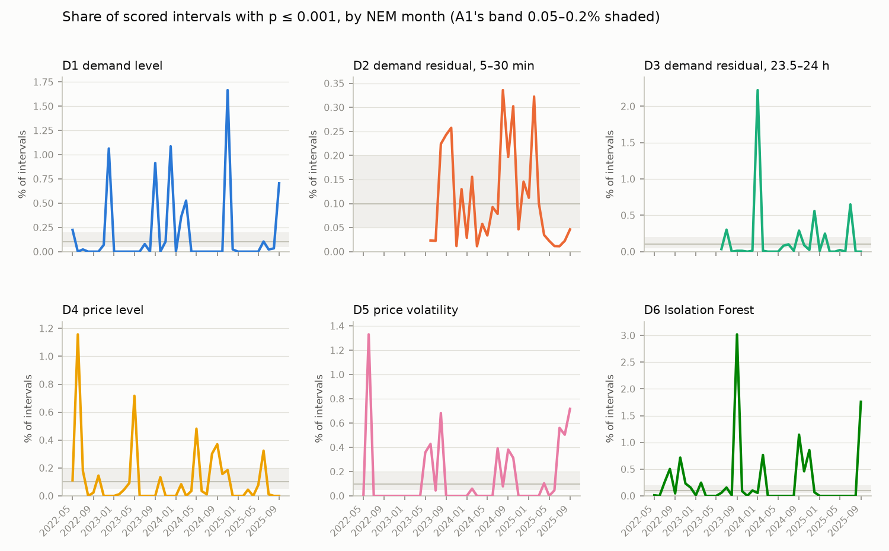
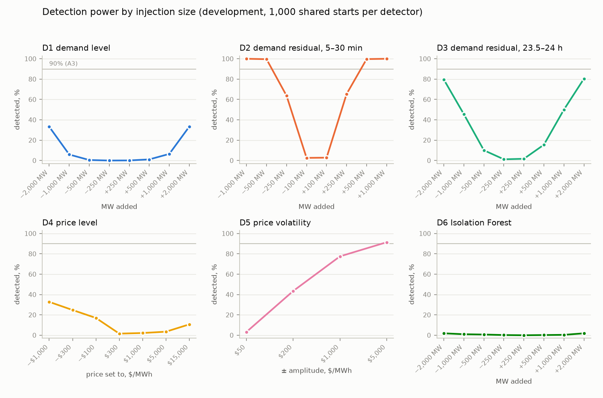

# M4: market anomalies in development (Victoria)

Generated by `gridcast report-m4` from the stored development run. Every number below is recomputed from the stored files and events; the report stops if a recomputed tier, line, event or count differs from the run's record. The criteria were pre-registered in [`docs/plans/m4_plan.md`](../docs/plans/m4_plan.md) §3, and every detector setting was fixed in §2 before any detector code or score existed. The recipe was frozen before this run, so these verdicts are blind to tuning.

## Verdicts (development)

| # | Pass if | Measured | Result |
| :--- | :--- | :--- | :--- |
| A1 | every calibrated detector: share at p ≤ 0.01 in [0.5%, 2%] and at p ≤ 0.001 in [0.05%, 0.2%] (12 checks) | 11 of 12 checks inside; outside: D6 1.79% / 0.259% (p ≤ 0.01 / p ≤ 0.001) | **FAIL** |
| A2 | every scorable class-P reference event has a notable calibrated alert within 30 min of its span | 6 of 7 caught; missed P05 | **FAIL** |
| A3 | ≥ 90% of injections detected at each detector's largest size, per sign (11 checks) | 3 of 11 at ≥ 90%; below: D1 −2,000 MW 33.2%, D1 +2,000 MW 33.4%, D3 −2,000 MW 79.6%, D3 +2,000 MW 80.4%, D4 $15,000 10.7%, D4 −$1,000 32.8%, D6 −2,000 MW 1.9%, D6 +2,000 MW 1.9% | **FAIL** |
| A4 | every development event has every evidence field filled or marked unavailable with a reason, and no summary has a banned phrase | 1102 of 1102 complete; 0 with a banned phrase | **PASS** |
| A5 | the synthetic causality suite passes (controls included), every real cut is identical, and no forest was fitted on its own month | suite 7 passed, 0 failed; 3 real cuts, 0 differences; 0 forest leaks | **PASS** |
| E1 (demand peaks) | the recomputed forecast equals the stored float32 value and base + Σ SHAP equals the raw prediction within 10⁻⁶, for every explained pair | 422 pairs; 0 forecast mismatches, 0 sum failures (largest error 2.0e-11) | **PASS** |

**3 of 6 pass.** Failures are published as measured; nothing in §2 was changed after this run. A disclosed, re-hashed v2 may follow (plan §6).

## Run

|  |  |
| :--- | :--- |
| Run | 104 (batch `40cbe0f5-d232-4bb9-8b92-0402ab249086`) |
| Anomaly config hash | `2ce8b3fc523ae81c` (frozen `2ce8b3fc523ae81c`) |
| Frozen recipe code | `2dc58fa`; run from `4990ebf` |
| Series | 420,768 intervals, 2021-09-30 14:05:00+00:00 → 2025-09-30 14:00:00+00:00 (UTC interval ends) |
| Scored | D1, D4–D6 and lines from 2022-05-01; D2–D3 from 2023-06-01; to 2025-10-01 (exclusive, NEM days) |
| D2/D3 band | QR batch `4bab11d7` with run 2's mask: 51,120 issue times; actuals equal market demand on 14,429,712 pairs |
| Run time | load 1 s, detect 46 s, inject 36 s, cuts 87 s, evidence 5 s |
| Freeze now | holds |
| Report code | `b0a5c5bc0c7efcdf30498567fafec6c40cbc724a` |

## A1: alert budget

Each detector's p-value is a conformal rank against its own trailing 26 weeks, so under exchangeability p ≤ 0.001 should flag about 0.1% of scored intervals. A1 allows a factor of 2 either way. *Scored* means inside the detector's scored period with a p-value (D2/D3: pairs in M2's common mask; D6: a month model).

| Detector | Scored intervals | p ≤ 0.01 | [0.5%, 2%] | p ≤ 0.001 | [0.05%, 0.2%] | p ≤ 0.0001 (reported) |
| :--- | ---: | ---: | :--- | ---: | :--- | ---: |
| D1 demand level | 359,712 | 1.07% | in | 0.170% | in | 0.0250% |
| D2 demand residual, 5–30 min | 239,749 | 1.05% | in | 0.111% | in | 0.0158% |
| D3 demand residual, 23.5–24 h | 239,461 | 1.08% | in | 0.120% | in | 0.0242% |
| D4 price level | 359,712 | 1.05% | in | 0.116% | in | 0.0167% |
| D5 price volatility | 359,712 | 1.08% | in | 0.147% | in | 0.0225% |
| D6 Isolation Forest | 359,712 | 1.79% | in | 0.259% | **out** | 0.0537% |

Share at p ≤ 0.001 by NEM year (reported only):

| NEM year | D1 | D2 | D3 | D4 | D5 | D6 |
| :--- | ---: | ---: | ---: | ---: | ---: | ---: |
| 2022 | 0.174% | – | – | 0.200% | 0.163% | 0.242% |
| 2023 | 0.183% | 0.131% | 0.054% | 0.085% | 0.127% | 0.303% |
| 2024 | 0.212% | 0.129% | 0.175% | 0.139% | 0.102% | 0.274% |
| 2025 | 0.095% | 0.074% | 0.103% | 0.051% | 0.216% | 0.193% |

## A2: AEMO-flagged reference events

Class-P events (price at a cap, floor or administered limit by AEMO's own flags, which are never detector inputs), from [`docs/m4_reference_events.md`](../docs/m4_reference_events.md). An event is caught if any calibrated detector (price lines excluded) raised a notable alert at an interval ending within 30 min of its span.

| Event | Span (local) | Flagged intervals | Price | Caught | Notable calibrated detectors (lowest p) | Lowest p of any calibrated detector (reported) |
| :--- | :--- | ---: | :--- | :--- | :--- | :--- |
| P03 | 2022-06-13 17:30 → 2022-06-15 14:00 | 335 | −$300 to $14,571 | yes | D4 (1.91 × 10⁻⁵) | D4 1.91 × 10⁻⁵ |
| P04 | 2024-02-13 14:15 → 2024-02-13 16:15 | 24 | $16,600 to $16,600 | yes | D2 (2.15 × 10⁻⁵), D4 (1.91 × 10⁻⁵), D6 (1.91 × 10⁻⁵) | D4 1.91 × 10⁻⁵ |
| P05 | 2024-08-05 08:00 → 2024-08-05 08:15 | 2 | $17,500 to $17,500 | **no** | none | D4 1.48 × 10⁻² |
| P06 | 2024-10-28 16:00 → 2024-10-28 16:05 | 1 | −$1,000 to −$1,000 | yes | D6 (7.63 × 10⁻⁴) | D6 7.63 × 10⁻⁴ |
| P07 | 2024-11-15 12:35 → 2024-11-15 12:40 | 1 | −$1,000 to −$1,000 | yes | D2 (5.72 × 10⁻⁴) | D2 5.72 × 10⁻⁴ |
| P08 | 2024-11-17 16:45 → 2024-11-17 16:55 | 2 | −$1,000 to −$1,000 | yes | D6 (1.91 × 10⁻⁵) | D6 1.91 × 10⁻⁵ |
| P09 | 2025-06-12 19:50 → 2025-06-12 19:55 | 1 | $17,500 to $17,500 | yes | D4 (3.82 × 10⁻⁵) | D4 3.82 × 10⁻⁵ |

Class O (reported only; such flags may leave no visible trace): 1 of 6 development events had a calibrated alert in the same window.

| Event | Span (local) | Flagged intervals | Price | Caught | Notable calibrated detectors (lowest p) | Lowest p of any calibrated detector (reported) |
| :--- | :--- | ---: | :--- | :--- | :--- | :--- |
| O02 | 2022-06-12 18:50 → 2022-06-24 14:00 | 2,766 | −$56 to $534 | yes | D4 (1.91 × 10⁻⁵), D5 (1.91 × 10⁻⁵) | D4 1.91 × 10⁻⁵ |
| O03 | 2022-08-10 11:30 → 2022-08-10 12:35 | 13 | $0 to $465 | **no** | none | D6 3.11 × 10⁻³ |
| O04 | 2022-11-17 10:05 → 2022-11-17 10:10 | 1 | $123 to $123 | **no** | none | D6 1.29 × 10⁻¹ |
| O05 | 2023-03-17 21:10 → 2023-03-17 22:10 | 12 | $108 to $114 | **no** | none | D4 1.22 × 10⁻¹ |
| O06 | 2023-04-22 16:15 → 2023-04-23 17:00 | 297 | −$45 to $169 | **no** | none | D5 8.55 × 10⁻³ |
| O07 | 2024-09-05 13:50 → 2024-09-05 15:10 | 16 | $34 to $53 | **no** | none | D2 9.84 × 10⁻³ |

## A3: detection power

Each injection is scored alone against the unmodified profiles, baselines, bands, forests and windows, at starts where the unmodified detector raised no notable alert within the span ± 1 h. Detected = at least one notable alert from that detector inside the span.

| Detector | Largest size | Injections | Detected | ≥ 90% |
| :--- | :--- | ---: | ---: | :--- |
| D1 demand level | −2,000 MW | 1,000 | 33.2% | **fail** |
| D1 demand level | +2,000 MW | 1,000 | 33.4% | **fail** |
| D2 demand residual, 5–30 min | −1,000 MW | 1,000 | 100.0% | pass |
| D2 demand residual, 5–30 min | +1,000 MW | 1,000 | 100.0% | pass |
| D3 demand residual, 23.5–24 h | −2,000 MW | 1,000 | 79.6% | **fail** |
| D3 demand residual, 23.5–24 h | +2,000 MW | 1,000 | 80.4% | **fail** |
| D4 price level | $15,000 | 1,000 | 10.7% | **fail** |
| D4 price level | −$1,000 | 1,000 | 32.8% | **fail** |
| D5 price volatility | $5,000 | 1,000 | 91.4% | pass |
| D6 Isolation Forest | −2,000 MW | 1,000 | 1.9% | **fail** |
| D6 Isolation Forest | +2,000 MW | 1,000 | 1.9% | **fail** |

All sizes (reported):

| Detector | Injections per size | Detected share by size |
| :--- | ---: | :--- |
| D1 demand level | 1,000 | −2,000 MW: 33.2%, −1,000 MW: 5.9%, −500 MW: 0.5%, −250 MW: 0.0%, +250 MW: 0.1%, +500 MW: 1.1%, +1,000 MW: 6.5%, +2,000 MW: 33.4% |
| D2 demand residual, 5–30 min | 1,000 | −1,000 MW: 100.0%, −500 MW: 99.6%, −250 MW: 63.7%, −100 MW: 2.6%, +100 MW: 2.8%, +250 MW: 65.4%, +500 MW: 99.7%, +1,000 MW: 100.0% |
| D3 demand residual, 23.5–24 h | 1,000 | −2,000 MW: 79.6%, −1,000 MW: 45.6%, −500 MW: 10.1%, −250 MW: 1.2%, +250 MW: 1.7%, +500 MW: 15.5%, +1,000 MW: 50.0%, +2,000 MW: 80.4% |
| D4 price level | 1,000 | −$1,000: 32.8%, −$300: 24.8%, −$100: 17.0%, $300: 1.6%, $1,000: 2.2%, $5,000: 3.5%, $15,000: 10.7% |
| D5 price volatility | 1,000 | $50: 3.3%, $200: 43.5%, $1,000: 77.5%, $5,000: 91.4% |
| D6 Isolation Forest | 1,000 | −2,000 MW: 1.9%, −1,000 MW: 1.0%, −500 MW: 0.7%, −250 MW: 0.2%, +250 MW: 0.0%, +500 MW: 0.2%, +1,000 MW: 0.4%, +2,000 MW: 1.9% |

Smallest size reaching 50% and 90% (reported):

| Detector | 50%, negative | 90%, negative | 50%, positive | 90%, positive |
| :--- | :--- | :--- | :--- | :--- |
| D1 demand level | not reached | not reached | not reached | not reached |
| D2 demand residual, 5–30 min | −250 MW | −500 MW | +250 MW | +500 MW |
| D3 demand residual, 23.5–24 h | −2,000 MW | not reached | +1,000 MW | not reached |
| D4 price level | not reached | not reached | not reached | not reached |
| D5 price volatility | – | – | $1,000 | $5,000 |
| D6 Isolation Forest | not reached | not reached | not reached | not reached |

Power at the largest size by start year (reported):

| Detector | Size | Detected by start year (NEM time) |
| :--- | :--- | :--- |
| D1 demand level | −2,000 MW | 2022: 46% (n 181); 2023: 38% (n 289); 2024: 26% (n 310); 2025: 25% (n 220) |
| D1 demand level | +2,000 MW | 2022: 45% (n 181); 2023: 37% (n 289); 2024: 30% (n 310); 2025: 24% (n 220) |
| D2 demand residual, 5–30 min | −1,000 MW | 2023: 100% (n 263); 2024: 100% (n 394); 2025: 100% (n 343) |
| D2 demand residual, 5–30 min | +1,000 MW | 2023: 100% (n 263); 2024: 100% (n 394); 2025: 100% (n 343) |
| D3 demand residual, 23.5–24 h | −2,000 MW | 2023: 92% (n 264); 2024: 80% (n 411); 2025: 68% (n 325) |
| D3 demand residual, 23.5–24 h | +2,000 MW | 2023: 89% (n 264); 2024: 83% (n 411); 2025: 70% (n 325) |
| D4 price level | $15,000 | 2022: 7% (n 193); 2023: 6% (n 279); 2024: 22% (n 307); 2025: 4% (n 221) |
| D4 price level | −$1,000 | 2022: 39% (n 193); 2023: 22% (n 279); 2024: 39% (n 307); 2025: 32% (n 221) |
| D5 price volatility | $5,000 | 2022: 75% (n 223); 2023: 93% (n 296); 2024: 97% (n 292); 2025: 100% (n 189) |
| D6 Isolation Forest | −2,000 MW | 2022: 4% (n 205); 2023: 3% (n 299); 2024: 1% (n 284); 2025: 0% (n 212) |
| D6 Isolation Forest | +2,000 MW | 2022: 1% (n 205); 2023: 3% (n 299); 2024: 2% (n 284); 2025: 0% (n 212) |

Reported only: holding the price flat for 3 h (D5's calm side) was detected in 11.1% of 1,000.

## A4: evidence without causal claims

1,102 development events; 0 incomplete, 0 with a banned phrase. Each evidence field is a fact with its source, labelled *known at the time* or *retrospective*, or marked unavailable with a reason.

## A5: causality

- Synthetic suite (`tests/unit/test_anomaly_causality.py`, run by this report): 7 passed, 0 failed. It includes a leaky control, which must be caught.
- Real data: the run repeated detection on the series truncated at 3 seeded cuts (2023-08-12 05:05:00+00:00, 2023-12-18 04:45:00+00:00, 2025-07-16 10:25:00+00:00); 0 differences at or before the cuts.
- Forests: 47 monthly models; 0 saw an interval ending after their month's start.

## Event catalogue (reported)

| Events | Count | Severe | Median duration, min | 90th percentile, min | Longest, min |
| :--- | ---: | ---: | ---: | ---: | ---: |
| from calibrated detectors | 475 | 104 | 20 | 115 | 920 |
| price lines only | 627 | 10 | 25 | 264 | 6,485 |
| all | 1,102 | 114 | 20 | 190 | 6,485 |

| Category (calibrated events; an event can hold several) | Events |
| :--- | ---: |
| unusual demand | 55 |
| unexpected demand (short-term) | 133 |
| unexpected demand (day-ahead) | 35 |
| high price | 33 |
| unusual price | 81 |
| volatility change | 49 |
| multivariate | 153 |

Calibrated events by NEM year: 2022 78, 2023 129, 2024 178, 2025 90.

Price-line-only events: 627, of which 10 reached $5,000/MWh. They are counted separately (§2.4).

Calibrated events in which both detectors fired (diagonal: events with that detector):

|  | D1 | D2 | D3 | D4 | D5 | D6 |
| :--- | ---: | ---: | ---: | ---: | ---: | ---: |
| D1 | 55 | 2 | 0 | 1 | 0 | 3 |
| D2 | 2 | 133 | 4 | 3 | 1 | 9 |
| D3 | 0 | 4 | 35 | 0 | 0 | 3 |
| D4 | 1 | 3 | 0 | 81 | 3 | 6 |
| D5 | 0 | 1 | 0 | 3 | 49 | 2 |
| D6 | 3 | 9 | 3 | 6 | 2 | 153 |

## Case studies

Chosen by the fixed rule (§3.2 and the step-4 tie rule): the 5 events with the lowest p from a calibrated detector, ties by more calibrated detectors firing, then a seeded draw; then the named days. Summaries are generated from the evidence by fixed templates and state facts only.

**1. lowest p (rank 1):** 2024-11-06 14:35 → 2024-11-06 15:45 local, peak interval ending 2024-11-06 15:10; severe; unusual demand, unexpected demand (short-term), high price, unusual price, multivariate; detectors D1 (p 2.29 × 10⁻⁴), D2 (p 7.82 × 10⁻⁴), D4 (p 1.91 × 10⁻⁵), D6 (p 1.91 × 10⁻⁵), L1.

> Severe event, 14:35–15:45 Wed 6 Nov 2024 (Melbourne time): the price in the 5 minutes to 15:10 was $596/MWh; the median for that half-hour on the previous 28 days was −$54/MWh (10th–90th percentile −$91 to −$28/MWh). Over the same 5 minutes, demand moved from 5,343 to 5,141 MW. AEMO flagged nothing in the event's span.

**2. lowest p (rank 2) (also the named day 2024-02-13):** 2024-02-13 13:15 → 2024-02-13 17:15 local, peak interval ending 2024-02-13 14:35; severe; unexpected demand (short-term), high price, unusual price, volatility change, multivariate; detectors D2 (p 2.15 × 10⁻⁵), D4 (p 1.91 × 10⁻⁵), D5 (p 9.35 × 10⁻⁴), D6 (p 1.91 × 10⁻⁵), L1, L2.

> Severe event, 13:15–17:15 Tue 13 Feb 2024 (Melbourne time): the price in the 5 minutes to 14:35 was $16,600/MWh; the median for that half-hour on the previous 28 days was −$52/MWh (10th–90th percentile −$114 to $48/MWh). Over the same 5 minutes, demand moved from 7,036 to 7,077 MW. In the event's span, AEMO flagged 24 of 48 intervals: VoLL override in 10; MPC/MPF binding in 15.

**3. lowest p (rank 3):** 2024-02-22 15:40 → 2024-02-22 17:05 local, peak interval ending 2024-02-22 16:20; severe; unexpected demand (short-term), high price, multivariate; detectors D2 (p 6.67 × 10⁻⁴), D6 (p 1.91 × 10⁻⁵), L1.

> Severe event, 15:40–17:05 Thu 22 Feb 2024 (Melbourne time): the multivariate detector (Isolation Forest) gave the 5 minutes to 16:20 a p-value of 1.9 × 10⁻⁵ against its training window (the 26 weeks before the month). Over the same 5 minutes, demand moved from 8,543 to 8,777 MW. AEMO flagged nothing in the event's span.

**4. lowest p (rank 4):** 2024-09-28 09:00 → 2024-09-28 11:05 local, peak interval ending 2024-09-28 09:50; severe; unexpected demand (short-term), multivariate; detectors D2 (p 7.63 × 10⁻⁴), D6 (p 1.91 × 10⁻⁵).

> Severe event, 09:00–11:05 Sat 28 Sep 2024 (Melbourne time): the multivariate detector (Isolation Forest) gave the 5 minutes to 09:50 a p-value of 1.9 × 10⁻⁵ against its training window (the 26 weeks before the month). Over the same 5 minutes, demand moved from 2,451 to 2,272 MW. AEMO flagged nothing in the event's span.

**5. lowest p (rank 5):** 2023-09-16 08:30 → 2023-09-16 13:00 local, peak interval ending 2023-09-16 09:20; severe; unusual demand, multivariate; detectors D1 (p 1.91 × 10⁻⁵), D6 (p 1.91 × 10⁻⁵).

> Severe event, 08:30–13:00 Sat 16 Sep 2023 (Melbourne time): demand in the 5 minutes to 09:20 was 2,809 MW; the median for that half-hour on the weekend days and public holidays among the previous 28 days was 4,461 MW (10th–90th percentile 3,913–5,332 MW). Over the same 5 minutes, the price moved from −$57 to −$58/MWh. AEMO flagged nothing in the event's span.

**6. named day 2024-12-09:** 2024-12-09 15:00 → 2024-12-09 16:00 local, peak interval ending 2024-12-09 15:45; severe; unexpected demand (short-term); detectors D2 (p 1.91 × 10⁻⁵).

> Severe event, 15:00–16:00 Mon 9 Dec 2024 (Melbourne time): demand in the 5 minutes to 15:45 was 2,418 MW, 2,541 MW below LightGBM C's latest forecast (4,960 MW, issued at 15:30) and outside its 2.5–97.5% quantile band (4,802–5,219 MW). Over the same 5 minutes, the price moved from $80 to −$146/MWh. AEMO flagged nothing in the event's span.

## Disclosures

- The detectors were designed after M2's and M3's development and holdout results had been seen. The planning saw some development facts (the flagged days, the largest 5-minute demand changes) and some holdout facts (plan §3.3).
- The warm-up smoke run (before any development score) previewed likely failures at the largest sizes for D1, D3, D4 and D6 and a low D1 alert rate; the user chose to keep the pre-registered recipe (plan §1).
- How this report reads each criterion was fixed in the plan while the development run was in progress, before any of its output was read (plan §1, step 4).
- After the first generation of this report, only its presentation changed (p-value formatting, local start times in the case studies, the order of the run times, and the reported-only column of each reference event's lowest p). No criterion's computation changed.
- Price associations, SHAP summaries and the holdout come in steps 5 and 6.
