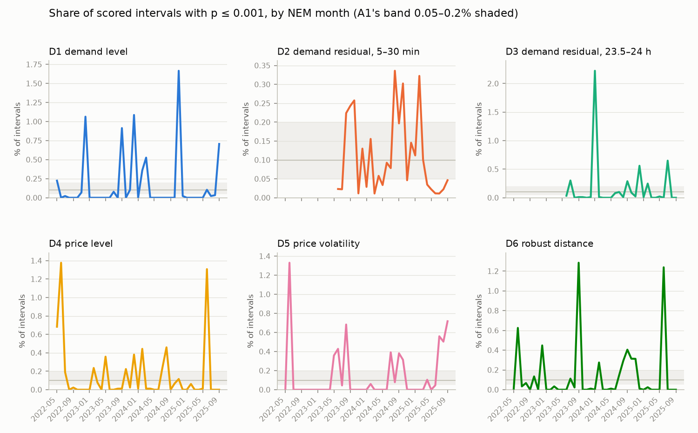
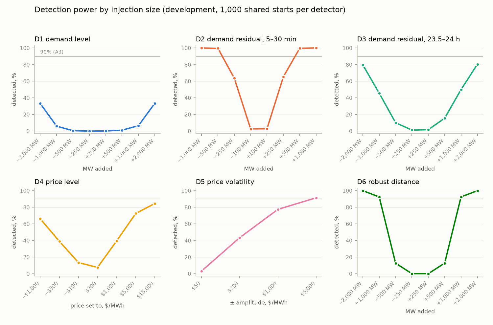

# M4 v2: market anomalies in development (Victoria), post hoc

Generated by `gridcast report-m4 --version 2` from v2's stored development run. Every number below is recomputed from the stored files and events; the report stops if a recomputed tier, line, event or count differs from the run's record. The criteria were pre-registered in [`docs/plans/m4_plan.md`](../docs/plans/m4_plan.md) §3. **v2 is a disclosed revision, so its verdicts are post hoc.** v1's development verdicts ([`m4_anomalies.md`](m4_anomalies.md)) failed A1, A2 and A3. A read-only diagnosis ([`docs/m4_v1_diagnosis.md`](../docs/m4_v1_diagnosis.md)) then found design defects in D4 and D6, and the user chose to revise those two only (plan §1, "Decided after the development verdicts"; §2.10): D4 uses asinh(price / $100), and D6 is a robust distance with a rolling p-value. Every v2 setting and this report's readings were frozen before this run, but they were chosen after v1's development results were seen, and P05 was known to be missed. The holdout year is v2's blind test (step 6). M5 and M6 serve v2 whatever it shows.

## Verdicts (development, post hoc)

| # | Pass if | v2 measured | v2 result (post hoc) | v1 (run 104, pre-registered) |
| :--- | :--- | :--- | :--- | :--- |
| A1 | every calibrated detector: share at p ≤ 0.01 in [0.5%, 2%] and at p ≤ 0.001 in [0.05%, 0.2%] (12 checks) | 12 of 12 checks inside | **PASS** | FAIL: 11 of 12 checks inside; outside: D6 1.79% / 0.259% (p ≤ 0.01 / p ≤ 0.001) |
| A2 | every scorable class-P reference event has a notable calibrated alert within 30 min of its span | 7 of 7 caught | **PASS** | FAIL: 6 of 7 caught; missed P05 |
| A3 | ≥ 90% of injections detected at each detector's largest size, per sign (11 checks) | 5 of 11 at ≥ 90%; below: D1 −2,000 MW 33.2%, D1 +2,000 MW 33.4%, D3 −2,000 MW 79.6%, D3 +2,000 MW 80.4%, D4 $15,000 84.6%, D4 −$1,000 66.2% | **FAIL** | FAIL: 3 of 11 at ≥ 90%; below: D1 −2,000 MW 33.2%, D1 +2,000 MW 33.4%, D3 −2,000 MW 79.6%, D3 +2,000 MW 80.4%, D4 $15,000 10.7%, D4 −$1,000 32.8%, D6 −2,000 MW 1.9%, D6 +2,000 MW 1.9% |
| A4 | every development event has every evidence field filled or marked unavailable with a reason, and no summary has a banned phrase | 994 of 994 complete; 0 with a banned phrase | **PASS** | PASS: 1102 of 1102 complete; 0 with a banned phrase |
| A5 | the synthetic causality suite passes (controls included), every real cut is identical, and no D6 month model was fitted on its own month | suite 7 passed, 0 failed; 3 real cuts, 0 differences; 0 month-model leaks | **PASS** | PASS: suite 7 passed, 0 failed; 3 real cuts, 0 differences; 0 forest leaks |
| E1 (demand peaks) | the recomputed forecast equals the stored float32 value and base + Σ SHAP equals the raw prediction within 10⁻⁶, for every explained pair | 424 pairs; 0 forecast mismatches, 0 sum failures (largest error 2.0e-11) | **PASS** | PASS: 422 pairs; 0 forecast mismatches, 0 sum failures (largest error 2.0e-11) |

**5 of 6 pass (post hoc).** v1's pre-registered development result was 3 of 6, and it stands as published.

## What changed: D4 and D6 (development)

| Development | v1 (Isolation Forest, asinh $10) | v2 (robust distance, asinh $100) |
| :--- | ---: | ---: |
| D4 share at p ≤ 0.01 / p ≤ 0.001 | 1.05% / 0.116% | 1.07% / 0.153% |
| D4 detected at $15,000 / −$1,000 | 10.7% / 32.8% | 84.6% / 66.2% |
| D6 share at p ≤ 0.01 / p ≤ 0.001 | 1.79% / 0.259% | 1.41% / 0.141% |
| D6 detected at −2,000 / +2,000 MW | 1.9% / 1.9% | 100.0% / 100.0% |
| P05: lowest p within 30 min (any calibrated detector) | D4 1.48 × 10⁻² | D4 7.44 × 10⁻⁴ (caught) |
| Calibrated events | 475 (104 severe) | 388 (76 severe) |
| Price-line-only events | 627 | 606 |

D1, D2, D3 and D5 are v1's: 20 stored columns (scores, p-values, window sizes, tiers and scored-period flags) equal run 104's exactly.

## Run

|  |  |
| :--- | :--- |
| Run | 106 (batch `0ff972b0-9d46-4ca0-a84f-86d85c450be1`) |
| Recipe | v2 (plan §2.10) |
| Anomaly config hash | `44abbf4b24cf6ac8` (frozen `44abbf4b24cf6ac8`) |
| Frozen recipe code | `04da607`; run from `7b989af` |
| Series | 420,768 intervals, 2021-09-30 14:05:00+00:00 → 2025-09-30 14:00:00+00:00 (UTC interval ends) |
| Scored | D1, D4–D6 and lines from 2022-05-01; D2–D3 from 2023-06-01; to 2025-10-01 (exclusive, NEM days) |
| D2/D3 band | QR batch `4bab11d7` with run 2's mask: 51,120 issue times; actuals equal market demand on 14,429,712 pairs |
| Run time | load 2 s, detect 38 s, inject 36 s, cuts 71 s, evidence 5 s |
| Freeze now | holds |
| Report code | `552fc628059277e444b2111df3ae730c0df9fc85` |

## A1: alert budget

Each detector's p-value is a conformal rank against its own trailing 26 weeks, so under exchangeability p ≤ 0.001 should flag about 0.1% of scored intervals. A1 allows a factor of 2 either way. *Scored* means inside the detector's scored period with a p-value (D2/D3: pairs in M2's common mask; D6: a month model).

| Detector | Scored intervals | p ≤ 0.01 | [0.5%, 2%] | p ≤ 0.001 | [0.05%, 0.2%] | p ≤ 0.0001 (reported) |
| :--- | ---: | ---: | :--- | ---: | :--- | ---: |
| D1 demand level | 359,712 | 1.07% | in | 0.170% | in | 0.0250% |
| D2 demand residual, 5–30 min | 239,749 | 1.05% | in | 0.111% | in | 0.0158% |
| D3 demand residual, 23.5–24 h | 239,461 | 1.08% | in | 0.120% | in | 0.0242% |
| D4 price level | 359,712 | 1.07% | in | 0.153% | in | 0.0200% |
| D5 price volatility | 359,712 | 1.08% | in | 0.147% | in | 0.0225% |
| D6 robust distance | 359,712 | 1.41% | in | 0.141% | in | 0.0200% |

Share at p ≤ 0.001 by NEM year (reported only):

| NEM year | D1 | D2 | D3 | D4 | D5 | D6 |
| :--- | ---: | ---: | ---: | ---: | ---: | ---: |
| 2022 | 0.174% | – | – | 0.282% | 0.163% | 0.164% |
| 2023 | 0.183% | 0.131% | 0.054% | 0.110% | 0.127% | 0.121% |
| 2024 | 0.212% | 0.129% | 0.175% | 0.112% | 0.102% | 0.146% |
| 2025 | 0.095% | 0.074% | 0.103% | 0.151% | 0.216% | 0.139% |

## A2: AEMO-flagged reference events

Class-P events (price at a cap, floor or administered limit by AEMO's own flags, which are never detector inputs), from [`docs/m4_reference_events.md`](../docs/m4_reference_events.md). An event is caught if any calibrated detector (price lines excluded) raised a notable alert at an interval ending within 30 min of its span.

| Event | Span (local) | Flagged intervals | Price | Caught | Notable calibrated detectors (lowest p) | Lowest p of any calibrated detector (reported) |
| :--- | :--- | ---: | :--- | :--- | :--- | :--- |
| P03 | 2022-06-13 17:30 → 2022-06-15 14:00 | 335 | −$300 to $14,571 | yes | D4 (1.91 × 10⁻⁵), D6 (1.91 × 10⁻⁵) | D4 1.91 × 10⁻⁵ |
| P04 | 2024-02-13 14:15 → 2024-02-13 16:15 | 24 | $16,600 to $16,600 | yes | D2 (2.15 × 10⁻⁵), D4 (1.91 × 10⁻⁵), D6 (1.91 × 10⁻⁵) | D4 1.91 × 10⁻⁵ |
| P05 | 2024-08-05 08:00 → 2024-08-05 08:15 | 2 | $17,500 to $17,500 | yes | D4 (7.44 × 10⁻⁴) | D4 7.44 × 10⁻⁴ |
| P06 | 2024-10-28 16:00 → 2024-10-28 16:05 | 1 | −$1,000 to −$1,000 | yes | D6 (3.43 × 10⁻⁴) | D6 3.43 × 10⁻⁴ |
| P07 | 2024-11-15 12:35 → 2024-11-15 12:40 | 1 | −$1,000 to −$1,000 | yes | D2 (5.72 × 10⁻⁴), D4 (7.44 × 10⁻⁴), D6 (1.91 × 10⁻⁴) | D6 1.91 × 10⁻⁴ |
| P08 | 2024-11-17 16:45 → 2024-11-17 16:55 | 2 | −$1,000 to −$1,000 | yes | D4 (4.58 × 10⁻⁴), D6 (8.39 × 10⁻⁴) | D4 4.58 × 10⁻⁴ |
| P09 | 2025-06-12 19:50 → 2025-06-12 19:55 | 1 | $17,500 to $17,500 | yes | D4 (1.91 × 10⁻⁵), D6 (1.91 × 10⁻⁵) | D4 1.91 × 10⁻⁵ |

Class O (reported only; such flags may leave no visible trace): 2 of 6 development events had a calibrated alert in the same window.

| Event | Span (local) | Flagged intervals | Price | Caught | Notable calibrated detectors (lowest p) | Lowest p of any calibrated detector (reported) |
| :--- | :--- | ---: | :--- | :--- | :--- | :--- |
| O02 | 2022-06-12 18:50 → 2022-06-24 14:00 | 2,766 | −$56 to $534 | yes | D4 (1.91 × 10⁻⁵), D5 (1.91 × 10⁻⁵), D6 (1.91 × 10⁻⁵) | D4 1.91 × 10⁻⁵ |
| O03 | 2022-08-10 11:30 → 2022-08-10 12:35 | 13 | $0 to $465 | yes | D6 (3.62 × 10⁻⁴) | D6 3.62 × 10⁻⁴ |
| O04 | 2022-11-17 10:05 → 2022-11-17 10:10 | 1 | $123 to $123 | **no** | none | D4 1.05 × 10⁻¹ |
| O05 | 2023-03-17 21:10 → 2023-03-17 22:10 | 12 | $108 to $114 | **no** | none | D6 2.84 × 10⁻² |
| O06 | 2023-04-22 16:15 → 2023-04-23 17:00 | 297 | −$45 to $169 | **no** | none | D5 8.55 × 10⁻³ |
| O07 | 2024-09-05 13:50 → 2024-09-05 15:10 | 16 | $34 to $53 | **no** | none | D2 9.84 × 10⁻³ |

## A3: detection power

Each injection is scored alone against the unmodified profiles, baselines, bands, month models and windows, at starts where the unmodified detector raised no notable alert within the span ± 1 h. Detected = at least one notable alert from that detector inside the span.

| Detector | Largest size | Injections | Detected | ≥ 90% |
| :--- | :--- | ---: | ---: | :--- |
| D1 demand level | −2,000 MW | 1,000 | 33.2% | **fail** |
| D1 demand level | +2,000 MW | 1,000 | 33.4% | **fail** |
| D2 demand residual, 5–30 min | −1,000 MW | 1,000 | 100.0% | pass |
| D2 demand residual, 5–30 min | +1,000 MW | 1,000 | 100.0% | pass |
| D3 demand residual, 23.5–24 h | −2,000 MW | 1,000 | 79.6% | **fail** |
| D3 demand residual, 23.5–24 h | +2,000 MW | 1,000 | 80.4% | **fail** |
| D4 price level | $15,000 | 1,000 | 84.6% | **fail** |
| D4 price level | −$1,000 | 1,000 | 66.2% | **fail** |
| D5 price volatility | $5,000 | 1,000 | 91.4% | pass |
| D6 robust distance | −2,000 MW | 1,000 | 100.0% | pass |
| D6 robust distance | +2,000 MW | 1,000 | 100.0% | pass |

All sizes (reported):

| Detector | Injections per size | Detected share by size |
| :--- | ---: | :--- |
| D1 demand level | 1,000 | −2,000 MW: 33.2%, −1,000 MW: 5.9%, −500 MW: 0.5%, −250 MW: 0.0%, +250 MW: 0.1%, +500 MW: 1.1%, +1,000 MW: 6.5%, +2,000 MW: 33.4% |
| D2 demand residual, 5–30 min | 1,000 | −1,000 MW: 100.0%, −500 MW: 99.6%, −250 MW: 63.7%, −100 MW: 2.6%, +100 MW: 2.8%, +250 MW: 65.4%, +500 MW: 99.7%, +1,000 MW: 100.0% |
| D3 demand residual, 23.5–24 h | 1,000 | −2,000 MW: 79.6%, −1,000 MW: 45.6%, −500 MW: 10.1%, −250 MW: 1.2%, +250 MW: 1.7%, +500 MW: 15.5%, +1,000 MW: 50.0%, +2,000 MW: 80.4% |
| D4 price level | 1,000 | −$1,000: 66.2%, −$300: 39.1%, −$100: 13.5%, $300: 7.6%, $1,000: 39.5%, $5,000: 72.5%, $15,000: 84.6% |
| D5 price volatility | 1,000 | $50: 3.3%, $200: 43.5%, $1,000: 77.5%, $5,000: 91.4% |
| D6 robust distance | 1,000 | −2,000 MW: 100.0%, −1,000 MW: 92.4%, −500 MW: 12.7%, −250 MW: 0.1%, +250 MW: 0.1%, +500 MW: 12.8%, +1,000 MW: 92.5%, +2,000 MW: 100.0% |

Smallest size reaching 50% and 90% (reported):

| Detector | 50%, negative | 90%, negative | 50%, positive | 90%, positive |
| :--- | :--- | :--- | :--- | :--- |
| D1 demand level | not reached | not reached | not reached | not reached |
| D2 demand residual, 5–30 min | −250 MW | −500 MW | +250 MW | +500 MW |
| D3 demand residual, 23.5–24 h | −2,000 MW | not reached | +1,000 MW | not reached |
| D4 price level | −$1,000 | not reached | $5,000 | not reached |
| D5 price volatility | – | – | $1,000 | $5,000 |
| D6 robust distance | −1,000 MW | −1,000 MW | +1,000 MW | +1,000 MW |

Power at the largest size by start year (reported):

| Detector | Size | Detected by start year (NEM time) |
| :--- | :--- | :--- |
| D1 demand level | −2,000 MW | 2022: 46% (n 181); 2023: 38% (n 289); 2024: 26% (n 310); 2025: 25% (n 220) |
| D1 demand level | +2,000 MW | 2022: 45% (n 181); 2023: 37% (n 289); 2024: 30% (n 310); 2025: 24% (n 220) |
| D2 demand residual, 5–30 min | −1,000 MW | 2023: 100% (n 263); 2024: 100% (n 394); 2025: 100% (n 343) |
| D2 demand residual, 5–30 min | +1,000 MW | 2023: 100% (n 263); 2024: 100% (n 394); 2025: 100% (n 343) |
| D3 demand residual, 23.5–24 h | −2,000 MW | 2023: 92% (n 264); 2024: 80% (n 411); 2025: 68% (n 325) |
| D3 demand residual, 23.5–24 h | +2,000 MW | 2023: 89% (n 264); 2024: 83% (n 411); 2025: 70% (n 325) |
| D4 price level | $15,000 | 2022: 75% (n 194); 2023: 97% (n 276); 2024: 91% (n 308); 2025: 68% (n 222) |
| D4 price level | −$1,000 | 2022: 65% (n 194); 2023: 78% (n 276); 2024: 69% (n 308); 2025: 49% (n 222) |
| D5 price volatility | $5,000 | 2022: 75% (n 223); 2023: 93% (n 296); 2024: 97% (n 292); 2025: 100% (n 189) |
| D6 robust distance | −2,000 MW | 2022: 100% (n 205); 2023: 100% (n 300); 2024: 100% (n 284); 2025: 100% (n 211) |
| D6 robust distance | +2,000 MW | 2022: 100% (n 205); 2023: 100% (n 300); 2024: 100% (n 284); 2025: 100% (n 211) |

Reported only: holding the price flat for 3 h (D5's calm side) was detected in 11.1% of 1,000.

## A4: evidence without causal claims

994 development events; 0 incomplete, 0 with a banned phrase. Each evidence field is a fact with its source, labelled *known at the time* or *retrospective*, or marked unavailable with a reason.

## A5: causality

- Synthetic suite (`tests/unit/test_anomaly_causality.py`, its v2 cases, run by this report): 7 passed, 0 failed. It includes a leaky control, which must be caught.
- Real data: the run repeated detection on the series truncated at 3 seeded cuts (2023-08-12 05:05:00+00:00, 2023-12-18 04:45:00+00:00, 2025-07-16 10:25:00+00:00); 0 differences at or before the cuts.
- D6 month models: 47 monthly models; 0 saw an interval ending after their month's start.

## Event catalogue (reported)

| Events | Count | Severe | Median duration, min | 90th percentile, min | Longest, min |
| :--- | ---: | ---: | ---: | ---: | ---: |
| from calibrated detectors | 388 | 76 | 20 | 135 | 3,245 |
| price lines only | 606 | 2 | 20 | 258 | 6,485 |
| all | 994 | 78 | 20 | 200 | 6,485 |

| Category (calibrated events; an event can hold several) | Events |
| :--- | ---: |
| unusual demand | 56 |
| unexpected demand (short-term) | 133 |
| unexpected demand (day-ahead) | 35 |
| high price | 53 |
| unusual price | 94 |
| volatility change | 49 |
| multivariate | 77 |

Calibrated events by NEM year: 2022 50, 2023 125, 2024 148, 2025 65.

Price-line-only events: 606, of which 2 reached $5,000/MWh. They are counted separately (§2.4).

Calibrated events in which both detectors fired (diagonal: events with that detector):

|  | D1 | D2 | D3 | D4 | D5 | D6 |
| :--- | ---: | ---: | ---: | ---: | ---: | ---: |
| D1 | 56 | 2 | 0 | 2 | 0 | 8 |
| D2 | 2 | 133 | 4 | 4 | 0 | 7 |
| D3 | 0 | 4 | 35 | 1 | 0 | 1 |
| D4 | 2 | 4 | 1 | 94 | 3 | 29 |
| D5 | 0 | 0 | 0 | 3 | 49 | 1 |
| D6 | 8 | 7 | 1 | 29 | 1 | 77 |

## Case studies

Chosen by the fixed rule (§3.2 and the step-4 tie rule): the 5 events with the lowest p from a calibrated detector, ties by more calibrated detectors firing, then a seeded draw; then the named days. Summaries are generated from the evidence by fixed templates and state facts only.

**1. lowest p (rank 1) (also the named day 2024-02-13):** 2024-02-13 13:00 → 2024-02-13 16:15 local, peak interval ending 2024-02-13 14:40; severe; unexpected demand (short-term), high price, unusual price, multivariate; detectors D2 (p 2.15 × 10⁻⁵), D4 (p 1.91 × 10⁻⁵), D6 (p 1.91 × 10⁻⁵), L1, L2.

> Severe event, 13:00–16:15 Tue 13 Feb 2024 (Melbourne time): the multivariate detector (robust distance) gave the 5 minutes to 14:40 a p-value of 1.9 × 10⁻⁵ against its trailing 26 weeks. Over the same 5 minutes, demand moved from 7,077 to 6,859 MW. In the event's span, AEMO flagged 24 of 39 intervals: VoLL override in 10; MPC/MPF binding in 15.

**2. lowest p (rank 2):** 2022-06-13 17:45 → 2022-06-13 18:30 local, peak interval ending 2022-06-13 18:05; severe; high price, unusual price, multivariate; detectors D4 (p 1.91 × 10⁻⁵), D6 (p 3.82 × 10⁻⁵), L1, L2.

> Severe event, 17:45–18:30 Mon 13 Jun 2022 (Melbourne time): the price in the 5 minutes to 18:05 was $14,518/MWh; the median for that half-hour on the previous 28 days was $355/MWh (10th–90th percentile $301 to $544/MWh). Over the same 5 minutes, demand moved from 6,751 to 6,766 MW. In the event's span, AEMO flagged 2 of 9 intervals: MPC/MPF binding in 2; price scaled by the inter-regional loss factor in 2.

**3. lowest p (rank 3) (also the named day 2024-12-09):** 2024-12-09 15:00 → 2024-12-09 16:00 local, peak interval ending 2024-12-09 15:45; severe; unexpected demand (short-term), multivariate; detectors D2 (p 1.91 × 10⁻⁵), D6 (p 1.91 × 10⁻⁵).

> Severe event, 15:00–16:00 Mon 9 Dec 2024 (Melbourne time): the multivariate detector (robust distance) gave the 5 minutes to 15:45 a p-value of 1.9 × 10⁻⁵ against its trailing 26 weeks. Over the same 5 minutes, demand moved from 5,518 to 2,418 MW. AEMO flagged nothing in the event's span.

**4. lowest p (rank 4):** 2025-06-11 16:20 → 2025-06-11 21:45 local, peak interval ending 2025-06-11 19:00; severe; high price, unusual price, multivariate; detectors D4 (p 1.91 × 10⁻⁵), D6 (p 1.91 × 10⁻⁵), L1, L2.

> Severe event, 16:20–21:45 Wed 11 Jun 2025 (Melbourne time): the multivariate detector (robust distance) gave the 5 minutes to 19:00 a p-value of 1.9 × 10⁻⁵ against its trailing 26 weeks. Over the same 5 minutes, demand moved from 7,701 to 7,676 MW. AEMO flagged nothing in the event's span.

**5. lowest p (rank 5):** 2024-11-16 17:55 → 2024-11-16 21:05 local, peak interval ending 2024-11-16 19:00; severe; unusual demand, multivariate; detectors D1 (p 1.91 × 10⁻⁵), D6 (p 4.77 × 10⁻⁴).

> Severe event, 17:55–21:05 Sat 16 Nov 2024 (Melbourne time): demand in the 5 minutes to 19:00 was 5,924 MW; the median for that half-hour on the weekend days and public holidays among the previous 28 days was 4,531 MW (10th–90th percentile 4,377–4,783 MW). Over the same 5 minutes, the price moved from $131 to $139/MWh. AEMO flagged nothing in the event's span.

## Disclosures

- The detectors were designed after M2's and M3's development and holdout results had been seen. The planning saw some development facts (the flagged days, the largest 5-minute demand changes) and some holdout facts (plan §3.3).
- v2 was designed after v1's development verdicts and diagnosis, so every v2 development verdict is post hoc: it shows whether the revision fixed the diagnosed defects on the data that revealed them, not how it performs on unseen data.
- To keep v1 runnable, the frozen modules were generalised behind a recipe version. v1's code freeze was carried to v2's frozen commit by reproducing run 104 exactly (`gridcast anomalies-reproduce`; plan step 4g). This report also checks that v2's D1, D2, D3 and D5 equal run 104's.
- The warm-up smoke runs under v2 (before any v2 development score) previewed high power for v2's D4 and D6 and a low D6 alert rate in the warm-up weeks (plan step 4g).
- How this report reads v2 was fixed before v2's development run (plan §2.10).
- The first v2 development run computed every output, then failed on insert: the events table's detector list did not yet name `robust_distance` (fixed by migration 0008). Nothing was stored, and this run is the rerun from the same frozen code. What was seen of the failed attempt (two cut counts in its log, and 11 events' fields in its error message) is listed in plan step 4h.
- Price associations, SHAP summaries and the holdout of both versions come in steps 5 and 6.
