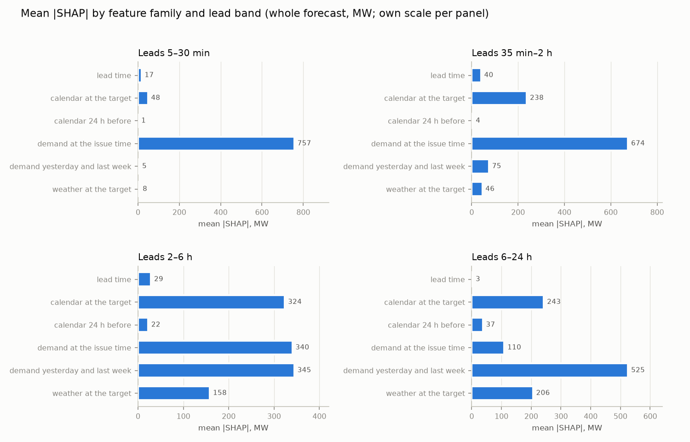
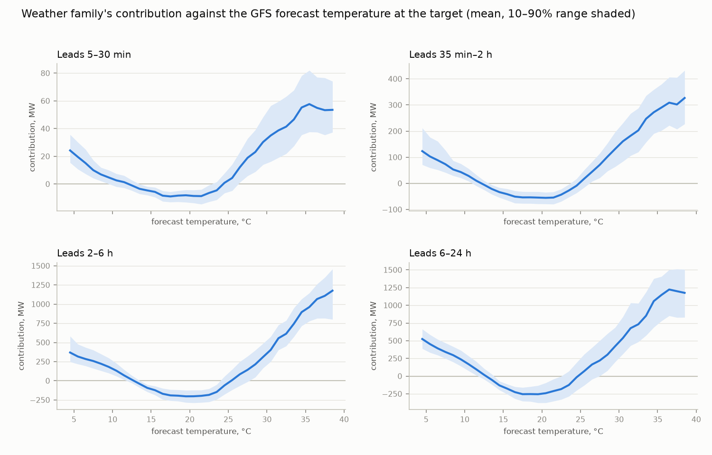
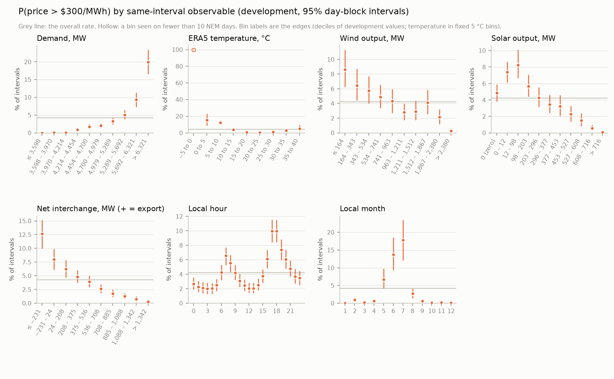
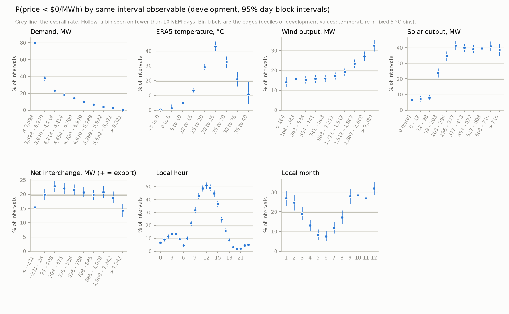

# M4 explanations: the demand model's SHAP values and price associations (development, Victoria)

Generated by `gridcast report-m4-explain` at commit `77cf85d` from the stored global SHAP sample (`gridcast explain-dev` at commit `f128f19`, 2026-11-20 12:34 UTC: run 2, batch `6d783932…`, 48 fits, up to 20,000 seeded pairs per fit over the issue times of NEM days 2022-11-01 → 2025-09-30) and the database. Every number below is computed from those outputs. The decisions behind it are in [`docs/plans/m4_plan.md`](../docs/plans/m4_plan.md) §1 ("Clarified in step 5"), §2.6 and §2.7. Reported only: E1 is the one criterion here.

## How to read this report

- **Whole forecast.** Each M2 fit predicts a correction to an anchor that depends on its target form: nothing (*direct*), the latest demand (*latest*), demand at the same time yesterday (*residual*), or both plus yesterday's change (*anchored*). Raw TreeSHAP covers only the correction. The headline adds each fit's anchor to the features it is made of, as x − x̄ over the fit's own sample, which is the exact Shapley value of a linear term. Every pair then reads forecast = constant + Σ contributions, exactly, whatever the form, so fits of different forms can be pooled.
- **The mix is disclosed.** The trees' part is path-dependent TreeSHAP and the anchor's part is an interventional attribution against the sample, so the sum is the Shapley value of neither game exactly. It adds up to the forecast. The raw tree-only values are shown by target form beside the headline.
- **The model's arithmetic, not the grid's physics.** A contribution says how the model's forecast moved with an input. Correlated inputs (several temperature terms, demand lags) share credit among themselves, so families are the main unit.
- **Price associations are association only:** rates by same-interval conditions, with no model and no claim about mechanism.

## 1. E1 on the global sample

E1 (§3) asks that every explained pair's recomputed forecast, cast to float32 as M2 stored it, equals the stored forecast bit for bit, and that base value + Σ SHAP equals the raw prediction within 1e-06. On the global sample: **PASS**. The float64 column is for information: the gate compares float32 values, and one float32 step near 8,000 MW is about 0.001 MW.

| Leads | Fits | Pairs | Forecast mismatches | Largest \|float64 − stored\|, MW | SHAP-sum failures | Largest SHAP-sum error |
| :--- | ---: | ---: | ---: | ---: | ---: | ---: |
| 5–30 min | 12 | 237,568 | 0 | 4.9e-04 | 0 | 2.9e-11 |
| 35 min–2 h | 12 | 240,000 | 0 | 4.9e-04 | 0 | 6.0e-11 |
| 2–6 h | 12 | 240,000 | 0 | 4.9e-04 | 0 | 4.7e-11 |
| 6–24 h | 12 | 240,000 | 0 | 4.8e-04 | 0 | 5.5e-11 |
| **all** | 48 | 957,568 | 0 | 4.9e-04 | 0 | 6.0e-11 |

## 2. Which inputs the forecasts lean on

Mean |SHAP| is the average size of a family's contribution to the forecast, in MW, on the whole-forecast decomposition. The largest family per band: 5–30 min: demand at the issue time (757 MW); 35 min–2 h: demand at the issue time (674 MW); 2–6 h: demand yesterday and last week (345 MW); 6–24 h: demand yesterday and last week (525 MW).

| Family (mean \|SHAP\|, MW) | 5–30 min | 35 min–2 h | 2–6 h | 6–24 h |
| :--- | ---: | ---: | ---: | ---: |
| lead time | 17 | 40 | 29 | 3 |
| calendar at the target | 48 | 238 | 324 | 243 |
| calendar 24 h before | 1 | 4 | 22 | 37 |
| demand at the issue time | 757 | 674 | 340 | 110 |
| demand yesterday and last week | 5 | 75 | 345 | 525 |
| weather at the target | 8 | 46 | 158 | 206 |
| *pairs* | 237,568 | 240,000 | 240,000 | 240,000 |

Run 2 chose a target form per retrain and band (M2 step 3):

| Leads | Target forms of run 2's fits |
| :--- | :--- |
| 5–30 min | latest 12 |
| 35 min–2 h | latest 11, direct 1 |
| 2–6 h | latest 8, direct 2, residual 2 |
| 6–24 h | direct 5, residual 4, anchored 2, latest 1 |

**M2's split gain** (tree-only, so it describes the correction to each fit's anchor, not the whole forecast), as a share of each fit's total, averaged over the band's fits:

| Family (share of split gain) | 5–30 min | 35 min–2 h | 2–6 h | 6–24 h |
| :--- | ---: | ---: | ---: | ---: |
| lead time | 6.0% | 4.3% | 2.0% | 0.2% |
| calendar at the target | 32.6% | 48.4% | 34.0% | 26.0% |
| calendar 24 h before | 0.2% | 0.3% | 0.9% | 2.5% |
| demand at the issue time | 50.4% | 34.2% | 32.3% | 18.1% |
| demand yesterday and last week | 6.1% | 6.7% | 22.2% | 38.2% |
| weather at the target | 4.7% | 6.1% | 8.6% | 15.0% |

**Raw TreeSHAP by target form** (tree-only, relative to each fit's anchor; mean \|SHAP\| of the family, MW). These are the values the headline adds the anchor to:

| Leads | Target form | Fits | Pairs | lead time | calendar at the target | calendar 24 h before | demand at the issue time | demand yesterday and last week | weather at the target |
| :--- | :--- | ---: | ---: | ---: | ---: | ---: | ---: | ---: | ---: |
| 5–30 min | latest | 12 | 237,568 | 17 | 48 | 1 | 48 | 5 | 8 |
| 35 min–2 h | direct | 1 | 20,000 | 30 | 156 | 6 | 741 | 325 | 49 |
| 35 min–2 h | latest | 11 | 220,000 | 41 | 245 | 4 | 140 | 52 | 46 |
| 2–6 h | direct | 2 | 40,000 | 8 | 194 | 27 | 183 | 459 | 143 |
| 2–6 h | latest | 8 | 160,000 | 38 | 397 | 21 | 562 | 274 | 167 |
| 2–6 h | residual | 2 | 40,000 | 11 | 161 | 25 | 198 | 275 | 138 |
| 6–24 h | anchored | 2 | 40,000 | 8 | 260 | 50 | 449 | 367 | 224 |
| 6–24 h | direct | 5 | 100,000 | 1 | 246 | 33 | 41 | 474 | 203 |
| 6–24 h | latest | 1 | 20,000 | 4 | 363 | 31 | 925 | 470 | 233 |
| 6–24 h | residual | 4 | 80,000 | 2 | 201 | 38 | 54 | 269 | 194 |

Every feature: mean |SHAP| (whole forecast, MW) and split-gain share

| Feature | Family | 5–30 min | 35 min–2 h | 2–6 h | 6–24 h |
| :--- | :--- | ---: | ---: | ---: | ---: |
| `lead_minutes` | lead time | 17.0 | 40.3 | 28.7 | 2.8 |
| `cal_slot` | calendar at the target | 17.6 | 59.8 | 140.2 | 79.3 |
| `cal_day_of_week` | calendar at the target | 1.9 | 9.4 | 31.7 | 53.0 |
| `cal_month` | calendar at the target | 4.9 | 24.2 | 64.5 | 89.1 |
| `cal_non_working` | calendar at the target | 3.6 | 20.5 | 69.3 | 132.7 |
| `cal_public_holiday` | calendar at the target | 0.2 | 1.4 | 5.1 | 5.8 |
| `cal_dst_change_day` | calendar at the target | 0.0 | 0.1 | 0.2 | 0.3 |
| `cal_tod_sin` | calendar at the target | 19.2 | 32.8 | 150.7 | 51.9 |
| `cal_tod_cos` | calendar at the target | 17.1 | 177.0 | 57.4 | 40.9 |
| `cal_yesterday_non_working` | calendar 24 h before | 0.9 | 4.1 | 22.0 | 36.1 |
| `cal_yesterday_public_holiday` | calendar 24 h before | 0.1 | 0.3 | 1.0 | 2.6 |
| `dem_now` | demand at the issue time | 748.1 | 689.3 | 430.9 | 61.5 |
| `dem_now_vs_yesterday` | demand at the issue time | 1.7 | 23.5 | 85.2 | 23.2 |
| `dem_change_1h` | demand at the issue time | 36.8 | 60.4 | 22.7 | 1.6 |
| `dem_mean_1h` | demand at the issue time | 7.4 | 65.6 | 247.0 | 7.0 |
| `dem_std_1h` | demand at the issue time | 10.8 | 10.1 | 11.2 | 0.3 |
| `dem_mean_24h` | demand at the issue time | 3.4 | 14.7 | 37.0 | 27.1 |
| `dem_std_24h` | demand at the issue time | 2.8 | 10.0 | 22.2 | 24.6 |
| `dem_same_time_yesterday` | demand yesterday and last week | 3.1 | 52.4 | 284.3 | 510.4 |
| `dem_same_time_last_week` | demand yesterday and last week | 2.4 | 27.7 | 99.4 | 94.4 |
| `dem_yesterday_vs_last_week` | demand yesterday and last week | 1.1 | 5.0 | 31.4 | 81.8 |
| `wx_temp` | weather at the target | 2.7 | 14.8 | 50.2 | 60.9 |
| `wx_cooling_degrees` | weather at the target | 2.6 | 12.6 | 30.3 | 35.0 |
| `wx_heating_degrees` | weather at the target | 2.6 | 17.9 | 71.5 | 88.9 |
| `wx_temp_sq` | weather at the target | 0.3 | 2.0 | 7.5 | 8.5 |
| `wx_temp_single_site` | weather at the target | 1.7 | 9.2 | 32.5 | 52.7 |

| Feature (share of split gain) | 5–30 min | 35 min–2 h | 2–6 h | 6–24 h |
| :--- | ---: | ---: | ---: | ---: |
| `lead_minutes` | 6.0% | 4.3% | 2.0% | 0.2% |
| `cal_slot` | 12.2% | 10.0% | 13.3% | 5.7% |
| `cal_day_of_week` | 0.9% | 1.4% | 2.4% | 5.4% |
| `cal_month` | 2.2% | 3.9% | 3.2% | 4.9% |
| `cal_non_working` | 0.7% | 1.0% | 1.9% | 3.8% |
| `cal_public_holiday` | 0.0% | 0.1% | 0.3% | 0.5% |
| `cal_dst_change_day` | 0.0% | 0.0% | 0.0% | 0.1% |
| `cal_tod_sin` | 7.2% | 4.2% | 8.9% | 2.6% |
| `cal_tod_cos` | 9.3% | 27.8% | 4.0% | 3.0% |
| `cal_yesterday_non_working` | 0.2% | 0.3% | 0.7% | 2.1% |
| `cal_yesterday_public_holiday` | 0.0% | 0.1% | 0.2% | 0.4% |
| `dem_now` | 4.2% | 7.5% | 4.3% | 2.6% |
| `dem_now_vs_yesterday` | 2.4% | 3.0% | 7.6% | 7.3% |
| `dem_change_1h` | 25.1% | 8.3% | 1.1% | 0.0% |
| `dem_mean_1h` | 4.9% | 5.9% | 11.7% | 0.2% |
| `dem_std_1h` | 8.5% | 2.7% | 0.5% | 0.0% |
| `dem_mean_24h` | 2.6% | 3.6% | 3.9% | 4.4% |
| `dem_std_24h` | 2.8% | 3.2% | 3.2% | 3.5% |
| `dem_same_time_yesterday` | 2.1% | 3.0% | 13.1% | 22.7% |
| `dem_same_time_last_week` | 2.2% | 2.3% | 6.2% | 7.5% |
| `dem_yesterday_vs_last_week` | 1.8% | 1.4% | 2.9% | 8.0% |
| `wx_temp` | 1.3% | 1.6% | 2.2% | 3.4% |
| `wx_cooling_degrees` | 0.9% | 1.4% | 1.6% | 2.6% |
| `wx_heating_degrees` | 0.9% | 1.1% | 2.1% | 3.6% |
| `wx_temp_sq` | 0.1% | 0.2% | 0.3% | 0.5% |
| `wx_temp_single_site` | 1.5% | 1.8% | 2.3% | 5.0% |

## 3. Stability across retrains

Spearman correlation between consecutive retrains' rankings of the 26 features by mean |SHAP| (whole forecast), per band. 1 means the same order.

| Leads | Median | Lowest | Same form: pairs, median | Form changed: pairs, median |
| :--- | ---: | ---: | ---: | ---: |
| 5–30 min | 0.96 | 0.93 | 11: 0.96 | – |
| 35 min–2 h | 0.96 | 0.80 | 9: 0.98 | 2: 0.82 |
| 2–6 h | 0.78 | 0.55 | 5: 0.94 | 6: 0.66 |
| 6–24 h | 0.94 | 0.51 | 6: 0.97 | 5: 0.77 |

Every consecutive pair

| Leads | Retrains | Target forms | Spearman |
| :--- | :--- | :--- | ---: |
| 5–30 min | 2022-11-01 → 2023-02-01 | latest → latest | 0.94 |
| 5–30 min | 2023-02-01 → 2023-05-01 | latest → latest | 0.97 |
| 5–30 min | 2023-05-01 → 2023-08-01 | latest → latest | 0.99 |
| 5–30 min | 2023-08-01 → 2023-11-01 | latest → latest | 0.96 |
| 5–30 min | 2023-11-01 → 2024-02-01 | latest → latest | 0.98 |
| 5–30 min | 2024-02-01 → 2024-05-01 | latest → latest | 0.93 |
| 5–30 min | 2024-05-01 → 2024-08-01 | latest → latest | 0.99 |
| 5–30 min | 2024-08-01 → 2024-11-01 | latest → latest | 0.96 |
| 5–30 min | 2024-11-01 → 2025-02-01 | latest → latest | 0.99 |
| 5–30 min | 2025-02-01 → 2025-05-01 | latest → latest | 0.94 |
| 5–30 min | 2025-05-01 → 2025-08-01 | latest → latest | 0.96 |
| 35 min–2 h | 2022-11-01 → 2023-02-01 | latest → latest | 0.99 |
| 35 min–2 h | 2023-02-01 → 2023-05-01 | latest → latest | 0.96 |
| 35 min–2 h | 2023-05-01 → 2023-08-01 | latest → latest | 0.99 |
| 35 min–2 h | 2023-08-01 → 2023-11-01 | latest → latest | 0.96 |
| 35 min–2 h | 2023-11-01 → 2024-02-01 | latest → latest | 0.98 |
| 35 min–2 h | 2024-02-01 → 2024-05-01 | latest → latest | 0.96 |
| 35 min–2 h | 2024-05-01 → 2024-08-01 | latest → latest | 0.99 |
| 35 min–2 h | 2024-08-01 → 2024-11-01 | latest → latest | 0.96 |
| 35 min–2 h | 2024-11-01 → 2025-02-01 | latest → latest | 0.98 |
| 35 min–2 h | 2025-02-01 → 2025-05-01 | latest → direct | 0.80 |
| 35 min–2 h | 2025-05-01 → 2025-08-01 | direct → latest | 0.83 |
| 2–6 h | 2022-11-01 → 2023-02-01 | direct → latest | 0.71 |
| 2–6 h | 2023-02-01 → 2023-05-01 | latest → latest | 0.90 |
| 2–6 h | 2023-05-01 → 2023-08-01 | latest → direct | 0.73 |
| 2–6 h | 2023-08-01 → 2023-11-01 | direct → residual | 0.78 |
| 2–6 h | 2023-11-01 → 2024-02-01 | residual → latest | 0.55 |
| 2–6 h | 2024-02-01 → 2024-05-01 | latest → latest | 0.94 |
| 2–6 h | 2024-05-01 → 2024-08-01 | latest → residual | 0.60 |
| 2–6 h | 2024-08-01 → 2024-11-01 | residual → latest | 0.56 |
| 2–6 h | 2024-11-01 → 2025-02-01 | latest → latest | 0.98 |
| 2–6 h | 2025-02-01 → 2025-05-01 | latest → latest | 0.90 |
| 2–6 h | 2025-05-01 → 2025-08-01 | latest → latest | 0.98 |
| 6–24 h | 2022-11-01 → 2023-02-01 | direct → direct | 0.98 |
| 6–24 h | 2023-02-01 → 2023-05-01 | direct → direct | 0.95 |
| 6–24 h | 2023-05-01 → 2023-08-01 | direct → direct | 0.98 |
| 6–24 h | 2023-08-01 → 2023-11-01 | direct → residual | 0.77 |
| 6–24 h | 2023-11-01 → 2024-02-01 | residual → residual | 0.96 |
| 6–24 h | 2024-02-01 → 2024-05-01 | residual → latest | 0.51 |
| 6–24 h | 2024-05-01 → 2024-08-01 | latest → residual | 0.62 |
| 6–24 h | 2024-08-01 → 2024-11-01 | residual → residual | 0.94 |
| 6–24 h | 2024-11-01 → 2025-02-01 | residual → direct | 0.86 |
| 6–24 h | 2025-02-01 → 2025-05-01 | direct → anchored | 0.83 |
| 6–24 h | 2025-05-01 → 2025-08-01 | anchored → anchored | 0.99 |

## 4. The weather contribution against forecast temperature

The weather family's contribution (the sum of its five features' SHAP values) against `wx_temp`, the population-weighted GFS forecast temperature at the target, in 1 °C bins. Bins with fewer than 100 pairs are not drawn. None of the weather features is part of an anchor, so these values are the trees' own.

Leads 6–24 h, every drawn bin

| Forecast temperature, °C (bin) | Pairs | Mean, MW | 10–90% range, MW |
| :--- | ---: | ---: | ---: |
| 4 to 5 | 780 | +524 | +389 to +665 |
| 5 to 6 | 1,938 | +453 | +333 to +586 |
| 6 to 7 | 4,386 | +392 | +297 to +519 |
| 7 to 8 | 7,139 | +341 | +250 to +469 |
| 8 to 9 | 10,394 | +296 | +200 to +417 |
| 9 to 10 | 14,408 | +237 | +141 to +364 |
| 10 to 11 | 16,509 | +169 | +75 to +285 |
| 11 to 12 | 17,083 | +96 | +13 to +207 |
| 12 to 13 | 17,437 | +20 | −44 to +109 |
| 13 to 14 | 17,399 | −51 | −116 to +29 |
| 14 to 15 | 17,507 | −131 | −196 to −71 |
| 15 to 16 | 16,787 | −176 | −254 to −113 |
| 16 to 17 | 16,024 | −225 | −318 to −149 |
| 17 to 18 | 13,858 | −255 | −353 to −160 |
| 18 to 19 | 11,844 | −253 | −357 to −148 |
| 19 to 20 | 9,998 | −255 | −377 to −133 |
| 20 to 21 | 9,173 | −241 | −376 to −95 |
| 21 to 22 | 7,460 | −211 | −353 to −42 |
| 22 to 23 | 5,457 | −183 | −330 to −1 |
| 23 to 24 | 4,474 | −125 | −285 to +70 |
| 24 to 25 | 3,858 | −16 | −201 to +192 |
| 25 to 26 | 3,223 | +72 | −129 to +310 |
| 26 to 27 | 2,291 | +165 | −44 to +404 |
| 27 to 28 | 2,196 | +220 | +3 to +501 |
| 28 to 29 | 1,654 | +303 | +78 to +600 |
| 29 to 30 | 1,371 | +423 | +202 to +688 |
| 30 to 31 | 1,178 | +538 | +313 to +838 |
| 31 to 32 | 950 | +677 | +431 to +1,034 |
| 32 to 33 | 588 | +732 | +484 to +1,028 |
| 33 to 34 | 617 | +852 | +575 to +1,187 |
| 34 to 35 | 447 | +1,059 | +689 to +1,376 |
| 35 to 36 | 430 | +1,146 | +780 to +1,407 |
| 36 to 37 | 375 | +1,223 | +852 to +1,502 |
| 37 to 38 | 337 | +1,199 | +828 to +1,512 |
| 38 to 39 | 215 | +1,176 | +830 to +1,507 |

## 5. Question 5, demand: what the model adds for high-demand targets

In the 6–24 h band, the pooled global sample of its 12 fits. Each row's top 5% is taken within its own group (summer: months 12, 1, 2; winter: months 6, 7, 8; by the target's local month). The terms add up to the forecast, so each difference column sums to the forecast's difference. They describe the model's arithmetic on a sample, not the grid's physics, and no interval is attached. The constant also differs between the top 5% and all targets: each fit has its own constant, and the top 5% are not spread evenly over the fits.

The family that differs most between the top 5% of actual demand and all targets: overall: demand yesterday and last week (+1,019 MW); summer: demand yesterday and last week (+882 MW); winter: demand yesterday and last week (+881 MW).

**Top 5% of actual demand** (overall: above 6,818 MW, 12,000 of 240,000 pairs; summer: above 6,288 MW, 2,882 of 57,671 pairs; winter: above 7,380 MW, 3,164 of 63,278 pairs):

| Term (mean, MW) | overall: top 5% | overall: all | overall: difference | summer: top 5% | summer: all | summer: difference | winter: top 5% | winter: all | winter: difference |
| :--- | ---: | ---: | ---: | ---: | ---: | ---: | ---: | ---: | ---: |
| constant (base value + sample mean of the anchor) | 5,221 | 4,792 | +428 | 4,524 | 4,481 | +43 | 5,466 | 5,145 | +321 |
| lead time | 0 | 0 | 0 | 0 | 0 | 0 | 1 | 0 | +1 |
| calendar at the target | 438 | 15 | +423 | 272 | −4 | +276 | 555 | 53 | +502 |
| calendar 24 h before | −4 | −1 | −3 | −6 | 0 | −6 | −10 | 0 | −10 |
| demand at the issue time | −165 | −54 | −111 | 17 | 7 | +10 | −209 | −154 | −55 |
| demand yesterday and last week | 1,031 | 12 | +1,019 | 848 | −33 | +882 | 1,146 | 265 | +881 |
| weather at the target | 404 | −3 | +408 | 681 | −61 | +743 | 385 | 155 | +231 |
| **forecast** | 6,925 | 4,761 | +2,164 | 6,337 | 4,390 | +1,947 | 7,333 | 5,462 | +1,870 |

**Top 5% of forecast demand** (overall: above 6,597 MW, 12,000 of 240,000 pairs; summer: above 5,835 MW, 2,884 of 57,671 pairs; winter: above 7,157 MW, 3,164 of 63,278 pairs):

| Term (mean, MW) | overall: top 5% | overall: all | overall: difference | summer: top 5% | summer: all | summer: difference | winter: top 5% | winter: all | winter: difference |
| :--- | ---: | ---: | ---: | ---: | ---: | ---: | ---: | ---: | ---: |
| constant (base value + sample mean of the anchor) | 5,222 | 4,792 | +429 | 4,547 | 4,481 | +66 | 5,423 | 5,145 | +278 |
| lead time | 0 | 0 | 0 | 0 | 0 | 0 | 1 | 0 | 0 |
| calendar at the target | 450 | 15 | +435 | 284 | −4 | +288 | 521 | 53 | +468 |
| calendar 24 h before | −4 | −1 | −3 | −4 | 0 | −4 | −11 | 0 | −10 |
| demand at the issue time | −148 | −54 | −94 | 18 | 7 | +10 | −158 | −154 | −4 |
| demand yesterday and last week | 1,127 | 12 | +1,115 | 945 | −33 | +978 | 1,262 | 265 | +997 |
| weather at the target | 398 | −3 | +401 | 731 | −61 | +792 | 390 | 155 | +235 |
| **forecast** | 7,045 | 4,761 | +2,284 | 6,520 | 4,390 | +2,130 | 7,428 | 5,462 | +1,965 |

## 6. Question 5, price: when high and negative prices were more frequent

All 5-minute intervals of NEM days 2022-05-01 → 2025-09-30 (359,712 intervals, 1,249 days). Overall, P(price > $300/MWh) = 4.23% (3.37–5.08) and P(price < $0/MWh) = 19.59% (18.48–20.73) (95% intervals from 1,000 day-block bootstrap resamples, NEM days, seeded). Every rate is a share of intervals in the same 5 minutes as the observed condition: an association only. A rate that is higher in a bin means high (or negative) prices were more frequent when that condition held, nothing more.

**Bins.** Deciles are right-closed bins between the development 10% … 90% quantiles (the bin labels are the edges). Solar output is exactly 0 MW in 47.6% of intervals, so it has a zero-output bin plus deciles of positive output. Temperature bins are fixed 5 °C bins that include their lower edge. These edges are fixed now: the holdout (step 6) reuses them. *Days* counts the NEM days with at least one interval in the bin: a bin seen on few days has an unreliable interval (a bin seen on one day gets a zero-width one).

**Lowest and highest rate across each variable's bins:**

| Observable | P(> $300): lowest | P(> $300): highest | P(< $0): lowest | P(< $0): highest |
| :--- | :--- | :--- | :--- | :--- |
| Demand (MW) | 0.00% (≤ 3,598 MW; 35,972 intervals on 588 days) | 19.92% (> 6,321 MW; 35,972 intervals on 578 days) | 0.61% (> 6,321 MW; 35,972 intervals on 578 days) | 79.78% (≤ 3,598 MW; 35,972 intervals on 588 days) |
| ERA5 population-weighted temperature (°C) | 0.10% (20 to 25 °C; 36,802 intervals on 482 days) | 100.00% (−5 to 0 °C; 2 intervals on 1 day) | 0.00% (−5 to 0 °C; 2 intervals on 1 day) | 43.12% (20 to 25 °C; 36,802 intervals on 482 days) |
| Wind output, semi-scheduled (MW) | 0.27% (> 2,380 MW; 35,972 intervals on 423 days) | 8.65% (≤ 164 MW; 35,972 intervals on 466 days) | 14.07% (≤ 164 MW; 35,972 intervals on 466 days) | 32.49% (> 2,380 MW; 35,972 intervals on 423 days) |
| Solar output, semi-scheduled (MW) | 0.08% (> 716 MW; 18,833 intervals on 472 days) | 8.26% (12 – 98 MW; 18,832 intervals on 1,249 days) | 6.61% (0 MW (zero output); 171,387 intervals on 1,249 days) | 41.49% (296 – 377 MW; 18,833 intervals on 1,205 days) |
| Net interchange (MW, positive = export) | 0.29% (> 1,342 MW; 35,969 intervals on 699 days) | 12.68% (≤ −231 MW; 35,972 intervals on 840 days) | 14.21% (> 1,342 MW; 35,969 intervals on 699 days) | 22.78% (24 – 208 MW; 35,972 intervals on 1,146 days) |
| Local hour | 2.02% (3; 14,988 intervals on 1,249 days) | 9.99% (18; 14,988 intervals on 1,249 days) | 1.80% (20; 14,988 intervals on 1,249 days) | 50.93% (12; 14,988 intervals on 1,249 days) |
| Local month | 0.03% (1; 26,784 intervals on 96 days) | 17.82% (7; 35,712 intervals on 124 days) | 7.55% (6; 34,560 intervals on 120 days) | 31.93% (12; 26,784 intervals on 96 days) |

Demand (MW)

| Bin | Intervals | Days | Share | P(> $300) (95%) | P(< $0) (95%) |
| :--- | ---: | ---: | ---: | ---: | ---: |
| ≤ 3,598 MW | 35,972 | 588 | 10.0% | 0.00% (0.00–0.00) | 79.78% (77.49–81.97) |
| 3,598 – 3,970 MW | 35,971 | 881 | 10.0% | 0.01% (0.00–0.05) | 37.76% (35.08–40.22) |
| 3,970 – 4,214 MW | 35,973 | 1,045 | 10.0% | 0.05% (0.01–0.12) | 23.11% (21.26–24.95) |
| 4,214 – 4,454 MW | 35,969 | 1,154 | 10.0% | 0.90% (0.46–1.40) | 18.08% (16.41–19.86) |
| 4,454 – 4,700 MW | 35,971 | 1,210 | 10.0% | 1.76% (1.15–2.49) | 14.14% (12.71–15.63) |
| 4,700 – 4,979 MW | 35,971 | 1,220 | 10.0% | 2.04% (1.36–2.73) | 9.93% (8.78–11.01) |
| 4,979 – 5,289 MW | 35,971 | 1,151 | 10.0% | 3.26% (2.33–4.26) | 6.34% (5.46–7.34) |
| 5,289 – 5,692 MW | 35,971 | 1,051 | 10.0% | 5.08% (3.84–6.39) | 3.83% (3.15–4.65) |
| 5,692 – 6,321 MW | 35,971 | 830 | 10.0% | 9.32% (7.27–11.32) | 2.29% (1.80–2.89) |
| > 6,321 MW | 35,972 | 578 | 10.0% | 19.92% (16.60–23.44) | 0.61% (0.34–0.95) |

ERA5 population-weighted temperature (°C)

| Bin | Intervals | Days | Share | P(> $300) (95%) | P(< $0) (95%) |
| :--- | ---: | ---: | ---: | ---: | ---: |
| −5 to 0 °C | 2 | 1 | 0.0% | 100.00% (100.00–100.00) | 0.00% (0.00–0.00) |
| 0 to 5 °C | 6,222 | 100 | 1.7% | 15.49% (8.80–23.15) | 1.45% (0.05–3.85) |
| 5 to 10 °C | 66,001 | 619 | 18.3% | 12.16% (9.61–14.75) | 4.90% (3.76–6.15) |
| 10 to 15 °C | 135,727 | 1,079 | 37.7% | 3.97% (3.16–4.92) | 13.24% (11.91–14.60) |
| 15 to 20 °C | 95,651 | 893 | 26.6% | 0.49% (0.23–0.83) | 29.12% (27.15–31.06) |
| 20 to 25 °C | 36,802 | 482 | 10.2% | 0.10% (0.04–0.17) | 43.12% (40.19–46.67) |
| 25 to 30 °C | 12,896 | 200 | 3.6% | 0.93% (0.46–1.52) | 32.70% (28.70–36.46) |
| 30 to 35 °C | 5,277 | 86 | 1.5% | 3.13% (1.58–4.86) | 21.05% (16.18–25.95) |
| 35 to 40 °C | 1,134 | 23 | 0.3% | 5.20% (1.88–9.56) | 10.67% (4.38–19.32) |

Wind output, semi-scheduled (MW)

| Bin | Intervals | Days | Share | P(> $300) (95%) | P(< $0) (95%) |
| :--- | ---: | ---: | ---: | ---: | ---: |
| ≤ 164 MW | 35,972 | 466 | 10.0% | 8.65% (6.27–11.33) | 14.07% (11.72–16.85) |
| 164 – 343 MW | 35,971 | 706 | 10.0% | 6.47% (4.41–8.72) | 15.56% (13.56–17.81) |
| 343 – 534 MW | 35,971 | 837 | 10.0% | 5.72% (4.04–7.71) | 15.30% (13.52–17.31) |
| 534 – 741 MW | 35,971 | 917 | 10.0% | 4.91% (3.37–6.56) | 15.78% (13.97–17.68) |
| 741 – 963 MW | 35,971 | 950 | 10.0% | 4.30% (2.70–5.93) | 15.90% (14.17–17.72) |
| 963 – 1,211 MW | 35,971 | 947 | 10.0% | 2.80% (1.76–3.95) | 17.18% (15.44–19.00) |
| 1,211 – 1,512 MW | 35,971 | 875 | 10.0% | 2.93% (1.75–4.36) | 19.19% (17.30–21.12) |
| 1,512 – 1,867 MW | 35,971 | 785 | 10.0% | 4.14% (2.55–5.86) | 23.33% (21.21–25.53) |
| 1,867 – 2,380 MW | 35,971 | 644 | 10.0% | 2.15% (1.18–3.21) | 27.08% (24.74–29.53) |
| > 2,380 MW | 35,972 | 423 | 10.0% | 0.27% (0.10–0.51) | 32.49% (29.58–35.35) |

Solar output, semi-scheduled (MW)

| Bin | Intervals | Days | Share | P(> $300) (95%) | P(< $0) (95%) |
| :--- | ---: | ---: | ---: | ---: | ---: |
| 0 MW (zero output) | 171,387 | 1,249 | 47.6% | 4.86% (3.83–5.91) | 6.61% (5.76–7.50) |
| 0 – 12 MW | 18,833 | 1,249 | 5.2% | 7.39% (6.14–8.63) | 7.31% (5.55–9.10) |
| 12 – 98 MW | 18,832 | 1,249 | 5.2% | 8.26% (6.65–10.12) | 7.98% (6.40–9.68) |
| 98 – 203 MW | 18,833 | 1,248 | 5.2% | 5.67% (4.40–7.07) | 24.02% (21.14–26.77) |
| 203 – 296 MW | 18,832 | 1,238 | 5.2% | 4.25% (3.16–5.53) | 34.68% (31.72–37.69) |
| 296 – 377 MW | 18,833 | 1,205 | 5.2% | 3.46% (2.41–4.63) | 41.49% (38.77–44.54) |
| 377 – 453 MW | 18,832 | 1,159 | 5.2% | 3.22% (2.07–4.59) | 39.95% (37.37–42.63) |
| 453 – 527 MW | 18,832 | 1,063 | 5.2% | 2.27% (1.38–3.30) | 39.32% (36.58–42.00) |
| 527 – 608 MW | 18,833 | 932 | 5.2% | 1.51% (0.78–2.37) | 39.56% (37.05–42.45) |
| 608 – 716 MW | 18,832 | 753 | 5.2% | 0.57% (0.28–0.95) | 41.02% (38.01–44.25) |
| > 716 MW | 18,833 | 472 | 5.2% | 0.08% (0.03–0.16) | 38.62% (34.80–42.45) |

Net interchange (MW, positive = export)

| Bin | Intervals | Days | Share | P(> $300) (95%) | P(< $0) (95%) |
| :--- | ---: | ---: | ---: | ---: | ---: |
| ≤ −231 MW | 35,972 | 840 | 10.0% | 12.68% (9.96–15.17) | 15.40% (13.27–17.87) |
| −231 – 24 MW | 35,973 | 1,059 | 10.0% | 7.99% (6.12–9.89) | 19.86% (17.98–21.87) |
| 24 – 208 MW | 35,972 | 1,146 | 10.0% | 6.25% (4.69–7.86) | 22.78% (20.81–24.77) |
| 208 – 375 MW | 35,968 | 1,197 | 10.0% | 4.81% (3.71–6.02) | 22.01% (20.09–23.89) |
| 375 – 536 MW | 35,972 | 1,212 | 10.0% | 3.90% (2.93–5.01) | 21.61% (19.79–23.44) |
| 536 – 708 MW | 35,971 | 1,204 | 10.0% | 2.62% (1.86–3.44) | 20.62% (19.02–22.44) |
| 708 – 885 MW | 35,971 | 1,159 | 10.0% | 1.78% (1.16–2.49) | 19.78% (17.97–21.60) |
| 885 – 1,088 MW | 35,970 | 1,074 | 10.0% | 1.28% (0.81–1.86) | 20.78% (18.71–22.86) |
| 1,088 – 1,342 MW | 35,974 | 941 | 10.0% | 0.74% (0.33–1.26) | 18.84% (16.84–21.00) |
| > 1,342 MW | 35,969 | 699 | 10.0% | 0.29% (0.08–0.56) | 14.21% (11.99–16.53) |

Local hour

| Bin | Intervals | Days | Share | P(> $300) (95%) | P(< $0) (95%) |
| :--- | ---: | ---: | ---: | ---: | ---: |
| 0 | 14,988 | 1,246 | 4.2% | 2.70% (1.89–3.56) | 6.68% (5.47–7.84) |
| 1 | 14,988 | 1,249 | 4.2% | 2.27% (1.56–3.06) | 8.94% (7.54–10.38) |
| 2 | 14,988 | 1,246 | 4.2% | 2.12% (1.39–2.91) | 11.38% (9.73–13.00) |
| 3 | 14,988 | 1,249 | 4.2% | 2.02% (1.31–2.81) | 13.58% (11.70–15.53) |
| 4 | 14,988 | 1,249 | 4.2% | 2.04% (1.29–2.79) | 13.25% (11.51–15.14) |
| 5 | 14,988 | 1,249 | 4.2% | 2.51% (1.69–3.36) | 9.49% (8.03–11.00) |
| 6 | 14,988 | 1,249 | 4.2% | 4.24% (3.21–5.28) | 4.58% (3.64–5.52) |
| 7 | 14,988 | 1,249 | 4.2% | 6.56% (5.30–7.73) | 10.07% (8.76–11.51) |
| 8 | 14,988 | 1,249 | 4.2% | 5.52% (4.34–6.69) | 21.64% (19.73–23.70) |
| 9 | 14,988 | 1,249 | 4.2% | 4.23% (3.24–5.29) | 31.73% (29.54–34.06) |
| 10 | 14,988 | 1,249 | 4.2% | 3.10% (2.24–4.07) | 42.77% (40.26–45.31) |
| 11 | 14,988 | 1,249 | 4.2% | 2.44% (1.67–3.30) | 48.68% (46.15–51.08) |
| 12 | 14,988 | 1,249 | 4.2% | 2.07% (1.41–2.82) | 50.93% (48.42–53.43) |
| 13 | 14,988 | 1,249 | 4.2% | 2.03% (1.37–2.85) | 49.11% (46.69–51.66) |
| 14 | 14,988 | 1,249 | 4.2% | 2.53% (1.81–3.37) | 44.71% (42.28–47.14) |
| 15 | 14,988 | 1,249 | 4.2% | 3.74% (2.82–4.66) | 36.69% (34.16–39.07) |
| 16 | 14,988 | 1,249 | 4.2% | 6.11% (4.83–7.34) | 24.57% (22.44–26.69) |
| 17 | 14,988 | 1,249 | 4.2% | 9.97% (8.40–11.56) | 15.81% (14.09–17.71) |
| 18 | 14,988 | 1,249 | 4.2% | 9.99% (8.40–11.52) | 8.64% (7.35–9.90) |
| 19 | 14,988 | 1,249 | 4.2% | 7.40% (5.96–8.83) | 3.44% (2.66–4.22) |
| 20 | 14,988 | 1,249 | 4.2% | 6.07% (4.78–7.41) | 1.80% (1.28–2.40) |
| 21 | 14,988 | 1,249 | 4.2% | 4.78% (3.71–5.92) | 2.24% (1.62–2.82) |
| 22 | 14,988 | 1,249 | 4.2% | 3.70% (2.73–4.74) | 4.42% (3.59–5.38) |
| 23 | 14,988 | 1,249 | 4.2% | 3.47% (2.52–4.46) | 4.95% (3.96–5.97) |

Local month

| Bin | Intervals | Days | Share | P(> $300) (95%) | P(< $0) (95%) |
| :--- | ---: | ---: | ---: | ---: | ---: |
| 1 | 26,784 | 96 | 7.4% | 0.03% (0.00–0.08) | 26.95% (23.01–30.74) |
| 2 | 24,480 | 88 | 6.8% | 0.99% (0.48–1.58) | 24.67% (20.88–28.63) |
| 3 | 26,784 | 96 | 7.4% | 0.25% (0.09–0.47) | 18.88% (15.77–22.33) |
| 4 | 25,956 | 93 | 7.2% | 0.60% (0.28–1.00) | 13.16% (10.52–15.96) |
| 5 | 35,712 | 124 | 9.9% | 6.68% (4.23–9.75) | 8.22% (5.65–11.13) |
| 6 | 34,560 | 120 | 9.6% | 13.68% (9.32–18.57) | 7.55% (5.21–10.38) |
| 7 | 35,712 | 124 | 9.9% | 17.82% (12.10–23.47) | 11.77% (9.07–14.97) |
| 8 | 35,712 | 124 | 9.9% | 2.69% (1.39–4.13) | 17.25% (13.97–20.88) |
| 9 | 34,560 | 120 | 9.6% | 0.59% (0.21–1.10) | 28.03% (24.17–31.84) |
| 10 | 26,748 | 93 | 7.4% | 0.12% (0.03–0.23) | 28.48% (24.60–32.05) |
| 11 | 25,920 | 93 | 7.2% | 0.16% (0.06–0.29) | 26.87% (22.26–30.99) |
| 12 | 26,784 | 96 | 7.4% | 0.15% (0.01–0.35) | 31.93% (28.41–35.29) |

**Demand tercile × wind tercile** (demand edges 4,296, 5,180 MW; wind edges 600, 1,403 MW):

| Demand | Wind | Intervals | Days | P(> $300) (95%) | P(< $0) (95%) |
| :--- | :--- | ---: | ---: | ---: | ---: |
| low demand | low wind | 42,971 | 651 | 0.11% (0.01–0.27) | 40.70% (37.93–43.70) |
| low demand | middle wind | 43,173 | 783 | 0.06% (0.00–0.17) | 40.62% (37.86–43.01) |
| low demand | high wind | 33,761 | 630 | 0.03% (0.00–0.10) | 53.07% (49.89–55.99) |
| middle demand | low wind | 36,883 | 700 | 3.97% (2.44–5.60) | 1.52% (1.17–1.85) |
| middle demand | middle wind | 40,707 | 929 | 1.67% (0.97–2.54) | 5.87% (5.03–6.82) |
| middle demand | high wind | 42,313 | 783 | 0.60% (0.24–1.03) | 27.28% (24.99–29.51) |
| high demand | low wind | 40,050 | 590 | 16.44% (13.17–19.61) | 0.08% (0.04–0.13) |
| high demand | middle wind | 36,024 | 758 | 10.35% (7.47–13.21) | 0.36% (0.26–0.48) |
| high demand | high wind | 43,830 | 615 | 5.56% (3.55–7.70) | 6.52% (5.53–7.73) |

## Disclosures

- These analyses were designed after M2's and M3's development and holdout results had been seen (plan §3.3). Their settings were fixed in the step-5 question round, before any global SHAP value or association rate was computed.
- While this report's code was being written, the progress log of `explain-dev` was read. It shows each fit's E1 result, pair count and time, and no SHAP value.
- ERA5 temperature is retrospective (published days later). It describes the same interval as the price, which is what an association needs, but it was not known at the time.
- The day-block bootstrap resamples NEM days, so it keeps the dependence within a day but not across days (multi-day heat or wind droughts). The intervals may be too narrow where such spells dominate a bin.
- Two presentation details were added after the first draft of this report was read, and change no number: the *Days* column with the hollow markers for bins seen on fewer than 10 NEM days (the first draft showed a 2-interval temperature bin at 100%), and the cleaner labels.
- The global sample is 20,000 seeded pairs per fit (fewer where fewer were eligible, e.g. the GFS gap of Dec 2023 → Jan 2024), pooled with one weight per pair.
