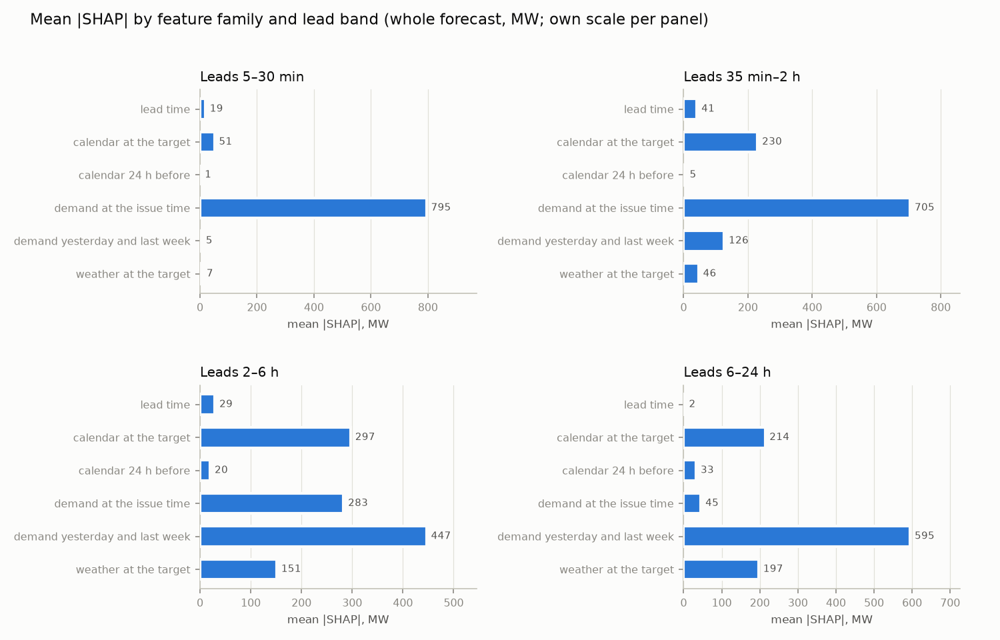
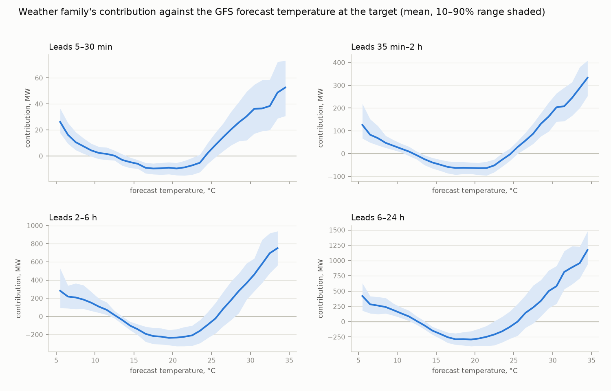
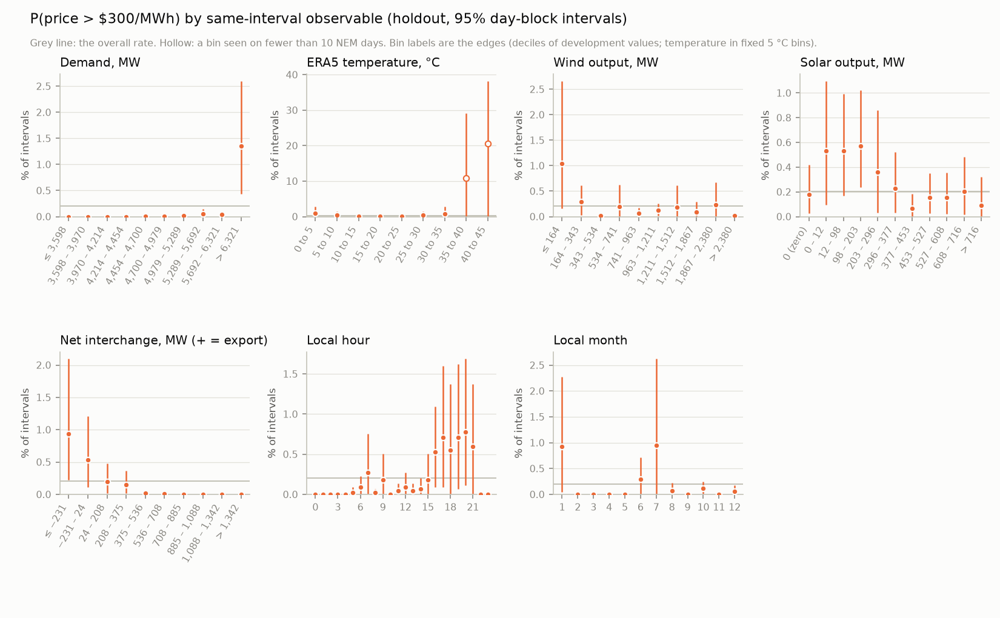
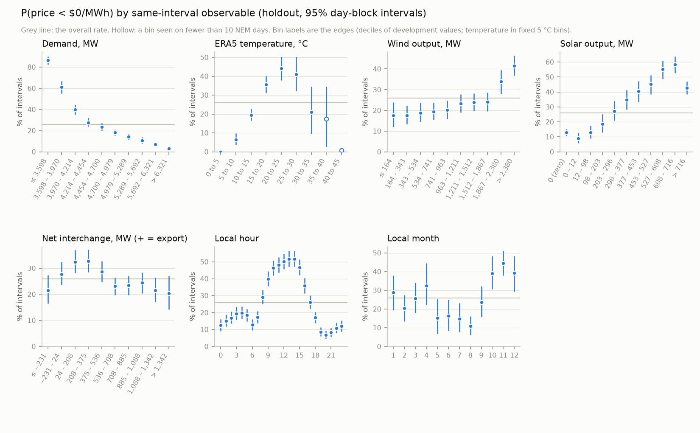

# M4 explanations on the holdout year: the demand model's SHAP values and price associations (Victoria)

Generated by `gridcast report-m4-explain-holdout` at commit `d41aed4` from the stored holdout SHAP sample (`gridcast explain-holdout` at commit `a44cc9b`, 2026-11-20 12:57 UTC; 1 run: `holdout_main`, batch `fcb6abb6…`, 20 fits, up to 20,000 seeded pairs per fit over the issue times of NEM days 2025-10-01 → 2026-09-30), the development sample of step 5 (`explain-dev` at commit `f128f19`, 48 fits) and the database. Every number below is computed from those outputs. The decisions behind it are in [`docs/plans/m4_plan.md`](../docs/plans/m4_plan.md) §1 ("Clarified in step 5" and "Clarified in step 6"), §2.6 and §2.7. Reported only: E1 is the one criterion here. Development values, from [`m4_explainability.md`](m4_explainability.md), are shown beside the holdout's, in brackets or in their own columns.

## How to read this report

- **Whole forecast.** Each M2 fit predicts a correction to an anchor that depends on its target form: nothing (*direct*), the latest demand (*latest*), demand at the same time yesterday (*residual*), or both plus yesterday's change (*anchored*). Raw TreeSHAP covers only the correction. The headline adds each fit's anchor to the features it is made of, as x − x̄ over the fit's own sample, which is the exact Shapley value of a linear term. Every pair then reads forecast = constant + Σ contributions, exactly, whatever the form, so fits of different forms can be pooled.
- **The mix is disclosed.** The trees' part is path-dependent TreeSHAP and the anchor's part is an interventional attribution against the sample, so the sum is the Shapley value of neither game exactly. It adds up to the forecast. The raw tree-only values are shown by target form beside the headline.
- **The model's arithmetic, not the grid's physics.** A contribution says how the model's forecast moved with an input. Correlated inputs (several temperature terms, demand lags) share credit among themselves, so families are the main unit.
- **Price associations are association only:** rates by same-interval conditions, with no model and no claim about mechanism.

## 1. E1 on the holdout global sample

E1 (§3) asks that every explained pair's recomputed forecast, cast to float32 as M2 stored it, equals the stored forecast bit for bit, and that base value + Σ SHAP equals the raw prediction within 1e-06. On the global sample: **PASS**. The float64 column is for information: the gate compares float32 values, and one float32 step near 8,000 MW is about 0.001 MW.

| Leads | Fits | Pairs | Forecast mismatches | Largest \|float64 − stored\|, MW | SHAP-sum failures | Largest SHAP-sum error |
| :--- | ---: | ---: | ---: | ---: | ---: | ---: |
| 5–30 min | 5 | 86,496 | 0 | 4.9e-04 | 0 | 9.7e-12 |
| 35 min–2 h | 5 | 100,000 | 0 | 4.9e-04 | 0 | 5.7e-11 |
| 2–6 h | 5 | 100,000 | 0 | 4.9e-04 | 0 | 4.0e-11 |
| 6–24 h | 5 | 100,000 | 0 | 4.8e-04 | 0 | 3.3e-11 |
| **all** | 20 | 386,496 | 0 | 4.9e-04 | 0 | 5.7e-11 |

## 2. Which inputs the forecasts lean on

Mean |SHAP| of each family on the whole-forecast decomposition, in MW, holdout first and development in brackets. The largest family per band on the holdout: 5–30 min: demand at the issue time (795 MW; in development: demand at the issue time); 35 min–2 h: demand at the issue time (705 MW; in development: demand at the issue time); 2–6 h: demand yesterday and last week (447 MW; in development: demand yesterday and last week); 6–24 h: demand yesterday and last week (595 MW; in development: demand yesterday and last week).

| Family (mean \|SHAP\|, MW): holdout (development) | 5–30 min | 35 min–2 h | 2–6 h | 6–24 h |
| :--- | ---: | ---: | ---: | ---: |
| lead time | 19 (17) | 41 (40) | 29 (29) | 2 (3) |
| calendar at the target | 51 (48) | 230 (238) | 297 (324) | 214 (243) |
| calendar 24 h before | 1 (1) | 5 (4) | 20 (22) | 33 (37) |
| demand at the issue time | 795 (757) | 705 (674) | 283 (340) | 45 (110) |
| demand yesterday and last week | 5 (5) | 126 (75) | 447 (345) | 595 (525) |
| weather at the target | 7 (8) | 46 (46) | 151 (158) | 197 (206) |
| *pairs* | 86,496 (237,568) | 100,000 (240,000) | 100,000 (240,000) | 100,000 (240,000) |

`holdout_main` chose its target forms by the frozen M2 recipe at each retrain, as run 2 did:

| Leads | Holdout fits | Development fits (run 2) |
| :--- | :--- | :--- |
| 5–30 min | latest 5 | latest 12 |
| 35 min–2 h | latest 4, direct 1 | latest 11, direct 1 |
| 2–6 h | latest 3, residual 2 | latest 8, direct 2, residual 2 |
| 6–24 h | residual 3, anchored 1, direct 1 | direct 5, residual 4, anchored 2, latest 1 |

**M2's split gain** (tree-only), as a share of each fit's total, averaged over the band's fits, holdout (development):

| Family (share of split gain) | 5–30 min | 35 min–2 h | 2–6 h | 6–24 h |
| :--- | ---: | ---: | ---: | ---: |
| lead time | 5.7% (6.0%) | 4.5% (4.3%) | 2.0% (2.0%) | 0.2% (0.2%) |
| calendar at the target | 32.8% (32.6%) | 46.1% (48.4%) | 31.0% (34.0%) | 27.8% (26.0%) |
| calendar 24 h before | 0.2% (0.2%) | 0.3% (0.3%) | 0.9% (0.9%) | 2.8% (2.5%) |
| demand at the issue time | 51.6% (50.4%) | 36.7% (34.2%) | 37.2% (32.3%) | 15.2% (18.1%) |
| demand yesterday and last week | 5.0% (6.1%) | 7.4% (6.7%) | 19.2% (22.2%) | 34.7% (38.2%) |
| weather at the target | 4.7% (4.7%) | 5.0% (6.1%) | 9.7% (8.6%) | 19.3% (15.0%) |

**Raw TreeSHAP by target form** on the holdout (tree-only, relative to each fit's anchor; mean \|SHAP\| of the family, MW):

| Leads | Target form | Fits | Pairs | lead time | calendar at the target | calendar 24 h before | demand at the issue time | demand yesterday and last week | weather at the target |
| :--- | :--- | ---: | ---: | ---: | ---: | ---: | ---: | ---: | ---: |
| 5–30 min | latest | 5 | 86,496 | 19 | 51 | 1 | 53 | 5 | 7 |
| 35 min–2 h | direct | 1 | 20,000 | 30 | 141 | 7 | 771 | 395 | 44 |
| 35 min–2 h | latest | 4 | 80,000 | 44 | 252 | 4 | 150 | 59 | 47 |
| 2–6 h | latest | 3 | 60,000 | 41 | 389 | 19 | 465 | 243 | 176 |
| 2–6 h | residual | 2 | 40,000 | 12 | 159 | 21 | 181 | 292 | 114 |
| 6–24 h | anchored | 1 | 20,000 | 6 | 217 | 45 | 450 | 278 | 196 |
| 6–24 h | direct | 1 | 20,000 | 2 | 251 | 31 | 51 | 503 | 265 |
| 6–24 h | residual | 3 | 60,000 | 1 | 200 | 29 | 39 | 266 | 175 |

Every feature: mean |SHAP| (whole forecast, MW), holdout (development)

| Feature | Family | 5–30 min | 35 min–2 h | 2–6 h | 6–24 h |
| :--- | :--- | ---: | ---: | ---: | ---: |
| `lead_minutes` | lead time | 18.6 (17.0) | 41.3 (40.3) | 29.4 (28.7) | 2.2 (2.8) |
| `cal_slot` | calendar at the target | 18.1 (17.6) | 62.4 (59.8) | 118.8 (140.2) | 66.3 (79.3) |
| `cal_day_of_week` | calendar at the target | 2.0 (1.9) | 9.8 (9.4) | 37.0 (31.7) | 61.7 (53.0) |
| `cal_month` | calendar at the target | 4.9 (4.9) | 24.2 (24.2) | 70.0 (64.5) | 86.1 (89.1) |
| `cal_non_working` | calendar at the target | 3.6 (3.6) | 21.9 (20.5) | 69.1 (69.3) | 123.4 (132.7) |
| `cal_public_holiday` | calendar at the target | 0.2 (0.2) | 1.5 (1.4) | 4.0 (5.1) | 4.8 (5.8) |
| `cal_dst_change_day` | calendar at the target | 0.0 (0.0) | 0.1 (0.1) | 0.1 (0.2) | 0.2 (0.3) |
| `cal_tod_sin` | calendar at the target | 21.1 (19.2) | 40.5 (32.8) | 135.6 (150.7) | 37.1 (51.9) |
| `cal_tod_cos` | calendar at the target | 16.8 (17.1) | 160.1 (177.0) | 69.4 (57.4) | 49.6 (40.9) |
| `cal_yesterday_non_working` | calendar 24 h before | 1.0 (0.9) | 4.8 (4.1) | 19.9 (22.0) | 32.3 (36.1) |
| `cal_yesterday_public_holiday` | calendar 24 h before | 0.1 (0.1) | 0.2 (0.3) | 1.0 (1.0) | 1.6 (2.6) |
| `dem_now` | demand at the issue time | 788.3 (748.1) | 710.8 (689.3) | 346.1 (430.9) | 3.1 (61.5) |
| `dem_now_vs_yesterday` | demand at the issue time | 1.7 (1.7) | 40.4 (23.5) | 105.7 (85.2) | 26.2 (23.2) |
| `dem_change_1h` | demand at the issue time | 41.9 (36.8) | 74.7 (60.4) | 21.3 (22.7) | 0.3 (1.6) |
| `dem_mean_1h` | demand at the issue time | 9.1 (7.4) | 68.7 (65.6) | 182.6 (247.0) | 1.6 (7.0) |
| `dem_std_1h` | demand at the issue time | 12.4 (10.8) | 11.1 (10.1) | 12.1 (11.2) | 0.1 (0.3) |
| `dem_mean_24h` | demand at the issue time | 3.9 (3.4) | 17.5 (14.7) | 29.6 (37.0) | 29.4 (27.1) |
| `dem_std_24h` | demand at the issue time | 2.5 (2.8) | 8.9 (10.0) | 17.6 (22.2) | 19.0 (24.6) |
| `dem_same_time_yesterday` | demand yesterday and last week | 3.0 (3.1) | 98.1 (52.4) | 414.2 (284.3) | 616.5 (510.4) |
| `dem_same_time_last_week` | demand yesterday and last week | 2.2 (2.4) | 34.8 (27.7) | 75.7 (99.4) | 53.6 (94.4) |
| `dem_yesterday_vs_last_week` | demand yesterday and last week | 1.1 (1.1) | 5.0 (5.0) | 56.1 (31.4) | 117.2 (81.8) |
| `wx_temp` | weather at the target | 2.5 (2.7) | 14.9 (14.8) | 49.6 (50.2) | 59.7 (60.9) |
| `wx_cooling_degrees` | weather at the target | 2.5 (2.6) | 13.6 (12.6) | 31.0 (30.3) | 38.3 (35.0) |
| `wx_heating_degrees` | weather at the target | 3.1 (2.6) | 18.1 (17.9) | 68.6 (71.5) | 76.9 (88.9) |
| `wx_temp_sq` | weather at the target | 0.3 (0.3) | 2.3 (2.0) | 7.1 (7.5) | 12.4 (8.5) |
| `wx_temp_single_site` | weather at the target | 1.7 (1.7) | 9.2 (9.2) | 30.1 (32.5) | 50.3 (52.7) |

## 3. Stability across retrains

Spearman correlation between consecutive holdout retrains' rankings of the 26 features by mean |SHAP| (whole forecast), per band. 1 means the same order.

| Leads | Pairs | Median | Lowest | Same form: pairs, median | Form changed: pairs, median | Development median |
| :--- | ---: | ---: | ---: | ---: | ---: | ---: |
| 5–30 min | 4 | 0.98 | 0.95 | 4: 0.98 | – | 0.96 |
| 35 min–2 h | 4 | 0.93 | 0.84 | 2: 0.98 | 2: 0.86 | 0.96 |
| 2–6 h | 4 | 0.90 | 0.59 | 3: 0.97 | 1: 0.59 | 0.78 |
| 6–24 h | 4 | 0.88 | 0.82 | 2: 0.93 | 2: 0.82 | 0.94 |

Every consecutive holdout pair

| Leads | Retrains | Target forms | Spearman |
| :--- | :--- | :--- | ---: |
| 5–30 min | 2025-08-01 → 2025-11-01 | latest → latest | 0.98 |
| 5–30 min | 2025-11-01 → 2026-02-01 | latest → latest | 0.98 |
| 5–30 min | 2026-02-01 → 2026-05-01 | latest → latest | 0.95 |
| 5–30 min | 2026-05-01 → 2026-08-01 | latest → latest | 0.98 |
| 35 min–2 h | 2025-08-01 → 2025-11-01 | latest → latest | 0.97 |
| 35 min–2 h | 2025-11-01 → 2026-02-01 | latest → latest | 0.98 |
| 35 min–2 h | 2026-02-01 → 2026-05-01 | latest → direct | 0.84 |
| 35 min–2 h | 2026-05-01 → 2026-08-01 | direct → latest | 0.88 |
| 2–6 h | 2025-08-01 → 2025-11-01 | latest → latest | 0.97 |
| 2–6 h | 2025-11-01 → 2026-02-01 | latest → latest | 0.98 |
| 2–6 h | 2026-02-01 → 2026-05-01 | latest → residual | 0.59 |
| 2–6 h | 2026-05-01 → 2026-08-01 | residual → residual | 0.84 |
| 6–24 h | 2025-08-01 → 2025-11-01 | anchored → direct | 0.82 |
| 6–24 h | 2025-11-01 → 2026-02-01 | direct → residual | 0.83 |
| 6–24 h | 2026-02-01 → 2026-05-01 | residual → residual | 0.93 |
| 6–24 h | 2026-05-01 → 2026-08-01 | residual → residual | 0.93 |

## 4. The weather contribution against forecast temperature

The weather family's contribution against `wx_temp`, the population-weighted GFS forecast temperature at the target, in 1 °C bins (fewer than 100 pairs: not drawn). None of the weather features is part of an anchor, so these values are the trees' own.

Leads 6–24 h, every drawn holdout bin, with the development mean beside it:

| Forecast temperature, °C (bin) | Pairs | Mean, MW | 10–90% range, MW | Development mean, MW |
| :--- | ---: | ---: | ---: | ---: |
| 5 to 6 | 221 | +421 | +181 to +630 | +453 |
| 6 to 7 | 1,265 | +285 | +137 to +418 | +392 |
| 7 to 8 | 2,842 | +264 | +125 to +406 | +341 |
| 8 to 9 | 3,702 | +241 | +136 to +389 | +296 |
| 9 to 10 | 5,665 | +190 | +102 to +298 | +237 |
| 10 to 11 | 6,511 | +137 | +62 to +235 | +169 |
| 11 to 12 | 8,597 | +86 | +15 to +184 | +96 |
| 12 to 13 | 8,274 | +12 | −48 to +89 | +20 |
| 13 to 14 | 7,933 | −60 | −125 to +13 | −51 |
| 14 to 15 | 7,925 | −144 | −209 to −81 | −131 |
| 15 to 16 | 7,307 | −198 | −274 to −129 | −176 |
| 16 to 17 | 7,360 | −253 | −345 to −175 | −225 |
| 17 to 18 | 6,130 | −286 | −375 to −189 | −255 |
| 18 to 19 | 4,894 | −284 | −386 to −169 | −253 |
| 19 to 20 | 3,911 | −291 | −399 to −154 | −255 |
| 20 to 21 | 3,434 | −274 | −391 to −114 | −241 |
| 21 to 22 | 2,899 | −246 | −395 to −67 | −211 |
| 22 to 23 | 2,277 | −208 | −384 to +9 | −183 |
| 23 to 24 | 1,926 | −157 | −337 to +81 | −125 |
| 24 to 25 | 1,647 | −85 | −276 to +170 | −16 |
| 25 to 26 | 1,155 | +3 | −227 to +292 | +72 |
| 26 to 27 | 1,011 | +143 | −98 to +432 | +165 |
| 27 to 28 | 700 | +233 | −26 to +594 | +220 |
| 28 to 29 | 524 | +342 | +90 to +683 | +303 |
| 29 to 30 | 457 | +501 | +223 to +839 | +423 |
| 30 to 31 | 321 | +580 | +295 to +912 | +538 |
| 31 to 32 | 199 | +814 | +533 to +1,156 | +677 |
| 32 to 33 | 192 | +889 | +612 to +1,235 | +732 |
| 33 to 34 | 170 | +958 | +712 to +1,229 | +852 |
| 34 to 35 | 129 | +1,173 | +938 to +1,480 | +1,059 |

## 5. Question 5, demand: what the model adds for high-demand targets

The holdout's seasons follow the same months (summer: months 12, 1, 2; winter: months 6, 7, 8): summer is December 2025 to February 2026 and winter June to August 2026.

**Top 5% of actual demand minus all targets, holdout (development), mean MW by family:**

| Family | overall | summer | winter |
| :--- | ---: | ---: | ---: |
| lead time | 0 (0) | 0 (0) | 0 (+1) |
| calendar at the target | +299 (+423) | +398 (+276) | +293 (+502) |
| calendar 24 h before | +6 (−3) | +2 (−6) | +2 (−10) |
| demand at the issue time | −24 (−111) | +52 (+10) | −9 (−55) |
| demand yesterday and last week | +1,127 (+1,019) | +851 (+882) | +1,227 (+881) |
| weather at the target | +336 (+408) | +901 (+743) | +251 (+231) |
| **forecast** | +2,344 (+2,164) | +2,207 (+1,947) | +1,854 (+1,870) |

The holdout tables in full:

In the 6–24 h band, the pooled global sample of its 5 fits. Each row's top 5% is taken within its own group (summer: months 12, 1, 2; winter: months 6, 7, 8; by the target's local month). The terms add up to the forecast, so each difference column sums to the forecast's difference. They describe the model's arithmetic on a sample, not the grid's physics, and no interval is attached. The constant also differs between the top 5% and all targets: each fit has its own constant, and the top 5% are not spread evenly over the fits.

The family that differs most between the top 5% of actual demand and all targets: overall: demand yesterday and last week (+1,127 MW); summer: weather at the target (+901 MW); winter: demand yesterday and last week (+1,227 MW).

**Top 5% of actual demand** (overall: above 7,106 MW, 4,999 of 100,000 pairs; summer: above 6,401 MW, 986 of 19,757 pairs; winter: above 7,770 MW, 1,166 of 23,312 pairs):

| Term (mean, MW) | overall: top 5% | overall: all | overall: difference | summer: top 5% | summer: all | summer: difference | winter: top 5% | winter: all | winter: difference |
| :--- | ---: | ---: | ---: | ---: | ---: | ---: | ---: | ---: | ---: |
| constant (base value + sample mean of the anchor) | 5,639 | 5,040 | +600 | 4,737 | 4,735 | +2 | 5,785 | 5,695 | +90 |
| lead time | 0 | 0 | 0 | 0 | 0 | 0 | 0 | 0 | 0 |
| calendar at the target | 268 | −30 | +299 | 364 | −35 | +398 | 314 | 20 | +293 |
| calendar 24 h before | 2 | −4 | +6 | −3 | −6 | +2 | 1 | −1 | +2 |
| demand at the issue time | −30 | −5 | −24 | 62 | 10 | +52 | −44 | −35 | −9 |
| demand yesterday and last week | 1,032 | −95 | +1,127 | 660 | −191 | +851 | 1,331 | 105 | +1,227 |
| weather at the target | 290 | −47 | +336 | 838 | −63 | +901 | 326 | 75 | +251 |
| **forecast** | 7,201 | 4,858 | +2,344 | 6,657 | 4,450 | +2,207 | 7,713 | 5,859 | +1,854 |

**Top 5% of forecast demand** (overall: above 6,880 MW, 5,000 of 100,000 pairs; summer: above 6,110 MW, 988 of 19,757 pairs; winter: above 7,572 MW, 1,166 of 23,312 pairs):

| Term (mean, MW) | overall: top 5% | overall: all | overall: difference | summer: top 5% | summer: all | summer: difference | winter: top 5% | winter: all | winter: difference |
| :--- | ---: | ---: | ---: | ---: | ---: | ---: | ---: | ---: | ---: |
| constant (base value + sample mean of the anchor) | 5,605 | 5,040 | +565 | 4,736 | 4,735 | +1 | 5,704 | 5,695 | +10 |
| lead time | 0 | 0 | 0 | 0 | 0 | 0 | 0 | 0 | 0 |
| calendar at the target | 243 | −30 | +273 | 409 | −35 | +444 | 238 | 20 | +218 |
| calendar 24 h before | 0 | −4 | +4 | 1 | −6 | +6 | −4 | −1 | −3 |
| demand at the issue time | −25 | −5 | −20 | 77 | 10 | +66 | −36 | −35 | −1 |
| demand yesterday and last week | 1,251 | −95 | +1,346 | 751 | −191 | +942 | 1,643 | 105 | +1,538 |
| weather at the target | 288 | −47 | +334 | 875 | −63 | +938 | 305 | 75 | +230 |
| **forecast** | 7,361 | 4,858 | +2,503 | 6,849 | 4,450 | +2,399 | 7,851 | 5,859 | +1,992 |

## 6. Question 5, price: when high and negative prices were more frequent

All 5-minute intervals of NEM days 2025-10-01 → 2026-09-30 (105,120 intervals, 365 days): P(> $300) 0.20% (0.07–0.38), P(< $0) 25.87% (23.45–28.53) (95% intervals from 1,000 day-block bootstrap resamples, NEM days, seeded). Development (NEM days 2022-05-01 → 2025-09-30): P(> $300) 4.23% (3.37–5.08), P(< $0) 19.59% (18.48–20.73). Every rate is a share of intervals in the same 5 minutes as the observed condition: an association only.

**Bins.** The bins are development's, read from step 5's stored edges and checked against a recomputation from development data. A shift in conditions between the periods shows as the *Share* of intervals per bin, beside development's. 214 intervals of this period had a price above $300, so a bin that holds few of them has a wide or degenerate interval; every bin's counts are shown, and no bin is dropped. *Days* counts the NEM days with at least one interval in the bin: a bin seen on few days has an unreliable interval.

**Lowest and highest holdout rate across each variable's bins:**

| Observable | P(> $300): lowest | P(> $300): highest | P(< $0): lowest | P(< $0): highest |
| :--- | :--- | :--- | :--- | :--- |
| Demand (MW) | 0.00% (≤ 3,598 MW; 10,253 intervals on 171 days) | 1.36% (> 6,321 MW; 14,584 intervals on 180 days) | 2.90% (> 6,321 MW; 14,584 intervals on 180 days) | 86.36% (≤ 3,598 MW; 10,253 intervals on 171 days) |
| ERA5 population-weighted temperature (°C) | 0.01% (15 to 20 °C; 29,833 intervals on 292 days) | 20.54% (40 to 45 °C; 112 intervals on 3 days) | 0.00% (0 to 5 °C; 1,287 intervals on 20 days) | 44.10% (20 to 25 °C; 12,312 intervals on 155 days) |
| Wind output, semi-scheduled (MW) | 0.02% (> 2,380 MW; 18,534 intervals on 178 days) | 1.04% (≤ 164 MW; 8,921 intervals on 127 days) | 17.45% (≤ 164 MW; 8,921 intervals on 127 days) | 41.56% (> 2,380 MW; 18,534 intervals on 178 days) |
| Solar output, semi-scheduled (MW) | 0.07% (377 – 453 MW; 3,031 intervals on 359 days) | 0.57% (98 – 203 MW; 3,488 intervals on 365 days) | 8.96% (0 – 12 MW; 3,204 intervals on 365 days) | 58.30% (608 – 716 MW; 5,851 intervals on 330 days) |
| Net interchange (MW, positive = export) | 0.00% (708 – 885 MW; 11,158 intervals on 339 days) | 0.94% (≤ −231 MW; 12,132 intervals on 248 days) | 20.39% (> 1,342 MW; 5,718 intervals on 186 days) | 32.81% (208 – 375 MW; 11,168 intervals on 355 days) |
| Local hour | 0.00% (0; 4,380 intervals on 364 days) | 0.78% (20; 4,380 intervals on 365 days) | 6.78% (20; 4,380 intervals on 365 days) | 51.69% (13; 4,380 intervals on 365 days) |
| Local month | 0.00% (2; 8,064 intervals on 29 days) | 0.95% (7; 8,928 intervals on 31 days) | 10.81% (8; 8,928 intervals on 31 days) | 44.34% (11; 8,640 intervals on 31 days) |

Demand (MW)

| Bin | Intervals | Days | Share | P(> $300) (95%) | P(< $0) (95%) | Development share | Development P(> $300) | Development P(< $0) |
| :--- | ---: | ---: | ---: | ---: | ---: | ---: | ---: | ---: |
| ≤ 3,598 MW | 10,253 | 171 | 9.8% | 0.00% (0.00–0.00) | 86.36% (82.40–89.86) | 10.0% | 0.00% | 79.78% |
| 3,598 – 3,970 MW | 6,890 | 222 | 6.6% | 0.00% (0.00–0.00) | 61.19% (55.07–66.96) | 10.0% | 0.01% | 37.76% |
| 3,970 – 4,214 MW | 7,634 | 259 | 7.3% | 0.00% (0.00–0.00) | 39.70% (35.05–44.39) | 10.0% | 0.05% | 23.11% |
| 4,214 – 4,454 MW | 9,816 | 292 | 9.3% | 0.00% (0.00–0.00) | 27.65% (23.76–31.79) | 10.0% | 0.90% | 18.08% |
| 4,454 – 4,700 MW | 9,755 | 321 | 9.3% | 0.01% (0.00–0.03) | 23.40% (19.80–27.15) | 10.0% | 1.76% | 14.14% |
| 4,700 – 4,979 MW | 10,783 | 345 | 10.3% | 0.01% (0.00–0.03) | 18.15% (15.38–21.20) | 10.0% | 2.04% | 9.93% |
| 4,979 – 5,289 MW | 10,882 | 345 | 10.4% | 0.02% (0.00–0.07) | 14.34% (11.60–17.14) | 10.0% | 3.26% | 6.34% |
| 5,289 – 5,692 MW | 12,144 | 328 | 11.6% | 0.06% (0.01–0.14) | 10.61% (7.81–13.76) | 10.0% | 5.08% | 3.83% |
| 5,692 – 6,321 MW | 12,379 | 275 | 11.8% | 0.04% (0.00–0.10) | 7.02% (4.95–9.36) | 10.0% | 9.32% | 2.29% |
| > 6,321 MW | 14,584 | 180 | 13.9% | 1.36% (0.44–2.60) | 2.90% (1.65–4.33) | 10.0% | 19.92% | 0.61% |

ERA5 population-weighted temperature (°C)

| Bin | Intervals | Days | Share | P(> $300) (95%) | P(< $0) (95%) | Development share | Development P(> $300) | Development P(< $0) |
| :--- | ---: | ---: | ---: | ---: | ---: | ---: | ---: | ---: |
| 0 to 5 °C | 1,287 | 20 | 1.2% | 0.93% (0.00–2.84) | 0.00% (0.00–0.00) | 1.7% | 15.49% | 1.45% |
| 5 to 10 °C | 14,189 | 155 | 13.5% | 0.50% (0.00–1.44) | 6.48% (3.68–9.77) | 18.3% | 12.16% | 4.90% |
| 10 to 15 °C | 41,676 | 317 | 39.6% | 0.10% (0.02–0.20) | 19.48% (16.41–22.72) | 37.7% | 3.97% | 13.24% |
| 15 to 20 °C | 29,833 | 292 | 28.4% | 0.01% (0.00–0.02) | 35.73% (31.19–40.18) | 26.6% | 0.49% | 29.12% |
| 20 to 25 °C | 12,312 | 155 | 11.7% | 0.02% (0.00–0.07) | 44.10% (37.85–50.25) | 10.2% | 0.10% | 43.12% |
| 25 to 30 °C | 4,362 | 75 | 4.1% | 0.50% (0.02–1.37) | 41.13% (32.29–50.32) | 3.6% | 0.93% | 32.70% |
| 30 to 35 °C | 1,055 | 23 | 1.0% | 0.85% (0.00–2.78) | 21.04% (9.62–34.58) | 1.5% | 3.13% | 21.05% |
| 35 to 40 °C | 294 | 5 | 0.3% | 10.88% (0.00–29.11) | 17.35% (2.51–34.53) | 0.3% | 5.20% | 10.67% |
| 40 to 45 °C | 112 | 3 | 0.1% | 20.54% (0.00–38.24) | 0.89% (0.00–2.04) | – | – | – |

Wind output, semi-scheduled (MW)

| Bin | Intervals | Days | Share | P(> $300) (95%) | P(< $0) (95%) | Development share | Development P(> $300) | Development P(< $0) |
| :--- | ---: | ---: | ---: | ---: | ---: | ---: | ---: | ---: |
| ≤ 164 MW | 8,921 | 127 | 8.5% | 1.04% (0.16–2.66) | 17.45% (12.10–23.84) | 10.0% | 8.65% | 14.07% |
| 164 – 343 MW | 8,251 | 185 | 7.8% | 0.29% (0.02–0.61) | 17.62% (13.47–22.30) | 10.0% | 6.47% | 15.56% |
| 343 – 534 MW | 8,515 | 231 | 8.1% | 0.02% (0.00–0.06) | 18.78% (14.54–23.77) | 10.0% | 5.72% | 15.30% |
| 534 – 741 MW | 8,884 | 265 | 8.5% | 0.19% (0.00–0.63) | 19.35% (15.41–23.77) | 10.0% | 4.91% | 15.78% |
| 741 – 963 MW | 9,227 | 274 | 8.8% | 0.07% (0.00–0.17) | 20.26% (15.80–24.68) | 10.0% | 4.30% | 15.90% |
| 963 – 1,211 MW | 10,381 | 287 | 9.9% | 0.13% (0.02–0.26) | 23.17% (18.94–27.69) | 10.0% | 2.80% | 17.18% |
| 1,211 – 1,512 MW | 10,696 | 288 | 10.2% | 0.19% (0.00–0.61) | 23.98% (19.83–28.22) | 10.0% | 2.93% | 19.19% |
| 1,512 – 1,867 MW | 10,503 | 276 | 10.0% | 0.10% (0.00–0.29) | 24.10% (19.58–28.62) | 10.0% | 4.14% | 23.33% |
| 1,867 – 2,380 MW | 11,208 | 243 | 10.7% | 0.23% (0.00–0.67) | 33.86% (27.94–39.54) | 10.0% | 2.15% | 27.08% |
| > 2,380 MW | 18,534 | 178 | 17.6% | 0.02% (0.00–0.05) | 41.56% (36.86–46.48) | 10.0% | 0.27% | 32.49% |

Solar output, semi-scheduled (MW)

| Bin | Intervals | Days | Share | P(> $300) (95%) | P(< $0) (95%) | Development share | Development P(> $300) | Development P(< $0) |
| :--- | ---: | ---: | ---: | ---: | ---: | ---: | ---: | ---: |
| 0 MW (zero output) | 50,808 | 365 | 48.3% | 0.18% (0.03–0.42) | 12.86% (10.60–15.25) | 47.6% | 4.86% | 6.61% |
| 0 – 12 MW | 3,204 | 365 | 3.0% | 0.53% (0.09–1.10) | 8.96% (5.92–12.69) | 5.2% | 7.39% | 7.31% |
| 12 – 98 MW | 4,340 | 365 | 4.1% | 0.53% (0.17–0.99) | 12.81% (8.95–17.48) | 5.2% | 8.26% | 7.98% |
| 98 – 203 MW | 3,488 | 365 | 3.3% | 0.57% (0.24–1.02) | 18.49% (12.82–25.18) | 5.2% | 5.67% | 24.02% |
| 203 – 296 MW | 3,043 | 364 | 2.9% | 0.36% (0.03–0.86) | 27.18% (20.98–33.87) | 5.2% | 4.25% | 34.68% |
| 296 – 377 MW | 3,056 | 363 | 2.9% | 0.23% (0.03–0.52) | 34.62% (28.22–41.21) | 5.2% | 3.46% | 41.49% |
| 377 – 453 MW | 3,031 | 359 | 2.9% | 0.07% (0.00–0.18) | 40.35% (33.37–47.30) | 5.2% | 3.22% | 39.95% |
| 453 – 527 MW | 3,288 | 353 | 3.1% | 0.15% (0.03–0.35) | 45.19% (38.50–51.32) | 5.2% | 2.27% | 39.32% |
| 527 – 608 MW | 3,916 | 346 | 3.7% | 0.15% (0.02–0.35) | 55.06% (48.65–60.92) | 5.2% | 1.51% | 39.56% |
| 608 – 716 MW | 5,851 | 330 | 5.6% | 0.21% (0.02–0.48) | 58.30% (52.50–63.81) | 5.2% | 0.57% | 41.02% |
| > 716 MW | 21,095 | 307 | 20.1% | 0.09% (0.00–0.32) | 42.73% (38.32–47.06) | 5.2% | 0.08% | 38.62% |

Net interchange (MW, positive = export)

| Bin | Intervals | Days | Share | P(> $300) (95%) | P(< $0) (95%) | Development share | Development P(> $300) | Development P(< $0) |
| :--- | ---: | ---: | ---: | ---: | ---: | ---: | ---: | ---: |
| ≤ −231 MW | 12,132 | 248 | 11.5% | 0.94% (0.23–2.10) | 21.55% (16.44–27.31) | 10.0% | 12.68% | 15.40% |
| −231 – 24 MW | 11,112 | 321 | 10.6% | 0.53% (0.11–1.21) | 27.71% (23.57–32.43) | 10.0% | 7.99% | 19.86% |
| 24 – 208 MW | 10,704 | 347 | 10.2% | 0.20% (0.02–0.48) | 32.34% (28.18–36.91) | 10.0% | 6.25% | 22.78% |
| 208 – 375 MW | 11,168 | 355 | 10.6% | 0.15% (0.02–0.37) | 32.81% (28.53–37.15) | 10.0% | 4.81% | 22.01% |
| 375 – 536 MW | 11,141 | 355 | 10.6% | 0.02% (0.00–0.05) | 28.68% (24.75–32.78) | 10.0% | 3.90% | 21.61% |
| 536 – 708 MW | 11,551 | 352 | 11.0% | 0.01% (0.00–0.03) | 23.11% (19.77–26.46) | 10.0% | 2.62% | 20.62% |
| 708 – 885 MW | 11,158 | 339 | 10.6% | 0.00% (0.00–0.00) | 23.49% (19.65–27.01) | 10.0% | 1.78% | 19.78% |
| 885 – 1,088 MW | 11,153 | 316 | 10.6% | 0.00% (0.00–0.00) | 24.42% (20.32–28.35) | 10.0% | 1.28% | 20.78% |
| 1,088 – 1,342 MW | 9,283 | 276 | 8.8% | 0.00% (0.00–0.00) | 21.57% (17.07–26.35) | 10.0% | 0.74% | 18.84% |
| > 1,342 MW | 5,718 | 186 | 5.4% | 0.00% (0.00–0.00) | 20.39% (14.16–27.03) | 10.0% | 0.29% | 14.21% |

Local hour

| Bin | Intervals | Days | Share | P(> $300) (95%) | P(< $0) (95%) | Development share | Development P(> $300) | Development P(< $0) |
| :--- | ---: | ---: | ---: | ---: | ---: | ---: | ---: | ---: |
| 0 | 4,380 | 364 | 4.2% | 0.00% (0.00–0.00) | 12.51% (9.04–15.96) | 4.2% | 2.70% | 6.68% |
| 1 | 4,380 | 365 | 4.2% | 0.00% (0.00–0.00) | 15.09% (11.78–18.72) | 4.2% | 2.27% | 8.94% |
| 2 | 4,380 | 364 | 4.2% | 0.00% (0.00–0.00) | 16.83% (13.59–20.60) | 4.2% | 2.12% | 11.38% |
| 3 | 4,380 | 365 | 4.2% | 0.00% (0.00–0.00) | 19.34% (15.73–23.22) | 4.2% | 2.02% | 13.58% |
| 4 | 4,380 | 365 | 4.2% | 0.00% (0.00–0.00) | 19.84% (16.19–23.63) | 4.2% | 2.04% | 13.25% |
| 5 | 4,380 | 365 | 4.2% | 0.02% (0.00–0.09) | 18.49% (14.91–22.17) | 4.2% | 2.51% | 9.49% |
| 6 | 4,380 | 365 | 4.2% | 0.09% (0.00–0.23) | 12.74% (9.61–16.05) | 4.2% | 4.24% | 4.58% |
| 7 | 4,380 | 365 | 4.2% | 0.27% (0.00–0.75) | 17.28% (13.81–20.76) | 4.2% | 6.56% | 10.07% |
| 8 | 4,380 | 365 | 4.2% | 0.02% (0.00–0.07) | 29.22% (25.11–33.27) | 4.2% | 5.52% | 21.64% |
| 9 | 4,380 | 365 | 4.2% | 0.18% (0.00–0.50) | 39.89% (35.55–44.50) | 4.2% | 4.23% | 31.73% |
| 10 | 4,380 | 365 | 4.2% | 0.00% (0.00–0.00) | 46.48% (41.85–50.80) | 4.2% | 3.10% | 42.77% |
| 11 | 4,380 | 365 | 4.2% | 0.05% (0.00–0.14) | 48.06% (43.54–52.68) | 4.2% | 2.44% | 48.68% |
| 12 | 4,380 | 365 | 4.2% | 0.09% (0.00–0.27) | 50.09% (45.59–54.77) | 4.2% | 2.07% | 50.93% |
| 13 | 4,380 | 365 | 4.2% | 0.05% (0.00–0.14) | 51.69% (47.21–56.35) | 4.2% | 2.03% | 49.11% |
| 14 | 4,380 | 365 | 4.2% | 0.07% (0.00–0.21) | 51.58% (47.21–56.39) | 4.2% | 2.53% | 44.71% |
| 15 | 4,380 | 365 | 4.2% | 0.18% (0.00–0.50) | 46.64% (42.10–51.46) | 4.2% | 3.74% | 36.69% |
| 16 | 4,380 | 365 | 4.2% | 0.53% (0.09–1.10) | 35.89% (31.44–40.32) | 4.2% | 6.11% | 24.57% |
| 17 | 4,380 | 365 | 4.2% | 0.71% (0.09–1.60) | 26.03% (22.24–30.09) | 4.2% | 9.97% | 15.81% |
| 18 | 4,380 | 365 | 4.2% | 0.55% (0.00–1.37) | 16.94% (13.88–20.32) | 4.2% | 9.99% | 8.64% |
| 19 | 4,380 | 365 | 4.2% | 0.71% (0.07–1.62) | 8.42% (6.03–11.21) | 4.2% | 7.40% | 3.44% |
| 20 | 4,380 | 365 | 4.2% | 0.78% (0.11–1.69) | 6.78% (4.50–9.29) | 4.2% | 6.07% | 1.80% |
| 21 | 4,380 | 365 | 4.2% | 0.59% (0.00–1.37) | 8.24% (5.80–10.98) | 4.2% | 4.78% | 2.24% |
| 22 | 4,380 | 365 | 4.2% | 0.00% (0.00–0.00) | 10.82% (8.04–14.02) | 4.2% | 3.70% | 4.42% |
| 23 | 4,380 | 365 | 4.2% | 0.00% (0.00–0.00) | 12.01% (8.88–15.21) | 4.2% | 3.47% | 4.95% |

Local month

| Bin | Intervals | Days | Share | P(> $300) (95%) | P(< $0) (95%) | Development share | Development P(> $300) | Development P(< $0) |
| :--- | ---: | ---: | ---: | ---: | ---: | ---: | ---: | ---: |
| 1 | 8,928 | 32 | 8.5% | 0.93% (0.04–2.27) | 28.74% (19.45–37.98) | 7.4% | 0.03% | 26.95% |
| 2 | 8,064 | 29 | 7.7% | 0.00% (0.00–0.00) | 20.30% (13.43–27.51) | 6.8% | 0.99% | 24.67% |
| 3 | 8,928 | 32 | 8.5% | 0.00% (0.00–0.00) | 25.60% (17.86–33.91) | 7.4% | 0.25% | 18.88% |
| 4 | 8,652 | 31 | 8.2% | 0.00% (0.00–0.00) | 32.52% (22.28–44.35) | 7.2% | 0.60% | 13.16% |
| 5 | 8,928 | 31 | 8.5% | 0.00% (0.00–0.00) | 15.29% (6.89–25.50) | 9.9% | 6.68% | 8.22% |
| 6 | 8,640 | 30 | 8.2% | 0.29% (0.00–0.71) | 16.38% (8.36–25.03) | 9.6% | 13.68% | 7.55% |
| 7 | 8,928 | 31 | 8.5% | 0.95% (0.00–2.62) | 14.64% (7.72–23.04) | 9.9% | 17.82% | 11.77% |
| 8 | 8,928 | 31 | 8.5% | 0.07% (0.00–0.23) | 10.81% (6.16–16.11) | 9.9% | 2.69% | 17.25% |
| 9 | 8,640 | 30 | 8.2% | 0.00% (0.00–0.00) | 23.59% (15.84–32.09) | 9.6% | 0.59% | 28.03% |
| 10 | 8,916 | 31 | 8.5% | 0.11% (0.01–0.24) | 39.01% (30.54–48.41) | 7.4% | 0.12% | 28.48% |
| 11 | 8,640 | 31 | 8.2% | 0.00% (0.00–0.00) | 44.34% (37.87–51.07) | 7.2% | 0.16% | 26.87% |
| 12 | 8,928 | 32 | 8.5% | 0.06% (0.00–0.17) | 39.14% (29.21–48.40) | 7.4% | 0.15% | 31.93% |

**Demand tercile × wind tercile** (development edges: demand 4,296, 5,180 MW; wind 600, 1,403 MW):

| Demand | Wind | Intervals | Days | P(> $300) (95%) | P(< $0) (95%) | Development P(> $300) | Development P(< $0) |
| :--- | :--- | ---: | ---: | ---: | ---: | ---: | ---: |
| low demand | low wind | 9,026 | 160 | 0.00% (0.00–0.00) | 55.51% (48.95–61.72) | 0.11% | 40.70% |
| low demand | middle wind | 9,549 | 194 | 0.00% (0.00–0.00) | 63.12% (57.76–68.26) | 0.06% | 40.62% |
| low demand | high wind | 9,400 | 169 | 0.00% (0.00–0.00) | 63.98% (56.87–70.32) | 0.03% | 53.07% |
| middle demand | low wind | 7,958 | 169 | 0.05% (0.00–0.12) | 2.61% (1.66–3.75) | 3.97% | 1.52% |
| middle demand | middle wind | 10,802 | 260 | 0.00% (0.00–0.00) | 8.90% (6.74–11.19) | 1.67% | 5.87% |
| middle demand | high wind | 15,640 | 266 | 0.00% (0.00–0.00) | 37.71% (33.01–42.22) | 0.60% | 27.28% |
| high demand | low wind | 11,547 | 160 | 1.07% (0.25–2.32) | 0.11% (0.02–0.28) | 16.44% | 0.08% |
| high demand | middle wind | 12,277 | 242 | 0.33% (0.06–0.74) | 0.51% (0.17–1.03) | 10.35% | 0.36% |
| high demand | high wind | 18,921 | 253 | 0.24% (0.01–0.70) | 15.87% (12.63–18.96) | 5.56% | 6.52% |

## Disclosures

- These analyses were designed after M2's and M3's development and holdout results had been seen. The planning saw some holdout price facts (plan §3.3): 0.2% of intervals above $300 and 25.9% negative. The settings were fixed in step 5 and the step-6 question round, before any holdout SHAP value or holdout association rate was computed.
- `explain-holdout` printed only its E1 gates and timings. This report's code was committed before any holdout SHAP value or holdout association rate was read. It was tested by rendering it with the development sample and period standing in for the holdout's.
- The holdout sample covers holdout issue times only. `holdout_main`'s first retrain (2025-08-01) contributes October 2025. Its August–September 2025 issue times belong to development, where run 2's identical model covers them (plan §1, step 3).
- ERA5 temperature is retrospective (published days later). It describes the same interval as the price, which is what an association needs, but it was not known at the time.
- The day-block bootstrap resamples NEM days, so it keeps the dependence within a day but not across days. The intervals may be too narrow where multi-day spells dominate a bin.
- Bins seen on fewer than 10 NEM days are drawn hollow in the figures, as in development.
