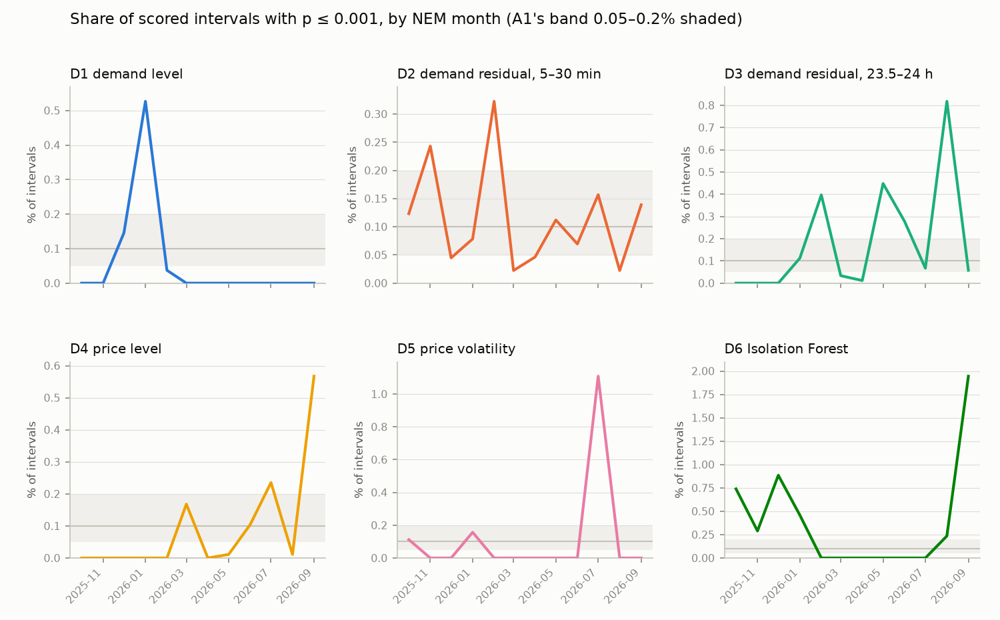
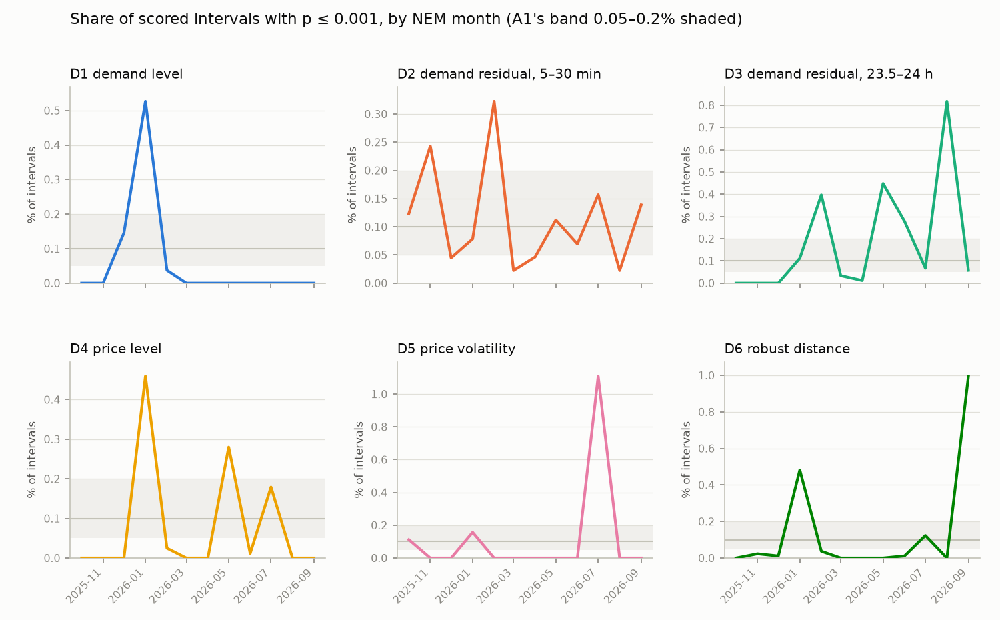
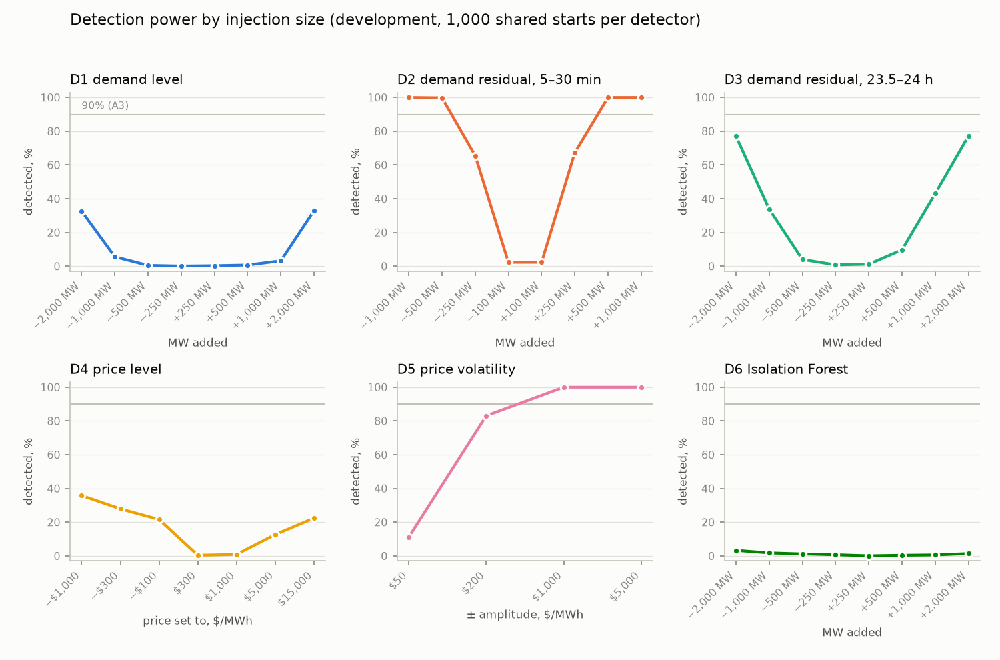
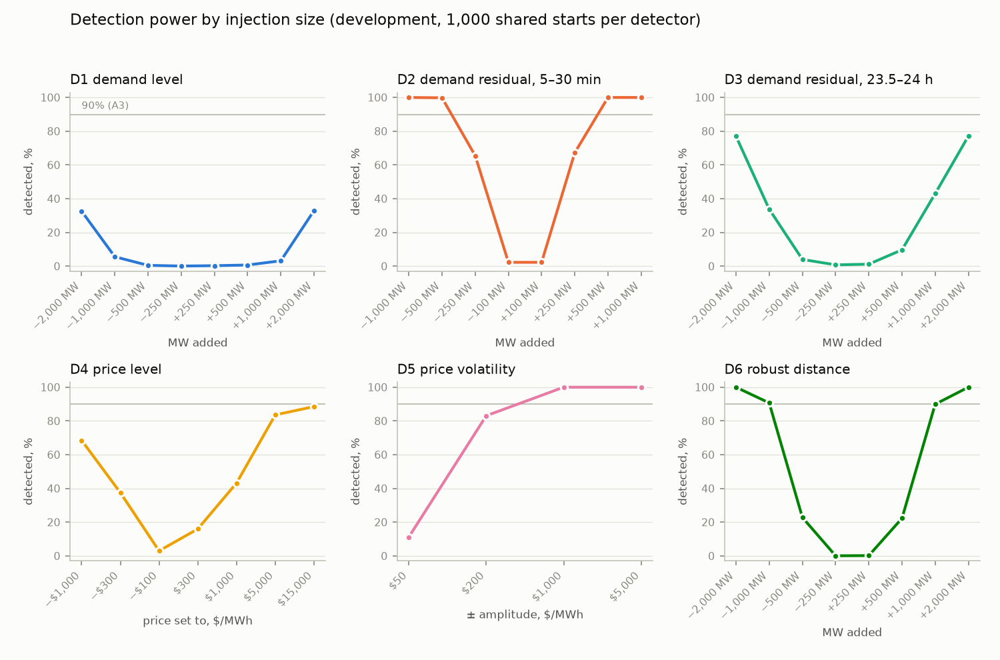

# M4: market anomalies on the holdout year (Victoria), v1 and v2

Generated by `gridcast report-m4-holdout` from the two stored holdout runs, one per recipe version, each scored once (A6). Every number below is recomputed from the stored files and events, and the report stops if a recomputed tier, line, event or count differs from a run's record. The criteria were pre-registered in [`docs/plans/m4_plan.md`](../docs/plans/m4_plan.md) §3, and this report's readings were fixed before either holdout run (§1, "Clarified in step 6"). On the holdout, A1, A3, A4, A5 and E1 are replications, reported as *holds* or *does not hold*. They do not change the development verdicts (§3.2). A6 is the holdout's own criterion.

- **v1** is the pre-registered recipe, and this is its replication.
- **v2** is the disclosed revision of D4 and D6 (§2.10), designed after v1's development results, and this is its first blind test. M5 and M6 serve v2 whatever the holdout shows; that was fixed before any holdout score.
- The holdout year is NEM days 2025-10-01 → 2026-09-30. It has no class-P reference event, so A2 is judged on development only (§3.1).

## Verdicts (holdout, with development beside)

| # | Pass if | v1 holdout | v1 development (pre-registered) | v2 holdout (blind) | v2 development (post hoc) |
| :--- | :--- | :--- | :--- | :--- | :--- |
| A1 | every calibrated detector: share at p ≤ 0.01 in [0.5%, 2%] and at p ≤ 0.001 in [0.05%, 0.2%] (12 checks) | **does not hold**: 10 of 12 checks inside; outside: D6 2.33% / 0.381% (p ≤ 0.01 / p ≤ 0.001) | FAIL: 11 of 12 checks inside; outside: D6 1.79% / 0.259% (p ≤ 0.01 / p ≤ 0.001) | **holds**: 12 of 12 checks inside | PASS: 12 of 12 checks inside |
| A2 | every scorable class-P reference event has a notable calibrated alert within 30 min of its span | – (no class-P event in the holdout; §3.1) | FAIL: 6 of 7 caught; missed P05 | – (no class-P event in the holdout; §3.1) | PASS: 7 of 7 caught |
| A3 | ≥ 90% of injections detected at each detector's largest size, per sign (11 checks) | **does not hold**: 3 of 11 at ≥ 90%; below: D1 −2,000 MW 32.6%, D1 +2,000 MW 32.9%, D3 −2,000 MW 77.0%, D3 +2,000 MW 77.1%, D4 $15,000 22.4%, D4 −$1,000 35.8%, D6 −2,000 MW 3.3%, D6 +2,000 MW 1.4% | FAIL: 3 of 11 at ≥ 90%; below: D1 −2,000 MW 33.2%, D1 +2,000 MW 33.4%, D3 −2,000 MW 79.6%, D3 +2,000 MW 80.4%, D4 $15,000 10.7%, D4 −$1,000 32.8%, D6 −2,000 MW 1.9%, D6 +2,000 MW 1.9% | **does not hold**: 5 of 11 at ≥ 90%; below: D1 −2,000 MW 32.6%, D1 +2,000 MW 32.9%, D3 −2,000 MW 77.0%, D3 +2,000 MW 77.1%, D4 $15,000 88.5%, D4 −$1,000 68.5% | FAIL: 5 of 11 at ≥ 90%; below: D1 −2,000 MW 33.2%, D1 +2,000 MW 33.4%, D3 −2,000 MW 79.6%, D3 +2,000 MW 80.4%, D4 $15,000 84.6%, D4 −$1,000 66.2% |
| A4 | every holdout event has every evidence field filled or marked unavailable with a reason, and no summary has a banned phrase | **holds**: 195 of 195 complete; 0 with a banned phrase | PASS: 1102 of 1102 complete; 0 with a banned phrase | **holds**: 133 of 133 complete; 0 with a banned phrase | PASS: 994 of 994 complete; 0 with a banned phrase |
| A5 | the synthetic causality suite passes (controls included), every real cut is identical, and no forest was fitted on its own month | **holds**: suite 7 passed, 0 failed; 3 real cuts, 0 differences; 0 forest leaks | PASS: suite 7 passed, 0 failed; 3 real cuts, 0 differences; 0 forest leaks | **holds**: suite 7 passed, 0 failed; 3 real cuts, 0 differences; 0 month-model leaks | PASS: suite 7 passed, 0 failed; 3 real cuts, 0 differences; 0 month-model leaks |
| E1 (demand peaks) | the recomputed forecast equals the stored float32 value and base + Σ SHAP equals the raw prediction within 10⁻⁶, for every explained pair | **holds**: 182 pairs; 0 forecast mismatches, 0 sum failures (largest error 1.5e-11) | PASS: 422 pairs; 0 forecast mismatches, 0 sum failures (largest error 2.0e-11) | **holds**: 182 pairs; 0 forecast mismatches, 0 sum failures (largest error 1.5e-11) | PASS: 424 pairs; 0 forecast mismatches, 0 sum failures (largest error 2.0e-11) |
| E1 (global sample) | §2.6's gate on every pair of the global SHAP sample (`explain-dev` / `explain-holdout`; one sample serves both versions) | **holds**: 386,496 pairs; 0 forecast mismatches, 0 sum failures (largest error 5.7e-11) | PASS: 957,568 pairs; 0 forecast mismatches, 0 sum failures (largest error 6.0e-11) | **holds**: 386,496 pairs; 0 forecast mismatches, 0 sum failures (largest error 5.7e-11) | PASS: 957,568 pairs; 0 forecast mismatches, 0 sum failures (largest error 6.0e-11) |
| A6 | the holdout is scored by a single `evaluate-holdout-anomalies` run per recipe hash, and the command refuses to run again | **PASS**: run 107 (batch `b5c57f68`), the only holdout run stored for hash `2ce8b3fc523ae81c`; a second run is refused | – | **PASS**: run 108 (batch `96ac5ebd`), the only holdout run stored for hash `44abbf4b24cf6ac8`; a second run is refused | – |

**v1: 3 of 5 replicated criteria hold** (A1, A3, A4, A5, E1), A6 passes; **v2: 4 of 5 replicated criteria hold** (A1, A3, A4, A5, E1), A6 passes. The development verdicts stand as published.

## Runs

|  | v1 | v2 |
| :--- | :--- | :--- |
| Run | 107 (batch `b5c57f68-bb60-49c7-a67e-be6476dfb4a7`) | 108 (batch `96ac5ebd-1220-4f5b-aec0-04f53c9963ca`) |
| Anomaly config hash | `2ce8b3fc523ae81c` (frozen `2ce8b3fc523ae81c`) | `44abbf4b24cf6ac8` (frozen `44abbf4b24cf6ac8`) |
| Frozen recipe code | `04da607`; run from `d41aed4` | `04da607`; run from `d41aed4` |
| Reproduction, 1 | development run 104 recomputed exactly (178 s): intervals.parquet 420,768, injections.parquet 44,000, forests.parquet 47, cuts.parquet 3, events 1,102, run record 9 | development run 106 recomputed exactly (153 s): intervals.parquet 420,768, injections.parquet 44,000, forests.parquet 47, cuts.parquet 3, events 994, run record 9 |
| Reproduction, 2 (the continuous run's development part) | equal to the stored development batch: development intervals 420,768, development month models 47, development events 1,102 | equal to the stored development batch: development intervals 420,768, development month models 47, development events 994 |
| Series | 525,888 intervals, 2021-09-30 14:05:00+00:00 → 2026-09-30 14:00:00+00:00 (UTC interval ends) | 525,888 intervals, 2021-09-30 14:05:00+00:00 → 2026-09-30 14:00:00+00:00 (UTC interval ends) |
| Scored | every detector and the lines from 2025-10-01 to 2026-10-01 (exclusive, NEM days) | every detector and the lines from 2025-10-01 to 2026-10-01 (exclusive, NEM days) |
| D2/D3 band | QR batches `4bab11d7` + `b226706b`, split at the holdout start: 68,640 issue times; actuals equal market demand on 19,475,472 pairs | QR batches `4bab11d7` + `b226706b`, split at the holdout start: 68,640 issue times; actuals equal market demand on 19,475,472 pairs |
| Run time | load 3 s, detect 59 s, inject 44 s, cuts 162 s, evidence 6 s | load 2 s, detect 49 s, inject 46 s, cuts 133 s, evidence 5 s |
| Freeze now | holds | holds |
| Report code | `d41aed40ee6f4bbed4358599d0ec727bd822141d` | `d41aed40ee6f4bbed4358599d0ec727bd822141d` |

v2's D1, D2, D3 and D5 are v1's: 20 stored columns of the two holdout runs (scores, p-values, window sizes, tiers and scored-period flags, every interval of the continuous run) are equal (§2.10).

## A1: alert budget

Each detector's p-value is a conformal rank against its own trailing 26 weeks, so under exchangeability p ≤ 0.001 should flag about 0.1% of scored intervals. A1 allows a factor of 2 either way. *Scored* means inside the holdout with a p-value (D2/D3: pairs in M2's common mask; D6: a month model). The trailing windows cross into the holdout from development, as a deployed detector's would.

**v1:**

| Detector | Scored intervals | p ≤ 0.01 | [0.5%, 2%] | p ≤ 0.001 | [0.05%, 0.2%] | p ≤ 0.0001 (reported) | Development: p ≤ 0.01 / p ≤ 0.001 |
| :--- | ---: | ---: | :--- | ---: | :--- | ---: | ---: |
| D1 demand level | 105,120 | 0.94% | in | 0.060% | in | 0.0105% | 1.07% / 0.170% |
| D2 demand residual, 5–30 min | 105,120 | 1.08% | in | 0.113% | in | 0.0143% | 1.05% / 0.111% |
| D3 demand residual, 23.5–24 h | 105,120 | 1.27% | in | 0.185% | in | 0.0400% | 1.08% / 0.120% |
| D4 price level | 105,120 | 0.90% | in | 0.091% | in | 0.0162% | 1.05% / 0.116% |
| D5 price volatility | 105,120 | 1.26% | in | 0.117% | in | 0.0200% | 1.08% / 0.147% |
| D6 Isolation Forest | 105,120 | 2.33% | **out** | 0.381% | **out** | 0.1151% | 1.79% / 0.259% |

**v2:**

| Detector | Scored intervals | p ≤ 0.01 | [0.5%, 2%] | p ≤ 0.001 | [0.05%, 0.2%] | p ≤ 0.0001 (reported) | Development: p ≤ 0.01 / p ≤ 0.001 |
| :--- | ---: | ---: | :--- | ---: | :--- | ---: | ---: |
| D1 demand level | 105,120 | 0.94% | in | 0.060% | in | 0.0105% | 1.07% / 0.170% |
| D2 demand residual, 5–30 min | 105,120 | 1.08% | in | 0.113% | in | 0.0143% | 1.05% / 0.111% |
| D3 demand residual, 23.5–24 h | 105,120 | 1.27% | in | 0.185% | in | 0.0400% | 1.08% / 0.120% |
| D4 price level | 105,120 | 0.92% | in | 0.081% | in | 0.0124% | 1.07% / 0.153% |
| D5 price volatility | 105,120 | 1.26% | in | 0.117% | in | 0.0200% | 1.08% / 0.147% |
| D6 robust distance | 105,120 | 0.80% | in | 0.140% | in | 0.0124% | 1.41% / 0.141% |

## The class-O day (reported)

The holdout's one reference event is class O (it may leave no visible trace), so it is reported, not judged. An alert counts if a calibrated detector raised a notable alert at an interval ending within 30 min of the flagged span.

**v1:** 0 of 1 holdout class-O events had a calibrated alert in that window.

| Event | Span (local) | Flagged intervals | Price | Caught | Notable calibrated detectors (lowest p) | Lowest p of any calibrated detector (reported) |
| :--- | :--- | ---: | :--- | :--- | :--- | :--- |
| O08 | 2026-03-23 14:35 → 2026-03-23 19:30 | 19 | $45 to $95 | **no** | none | D2 2.10 × 10⁻² |

**v2:** 0 of 1 holdout class-O events had a calibrated alert in that window.

| Event | Span (local) | Flagged intervals | Price | Caught | Notable calibrated detectors (lowest p) | Lowest p of any calibrated detector (reported) |
| :--- | :--- | ---: | :--- | :--- | :--- | :--- |
| O08 | 2026-03-23 14:35 → 2026-03-23 19:30 | 19 | $45 to $95 | **no** | none | D2 2.10 × 10⁻² |

## A3: detection power

As in development: each injection is scored alone against the unmodified profiles, baselines, bands, month models and windows, at starts drawn from the holdout's scored intervals where the unmodified detector raised no notable alert within the span ± 1 h. Detected = at least one notable alert from that detector inside the span.

### v1

| Detector | Largest size | Injections | Detected | ≥ 90% | Development |
| :--- | :--- | ---: | ---: | :--- | ---: |
| D1 demand level | −2,000 MW | 1,000 | 32.6% | **does not hold** | 33.2% (n 1,000) |
| D1 demand level | +2,000 MW | 1,000 | 32.9% | **does not hold** | 33.4% (n 1,000) |
| D2 demand residual, 5–30 min | −1,000 MW | 1,000 | 100.0% | holds | 100.0% (n 1,000) |
| D2 demand residual, 5–30 min | +1,000 MW | 1,000 | 100.0% | holds | 100.0% (n 1,000) |
| D3 demand residual, 23.5–24 h | −2,000 MW | 1,000 | 77.0% | **does not hold** | 79.6% (n 1,000) |
| D3 demand residual, 23.5–24 h | +2,000 MW | 1,000 | 77.1% | **does not hold** | 80.4% (n 1,000) |
| D4 price level | $15,000 | 1,000 | 22.4% | **does not hold** | 10.7% (n 1,000) |
| D4 price level | −$1,000 | 1,000 | 35.8% | **does not hold** | 32.8% (n 1,000) |
| D5 price volatility | $5,000 | 1,000 | 100.0% | holds | 91.4% (n 1,000) |
| D6 Isolation Forest | −2,000 MW | 1,000 | 3.3% | **does not hold** | 1.9% (n 1,000) |
| D6 Isolation Forest | +2,000 MW | 1,000 | 1.4% | **does not hold** | 1.9% (n 1,000) |

All sizes (reported):

| Detector | Injections per size | Detected share by size |
| :--- | ---: | :--- |
| D1 demand level | 1,000 | −2,000 MW: 32.6%, −1,000 MW: 5.6%, −500 MW: 0.5%, −250 MW: 0.1%, +250 MW: 0.3%, +500 MW: 0.7%, +1,000 MW: 3.2%, +2,000 MW: 32.9% |
| D2 demand residual, 5–30 min | 1,000 | −1,000 MW: 100.0%, −500 MW: 99.8%, −250 MW: 65.5%, −100 MW: 2.3%, +100 MW: 2.3%, +250 MW: 67.3%, +500 MW: 100.0%, +1,000 MW: 100.0% |
| D3 demand residual, 23.5–24 h | 1,000 | −2,000 MW: 77.0%, −1,000 MW: 33.8%, −500 MW: 4.0%, −250 MW: 0.8%, +250 MW: 1.2%, +500 MW: 9.7%, +1,000 MW: 43.0%, +2,000 MW: 77.1% |
| D4 price level | 1,000 | −$1,000: 35.8%, −$300: 27.9%, −$100: 21.6%, $300: 0.4%, $1,000: 0.9%, $5,000: 12.7%, $15,000: 22.4% |
| D5 price volatility | 1,000 | $50: 11.2%, $200: 83.1%, $1,000: 100.0%, $5,000: 100.0% |
| D6 Isolation Forest | 1,000 | −2,000 MW: 3.3%, −1,000 MW: 1.8%, −500 MW: 1.2%, −250 MW: 0.7%, +250 MW: 0.1%, +500 MW: 0.4%, +1,000 MW: 0.6%, +2,000 MW: 1.4% |

Smallest size reaching 50% and 90% (reported):

| Detector | 50%, negative | 90%, negative | 50%, positive | 90%, positive |
| :--- | :--- | :--- | :--- | :--- |
| D1 demand level | not reached | not reached | not reached | not reached |
| D2 demand residual, 5–30 min | −250 MW | −500 MW | +250 MW | +500 MW |
| D3 demand residual, 23.5–24 h | −2,000 MW | not reached | +2,000 MW | not reached |
| D4 price level | not reached | not reached | not reached | not reached |
| D5 price volatility | – | – | $200 | $1,000 |
| D6 Isolation Forest | not reached | not reached | not reached | not reached |

Power at the largest size by start year (reported):

| Detector | Size | Detected by start year (NEM time) |
| :--- | :--- | :--- |
| D1 demand level | −2,000 MW | 2025: 48% (n 238); 2026: 28% (n 762) |
| D1 demand level | +2,000 MW | 2025: 46% (n 238); 2026: 29% (n 762) |
| D2 demand residual, 5–30 min | −1,000 MW | 2025: 100% (n 258); 2026: 100% (n 742) |
| D2 demand residual, 5–30 min | +1,000 MW | 2025: 100% (n 258); 2026: 100% (n 742) |
| D3 demand residual, 23.5–24 h | −2,000 MW | 2025: 70% (n 264); 2026: 80% (n 736) |
| D3 demand residual, 23.5–24 h | +2,000 MW | 2025: 62% (n 264); 2026: 83% (n 736) |
| D4 price level | $15,000 | 2025: 14% (n 250); 2026: 25% (n 750) |
| D4 price level | −$1,000 | 2025: 20% (n 250); 2026: 41% (n 750) |
| D5 price volatility | $5,000 | 2025: 100% (n 278); 2026: 100% (n 722) |
| D6 Isolation Forest | −2,000 MW | 2025: 7% (n 251); 2026: 2% (n 749) |
| D6 Isolation Forest | +2,000 MW | 2025: 2% (n 251); 2026: 1% (n 749) |

Reported only: holding the price flat for 3 h was detected in 0.4% of 1,000.

### v2

| Detector | Largest size | Injections | Detected | ≥ 90% | Development |
| :--- | :--- | ---: | ---: | :--- | ---: |
| D1 demand level | −2,000 MW | 1,000 | 32.6% | **does not hold** | 33.2% (n 1,000) |
| D1 demand level | +2,000 MW | 1,000 | 32.9% | **does not hold** | 33.4% (n 1,000) |
| D2 demand residual, 5–30 min | −1,000 MW | 1,000 | 100.0% | holds | 100.0% (n 1,000) |
| D2 demand residual, 5–30 min | +1,000 MW | 1,000 | 100.0% | holds | 100.0% (n 1,000) |
| D3 demand residual, 23.5–24 h | −2,000 MW | 1,000 | 77.0% | **does not hold** | 79.6% (n 1,000) |
| D3 demand residual, 23.5–24 h | +2,000 MW | 1,000 | 77.1% | **does not hold** | 80.4% (n 1,000) |
| D4 price level | $15,000 | 1,000 | 88.5% | **does not hold** | 84.6% (n 1,000) |
| D4 price level | −$1,000 | 1,000 | 68.5% | **does not hold** | 66.2% (n 1,000) |
| D5 price volatility | $5,000 | 1,000 | 100.0% | holds | 91.4% (n 1,000) |
| D6 robust distance | −2,000 MW | 1,000 | 100.0% | holds | 100.0% (n 1,000) |
| D6 robust distance | +2,000 MW | 1,000 | 100.0% | holds | 100.0% (n 1,000) |

All sizes (reported):

| Detector | Injections per size | Detected share by size |
| :--- | ---: | :--- |
| D1 demand level | 1,000 | −2,000 MW: 32.6%, −1,000 MW: 5.6%, −500 MW: 0.5%, −250 MW: 0.1%, +250 MW: 0.3%, +500 MW: 0.7%, +1,000 MW: 3.2%, +2,000 MW: 32.9% |
| D2 demand residual, 5–30 min | 1,000 | −1,000 MW: 100.0%, −500 MW: 99.8%, −250 MW: 65.5%, −100 MW: 2.3%, +100 MW: 2.3%, +250 MW: 67.3%, +500 MW: 100.0%, +1,000 MW: 100.0% |
| D3 demand residual, 23.5–24 h | 1,000 | −2,000 MW: 77.0%, −1,000 MW: 33.8%, −500 MW: 4.0%, −250 MW: 0.8%, +250 MW: 1.2%, +500 MW: 9.7%, +1,000 MW: 43.0%, +2,000 MW: 77.1% |
| D4 price level | 1,000 | −$1,000: 68.5%, −$300: 37.5%, −$100: 3.0%, $300: 16.0%, $1,000: 43.2%, $5,000: 83.6%, $15,000: 88.5% |
| D5 price volatility | 1,000 | $50: 11.2%, $200: 83.1%, $1,000: 100.0%, $5,000: 100.0% |
| D6 robust distance | 1,000 | −2,000 MW: 100.0%, −1,000 MW: 90.7%, −500 MW: 22.8%, −250 MW: 0.1%, +250 MW: 0.2%, +500 MW: 22.3%, +1,000 MW: 89.9%, +2,000 MW: 100.0% |

Smallest size reaching 50% and 90% (reported):

| Detector | 50%, negative | 90%, negative | 50%, positive | 90%, positive |
| :--- | :--- | :--- | :--- | :--- |
| D1 demand level | not reached | not reached | not reached | not reached |
| D2 demand residual, 5–30 min | −250 MW | −500 MW | +250 MW | +500 MW |
| D3 demand residual, 23.5–24 h | −2,000 MW | not reached | +2,000 MW | not reached |
| D4 price level | −$1,000 | not reached | $5,000 | not reached |
| D5 price volatility | – | – | $200 | $1,000 |
| D6 robust distance | −1,000 MW | −1,000 MW | +1,000 MW | +2,000 MW |

Power at the largest size by start year (reported):

| Detector | Size | Detected by start year (NEM time) |
| :--- | :--- | :--- |
| D1 demand level | −2,000 MW | 2025: 48% (n 238); 2026: 28% (n 762) |
| D1 demand level | +2,000 MW | 2025: 46% (n 238); 2026: 29% (n 762) |
| D2 demand residual, 5–30 min | −1,000 MW | 2025: 100% (n 258); 2026: 100% (n 742) |
| D2 demand residual, 5–30 min | +1,000 MW | 2025: 100% (n 258); 2026: 100% (n 742) |
| D3 demand residual, 23.5–24 h | −2,000 MW | 2025: 70% (n 264); 2026: 80% (n 736) |
| D3 demand residual, 23.5–24 h | +2,000 MW | 2025: 62% (n 264); 2026: 83% (n 736) |
| D4 price level | $15,000 | 2025: 56% (n 248); 2026: 99% (n 752) |
| D4 price level | −$1,000 | 2025: 19% (n 248); 2026: 85% (n 752) |
| D5 price volatility | $5,000 | 2025: 100% (n 278); 2026: 100% (n 722) |
| D6 robust distance | −2,000 MW | 2025: 100% (n 258); 2026: 100% (n 742) |
| D6 robust distance | +2,000 MW | 2025: 100% (n 258); 2026: 100% (n 742) |

Reported only: holding the price flat for 3 h was detected in 0.4% of 1,000.

## A4: evidence without causal claims

- v1: 195 holdout events; 0 incomplete, 0 with a banned phrase.

- v2: 133 holdout events; 0 incomplete, 0 with a banned phrase.

## A5: causality

- v1: the synthetic suite's v1 cases (run by this report) 7 passed, 0 failed, a leaky control included; the run repeated detection truncated at 3 seeded cuts inside the holdout (2026-02-14 12:45:00+00:00, 2026-03-23 22:25:00+00:00, 2026-09-08 07:50:00+00:00), with 0 differences at or before them; 59 monthly models, 0 of which saw an interval ending after their month's start.

- v2: the synthetic suite's v2 cases (run by this report) 7 passed, 0 failed, a leaky control included; the run repeated detection truncated at 3 seeded cuts inside the holdout (2026-02-14 12:45:00+00:00, 2026-03-23 22:25:00+00:00, 2026-09-08 07:50:00+00:00), with 0 differences at or before them; 59 monthly models, 0 of which saw an interval ending after their month's start.

## E1: SHAP reproduces the forecasts

- At the holdout demand peaks of each run: v1 182 pairs, 0 mismatches; v2 182 pairs, 0 mismatches.

- On the holdout global sample (`explain-holdout`, 1 run): 386,496 pairs, 0 forecast mismatches, 0 SHAP-sum failures (largest error 5.7e-11). Its summaries are in [`m4_explainability_holdout.md`](m4_explainability_holdout.md). Development: 957,568 pairs, 0 mismatches.

## Event catalogue (reported)

### v1

| Events | Count | Severe | Median duration, min | 90th percentile, min | Longest, min |
| :--- | ---: | ---: | ---: | ---: | ---: |
| from calibrated detectors | 178 | 40 | 10 | 82 | 485 |
| price lines only | 17 | 0 | 10 | 82 | 165 |
| all | 195 | 40 | 10 | 83 | 485 |

| Category (calibrated events; an event can hold several) | Events |
| :--- | ---: |
| unusual demand | 5 |
| unexpected demand (short-term) | 58 |
| unexpected demand (day-ahead) | 29 |
| high price | 4 |
| unusual price | 31 |
| volatility change | 9 |
| multivariate | 59 |

Calibrated events by NEM year: 2025 56, 2026 122.

Price-line-only events: 17.

Calibrated events in which both detectors fired (diagonal: events with that detector):

|  | D1 | D2 | D3 | D4 | D5 | D6 |
| :--- | ---: | ---: | ---: | ---: | ---: | ---: |
| D1 | 5 | 0 | 1 | 0 | 0 | 1 |
| D2 | 0 | 58 | 0 | 2 | 1 | 4 |
| D3 | 1 | 0 | 29 | 0 | 0 | 0 |
| D4 | 0 | 2 | 0 | 31 | 2 | 2 |
| D5 | 0 | 1 | 0 | 2 | 9 | 0 |
| D6 | 1 | 4 | 0 | 2 | 0 | 59 |

### v2

| Events | Count | Severe | Median duration, min | 90th percentile, min | Longest, min |
| :--- | ---: | ---: | ---: | ---: | ---: |
| from calibrated detectors | 118 | 22 | 10 | 101 | 365 |
| price lines only | 15 | 0 | 10 | 80 | 85 |
| all | 133 | 22 | 10 | 84 | 365 |

| Category (calibrated events; an event can hold several) | Events |
| :--- | ---: |
| unusual demand | 5 |
| unexpected demand (short-term) | 58 |
| unexpected demand (day-ahead) | 29 |
| high price | 6 |
| unusual price | 14 |
| volatility change | 9 |
| multivariate | 22 |

Calibrated events by NEM year: 2025 23, 2026 95.

Price-line-only events: 15.

Calibrated events in which both detectors fired (diagonal: events with that detector):

|  | D1 | D2 | D3 | D4 | D5 | D6 |
| :--- | ---: | ---: | ---: | ---: | ---: | ---: |
| D1 | 5 | 0 | 1 | 0 | 0 | 2 |
| D2 | 0 | 58 | 0 | 1 | 1 | 5 |
| D3 | 1 | 0 | 29 | 0 | 0 | 0 |
| D4 | 0 | 1 | 0 | 14 | 1 | 9 |
| D5 | 0 | 1 | 0 | 1 | 9 | 0 |
| D6 | 2 | 5 | 0 | 9 | 0 | 22 |

## Case studies

Chosen by the fixed rule (§3.2 and the step-4 tie rule): the 5 holdout events with the lowest p from a calibrated detector, ties by more calibrated detectors firing, then a seeded draw. The holdout has no named days. Summaries are generated from the evidence by fixed templates and state facts only.

### v1

**1. lowest p (rank 1):** 2026-07-28 17:05 → 2026-07-28 18:15 local, peak interval ending 2026-07-28 17:35; severe; unexpected demand (short-term), unusual price; detectors D2 (p 1.91 × 10⁻⁵), D4 (p 5.72 × 10⁻⁵).

> Severe event, 17:05–18:15 Tue 28 Jul 2026 (Melbourne time): demand in the 5 minutes to 17:35 was 6,999 MW, 473 MW below LightGBM C's latest forecast (7,472 MW, issued at 17:30) and outside its 2.5–97.5% quantile band (7,359–7,545 MW). Over the same 5 minutes, the price moved from $237 to −$1/MWh. AEMO flagged nothing in the event's span.

**2. lowest p (rank 2):** 2025-10-10 13:30 → 2025-10-10 16:10 local, peak interval ending 2025-10-10 15:25; severe; unexpected demand (short-term), multivariate; detectors D2 (p 9.73 × 10⁻⁴), D6 (p 1.91 × 10⁻⁵).

> Severe event, 13:30–16:10 Fri 10 Oct 2025 (Melbourne time): the multivariate detector (Isolation Forest) gave the 5 minutes to 15:25 a p-value of 1.9 × 10⁻⁵ against its training window (the 26 weeks before the month). Over the same 5 minutes, demand moved from 3,191 to 3,340 MW. AEMO flagged nothing in the event's span.

**3. lowest p (rank 3):** 2026-07-13 07:25 → 2026-07-13 11:10 local, peak interval ending 2026-07-13 09:05; severe; unexpected demand (short-term), volatility change; detectors D2 (p 3.82 × 10⁻⁵), D5 (p 1.91 × 10⁻⁵).

> Severe event, 07:25–11:10 Mon 13 Jul 2026 (Melbourne time): in the hour to 09:05, the root-mean-square 5-minute change in asinh(price/$10) was 41 times its median over the previous 7 days, and the price ranged from −$95 to $284/MWh. Over the same 5 minutes, demand moved from 7,924 to 7,504 MW. AEMO flagged nothing in the event's span.

**4. lowest p (rank 4):** 2026-07-13 16:05 → 2026-07-13 17:10 local, peak interval ending 2026-07-13 16:40; severe; unusual price, volatility change; detectors D4 (p 2.29 × 10⁻⁴), D5 (p 1.91 × 10⁻⁵).

> Severe event, 16:05–17:10 Mon 13 Jul 2026 (Melbourne time): in the hour to 16:40, the root-mean-square 5-minute change in asinh(price/$10) was 49 times its median over the previous 7 days, and the price ranged from −$718 to $239/MWh. Over the same 5 minutes, demand moved from 7,091 to 7,334 MW. AEMO flagged nothing in the event's span.

**5. lowest p (rank 5):** 2026-02-08 17:35 → 2026-02-08 19:20 local, peak interval ending 2026-02-08 18:15; severe; unexpected demand (day-ahead); detectors D3 (p 1.91 × 10⁻⁵).

> Severe event, 17:35–19:20 Sun 8 Feb 2026 (Melbourne time): demand in the 5 minutes to 18:15 was 6,665 MW, 2,097 MW above LightGBM C's day-ahead forecast (4,568 MW, issued at 18:30 on Sat 7 Feb 2026) and outside its 2.5–97.5% quantile band (3,935–5,432 MW). Over the same 5 minutes, the price moved from $97 to $100/MWh. AEMO flagged nothing in the event's span.

### v2

**1. lowest p (rank 1):** 2026-07-08 16:25 → 2026-07-08 21:35 local, peak interval ending 2026-07-08 19:40; severe; high price, unusual price, multivariate; detectors D4 (p 1.91 × 10⁻⁵), D6 (p 1.91 × 10⁻⁵), L1, L2.

> Severe event, 16:25–21:35 Wed 8 Jul 2026 (Melbourne time): the multivariate detector (robust distance) gave the 5 minutes to 19:40 a p-value of 1.9 × 10⁻⁵ against its trailing 26 weeks. Over the same 5 minutes, demand moved from 8,340 to 8,313 MW. AEMO flagged nothing in the event's span.

**2. lowest p (rank 2):** 2026-07-13 16:05 → 2026-07-13 17:10 local, peak interval ending 2026-07-13 16:40; severe; unusual price, volatility change; detectors D4 (p 7.63 × 10⁻⁴), D5 (p 1.91 × 10⁻⁵).

> Severe event, 16:05–17:10 Mon 13 Jul 2026 (Melbourne time): in the hour to 16:40, the root-mean-square 5-minute change in asinh(price/$10) was 49 times its median over the previous 7 days, and the price ranged from −$718 to $239/MWh. Over the same 5 minutes, demand moved from 7,091 to 7,334 MW. AEMO flagged nothing in the event's span.

**3. lowest p (rank 3):** 2026-07-13 07:25 → 2026-07-13 11:10 local, peak interval ending 2026-07-13 09:05; severe; unexpected demand (short-term), volatility change; detectors D2 (p 3.82 × 10⁻⁵), D5 (p 1.91 × 10⁻⁵).

> Severe event, 07:25–11:10 Mon 13 Jul 2026 (Melbourne time): in the hour to 09:05, the root-mean-square 5-minute change in asinh(price/$10) was 41 times its median over the previous 7 days, and the price ranged from −$95 to $284/MWh. Over the same 5 minutes, demand moved from 7,924 to 7,504 MW. AEMO flagged nothing in the event's span.

**4. lowest p (rank 4):** 2026-01-24 19:35 → 2026-01-24 23:35 local, peak interval ending 2026-01-24 21:40; severe; unusual demand, multivariate; detectors D1 (p 1.91 × 10⁻⁵), D6 (p 2.29 × 10⁻⁴).

> Severe event, 19:35–23:35 Sat 24 Jan 2026 (Melbourne time): demand in the 5 minutes to 21:40 was 7,544 MW; the median for that half-hour on the weekend days and public holidays among the previous 28 days was 4,734 MW (10th–90th percentile 4,512–5,208 MW). Over the same 5 minutes, the price moved from $123 to $124/MWh. AEMO flagged nothing in the event's span.

**5. lowest p (rank 5):** 2025-11-06 13:25 → 2025-11-06 13:50 local, peak interval ending 2025-11-06 13:50; severe; unexpected demand (short-term), multivariate; detectors D2 (p 1.91 × 10⁻⁵), D6 (p 1.91 × 10⁻⁵).

> Severe event, 13:25–13:50 Thu 6 Nov 2025 (Melbourne time): the multivariate detector (robust distance) gave the 5 minutes to 13:50 a p-value of 1.9 × 10⁻⁵ against its trailing 26 weeks. Over the same 5 minutes, demand moved from 4,546 to 2,788 MW. AEMO flagged nothing in the event's span.

## Disclosures

- The detectors were designed after M2's and M3's development and holdout results had been seen. The planning saw some holdout facts (plan §3.3): the price calm (0.2% of intervals above $300, 25.9% negative), one day above $5,000 (8 Jul 2026), the demand jumps of 6 and 10 Nov 2025, and the flagged day of 23 Mar 2026.
- v2 was designed after v1's development verdicts, so its development verdicts are post hoc. Its holdout run is blind: no holdout score of either version existed when v2 was frozen.
- The order was fixed before the runs (plan §1, "Clarified in step 6"). `explain-holdout` ran first and printed only its E1 gates and timings. This report's code was committed before either anomaly holdout run, after a test on the stored development runs. v1 and v2 then ran back to back, and their console output went to log files that were not read until both runs were stored.
- Before the runs, `evaluate-holdout-anomalies --check-only` ran for both versions. It prints input counts only (series length, band issue times, the actual checks, the number of holdout models), and no score.
